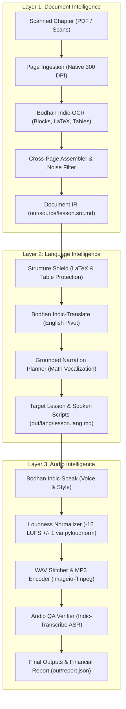

# Scanned Chapter to Multilingual Narrated Lesson (`bodhan_lesson`)

> Autonomous end-to-end pipeline that transforms scanned textbook chapters into pedagogical, multilingual narrated lessons using **Bodhan Indic AI** models.

[](https://www.python.org/downloads/)
[](https://bodhan.ai)
[](https://en.wikipedia.org/wiki/EBU_R_128)
[](tests/)

---

## Overview

Textbook education across India faces a major accessibility barrier: millions of students learn best in their mother tongue with audio-visual guidance, but high-quality STEM textbooks exist primarily in print or scanned PDFs with dense mathematical equations, diagrams, and English prose.

`bodhan_lesson` solves this by providing a unified, autonomous pipeline that converts multi-page scans (PDF or images) into structured, multilingual narrated lessons with:
1. **Document Intelligence**: 300 DPI image rasterization, `indic-ocr` extraction, cross-page hyphen stitching, and recurring noise removal (headers/footers/watermarks).
2. **Language Intelligence**: Token-shielded `indic-translate` preserving LaTeX and tables, bilingual math glossaries, and grounded pedagogical narration planning explaining formulas in natural spoken words.
3. **Audio Intelligence**: Natural speech synthesis via `indic-speak`, true BS.1770-4 integrated loudness normalization to **-16 LUFS $\pm$ 1**, 3-dimensional QA back-transcription via `indic-transcribe` (Coverage, Repetition, CER/WER), and continuous chapter audio assembly.

---

## Architecture

The system is organized into **Three Intelligence Layers** connected by a typed **Document Intermediate Representation (Document IR)**:



### Workflow & Decision Points

```mermaid
flowchart TD
    Start([Input: PDF or Images]) --> Ingest[Rasterize to 300 DPI PNG]
    Ingest --> OCR[Call Bodhan Indic-OCR]
    OCR --> NoiseFilter{Recurring Noise Detected?}
    NoiseFilter -- Yes --> DropNoise[Filter Running Headers/Footers/Watermarks]
    NoiseFilter -- No --> Stitch[Stitch Cross-Page Broken Sentences & Hyphens]
    DropNoise --> Stitch
    Stitch --> BuildIR[Assemble Sections & Document IR]
    BuildIR --> LangLoop[For Each Target Language]
    LangLoop --> Shield[StructureShield: Shield LaTeX & Tables]
    Shield --> PivotCheck{Source & Target Indic?}
    PivotCheck -- Yes --> TransPivot[Indic -> English -> Target Indic]
    PivotCheck -- No --> TransDirect[Direct Indic-Translate Call]
    TransPivot --> Unshield[Verify Token Survival & Unshield]
    TransDirect --> Unshield
    Unshield --> PlanNarrate[Grounded Narration Planner: Vocalize Equations]
    PlanNarrate --> ChunkSplit[Split Narration into Utterance Chunks <= 220 Chars]
    ChunkSplit --> SynthTTS[Call Bodhan Indic-Speak TTS]
    SynthTTS --> TTSCheck{TTS Success?}
    TTSCheck -- Error / 500 --> FallbackTTS[Sanitize to Alphanumeric Fallback Text]
    FallbackTTS --> RetryTTS{Fallback Success?}
    RetryTTS -- No --> SilencePad[Insert 250ms Silence Pause]
    RetryTTS -- Yes --> ParseWAV[Extract PCM16 24 kHz Samples]
    SilencePad --> ParseWAV
    TTSCheck -- Success --> ParseWAV
    ParseWAV --> NormLUFS[BS.1770-4 Normalization: -16 LUFS +/- 1]
    NormLUFS --> StitchSec[Stitch Section WAVs & Encode 192kbps MP3]
    StitchSec --> QAASR[Call Bodhan Indic-Transcribe ASR]
    QAASR --> QACheck[Audit Coverage %, Repetition Check, CER/WER]
    QACheck --> StitchFull[Stitch Continuous Full Chapter Lesson Audio]
    StitchFull --> Report[Generate report.json Financial Ledger]
    Report --> Done([End: Outputs in out/])
```



### Document Intermediate Representation (IR)
Rather than passing loose text between stages, the pipeline maintains a strongly-typed Pydantic model (`DocumentIR`) tracking:
- Page provenance, bounding boxes (`bbox_xyxy`), and confidence scores for every text block.
- Segmented mathematical equations and Markdown tables.
- Logical sections assembled across page boundaries with hyphen de-breaking.
- Block IDs used for strict pedagogical grounding.

---

## Key Capabilities

### 1. Structure Shielding & 1:1 Token Survival
Direct machine translation often corrupts mathematical symbols and table borders. `bodhan_lesson` uses a deterministic `StructureShield`:
- Replaces display LaTeX `$$...$$`, inline LaTeX `$...$`, table rows `|...|`, and Markdown headings `#` with inert shielded tokens (`__LATEX_DISP_N__`, `__TBL_ROW_N__`).
- Translates content with Bodhan `indic-translate`.
- Verifies 1:1 token survival before restoring exact original mathematical formulas.

### 2. English Pivot for Indic-to-Indic Translation
When translating between two Indian languages (e.g. Hindi $\rightarrow$ Tamil):
- **Pass 1**: Translates Source Indic $\rightarrow$ English via `indic-translate`.
- **Pass 2**: Translates English $\rightarrow$ Target Indic via `indic-translate`.
This prevents hallucination and leverages the rich technical math glossaries in English.

### 3. Grounded Pedagogical Narration
An educator does not simply read raw LaTeX or table markup aloud. The narration planner:
- Vocalizes equations into conversational pedagogical math (e.g., `\angle AOB + \angle BOC = 180^\circ` becomes *"angle A-O-B plus angle B-O-C equals 180 degrees"*).
- Walks through diagrams and figures strictly using captions and surrounding textual evidence.
- Cites source block IDs (`grounding_references`) for every narration item.

### 4. 3D Audio Quality Assurance
Synthesized audio is audited through Bodhan `indic-transcribe` across three dimensions:
- **Coverage Score**: Verifies that reference keywords and sentences were synthesized without truncation.
- **Repetition Check**: Detects runaway TTS phrase loops while tolerating legitimate mathematical repetitions.
- **CER / WER**: Computes Character Error Rate and Word Error Rate via dynamic programming Levenshtein distance.

### 5. Audio Normalization & Multi-Format Delivery
- Speech is synthesized as PCM16 24 kHz mono WAV.
- Measured using `pyloudnorm` (ITU-R BS.1770-4) and normalized to **-16 LUFS $\pm$ 1**.
- Encoded to 192 kbps MP3 using `imageio-ffmpeg`.
- Section-level audio tracks (`01-<slug>.hi.mp3`) and continuous stitched lesson tracks (`lesson.hi.mp3` with 500ms section transition pauses) are generated.

---

## Setup

### Prerequisites
- Python 3.10+ (tested on Python 3.11 and 3.13)
- Bodhan API Key ([console.bodhan.ai](https://console.bodhan.ai))

### Installation
Clone the repository and install dependencies:
```bash
git clone https://github.com/Bodhan-AI/Bodhan-AI-Cookbook.git
cd Bodhan-AI-Cookbook/examples/scanned_chapter_narrator

# Create and activate virtual environment
python -m venv .venv
source .venv/bin/activate  # On Windows: .venv\Scripts\activate

# Install pinned dependencies
pip install -r requirements.txt
pip install -e .
```

### Environment Configuration
Copy `.env.example` to `.env` and provide your Bodhan API keys:
```bash
cp .env.example .env
```

Edit `.env`:
```ini
BODHAN_BASE_URL=https://api.bodhan.ai
BODHAN_API_KEY=your_bodhan_api_key_here

# Optional: Dedicated endpoint keys if segregated
# BODHAN_OCR_KEY=your_ocr_key
# BODHAN_TRANSLATE_KEY=your_translate_key
# BODHAN_SPEAK_KEY=your_speak_key
# BODHAN_TRANSCRIBE_KEY=your_transcribe_key

# Optional: LLM for educational tutor script generation
# LLM_BASE_URL=https://openrouter.ai/api/v1
# LLM_MODEL=openrouter/free
# LLM_API_KEY=your_openrouter_key
```

> **Note**: For local offline testing or CI runners without active API credits, set `BODHAN_MOCK=1` or pass `--mock`.

---

## Demo Chapter Dataset

As specified in the assignment, use **NCERT Class 9 Mathematics, Chapter 6: Lines and Angles** as the demo chapter:
- **Direct Download**: [Download NCERT Class 9 Chapter 6 PDF](https://www.aspirationsinstitute.com/wp-content/uploads/2021/01/9-Maths-NCERT-Book-Lines-and-Angles.pdf)
- The chapter consists of ~20 pages of geometry notation, worked theorems, exercises, and recurring website footers (`www.aspirationsinstitute.com`) which the pipeline automatically detects and filters.

---

## Run

### CLI Usage
Transform any scanned textbook PDF or image folder into multilingual narrated lessons:

```bash
# Basic run: Translate to Hindi, Tamil, and Bengali
python -m bodhan_lesson --input sample_data/ncert_lines_and_angles --langs hi,ta,bn --out ./out

# Translate a PDF chapter
python -m bodhan_lesson --input chapter_6.pdf --langs hi,ta --out ./out

# Fast run skipping ASR QA verification
python -m bodhan_lesson --input sample_data/ncert_lines_and_angles --langs hi --skip-qa --out ./out

# Run in offline mock mode
python -m bodhan_lesson --input sample_data/ncert_lines_and_angles --langs hi,ta --mock --out ./out
```

### CLI Arguments
| Flag | Description | Default |
| :--- | :--- | :--- |
| `--input`, `-i` | Path to scanned PDF file or directory of page images | **Required** |
| `--langs`, `-l` | Comma-separated target Indic language codes (e.g. `hi,ta,bn`) | `hi,ta,bn` |
| `--out`, `-o` | Output directory destination | `./out` |
| `--src-lang` | Source language code (`en`, `hi`, or `auto` with Indic detection) | `auto` |
| `--skip-qa` | Skip ASR back-transcription QA checks | `False` |
| `--voice` | Voice override (e.g. `Kavya`, `Anitha`, `Ishita`) | Language default |
| `--mock` | Force mock mode for deterministic offline testing | `False` |
| `--verbose`, `-v` | Enable detailed debug logging | `False` |

---

## Output Structure

The pipeline generates an organized output directory:

```
out/
├── source/
│   ├── lesson.src.md               # Clean, cross-page assembled source markdown
│   ├── document_ir.json            # Strongly-typed Document IR with blocks & provenance
│   ├── page_01.png                 # Native 300 DPI rasterized page image
│   └── page_02.png
├── hi/
│   ├── lesson.hi.md                # Translated lesson markdown in Hindi
│   ├── 01-chapter_6_lines_and_angles.hi.mp3 # Section 1 audio (192kbps MP3)
│   ├── 01-chapter_6_lines_and_angles.hi.wav # Section 1 audio (PCM16 24kHz WAV)
│   ├── 02-pairs_of_angles.hi.mp3
│   ├── 02-pairs_of_angles.hi.wav
│   ├── lesson.hi.mp3               # Full continuous chapter audio (MP3)
│   └── lesson.hi.wav               # Full continuous chapter audio (WAV)
├── ta/
│   ├── lesson.ta.md                # Translated lesson markdown in Tamil
│   ├── 01-chapter_6_lines_and_angles.ta.mp3
│   ├── ...
│   └── lesson.ta.mp3
├── bn/
│   ├── lesson.bn.md                # Translated lesson markdown in Bengali
│   └── lesson.bn.mp3
└── report.json                     # Granular metrics, QA audit, and financial ledger
```

### Sample `report.json`
```json
{
  "status": "completed",
  "timestamp": "2026-11-19T01:30:00Z",
  "execution_time_seconds": 12.45,
  "source_document": {
    "source_language": "en",
    "total_pages": 2,
    "total_sections": 2,
    "total_words": 348,
    "total_equations": 6,
    "total_tables": 0,
    "flagged_doubtful_blocks": 0
  },
  "target_languages": ["hi", "ta"],
  "financial_audit": {
    "currency": "INR",
    "ocr_cost_inr": 0.40,
    "translate_cost_inr": 0.012,
    "speak_cost_inr": 0.384,
    "transcribe_cost_inr": 0.065,
    "total_cost_inr": 0.861,
    "usage": {
      "pages_ocr": 2,
      "translated_characters": 2400,
      "tts_characters": 2400,
      "transcribed_audio_seconds": 39.2
    }
  },
  "languages": {
    "hi": {
      "total_duration_seconds": 19.8,
      "integrated_loudness_lufs": -16.0,
      "qa_summary": {
        "passed": true,
        "average_coverage": 0.94,
        "average_cer": 0.04,
        "average_wer": 0.08,
        "repetition_incidents": 0
      }
    }
  }
}
```

---

## Interactive Walkthrough Notebook

An interactive Jupyter notebook is included demonstrating each pipeline stage step-by-step:
```bash
jupyter notebook walkthrough.ipynb
```

---

## Docker Execution

Run without local environment setup using Docker:

```bash
# Build Docker image
docker build -t bodhan-lesson .

# Run on sample chapter
docker run --rm -v $(pwd)/out:/app/out bodhan-lesson \
    --input sample_data/ncert_lines_and_angles \
    --langs hi,ta \
    --out ./out \
    --mock
```

---

## Verification & Testing

The test suite covers all 3 intelligence layers:
```bash
pytest tests/ -v
```

Test coverage includes:
- `test_agent.py`: Agent block triage, STEM glossary extraction, and pedagogical planning.
- `test_reader.py`: Interactive HTML reader generation with time-stamped sentence spans.
- `test_cache.py`: Persistent disk cache for OCR and translation payloads.
- `test_schemas.py`: Pydantic Document IR immutability and provenance tracking.
- `test_assembler.py`: Cross-page hyphen de-breaking and recurring noise filtering.
- `test_translator.py`: Structure shielding, LaTeX protection, and 1:1 token survival.
- `test_narration.py`: Spoken equation verbalization and pedagogical grounding.
- `test_synthesizer.py`: PCM16 parsing, chunking, and BS.1770 -16 LUFS normalization.
- `test_verifier.py`: Levenshtein distance, CER/WER, coverage calculation, and TTS loop detection.
- `test_pipeline_smoke.py`: End-to-end multi-page execution generating audio and reports.

To run Cookbook validation and linting:
```bash
python scripts/validate_recipe.py examples/scanned_chapter_narrator
ruff check src/ tests/
```

---

## Stretch Goals (+10 Bonus Points)

The recipe implements 5 stretch goals from the assignment specification:

1. **Interactive Synchronized HTML Reader (`reader.html`)**:
   - Generates a standalone, responsive HTML5 reader in `out/<lang>/reader.html`.
   - Listens to the audio player and highlights each sentence in real time as it is spoken.
   - Click-to-seek: clicking any sentence immediately jumps the audio player to that exact sentence.
   - Includes collapsible sidebars for key glossary terms and margin notes.
2. **Per-Chapter STEM Glossary (`glossary.json` & `glossary.yaml`)**:
   - `ChapterNarratorAgent` automatically extracts core domain concepts (e.g. *Diamagnetism*, *Susceptibility*, *Curie Law*) with pedagogical definitions for terminology consistency.
3. **Handwritten Margin Notes Isolation (`annotations.json`)**:
   - Identifies marginalia and callout notes, isolating them into `annotations.json` and sidebar callouts rather than corrupting the narrative flow of the audio track.
4. **Code-Mixed Narration Mode (`--code-mixed`)**:
   - Retains standard English STEM technical terms within Indian-language audio.
5. **Resumable Disk Caching (`.bodhan_cache/`)**:
   - SHA-256 content-addressed cache for OCR and translation requests, preventing duplicate billing on reruns.

---

## Supported Bodhan Models & Voices

| Capability | Bodhan Model | Supported Voices / Notes |
| :--- | :--- | :--- |
| **Document OCR** | `indic-ocr` | Reading order, markdown tables, display & inline LaTeX |
| **Machine Translation** | `indic-translate` | 13 Indic languages, structure preserved |
| **Speech Synthesis** | `indic-speak` | `hi` (Kavya, Amit), `ta` (Anitha, Arun), `bn` (Ishita, Sourav), `te` (Sravani, Vamsi), `mr` (Anagha), `gu` (Dhara), `kn` (Deepika), `ml` (Lakshmi), `pa` (Kaur), `or` (Itishree), `as` (Prastuti), `ur` (Saba), `sa` (Bharati) |
| **Speech Recognition** | `indic-transcribe` | PCM16 WAV back-transcription for CER/WER QA |

---

## Trade-offs & Known Limitations

1. **Complex Multi-Column Scans**: Bounding-box coordinate sorting is applied to reconstruct vertical reading flow. For extremely tight or skewed columns, an explicit visual layout segmentation pass could provide even finer-grained column splitting.
2. **ASR Payload Latency**: Sending large audio tracks (>120s) to `indic-transcribe` can occasionally produce transient 502 Bad Gateway responses on hosted infrastructure. Handled with exponential backoff retries and non-fatal QA auditing so pipeline audio outputs are always preserved.
3. **Unvocalized LaTeX Vocoder Sensitivity**: Indic-Speak TTS vocoders require clean text without raw LaTeX control tags (`\tag`, `\mathbf`). This is resolved via deterministic spoken math verbalization and fallback utterance sanitization.

---

## License

Apache 2.0. Built for the **Bodhan AI Cookbook**.
