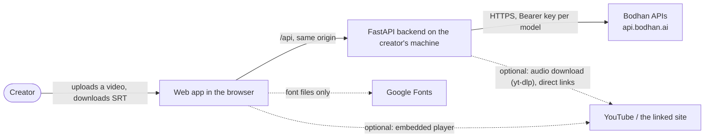
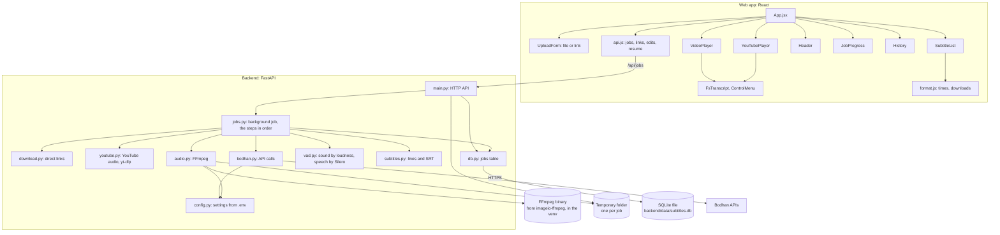

# Subtitle Generator — Architecture

## 1. Document details

| Field | Value |
| --- | --- |
| App name | Subtitle Generator (folder `examples/subtitle_generator`) |
| Approved spec | [SOFTWARE_SPECIFICATION.md](SOFTWARE_SPECIFICATION.md), version 0.1 (in review) |
| Authors | Sumit Bhukal |
| Bodhan reviewers | @Bodhan-AI/cookbook-maintainers |
| Status | Draft for review |
| Version | 0.1 |
| Last updated | 2 Nov 2026 |
| Code | `examples/subtitle_generator/`, in the same PR as these documents |

## 2. Overview and architectural drivers

**Summary.** A React web app and a small FastAPI backend, both on the creator's machine. The backend
takes an uploaded video (or downloads one from a direct or YouTube link), extracts the audio with FFmpeg,
and sends every stretch with sound to `indic-transcribe` in pieces of at most 24 s, cut at pauses found
by loudness and the Silero voice activity detector. The text is split into short lines placed on the
measured speech, then optionally translated line by line with `indic-translate`. Jobs run in the
background while the browser polls their progress. The video and audio are deleted after transcription;
only the text is kept, in SQLite, which also gives a job history.

### Architectural drivers

| Driver | From the spec | What it forces in the design |
| --- | --- | --- |
| The Bodhan key must not reach the browser | Sections 5, 10 | A backend makes every Bodhan call, reading the keys from `.env`; the browser only talks to that backend |
| `indic-transcribe` accepts about 30 s of audio per request | FR-3 | Long audio is cut into pieces of at most 24 s |
| `indic-transcribe` returns text without timestamps | FR-5, Section 7 | Timing comes from the audio itself: loudness finds the stretches of sound, Silero VAD the speech inside them, and lines are placed on the speech (or on the sound when Silero hears little, as in songs) |
| Transcripts come back without punctuation | Section 7 | Pieces end at real pauses, so the text of each request belongs to one or two sentences |
| `indic-transcribe` refuses some containers (AAC, M4A, WebM, AMR) | FR-4 | FFmpeg converts every upload to 16 kHz mono 16-bit WAV |
| Must run on any contributor's machine with little setup | Section 8 (portability) | FFmpeg from pip (`imageio-ffmpeg`), never a system install; one `.env`; the database is a SQLite file created on first run |
| Teaching code for other developers | G3 | Small backend modules with one job each; one database table; no task queue or dependency-injection framework |

**Constraints:** one developer; Bodhan's per-request audio limit and per-key rate limits; no
hosting budget; V0 runs locally.

### Quality attributes, ranked

1. Simplicity and readability, because the recipe is teaching code
2. Subtitle timing that matches the speech
3. Keeping the key and the user's video private
4. Time from upload to subtitles
5. Robustness on long videos: V0 trades some of this away (Section 14)

## 3. System context



| Outside system | What it does for the app | Data sent to it |
| --- | --- | --- |
| Bodhan APIs | Speech to text, translation | Audio pieces that contain speech; subtitle lines to translate |
| Google Fonts | Serves the Poppins and Inter fonts used by the page | Ordinary font requests from the browser; no app data |
| YouTube (optional, `YOUTUBE_LINKS`) | The video's audio for transcription; the embedded player for the preview (youtube-nocookie.com) | The video id; the usual player requests from the browser |
| The linked site (optional, `DIRECT_VIDEO_LINKS`) | The video file | One download request from the backend; the browser also loads the video for the preview |

## 4. Containers and components

Two containers run on the creator's machine: the web app (served by Vite in development) and the
backend (Uvicorn). Vite forwards `/api` requests to the backend, so the browser sees one origin
and no CORS set-up is needed. `npm start` runs both from one terminal. The optional Docker image runs
one process instead: the built web app is served by the backend itself (`WEB_DIST`), on port 8000.



### Tech stack

| Layer | Choice and version | Why this choice |
| --- | --- | --- |
| Backend | Python 3.10+, FastAPI 0.143.0, Uvicorn 0.54.0, httpx 0.28.1, pydantic-settings 2.15.0 | Async calls, upload handling and validation built in; offline tests with httpx's mock transport |
| Media | FFmpeg 7.1 from imageio-ffmpeg 0.6.0 | Converts every common format to WAV; installed by pip, nothing system-wide |
| Speech detection | silero-vad-lite 0.4.0 (MIT), plus a loudness measure | Finds speech under music, where FFmpeg's `silencedetect` failed; about 0.4 s per 24 s of audio |
| YouTube links (optional) | yt-dlp 2026.10.26, yt-dlp-ejs 0.8.0, Deno 2.9.8 from pip | The maintained YouTube tool; Deno comes from pip, like FFmpeg |
| Storage | SQLite through SQLModel 0.0.48 | History with no server to run; Postgres by changing `DATABASE_URL` |
| Web app | React 19.3.0, Vite 8.3.4, lucide-react 1.57.0, plain CSS with Bodhan's design tokens | A custom player synced with the line list; Vite's `/api` proxy |
| Hosting and distribution | None; run from source (an optional Docker image) | V0 is a developer recipe |

### Components

| Component | Responsibility | Depends on |
| --- | --- | --- |
| `main.py` | HTTP API: start a job (upload or link), job status and history, edit a line, resume. Checks each request before a job exists; one job at a time | jobs, db, download, youtube |
| `jobs.py` | The background job: download (links), extract audio, find sound and speech, plan pieces, transcribe, time lines, translate; resumes a stopped translation | audio, vad, subtitles, bodhan |
| `audio.py` | FFmpeg: duration and audio track, WAV extraction, cutting; plans pieces at pauses | FFmpeg |
| `vad.py` | Per 32 ms window, a speech probability (Silero) and a loudness; turns them into stretches of sound (what is sent) and speech (cut points, line timing) | silero-vad-lite |
| `subtitles.py` | Junk filter, line splitting, line timing, SRT | none |
| `bodhan.py` | The two Bodhan calls: key, 429 retries, `/translate` fallback, mock mode | httpx |
| `download.py` | Direct links: public addresses only (also after redirects), video types only, upload limits | httpx |
| `youtube.py` | YouTube links: one video id, YouTube's handler only, length and live checks before downloading the audio | yt-dlp, Deno |
| `db.py`, `config.py` | The `jobs` table; settings from `.env` | SQLModel, pydantic-settings |
| `App.jsx` | Page state: the form, polling the job, history, resume and **Run again** | api.js |
| `UploadForm` | File or link, languages, Generate | links.js |
| `VideoPlayer`, `YouTubePlayer` | The video with the current line (over a file, under a YouTube player); controls, speed menu, fullscreen with the transcript and a language menu | FsTranscript, ControlMenu |
| `SubtitleList`, `LineEditor` | Tabs, lines that follow the video, click to seek, edit a line, copy and download | useLineFollow |
| `History`, `JobProgress`, `Header` | Past jobs, 10 per page; the running job's progress; the theme toggle | none |

## 5. Bodhan API integration design

| Concern | Subtitle Generator V0 | Reference default | Gap |
| --- | --- | --- | --- |
| Key custody | `.env` on the backend; never sent to the browser | A backend holds the keys | None |
| Base URL | `BODHAN_BASE_URL`, default `https://api.bodhan.ai` | Configurable per environment | None |
| Input preparation | 16 kHz mono 16-bit WAV pieces of at most 24 s, cut at pauses; silence is not sent | At most 30 s per request; WAV documented | None |
| Translate route | `POST /translate` first; after a 404 (the live API returned 404) `POST /v1/chat/completions` with `target_language_code`, for the rest of the run | `POST /translate` is the documented main route; both give the same output | Depends on Bodhan (spec Q2) |
| Timestamps | `BODHAN_TIMESTAMPS=true` sends `response_format=verbose_json` and uses `words`, then `segments`, when present. Off by default: today they come back empty, and `timestamp_granularities[]` is rejected with 422 | Not documented | Depends on Bodhan (spec Q1) |
| Timeouts | One client per job: 20 s to connect, 180 s per request | A timeout per model, with progress in the UI | Step and progress shown while the job runs (spec FR-11) |
| Errors | Each failure becomes a readable message with an HTTP status (503 no key, 429 rate limit, 502 other API errors, 400 bad file). Bodhan's error body is passed on, truncated | Branch on `error.code`; keep `request_id` | `error.code` and `request_id` not used |
| Retries and rate limits | 429: wait for `Retry-After`, else the wait named in the error message, else 3, 6, 12, 20 s; five attempts. 1.5 s between transcription pieces; two translations at a time | Back off on 429 and 5xx; read `x-ratelimit-*` headers | 5xx not retried; rate-limit headers not read |
| Cost guardrails | Upload limits: 100 MB and 15 minutes per video. Silence is not sent | Per-user caps on a hosted backend | None needed while it runs locally; required before hosting |
| Response cleaning | A character or short group repeated 8+ times in a row is removed from transcripts | — | Works around a model issue (spec Section 7) |
| Caching | None | Cache only what is reused | None |
| Model ids | `indic-transcribe`, `indic-translate`, as constants in `bodhan.py` | Lower-case, current ids | None |

## 6. Data architecture

### Data stores

| Store | Technology | What it holds | Retention | Encrypted at rest? |
| --- | --- | --- | --- | --- |
| Job folder (`subtitles-*` in the system temp folder) | Files | The video, its WAV audio and the audio pieces | Deleted after transcription, or when the job fails | No; short-lived |
| `jobs` table | SQLite file `backend/data/subtitles.db` (git-ignored), or `DATABASE_URL` | File name or title, link (link jobs), languages, status, progress, error, subtitle lines and their translation. Never video or audio | Until the file is deleted (no delete button in V0) | No; on the creator's own machine |
| `.env` | File on the machine running the backend | Bodhan keys and settings | Until the person running the app changes it | No; git-ignored and never served |
| Browser memory | React state | The video (as a local object URL), the open job's subtitle lines and SRT text | Until the page is closed or a new video is chosen | Not stored |
| `localStorage` | Browser | Theme, last languages, translation and upload-or-link choices | Until cleared | No; nothing sensitive |

**Data model.** One table, `jobs`: `id`, `created_at`, `source` (`upload`, `url` or `youtube`), `source_url`
(the link, for link jobs), `file_name` (or the video's title), `language`, `target_language`, `status`
(queued, running, done, failed), `progress` (percent), `step`, `error`, `segments` (saved as soon as
transcription ends) and `translated_segments` (saved as lines come in, at most once a second; `null`
marks a line not translated yet) (JSON lists of `Segment(start, end, text)`, times in
seconds). SRT text is rebuilt from the segments when a job is read, not stored. No migrations tool
yet: the table is created if missing, and columns added later (`source_url`) are added to older databases at startup.

**User rights.** Only subtitle text is kept, on the creator's own machine. Deleting
`backend/data/subtitles.db` removes all of it; a per-job delete is left for later.

## 7. Key flows

### J1 and J2: subtitles for one video

```mermaid
sequenceDiagram
  actor C as Creator
  participant W as Web app
  participant M as main.py
  participant P as jobs.py
  participant F as FFmpeg (audio.py)
  participant T as indic-transcribe
  participant X as indic-translate
  C->>W: Drop video, pick languages, Generate
  W->>M: POST /api/jobs (video, language, target_language)
  M->>M: Refuse (409) if a job is unfinished; check type and key; stream to temp folder (max 100 MB)
  M->>F: probe: duration, has audio?
  M->>M: Add job (queued) to the database
  M-->>W: 202, job id
  M->>P: run_job() in the background
  loop every second until done or failed
    W->>M: GET /api/jobs/{id}
    M-->>W: status, step, progress
  end
  P->>F: extract 16 kHz mono WAV
  P->>P: vad.py: stretches of sound (loudness) and of speech (Silero)
  P->>P: plan pieces from the sound (cut at pauses, else at the quietest moment; max 24 s)
  loop each piece, 1.5 s apart
    P->>F: cut the piece
    P->>T: POST /v1/audio/transcriptions
    T-->>P: text
    P->>P: clean text, split into lines, place lines on the speech
  end
  opt translation chosen
    par two lines at a time
      P->>X: POST /translate (or chat completions after a 404)
      X-->>P: translation, same timing
    end
  end
  P->>P: save lines to the job, status done
  P->>P: delete temp folder
  W->>M: GET /api/jobs/{id}
  M-->>W: lines and SRT text
  W-->>C: Video with subtitles, line list, downloads
```

- **Wait budget:** transcription is sequential and translation runs two at a time; the browser shows each step and the progress meanwhile (Section 11).
- **Link jobs:** `POST /api/jobs/url` checks the link, creates the job, then downloads the video in the background before the same steps run.
- **On failure:** the error is saved with the job and shown. The subtitles are saved as soon as transcription ends, and translated lines as they come in, so `POST /api/jobs/{id}/resume` translates only the missing lines. A job that failed earlier needs the video again; **Run again** fills in its settings.

### Choosing the timing for one piece

1. If `indic-transcribe` returned word timestamps, lines are built from words: a new line at a pause over 0.6 s, at sentence-ending punctuation, or when a line is full.
2. Else, if it returned segment timestamps, each segment's text is placed within that segment.
3. Else lines are placed on the piece's measured stretches of speech, longer lines getting more time; a line boundary near a pause snaps to it, and pauses get no subtitle.

## 8. Security architecture

| Threat | Default mitigation | Subtitle Generator V0 |
| --- | --- | --- |
| A Bodhan key is extracted from the client | Keys exist only on a backend | The keys are only in the backend's `.env`; the browser never receives them |
| Strangers use the backend as a free route to Bodhan | Sign-in and per-user quotas | Runs on `127.0.0.1` for one person. Must not be hosted without sign-in and limits (spec Section 10) |
| A key is committed to git | `.env` git-ignored; CI secret scan | `.env` git-ignored; `.env.example` has placeholders; the cookbook validator's secret scan passes |
| Personal data leaks through logs | Log status and timings only | Logs hold HTTP statuses, counts and waits; no transcript, subtitle or file content |
| A pasted link reaches local or private services (SSRF) | Allow only public addresses | http(s) only; every address the host resolves to must be public, checked again on each redirect; links to this computer or a private network are refused before a job exists |
| A YouTube link is used to fetch something else | Allow-list, not a filter | Only the 11-character video id is taken from the link; yt-dlp gets `https://www.youtube.com/watch?v=<id>` and has only its YouTube video handler loaded. Off by default (`YOUTUBE_LINKS`), and the user allows it each visit |
| Oversized or hostile uploads | Check size, type and duration before processing | Extension allow-list; upload streamed to disk with a 100 MB cap; 15-minute limit checked before any API call; FFmpeg runs with fixed arguments and timeouts, never a shell |
| Temporary files left behind | Delete on every path | One folder per request, removed in `finally` |
| Traffic is intercepted | HTTPS to external services | Bodhan over HTTPS; browser to backend is local |
| A compromised or abandoned dependency | Pinned versions | Python packages pinned with `==`; npm packages pinned exactly, with a lock file |

- **End-user sign-in:** none; a single-user local tool.
- **Secrets management:** `.env` on the machine running the backend.
- **Device permissions:** none; the browser only reads the file the creator picks.

## 9. Deployment and infrastructure

| Item | Subtitle Generator V0 |
| --- | --- |
| Environments | Local only (the normal setup, `npm start`, or the optional Docker image) |
| Distribution | Source in the cookbook |
| CI | The cookbook workflow runs the recipe validator: no findings on the prototype. The backend tests are not run in CI (the workflow tests the cookbook's own scripts only) |
| Configuration and secrets | `.env` at the recipe root, copied from `.env.example` |
| Infrastructure cost per month | ₹0 |
| Who keeps it running | The person running it |

### Run it locally (from the README)

1. `cp .env.example .env` and paste the Bodhan keys, one per model (or set `DEV_MOCK_MODE=true`).
2. Backend: in `backend/`, create a virtual environment, `pip install -r requirements.txt`, then `fastapi dev app/main.py` (port 8000).
3. Web app: at the recipe root, `npm install` (installs into `frontend/`), then `npm run dev` (port 5173).
4. Open http://localhost:5173. Or, after steps 1 to 3, `npm start` runs both; or `docker compose up --build` runs the image on http://localhost:8000.

## 10. Observability and operations

| Signal | Subtitle Generator V0 | V1 suggestion |
| --- | --- | --- |
| Errors | Message in the browser banner; full traceback in the backend console | Also log Bodhan's `error.code` and `request_id` |
| Latency | Per-request lines from httpx and Uvicorn in the console; job time not recorded | Log time per step and per job |
| Usage and cost | The Bodhan console | Count audio seconds and translated lines per job |
| Rate limits | A warning line for each 429 retry, with the wait | Read `x-ratelimit-*` headers and pace requests to them |
| Health | `GET /api/health`: FFmpeg found, key set, mock mode, limits, which kinds of link are on | Same |

**Support path:** a user reports the banner text and the backend console output. Without the
`request_id`, a failed call cannot be traced on Bodhan's side.

## 11. Performance and scalability

### Measured on a 24-second test video (18.6 s of speech, 3 pieces)

| Step | Measured |
| --- | --- |
| Whole job, subtitles only | 7.3 s |
| Whole job, with Hindi-to-English translation (9 lines) | 11.4 s |
| Rate-limit retries | None |

### Measured on a 12-minute video

A YouTube link, English with Hindi translation, 155 lines: about 11 minutes, including the download.
That misses the spec's target (10 minutes of video in under 5 minutes). Job time per step is not
recorded yet (Section 10), so the split between transcription and translation is not known.

### Load and limits

- **Upload size:** up to 100 MB, streamed to disk in 1 MB pieces, so memory stays flat.
- **What breaks first:** translation, one request per line, meets the per-key rate limit on long videos; retries then add waits.
- **Concurrency:** one job at a time, enforced: starting a job (upload, link or resume) answers 409 while another is queued or running; the check and the start happen under one lock, so two requests can't both pass. Several jobs at once is planned for V2 (they would share the key's rate limit).

## 12. Testing and quality

| Level | What it covers | Tools | When it runs |
| --- | --- | --- | --- |
| Unit | SRT format, line splitting, junk removal, placing lines on speech, word-timestamp lines, piece planning | unittest | Every change; 99 tests in total, all offline |
| Media | FFmpeg location, duration and audio detection, audio cutting, piece planning | unittest, the bundled FFmpeg | Every change |
| Speech and sound detection | Stretches from probabilities and loudness; singing is sent though Silero ignores it; cut points; line placement; the real model on `sample_hindi.wav` (skipped when absent) | unittest, silero-vad-lite | Every change |
| Integration, offline | Bodhan calls against a fake HTTP server: request shape, 429 retry, 404 fallback, readable errors, `verbose_json` parsing | httpx `MockTransport` | Every change |
| API, mock mode | Upload to finished job with canned text; history; errors; restarts; editing; resume; one job at a time | FastAPI `TestClient` | Every change |
| Links, offline | Direct links against a local test server (types, size, private addresses, redirects); YouTube with yt-dlp faked (ids, playlists, length and live checks, errors, switches) | unittest, `http.server` | Every change |
| Live smoke test | One real job on a short clip | Manual, by the author | Before each PR; never in CI with a real key |
| Timing and readability evaluation | Line start error against clips with known timing; reading speed; time on screen | A script, not written yet (open for contributors) | After timing changes |
| Output quality | 10 lines per language rated by a native speaker | Rating sheet | Once, then on model changes |

**Test data:** synthetic tones generated by FFmpeg and synthetic speech probabilities; the cookbook's
`sample_hindi.wav` for one speech-detection test. No recordings of real people are committed.

## 13. Decision log

| ID | Decision | Options considered | Why this one | Consequences | Status |
| --- | --- | --- | --- | --- | --- |
| ADR-1 | Web app with a local Python backend | Notebook; Streamlit | The creator watches the video with its subtitles; the key stays on a server | Two processes to start | Accepted |
| ADR-2 | FastAPI | Flask; Django | Async calls, uploads and validation built in | None | Accepted |
| ADR-3 | React with a custom player | Native `<video>` with a WebVTT track | The overlay, synced list and click-to-seek need app state; the native track showed lines twice | More frontend code | Accepted |
| ADR-4 | FFmpeg from pip (imageio-ffmpeg) | System FFmpeg; a binary in the repo | The same build everywhere; nothing committed | A GPL binary downloaded at install; no ffprobe | Accepted |
| ADR-5 | Send all sound (loudness); Silero only for cuts and timing | FFmpeg `silencedetect`; Silero alone; fixed 24 s pieces | Nothing audible is skipped (Silero alone lost most of a song); silence is not billed | Wordless music is billed; rough timing in songs | Accepted |
| ADR-6 | Translate each line, keeping its timing | Translate whole pieces, then re-split | Translated lines match the original timing exactly | Many calls; less context per call | Under review (spec Q4) |
| ADR-7 | `POST /translate`, then chat completions after a 404 | One route only | Uses the documented route as soon as it works | Two code paths | Accepted |
| ADR-8 | Background jobs (FastAPI tasks), one at a time, state in SQLite | One request; Celery and Redis | Progress and history with no new services | A restart fails running jobs (translation resumes) | Accepted for V0 |
| ADR-9 | Vite proxies `/api` to the backend | CORS; a configured API URL | One origin, nothing to configure | Hosting would need the same routing | Accepted |
| ADR-10 | Timestamps only with `BODHAN_TIMESTAMPS=true` | Always; never | The API returns none yet | One setting to turn on later | Accepted |
| ADR-11 | YouTube: audio with yt-dlp; preview in YouTube's player, the line under it | Every site yt-dlp knows; downloading a preview video | One site done well; YouTube forbids drawing over its player; videos are never kept | yt-dlp needs updates; a 42 MB Deno binary | Accepted, off by default |
| ADR-12 | An optional Docker image and `npm start` | Docker as the main setup; separate images | One-command runs without changing the normal setup | Docker needs a rebuild after code changes | Accepted |

**Approaches rejected outright:** calling Bodhan from the browser, because it would expose the
key; sending the whole audio in one request, because `indic-transcribe` refuses more than about
30 s.

## 14. Risks, technical debt and the path to V1

| Shortcut or gap in V0 | Why it was acceptable | What V1 should do |
| --- | --- | --- |
| Lines within one stretch of speech are placed by length, not measured | No timestamps from the API; stretches are short | Use Bodhan timestamps when available, or optional forced alignment |
| Rough timing in songs and over long music | All sound is sent, so the words are there; only their placement is estimated | Bodhan timestamps or forced alignment |
| Music without words is billed | Silence is still skipped; music-only stretches are short in most creator videos | Skip long stretches with no speech after a check that nothing is sung |
| One request per translated line | Exact timing for translated lines | Translate whole pieces and re-split (spec Q4) |
| A failed call loses the whole job; 5xx not retried | Short videos, rare failures | Retry 5xx with backoff; keep finished pieces |
| A backend restart during transcription loses that job | Marked failed at startup; **Run again** fills in its settings. Translation, the long step, resumes where it stopped | Keep the audio until transcription ends, and resume per piece |
| No migrations tool | One table, created when missing | Alembic once the table changes after release |
| `error.code`, `request_id` and rate-limit headers not used | Messages are readable already | Parse the error envelope; pace to `x-ratelimit-*` |
| Backend tests do not run in the cookbook CI | The workflow only tests the cookbook's own scripts | Propose running recipe tests in CI, offline |
| No sign-in or limits on the backend | Runs locally for one person | Add both before any hosting |
| yt-dlp is pinned, and YouTube breaks old versions | Pins keep installs reproducible; the README says how to update | Raise the pin regularly, or move to a better tool if one appears; add other sites one by one |

**V1 direction.** Keep the same two-part design. Translate per piece, and switch line timing to Bodhan timestamps (or forced alignment) when they
are available. Publish the timing evaluation so changes can be compared.

## 15. Review

*Filled in at the review meeting.*

### Reviewer checklist

- [ ] Every architectural driver traces to a requirement in the spec
- [ ] Context and component diagrams show every place data goes
- [ ] No Bodhan key reaches code other people install
- [ ] Inputs respect per-request limits and accepted formats
- [ ] Errors branch on `error.code`; 429 and 5xx back off without loops; `request_id` is logged
- [ ] Per-user caps or another guard stop a backend becoming an open proxy
- [ ] Personal data is classified and kept out of logs
- [ ] Tests run offline by default; output quality is checked by native speakers
- [ ] A reviewer can run V0 from the documented steps
- [ ] Shortcuts are listed with a V1 plan

### Decision

| Field | Value |
| --- | --- |
| Decision | |
| Conditions | |
| Next step | |
