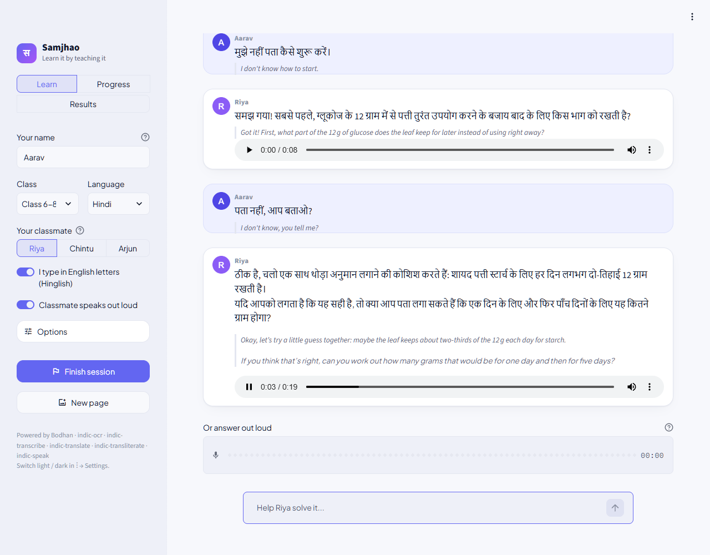
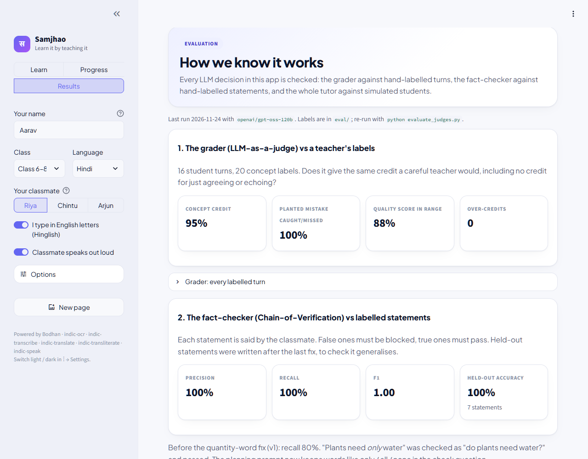

# Samjhao: a teach-back tutor

> *Samjhao* (समझाओ) means "explain it". A student photographs a textbook page and teaches it to an AI classmate who missed the class. The classmate asks naive questions and sometimes says something wrong on purpose; the student has to catch it.

**Bodhan models:** indic-ocr, indic-transliterate, indic-translate, indic-speak, indic-transcribe
**Languages shown:** Hindi (the app also offers English, Bengali, Tamil, Telugu, Marathi, Gujarati, Kannada, Malayalam, Odia, Punjabi, Assamese and Urdu)
**Format:** Streamlit app (light and dark) + walkthrough notebook + CLI

## What it does

Explaining an idea to someone else is one of the best tests of understanding (the Feynman technique). Most study apps ask the student questions; here the student does the explaining, in their own language, by typing or speaking:

0. **One start screen.** Add a page, then (optionally) say or type what you want: "help me with question 3", "I have a test on this tomorrow". A small, fast LLM (`openai/gpt-oss-20b`, set by `INTENT_MODEL`) reads the request and the start of the page and picks **Teach** or **Homework** mode, even the question you named; if that call fails, keyword rules decide. The choice and its reason are shown, with a one-tap switch.
1. **Photo or PDF → lesson.** `indic-ocr` reads the textbook page (or up to 4 pages of one lesson, read in parallel). A PDF of a whole book works too: pick the start page and how many pages, and they are rendered and read by `indic-ocr` like photos, so scanned books work as well. Phone photos are turned upright and resized first. An LLM drafts a *lesson card*: the key concepts the student should explain and the misconceptions the classmate can plant. Every item must quote the page, or it is dropped.
2. **Teach the classmate.** The classmate (Riya, Chintu or Arjun; the student picks, the class sets the difficulty; Riya speaks with a female voice, Chintu and Arjun with male voices, each in their own `indic-speak` style) asks about gaps, asks for examples, pushes for "why", and plants a wrong idea to see if the student catches it. A missed mistake gets a hint, then is revealed and explained; the student never leaves with the wrong idea. The classmate really "missed the class": it keeps a **notebook** of only what the student has taught it, and writes every reply from that notebook alone (visible in the app).
3. **Every classmate line is fact-checked before the student sees it** (Chain-of-Verification): its claims are checked against the page by a separate call that never sees the line, and it may not use lesson words the student has not said yet. A line that fails is rewritten once with the problems as feedback.
4. **Quick check before and after.** Three multiple-choice questions before teaching and the same three after give an objective **learning gain** per session. Each question is itself verified: an independent solver must reach the same answer from the page, or the question is thrown out.
5. **Honest report.** What the student explained, what they missed, which tricks they caught (on their own or after a hint), any wrong ideas they still hold, the learning gain, and how many classmate claims were checked, blocked or rewritten.
6. **Memory.** The tutor remembers each student. Next session it starts at the level they reached, asks about their weak spots first, and re-plants the mistakes they missed to check the correction stuck.
7. **Parent note.** A short, honest summary in the parent's language, written and spoken.
8. **Progress dashboard** (switch to **My progress** in the sidebar). Ideas mastered per topic, three thinking skills (explaining in your own words, spotting mistakes, thinking deeper) with the change since earlier sessions, learning gain per session, understanding over time, and what to practise next. It is computed from the saved sessions in plain Python, so it is instant and works offline.
9. **Homework mode** (picked from the start screen, or switch to it). For exercise pages whose answers are not printed. The classmate is stuck on a question from the page and the student helps solve it, step by step. If the student is stuck too, the classmate nudges in three rungs: a question about what to find next, then a half-finished guess, and only then does it work the step out itself. It never blurts out the answer (a Python guard checks every line). Anything the app could not check, or had to show, goes on a **"Doubts to ask your teacher"** list in the report. The answer is not on the page, so the reference solution is worked out **3 times independently** and used only if a majority agree (self-consistency); otherwise the classmate says it is not sure either and nothing is graded. Same Bodhan path: `indic-ocr` reads the exercise page, and the student types (transliterate) or speaks (transcribe) in their language; replies are translated and spoken.
10. **Results view** (sidebar). Every measured result below, read from `eval/`: the grader and fact-checker against hand labels, the homework answer key, the simulated students, grading in Hindi, and real and damaged pages.

| The start screen (light) | …and dark |
|---|---|
|  |  |

| Teaching Riya in Hinglish, Teacher view on | The report |
|---|---|
|  |  |

In the chat, the student typed romanized Hindi, which `indic-transliterate` turned into Devanagari and `indic-translate` into English for grading. Riya answers in Hindi with audio. Teacher view shows the fact-check at work: her first draft used a word the student had not taught yet ("green"), so it was blocked and rewritten; then she planted "plants get most of their food from the soil", and the fact-checker confirmed it is the planned mistake, with the page's own words as evidence.

| Homework: "I don't know" gets a nudge, not the answer | Homework report: steps, the 3-solve answer check, doubts for the teacher |
|---|---|
|  |  |

| A tiny photo: the small-text warning (and memory: "Welcome back") | Progress dashboard (dark) | Results view |
|---|---|---|
|  |  |  |


## Setup

```bash
cd examples/teach_back_tutor
python -m venv .venv && source .venv/bin/activate   # Windows: .venv\Scripts\activate
pip install -r requirements.txt
cp .env.example .env
```

Fill in `.env`:

- `BODHAN_API_KEY` from [console.bodhan.ai](https://console.bodhan.ai). If the console gave you one key per model, set `BODHAN_OCR_KEY`, `BODHAN_TRANSCRIBE_KEY` and the others instead.
- `LLM_API_KEY`, `LLM_BASE_URL`, `LLM_MODEL` for the companion LLM. Any OpenAI-compatible endpoint works; `.env.example` has ready-made settings for OpenAI, Gemini and Groq (both have free tiers).

## Run

```bash
streamlit run app.py              # the full app: photo, type or speak, report, parent note
jupyter notebook teach_back_tutor.ipynb   # step-by-step walkthrough of the pipeline
python smoke_test.py              # one call to each Bodhan model + the LLM, to check your keys

# terminal tools use the lesson card in eval/ (or pass --card; build one with python lesson.py <image>):
python tutor.py --student Aarav   # chat in the terminal, with memory
python simulate.py --all          # simulated students teaching a page (see Evaluation)
python simulate.py --homework     # simulated students in Homework mode
python evaluate_judges.py         # grader, fact-checker, homework answer key vs labels -> eval/results.json
python evaluate_public.py --scientsbank 20   # the grader vs real students' answers -> eval/public.json
python evaluate_language.py       # the same graded turns typed in Hinglish and spoken in Hindi -> eval/language.json
python evaluate_pages.py photos/ --pdf book.pdf --pdf-page 20 --pdf-lesson 16-19   # real + damaged pages -> eval/pages.json

pip install pytest && pytest test_policy.py   # offline tests, no keys needed
```

In the app, click **Try the sample page** to try it without a photo. Turn on **Teacher view** in the sidebar to see, on every turn, the score, the chosen move, the level and the fact-check of the classmate's line with the page's own words as evidence.

## How it works

**The LLM judges and talks; Python decides; and everything the LLM says is checked.** Each student turn runs five steps:

| Step | Who | What |
|---|---|---|
| 1. evaluate | LLM, JSON, temperature 0.2 | Credit per concept (`explained` / `partial` / `not_covered`), whether a planted mistake was caught, new or corrected wrong ideas, answer quality 0-3 |
| 2. update | Python | Mastery only goes up within a session; plant and error tracking; adaptive level 1-3; the classmate's notebook |
| 3. choose_move | Python | Fixed priority: hint or reveal a pending plant → probe a wrong idea → wrap up → go deeper → plant a mistake → clarify a vague part → ask about a gap |
| 4. respond | LLM, persona | Writes the classmate's line for that move, from its notebook only (it never sees the lesson card's explanations) |
| 5. verify | LLM ×2, then Python | Chain-of-Verification: list the line's claims and a check question for each; answer the checks from the page alone; Python blocks the line if a claim is contradicted (with page evidence), if it uses a lesson word nobody has said yet, or if a planned trick is missing. One rewrite with the problems as feedback. |

Keeping the policy in Python makes it predictable and testable (`test_policy.py`), and lets a small, cheap model do the language work. The fact-check adds one or two short LLM calls per turn (about 1-3 s); it can be turned off in the sidebar.

Design choices worth knowing:

- **Strict credit.** Agreeing with the classmate or repeating its words counts as at most `partial`. Otherwise a student who says "yes, right" to everything scores full marks.
- **Grounding.** Lesson-card items whose evidence quote is not on the page (at least 80% of the words) are dropped, so the tutor cannot test the student on something the page does not say.
- **Adaptive level.** The level rises after two good answers in a row, or after catching a planted mistake. It falls after two weak answers or a twice-missed plant. Higher levels ask "why" and "what if" questions and plant harder mistakes.
- **Every student gets tested.** Mistakes are planted on concepts the student has explained; if they have explained nothing by turn 4, the classmate plants one anyway. Agreeing with "plants eat soil" shows which wrong idea they hold.
- **Age groups.** Class 1-5: one easy plant, playful persona. Class 6-8: two plants up to medium, one "why" question required. Class 9-12: three plants up to hard, two "why" questions required.
- **Honest wrap-up and parent note.** Python turns the report into plain facts first ("did NOT notice this was wrong"); the LLM only words them, so it cannot turn a miss into praise.
- **Language round trip.** Typed romanized Hindi goes through `indic-transliterate` (to Devanagari), then `indic-translate` (to English) for grading. Speech goes through `indic-transcribe`. The classmate's reply goes back through `indic-translate` and is spoken by `indic-speak` in the persona's style (`children's stories`, `happy`, `educational lecture`). Grading tolerates mis-heard words.

| File | Role |
|---|---|
| `bodhan.py` | Bodhan API client (OCR, transcribe, translate, transliterate, speak), with back-off when the API is busy |
| `llm.py` | Companion LLM client: JSON repair and retry, back-off that honours `retry-after` |
| `lesson.py` | Photos or PDF pages → grounded lesson card (cached per set of images) |
| `tutor.py` | The teach-back engine: evaluate, update, choose_move, respond (from the notebook), report |
| `verify.py` | Chain-of-Verification fact-check of every classmate line, plus the leaked-word check |
| `quiz.py` | Before/after quick check; each question verified by an independent solver |
| `intent.py` | Teach or Homework? A small LLM reads what the student asked and the page; keyword rules as fallback |
| `exercise.py` | Homework mode: find exercise questions, self-consistent answer key, nudge ladder, answer guard |
| `evaluate_judges.py` | Grader, fact-checker and homework answer key vs labels (`eval/`), results in `eval/results.json` |
| `evaluate_language.py` | Grading through the Hindi typed and spoken paths (all five Bodhan models), results in `eval/language.json` |
| `evaluate_public.py` | The grader on SciEntsBank (real students' answers, expert labels); GSM8K for the answer key. Data is downloaded, not committed |
| `evaluate_pages.py` | Real photos, a multi-page PDF lesson, and deliberately damaged pages, results in `eval/pages.json` |
| `test_policy.py` | 43 offline tests of everything Python decides |
| `memory.py` | Cross-session student memory (one JSON file per student in `profiles/`) and the numbers behind the dashboard |
| `parent.py` | Parent note: facts → LLM wording → translate → speak |
| `app.py` | Streamlit app |
| `simulate.py` | Evaluation harness with simulated students |

## Evaluation

Every LLM decision in this recipe is checked, and so is the Bodhan path around it. All numbers come from scripts in this folder; their raw results are in `eval/` and in the app's **Evaluation** view.

| What is tested | How | Result |
|---|---|---|
| Everything Python decides | `pytest test_policy.py`, 43 offline tests | all pass |
| The grader (LLM-as-a-judge) | 16 hand-labelled student turns | 95% concept credit, 0 over-credits, 100% planted mistakes; identical on a second run |
| The grader on public data | SciEntsBank: 20 real students' science answers, graded by experts | 70% agree (3-way); 0 of 10 wrong answers given credit |
| The fact-checker (Chain-of-Verification) | 27 labelled statements, 7 held out | 100% precision and recall |
| Homework answer key (self-consistency) | 10 labelled exercises | 10/10 |
| Grading in Hindi (all five Bodhan models) | The 16 labelled turns, typed as Hinglish and spoken in Hindi | same scores as English |
| indic-ocr on damaged photos | One book page blurred, hazed, shrunk, tilted, compressed; the PDF's own text is the answer key | 88-99.8% word recall |
| Real pages | 11 photos and PDF pages, incl. hazy, handwritten, 300-year-old print | 10/11 start a session; 2 misreads now flagged |
| A 4-page lesson from a PDF book | OCR per page vs the PDF text; which pages the lesson card draws on | 99.3-100% recall per page |
| The whole tutor | Simulated strong / partial / confused students | ranked correctly; wrong claims and leaks blocked live |
| Homework mode | Simulated students who can solve, are stuck, or slip | 6/6 solved; 0 answers leaked; 1 give-away draft blocked |

The labelled sets in `eval/` were written by the recipe author, so they are small (one page, 16 turns, 27 statements, 10 exercises) and worth an independent review; that is why the grader is also checked on a public dataset of real students' answers labelled by experts.

### 1. The grader vs a teacher's labels

`python evaluate_judges.py`: 16 student turns with 20 concept labels, including agreeing, echoing, off-topic, mis-heard speech, and caught or missed planted mistakes.

| Grader version | Concept credit | Planted mistake caught/missed | Quality 0-3 in expected range | Over-credits |
|---|---|---|---|---|
| v2 | 100% (20/20) | 100% (4/4) | 100% (16/16) | 1 per run, on a different turn each run |
| v3, current: "explained" needs every part of the idea | 95% (19/20) | 100% (4/4) | 88% (14/16) | 0 |

v3 came from a simulated conversation where the grader, deep into a long chat, credited "the leaf is like a pizza oven" as explaining glucose production. Requiring every part of the idea removed over-credits at the cost of being slightly harsh (two clear answers scored quality 1 instead of 2). For a children's tutor we prefer that trade: telling a student they have mastered an idea they have not is the worse error. Re-run on a new day with a new API key (`openai/gpt-oss-120b`), every number above came out the same.

**On real students' answers (SciEntsBank).** Our own labels are small and written by us, so the grader is also checked against SciEntsBank (SemEval-2013 Task 7; Dzikovska et al., 2013): real school students' answers to science questions, graded by experts. Each question's reference answer becomes a one-idea lesson card, and the expert label maps onto the grader's verdict (correct → explained, partially correct → partial, contradictory or irrelevant → not explained). `python evaluate_public.py --scientsbank 20` (5 answers per label, fixed seed; `openai/gpt-oss-120b`):

| Expert label | Grader agreed |
|---|---|
| correct | 4/5 |
| partially correct | 3/5 |
| contradictory (a wrong idea) | 5/5 |
| irrelevant | 2/5 |
| **overall, 3-way** | **70%** |

No contradictory or irrelevant answer got full credit (0 of 10), and every wrong idea was caught. The disagreements lean generous in a specific way: vague answers that *sound* scientific ("because the magnetism is flowing", "the covered container can conceal heat") got partial credit where the experts gave none, and two partly correct answers were credited in full. Real children's answers are messier than our hand-written turns, which is why this is the more honest number; 20 items is a small sample, and the next step is the full set and a stricter rule for "partial".

### 2. The fact-checker vs labelled statements

Each statement is said by the classmate; false ones must be blocked, true ones must pass.

| Version | Precision | Recall | Held-out accuracy |
|---|---|---|---|
| v1 | 100% | 80% | - |
| v2 (quantity words kept in the check questions) | 100% | 100% | 100% (7 statements written after the fix) |

v1 missed "plants need *only* water": the planning step asked "do plants need water?", which the page answers yes. v2 tells the planner to keep words like *only / all / none* in the check question; the held-out statements were written afterwards to test that the fix generalises rather than fits the 20. Reviewing v1 also found one wrong label (turn 14; corrected and noted in `eval/judge_labels.json`) and one metric bug (agreeing with a planted mistake is recorded as a missed plant by design, not as a student error). The second run reproduced 100% / 100%.

### 3. Homework mode's answer key

Against 10 exercises with known answers (`eval/exercise_labels.json`: 4 arithmetic word problems, 6 reasoning questions): one solve was right 100% of the time, and the 3-solve vote answered 10/10 with 0 wrong-but-trusted, on two separate runs. These questions were easy enough that voting had nothing to fix, so voting is a safety net here rather than a measured gain; harder problems (for example GSM8K, which `evaluate_public.py --gsm8k 30` can run) are where it should pay off. The first run scored 9/10 only because our scorer compared "leaves." with its full stop; the scorer was fixed and the run repeated.


### 4. Does grading survive Hindi? (all five Bodhan models)

`python evaluate_language.py` sends the labelled student turns through the app's real input paths and grades them with the same grader against the same labels:

- **Typed Hinglish:** `indic-translate` turns the English turn into Hindi; the LLM writes it as a student would type it in romanized Hindi ("paudhe suraj ke prakash, paani aur carbon dioxide ka upyog karke..."); the app then runs `indic-transliterate` → `indic-translate`.
- **Spoken Hindi:** `indic-speak` reads the Hindi aloud; the app runs `indic-transcribe` → `indic-translate`.

| Input path (15 turns) | Concept credit | Over-credits | Planted mistakes | Quality in range |
|---|---|---|---|---|
| English (baseline) | 94% | 0 | 100% | 87% |
| Typed Hinglish | 94% | 0 | 100% | 100% |
| Spoken Hindi | 94% | 0 | 100% | 87% |

The language round trip costs the student nothing. (The 16th turn was not run: the Bodhan account's budget ran out mid-test; see Bodhan API notes.)

### 5. Pages: damaged, real, and a multi-page book lesson

`python evaluate_pages.py`. **Damaged copies** of one page from *Introduction to Political Science* (OpenStax, CC BY 4.0), with the PDF's own text layer as the answer key:

| Damage | indic-ocr word recall |
|---|---|
| clean (150 dpi render) | 99.5% |
| slight blur | 99.5% |
| hazy (dim, low contrast) | 99.5% |
| low resolution, 600 px wide | 99.4% |
| very low resolution, 400 px wide | 98.3% |
| tilted 6 degrees | 99.8% |
| hazy + blur + low resolution | 99.2% |
| heavy blur | 88.3% |

**Real pages**, end to end (OCR → lesson card → exercise finder). Test photos are not committed (textbook copyright); the results are in `eval/pages.json`.

| Page | Size | Words read | Card items grounded | Exercise questions | What the app does |
|---|---|---|---|---|---|
| Sample lesson page (this repo) | 1240×1020 | 157 | 8/8 | 0 | Teach session |
| Sample exercise page (this repo) | 1240×1020 | 127 | 8/8 | 4 | Teach or Homework |
| Stomata page (rendered) | 1240×900 | 84 | 6/6 | 0 | Teach session |
| NCERT Class 9 Science, chapter opener, phone photo (.webp) | 1073×1500 | 248 | 9/9 | 0 | Teach session |
| Handwritten grammar worksheet (photo) | 452×678 | 83 | 9/9 | 5 | Teach or Homework |
| NCERT "Structure of the Atom", tiny scan | 300×402 | 490 | 7/7 | 3 | **Misread**, now flagged |
| Latin pharmacopoeia, 1600s, hazy | 652×470 | 695 | 6/6 | 0 | **Misread**, now flagged |
| Halley's compound interest, 1700s print, hazy | 480×640 | 360 | 8/8 | 0 | Teach session |
| Dutch handwritten letter, 1600s | 682×1000 | - | - | - | indic-ocr cannot read it; the app says so |
| Political Science PDF, p. 20 | 1275×1651 | 608 | 7/7 | 0 | Teach session |

The most useful finding: the tiny atom scan was read as *"In Clavier X, we have learnt that assume and monokles are the fundamental building blocks of reason"* (the page says "In Chapter 3 … atoms and molecules … of matter"), and its lesson card still passed the grounding check, because grounding compares the card with the OCR text, and that text was itself wrong. indic-ocr gives no confidence score, so the app now measures **image pixels per word read**: the two misread photos had 246 and 440, every clean page 850 or more. Below 500 the student is told the text may be misread and to retake the photo closer. The threshold is calibrated on these 11 pages only. The handwritten letter used to surface as a raw `502 BadGateway`; the app now explains it in plain words.

**A 4-page lesson from a PDF book** (pages 16-19, section 1.5 "Empirical Political Science", about 2,300 words):

| Page | Words | indic-ocr word recall |
|---|---|---|
| 16 | 605 | 99.7% |
| 17 | 708 | 99.3% |
| 18 | 537 | 100% |
| 19 | 460 | 100% |

The lesson card drew 5 ideas and 4 tricks, none dropped, from pages 16 (3 items), 17 (2) and 18 (4), but none from page 19: a card of 3-5 ideas cannot cover four dense pages, which is why lessons stop at 4 pages and why a chapter index is the next step (Future work). Each prompt then carries about 2,300 words of page text.

### 6. Simulated students

`simulate.py` has an LLM role-play three students talking to the tutor and checks the scores match what each one knows. The partial and confused students never see the page, only a short memory of it, so they cannot give perfect answers by accident.

Latest run (tutor and students `openai/gpt-oss-20b`, class 6-8, fact-check on):

| Simulated student | Understanding | Planted mistakes caught | Wrong claims / leaked words blocked | Lines rewritten | Turns |
|---|---|---|---|---|---|
| strong (has read the page) | 100% | 2/2 on their own | 0 / 1 | 1 | 5 |
| partial (remembers half) | 100% | 2/2 on their own | 1 / 1 | 3 | 8 |
| confused (thinks plants eat soil) | 60% | 0/1 (agreed "plants get most of their food from the soil") | 2 / 4 | 6 | 13 |

What it showed:

- **The fact-checker earns its place.** The weaker the student, the more the classmate's drafts went wrong (leaking lesson words, or stating something the page contradicts), and every one was caught and rewritten before the student saw it.
- **"Knows too much."** The partial student was only told "sunlight, water, something from the air, in the leaves", yet explained the rest from the model's own training, and the grader correctly credited those true statements. Same in every run and every model we tried, and reported for LLM-simulated students in general ([arXiv 2511.06078](https://arxiv.org/abs/2511.06078)). Every simulated student also scored 3/3 on the quick check *before* teaching, so learning gain can only be measured with real students.
- **A bug it found, now fixed.** The confused student's 60% included *partial* credit on "the soil's role" for saying the misconception itself ("plants get their food from the soil"), which was flagged as an error at the same time. The report now drops a concept one level while the student still holds a wrong idea about it (explained → partial, partial → not covered), so stating a misconception never earns credit for that idea; covered by a test.
- Earlier runs found the three bugs described under the grader and in the design choices: the hint that stated the answer, the clarify loop, and the lenient grader.

An earlier run with `qwen/qwen3.8-27b` as tutor scored the three students 100% / 50% / 30% (understanding) and 2/2, 1/1, 0/1 (tricks). The engine itself takes about 4.3 s per turn; on Groq's free tier, rate-limit waits pushed that to about 23 s (the harness reports both).

**Memory across sessions** (`python simulate.py --profile partial --sessions 2`):

| | Session 1 | Session 2 (with memory) |
|---|---|---|
| Classmate's opening | "I totally missed that class... can you tell me what we talked about?" | "I remember we covered this, but I got a bit mixed up about what plants actually need, what chlorophyll does, and what they make." |
| Understanding | 50% | 70% |
| Planted mistakes caught | 1/1 | 2/2 |
| Weak concepts at the end | 3 | 2 |

The simulated student does not actually study between sessions, so the gain comes from the tutor going straight to the weak spots. It is one run, not a benchmark.

### 7. Homework mode with simulated students

`python simulate.py --homework`: simulated students help the classmate with two exercises from the frozen page, a sum ("a leaf makes 12 g of glucose and uses one third...") and a why-question ("a plant kept in a dark cupboard..."). The answer key came from 3 independent solves each time. Tutor and students `openai/gpt-oss-20b`; the stuck student never sees the page.

| Student | Question | Solved | Steps on their own | Nudges | Drafts blocked by the answer guard | Answer leaked to the student |
|---|---|---|---|---|---|---|
| can solve | sum | yes | 4/4 | 0 | 0 | 0 |
| stuck | sum | yes | 3/4 | 1 | 1 | 0 |
| slips once | sum | yes | 3/4 | 0 | 0 | 0 |
| can solve | why | yes | 5/5 | 0 | 0 | 0 |
| stuck | why | yes | 4/5 | 0 | 0 | 0 |
| slips once | why | yes | 5/5 | 0 | 0 | 0 |

The guard did its job: one of the classmate's drafts for the stuck student gave the next step away, was blocked and rewritten, and no answer ever reached a student before they said it. The limit is the same "knows too much" effect as above: even told to be stuck and denied the page, the model mostly worked these questions out itself, so the nudge ladder was barely needed. A scripted stuck student shows it working: answering "I don't know how to start" and then "I don't know, you tell me?" got first a question ("what part of the 12 g do we need to figure out first?") and then a half-finished guess ("each day the leaf makes 12 g of glucose... what should we do with that number next?"), never the answer (see the screenshot). The ladder's rules are also covered by the offline tests.

### Reliability fixes the testing forced

Running all of the above against free tiers broke things a real classroom would also break, and each is now handled:

- **Groq rejects broken JSON with a 400** instead of returning it, which crashed a simulation mid-session. `llm.chat_json` now treats it as bad JSON and retries (3 tries); if the fact-checker's own output stays broken, the line still goes through the Python checks and is marked "not fact-checked" instead of failing the student's turn; a broken homework solve simply does not vote.
- **Bodhan rate limits short bursts** (`429 Maximum rate limit reached`, seen with 9 parallel OCR calls); `bodhan.py` now backs off and retries.
- **Budgets run out mid-run** (the Bodhan account's ₹10 budget, Groq's 200,000 tokens a day). The evaluation scripts save after every item and resume where they stopped, and every result records the model that produced it.

## Related work

- **Feynman Bot** (Rajesh & Khan, IEEE TALE 2024, [arXiv 2506.09055](https://arxiv.org/abs/2506.09055)). An LLM+RAG bot the learner explains lecture material to; 14 adults, higher learning gain (post − pre) than passive review (3.83 vs 2.17), and learners preferred typing to speech. We borrow the learning-gain measure. We differ in that our classmate *pretends not to know* and plants checkable mistakes, grading is grounded in page quotes, the policy is deterministic and tested, and it runs for school students in Indian languages.
- **AlgoBo / TeachYou** (Jin et al., CHI 2024, [arXiv 2309.14534](https://arxiv.org/abs/2309.14534)). An LLM teachable agent for programming; found that LLM tutees "know too much", and proposed Reflect-Respond: keep an explicit knowledge state and answer only from it. Our notebook and leaked-word check implement that idea, and our simulated-student results show the same "knows too much" drift (see above), also reported in reviews of LLM-simulated students ([arXiv 2511.06078](https://arxiv.org/abs/2511.06078)).
- **Chain-of-Verification** (Dhuliawala et al., Findings of ACL 2024, [arXiv 2309.11495](https://arxiv.org/abs/2309.11495)). Draft, plan verification questions, answer them independently, revise. We use the factored variant on every classmate line and on every quiz question, with the page as the only source and Python making the final decision.
- **LLM-as-a-judge** (Zheng et al., NeurIPS 2023, [arXiv 2306.05685](https://arxiv.org/abs/2306.05685)). Using an LLM as a grader is only credible once checked against human labels, which `evaluate_judges.py` does for both of our judges.
- **Self-consistency** (Wang et al., ICLR 2023, [arXiv 2203.11171](https://arxiv.org/abs/2203.11171)). Sample several reasoning paths and take the majority answer. Homework mode uses it for the answer key, and abstains (does not grade) when there is no majority.

## Future work

- **Chapter knowledge base.** Today one lesson is up to 4 pages, all of which fit in the prompt, and everything a student taught is kept by Python (session state, notebook, memory), so nothing is "forgotten". For a whole chapter or book, the next step is a small JSON index of lesson cards across pages (concept, page, the student's mastery) so a later page can build on an earlier one. Retrieval over embeddings (RAG) should not be needed at that size.
- **Real students.** Every result here is from hand labels and simulated students; a small classroom study with separate before/after question sets is the proper test.
- **Maths beyond arithmetic.** Homework mode checks numeric answers by comparing the numbers; equations, diagrams and units need a stronger checker (for example, running the calculation in Python).

## Bodhan API notes

Things we ran into, and what the recipe does about them:

- **`POST /translate` and `POST /transliterate` return 404** (also reported in issue #34). The same models work through `POST /v1/chat/completions` with `model: indic-translate` / `indic-transliterate` and `target_language` / `language` plus `script` as top-level fields; `bodhan.py` uses that route. The transliteration route is not in the docs.
- **One key per model.** The console issued a separate key per model. `bodhan.py` reads `BODHAN_<MODEL>_KEY` and falls back to `BODHAN_API_KEY`.
- **indic-speak length.** About 30 seconds of speech per request, so `bodhan.speak_long()` speaks sentence by sentence (three requests in parallel) and joins the WAVs.
- **indic-transcribe** sometimes mis-hears a word (धूप "sunlight" came back as थूक "spit"). The grader is told to judge meaning and not penalise mis-heard words; the Hindi evaluation below shows grading is unchanged through speech.
- **indic-transliterate goes one way**: romanized → native script (which is what a student typing Hinglish needs). Asking for `script: roman` / `latin` returns Devanagari unchanged.
- **Busy and budget errors are both HTTP 429.** Short bursts (for example 9 parallel OCR calls) get `Maximum rate limit reached`; `bodhan.py` backs off and retries (2 → 30 s). An account that has spent its budget gets `Max budget limit reached` / `ExceededBudget`, which no retry fixes. The evaluation scripts save progress after every item, so a stopped run resumes where it stopped. Running every evaluation here once costs roughly ₹10 of Bodhan credit.

## Limitations

- Up to 4 pages per lesson, so one lesson fits one session. A whole book can be uploaded as a PDF, but the student picks the pages; there is no chapter-level view yet (see Future work).
- Homework mode's answer key comes from the LLM, not the book. Majority agreement makes a wrong key much less likely but not impossible, and questions without a majority are not graded. It has no memory-based adaptation or parent note yet; its sessions appear in the dashboard's homework history.
- The lesson card is cached per image file. A new photo of the same page builds a new card, so memory carries over by topic and concept name only.
- A turn in the app takes several seconds (transcribe → translate → grade → reply → translate → speak). Free LLM tiers add rate-limit waits. On Groq's free tier, `openai/gpt-oss-120b` allows 8,000 tokens per minute and 200,000 per day: enough for one student at a time, but the full evaluation suite uses about a day's quota, so part of it was run on `qwen/qwen3.8-27b` (each result names its model).
- "Ideas mastered" is per lesson page: an idea stays mastered once explained (unless the student later states a wrong idea about it). There is no shared skill taxonomy across subjects, and no question bank or past papers; practice comes from re-teaching the weak ideas on the same page.
- Voice is push-to-record, one answer at a time, not live streaming; `indic-transcribe` takes about 30 seconds of audio per request.
- Scores come from an LLM grader. The hand-label check and the simulation show they track understanding, but the label sets are small (16 turns, 27 statements, one page) and author-written; they are a guide for the student and parent, not an exam mark.
- The fact-checker can only block what the page contradicts. A claim the page does not mention stays "unverified" and is allowed through (it is shown as such in Teacher view).
- The quick check reuses the same three questions before and after, so part of the gain can be the testing effect; the Feynman Bot study used separate question sets.
- Student profiles are local JSON files with no accounts or access control. Do not use real children's names in a shared deployment.
