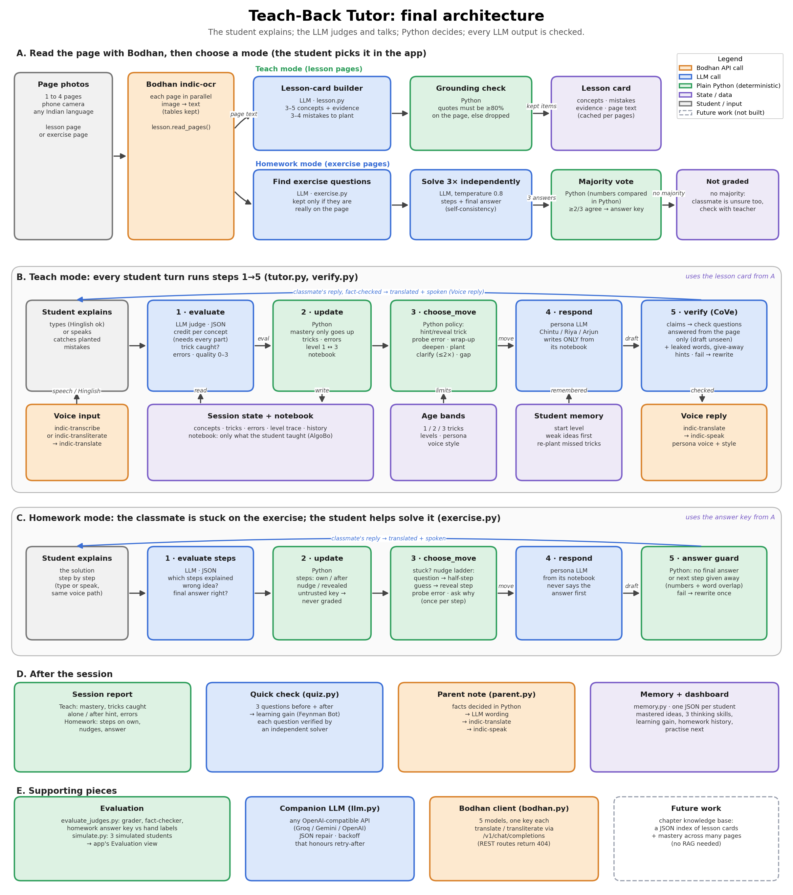

# Teach-Back Tutor

> A student photographs a textbook page and teaches it to an AI classmate who missed the class. The classmate asks naive questions and sometimes says something wrong on purpose; the student has to catch it.

**Bodhan models:** indic-ocr, indic-transliterate, indic-translate, indic-speak, indic-transcribe
**Languages shown:** Hindi (the app also offers English, Bengali, Tamil, Telugu, Marathi, Gujarati, Kannada, Malayalam, Odia, Punjabi, Assamese and Urdu)
**Format:** Streamlit app + walkthrough notebook + CLI

## What it does

Explaining an idea to someone else is one of the best tests of understanding (the Feynman technique). Most study apps ask the student questions; here the student does the explaining, in their own language, by typing or speaking:

1. **Photo → lesson.** `indic-ocr` reads the textbook page (or up to 4 pages of one lesson, read in parallel). An LLM drafts a *lesson card*: the key concepts the student should explain and the misconceptions the classmate can plant. Every item must quote the page, or it is dropped.
2. **Teach the classmate.** The classmate (Chintu, Riya or Arjun, by age group) asks about gaps, asks for examples, pushes for "why", and plants a wrong idea to see if the student catches it. A missed mistake gets a hint, then is revealed and explained; the student never leaves with the wrong idea. The classmate really "missed the class": it keeps a **notebook** of only what the student has taught it, and writes every reply from that notebook alone (visible in the app).
3. **Every classmate line is fact-checked before the student sees it** (Chain-of-Verification): its claims are checked against the page by a separate call that never sees the line, and it may not use lesson words the student has not said yet. A line that fails is rewritten once with the problems as feedback.
4. **Quick check before and after.** Three multiple-choice questions before teaching and the same three after give an objective **learning gain** per session. Each question is itself verified: an independent solver must reach the same answer from the page, or the question is thrown out.
5. **Honest report.** What the student explained, what they missed, which tricks they caught (on their own or after a hint), any wrong ideas they still hold, the learning gain, and how many classmate claims were checked, blocked or rewritten.
6. **Memory.** The tutor remembers each student. Next session it starts at the level they reached, asks about their weak spots first, and re-plants the mistakes they missed to check the correction stuck.
7. **Parent note.** A short, honest summary in the parent's language, written and spoken.
8. **Progress dashboard** (switch to **My progress** in the sidebar). Ideas mastered per topic, three thinking skills (explaining in your own words, spotting mistakes, thinking deeper) with the change since earlier sessions, learning gain per session, understanding over time, and what to practise next. It is computed from the saved sessions in plain Python, so it is instant and works offline.
9. **Homework mode** (choose **Solve homework together** on the start screen). For exercise pages whose answers are not printed. The classmate is stuck on a question from the page and the student helps solve it, step by step. If the student is stuck too, the classmate nudges in three rungs: a question about what to find next, then a half-finished guess, and only then does it work the step out itself. It never blurts out the answer (a Python guard checks every line). The answer is not on the page, so the reference solution is worked out **3 times independently** and used only if a majority agree (self-consistency); otherwise the classmate says it is not sure either and nothing is graded. Same Bodhan path: `indic-ocr` reads the exercise page, and the student types (transliterate) or speaks (transcribe) in their language; replies are translated and spoken.
10. **Evaluation view** (sidebar). The measured accuracy of both LLM judges against hand labels and the simulated-student results, from `eval/results.json`.

| Teaching Riya in Hinglish (she plants a mistake) | The report | Progress dashboard |
|---|---|---|
|  |  |  |

In the chat above, the student typed romanized Hindi; Riya replied in Hindi (with audio) and then claimed "chlorophyll is just a colour". The student corrected her, and the report shows the trick as caught.



## Setup

```bash
cd examples/teach_back_tutor
python -m venv .venv && source .venv/bin/activate   # Windows: .venv\Scripts\activate
pip install -r requirements.txt
cp .env.example .env
```

Fill in `.env`:

- `BODHAN_API_KEY` from [console.bodhan.ai](https://console.bodhan.ai). If the console gave you one key per model, set `BODHAN_OCR_KEY`, `BODHAN_TRANSCRIBE_KEY` and the others instead.
- `LLM_API_KEY`, `LLM_BASE_URL`, `LLM_MODEL` for the companion LLM. Any OpenAI-compatible endpoint works; `.env.example` has ready-made settings for OpenAI, Gemini and Groq (both have free tiers).

## Run

```bash
streamlit run app.py              # the full app: photo, type or speak, report, parent note
jupyter notebook teach_back_tutor.ipynb   # step-by-step walkthrough of the pipeline
python smoke_test.py              # one call to each Bodhan model + the LLM, to check your keys

# terminal tools use the lesson card in eval/ (or pass --card; build one with python lesson.py <image>):
python tutor.py --student Aarav   # chat in the terminal, with memory
python simulate.py --all          # simulated students (see Evaluation)
python evaluate_judges.py         # grader and fact-checker vs hand labels -> eval/results.json

pip install pytest && pytest test_policy.py   # offline tests, no keys needed
```

In the app, click **Try the sample page** to try it without a photo. Turn on **Teacher view** in the sidebar to see, on every turn, the score, the chosen move, the level and the fact-check of the classmate's line with the page's own words as evidence.

## How it works

**The LLM judges and talks; Python decides; and everything the LLM says is checked.** Each student turn runs five steps:

| Step | Who | What |
|---|---|---|
| 1. evaluate | LLM, JSON, temperature 0.2 | Credit per concept (`explained` / `partial` / `not_covered`), whether a planted mistake was caught, new or corrected wrong ideas, answer quality 0-3 |
| 2. update | Python | Mastery only goes up within a session; plant and error tracking; adaptive level 1-3; the classmate's notebook |
| 3. choose_move | Python | Fixed priority: hint or reveal a pending plant → probe a wrong idea → wrap up → go deeper → plant a mistake → clarify a vague part → ask about a gap |
| 4. respond | LLM, persona | Writes the classmate's line for that move, from its notebook only (it never sees the lesson card's explanations) |
| 5. verify | LLM ×2, then Python | Chain-of-Verification: list the line's claims and a check question for each; answer the checks from the page alone; Python blocks the line if a claim is contradicted (with page evidence), if it uses a lesson word nobody has said yet, or if a planned trick is missing. One rewrite with the problems as feedback. |

Keeping the policy in Python makes it predictable and testable (`test_policy.py`), and lets a small, cheap model do the language work. The fact-check adds one or two short LLM calls per turn (about 1-3 s); it can be turned off in the sidebar.

Design choices worth knowing:

- **Strict credit.** Agreeing with the classmate or repeating its words counts as at most `partial`. Otherwise a student who says "yes, right" to everything scores full marks.
- **Grounding.** Lesson-card items whose evidence quote is not on the page (at least 80% of the words) are dropped, so the tutor cannot test the student on something the page does not say.
- **Adaptive level.** The level rises after two good answers in a row, or after catching a planted mistake. It falls after two weak answers or a twice-missed plant. Higher levels ask "why" and "what if" questions and plant harder mistakes.
- **Every student gets tested.** Mistakes are planted on concepts the student has explained; if they have explained nothing by turn 4, the classmate plants one anyway. Agreeing with "plants eat soil" shows which wrong idea they hold.
- **Age groups.** Class 1-5: one easy plant, playful persona. Class 6-8: two plants up to medium, one "why" question required. Class 9-12: three plants up to hard, two "why" questions required.
- **Honest wrap-up and parent note.** Python turns the report into plain facts first ("did NOT notice this was wrong"); the LLM only words them, so it cannot turn a miss into praise.
- **Language round trip.** Typed romanized Hindi goes through `indic-transliterate` (to Devanagari), then `indic-translate` (to English) for grading. Speech goes through `indic-transcribe`. The classmate's reply goes back through `indic-translate` and is spoken by `indic-speak` in the persona's style (`children's stories`, `happy`, `educational lecture`). Grading tolerates mis-heard words.

| File | Role |
|---|---|
| `bodhan.py` | Bodhan API client (OCR, transcribe, translate, transliterate, speak) |
| `llm.py` | Companion LLM client: JSON repair, retries that honour `retry-after` |
| `lesson.py` | Page → grounded lesson card (cached per image) |
| `tutor.py` | The teach-back engine: evaluate, update, choose_move, respond (from the notebook), report |
| `verify.py` | Chain-of-Verification fact-check of every classmate line, plus the leaked-word check |
| `quiz.py` | Before/after quick check; each question verified by an independent solver |
| `exercise.py` | Homework mode: find exercise questions, self-consistent answer key, nudge ladder, answer guard |
| `evaluate_judges.py` | Grader and fact-checker vs hand labels (`eval/`), results in `eval/results.json` |
| `memory.py` | Cross-session student memory (one JSON file per student in `profiles/`) and the numbers behind the dashboard |
| `parent.py` | Parent note: facts → LLM wording → translate → speak |
| `app.py` | Streamlit app |
| `simulate.py` | Evaluation harness with simulated students |

## Evaluation

The recipe makes two kinds of LLM judgement, and both are checked against hand labels with `python evaluate_judges.py` (frozen lesson card and labels in `eval/`; the app's **Evaluation** view shows the latest `eval/results.json`). Labels were written by the recipe author, so they are small and worth an independent review.

**1. The grader (LLM-as-a-judge) vs a teacher's labels**: 16 student turns, 20 concept labels, including agreeing, echoing, off-topic, mis-heard speech, and caught or missed planted mistakes.

| Grader version | Concept credit | Planted mistake caught/missed | Quality 0-3 in expected range | Over-credits (credit for an idea the turn did not explain) |
|---|---|---|---|---|
| v2 | 100% (20/20) | 100% (4/4) | 100% (16/16) | 1 per run, on a different turn each run |
| v3, current: "explained" needs every part of the idea | 95% (19/20) | 100% (4/4) | 88% (14/16) | 0 |

v3 came from a simulated conversation where the grader, deep into a long chat, credited "the leaf is like a pizza oven" as explaining glucose production. Requiring every part of the idea removed over-credits at the cost of being slightly harsh (two clear answers scored quality 1 instead of 2). For a children's tutor we prefer that trade: telling a student they have mastered an idea they have not is the worse error.

**2. The fact-checker (Chain-of-Verification) vs labelled statements**: each statement is said by the classmate; false ones must be blocked, true ones must pass.

| Version | Precision | Recall | Held-out accuracy |
|---|---|---|---|
| v1 | 100% | 80% | - |
| v2 (quantity words kept in the check questions) | 100% | 100% | 100% (7 statements written after the fix) |

v1 missed "plants need *only* water": the planning step asked "do plants need water?", which the page answers yes. v2 tells the planner to keep words like *only / all / none* in the check question; the held-out statements were written afterwards to test that the fix generalises rather than fits the 20. Reviewing v1 also found one wrong label (turn 14 does state an idea the label left out; corrected and noted in `eval/judge_labels.json`) and one metric bug (agreeing with a planted mistake is recorded as a missed plant by design, not as a student error).

**Homework mode's answer key (self-consistency)** vs 10 exercise questions with known answers (`eval/exercise_labels.json`: 4 arithmetic word problems, 6 reasoning questions), run on `qwen/qwen3.8-27b`:

| One solve correct | Answered (majority agreed) | Correct when answered | Wrong but trusted |
|---|---|---|---|
| 100% | 10/10 (all 3/3) | 100% | 0 |

These questions were easy enough that one solve was already always right, so this run shows the answer key is reliable on page-level exercises, not that voting improved it. Self-consistency is the safety net for harder questions: when solutions disagree, the question is not graded. The first run of this check scored 9/10 because the scorer compared "leaves." with its full stop; the scorer was fixed (now unit-checked) and the run repeated.

**3. Simulated students.** `simulate.py` has an LLM role-play three students talking to the tutor, and checks the scores match what each one knows. The first run with fact-checking on (tutor `gpt-oss-120b`, students `gpt-oss-20b`) blocked 2 wrong claims and 2 leaked words and rewrote 4 replies before the students saw them. It also exposed three tutor bugs, now fixed and tested: a hint that stated the answer as a yes/no question (hints that contain the correction are now blocked by the fact-checker), a loop asking about the same vague idea five times (now at most twice), and the lenient grading above. In that run every simulated student scored 3/3 on the quick check *before* teaching: the models know basic photosynthesis themselves, so learning gain can only be measured with real students. The partial and confused students never see the page, only a short memory of it, so they cannot give perfect answers by accident.

| Simulated student | Understanding | Planted mistakes caught | Levels over the session | Turns |
|---|---|---|---|---|
| strong (has read the page) | 100% | 2/2 on their own | 1 → 2 → 3 | 5 |
| partial (remembers half) | 50% | 1/1 on their own | 1 → 3, then back down to 1 | 12 |
| confused (thinks plants eat soil) | 30% | 0/1 (agreed with "plants eat soil") | stays at 1 | 13 |

Class 6-8, Groq `qwen/qwen3.8-27b`. The engine takes about 1.3 s per turn; on Groq's free tier, rate limits add waits (the harness reports both). An early version gave the confused student 80-100% because agreeing counted as explaining; the strict credit rules above came from that.

**The simulator is only as faithful as the model playing the student.** With the larger `openai/gpt-oss-120b` playing the students, the "partial" student broke character: it had only been told "sunlight, water, something from the air, in the leaves", yet it explained chlorophyll as "little solar panels" and that the leaf "cooks up sugar and lets out oxygen", knowledge from the model's own training. The grader correctly credited those true statements, so that run scored the partial student at 100%. A smaller or more obedient model gives more faithful weak students; real classroom data would be the proper test.

**Memory across sessions** (`python simulate.py --profile partial --sessions 2`):

| | Session 1 | Session 2 (with memory) |
|---|---|---|
| Classmate's opening | "I totally missed that class... can you tell me what we talked about?" | "I remember we covered this, but I got a bit mixed up about what plants actually need, what chlorophyll does, and what they make." |
| Understanding | 50% | 70% |
| Planted mistakes caught | 1/1 | 2/2 |
| Weak concepts at the end | 3 | 2 |

The simulated student does not actually study between sessions, so the gain comes from the tutor going straight to the weak spots. It is one run, not a benchmark.

## Related work

- **Feynman Bot** (Rajesh & Khan, IEEE TALE 2024, [arXiv 2506.09055](https://arxiv.org/abs/2506.09055)). An LLM+RAG bot the learner explains lecture material to; 14 adults, higher learning gain (post − pre) than passive review (3.83 vs 2.17), and learners preferred typing to speech. We borrow the learning-gain measure. We differ in that our classmate *pretends not to know* and plants checkable mistakes, grading is grounded in page quotes, the policy is deterministic and tested, and it runs for school students in Indian languages.
- **AlgoBo / TeachYou** (Jin et al., CHI 2024, [arXiv 2309.14534](https://arxiv.org/abs/2309.14534)). An LLM teachable agent for programming; found that LLM tutees "know too much", and proposed Reflect-Respond: keep an explicit knowledge state and answer only from it. Our notebook and leaked-word check implement that idea, and our simulated-student results show the same "knows too much" drift (see above), also reported in reviews of LLM-simulated students ([arXiv 2511.06078](https://arxiv.org/abs/2511.06078)).
- **Chain-of-Verification** (Dhuliawala et al., Findings of ACL 2024, [arXiv 2309.11495](https://arxiv.org/abs/2309.11495)). Draft, plan verification questions, answer them independently, revise. We use the factored variant on every classmate line and on every quiz question, with the page as the only source and Python making the final decision.
- **LLM-as-a-judge** (Zheng et al., NeurIPS 2023, [arXiv 2306.05685](https://arxiv.org/abs/2306.05685)). Using an LLM as a grader is only credible once checked against human labels, which `evaluate_judges.py` does for both of our judges.
- **Self-consistency** (Wang et al., ICLR 2023, [arXiv 2203.11171](https://arxiv.org/abs/2203.11171)). Sample several reasoning paths and take the majority answer. Homework mode uses it for the answer key, and abstains (does not grade) when there is no majority.

## Future work

- **Chapter knowledge base.** Today one lesson is up to 4 pages, all of which fit in the prompt, and everything a student taught is kept by Python (session state, notebook, memory), so nothing is "forgotten". For a whole chapter or book, the next step is a small JSON index of lesson cards across pages (concept, page, the student's mastery) so a later page can build on an earlier one. Retrieval over embeddings (RAG) should not be needed at that size.
- **Real students.** Every result here is from hand labels and simulated students; a small classroom study with separate before/after question sets is the proper test.
- **Maths beyond arithmetic.** Homework mode checks numeric answers by comparing the numbers; equations, diagrams and units need a stronger checker (for example, running the calculation in Python).

## Bodhan API notes

Things we ran into, and what the recipe does about them:

- **`POST /translate` and `POST /transliterate` return 404** (also reported in issue #34). The same models work through `POST /v1/chat/completions` with `model: indic-translate` / `indic-transliterate` and `target_language` / `language` plus `script` as top-level fields; `bodhan.py` uses that route. The transliteration route is not in the docs.
- **One key per model.** The console issued a separate key per model. `bodhan.py` reads `BODHAN_<MODEL>_KEY` and falls back to `BODHAN_API_KEY`.
- **indic-speak length.** About 30 seconds of speech per request, so `bodhan.speak_long()` speaks sentence by sentence (three requests in parallel) and joins the WAVs.
- **indic-transcribe** sometimes mis-hears a word (धूप "sunlight" came back as थूक "spit"). The grader is told to judge meaning and not penalise mis-heard words.

## Limitations

- Up to 4 pages per lesson, so one lesson fits one session; there is no whole-chapter or book-level view yet (see Future work).
- Homework mode's answer key comes from the LLM, not the book. Majority agreement makes a wrong key much less likely but not impossible, and questions without a majority are not graded. It has no memory-based adaptation or parent note yet; its sessions appear in the dashboard's homework history.
- The lesson card is cached per image file. A new photo of the same page builds a new card, so memory carries over by topic and concept name only.
- A turn in the app takes several seconds (transcribe → translate → grade → reply → translate → speak). Free LLM tiers add rate-limit waits; Groq's free tier allows about 1,000 output tokens per minute for this model, enough for one student at a time.
- "Ideas mastered" is per lesson page: an idea stays mastered once explained (unless the student later states a wrong idea about it). There is no shared skill taxonomy across subjects, and no question bank or past papers; practice comes from re-teaching the weak ideas on the same page.
- Voice is push-to-record, one answer at a time, not live streaming; `indic-transcribe` takes about 30 seconds of audio per request.
- Scores come from an LLM grader. The hand-label check and the simulation show they track understanding, but the label sets are small (16 turns, 27 statements, one page) and author-written; they are a guide for the student and parent, not an exam mark.
- The fact-checker can only block what the page contradicts. A claim the page does not mention stays "unverified" and is allowed through (it is shown as such in Teacher view).
- The quick check reuses the same three questions before and after, so part of the gain can be the testing effect; the Feynman Bot study used separate question sets.
- Student profiles are local JSON files with no accounts or access control. Do not use real children's names in a shared deployment.
