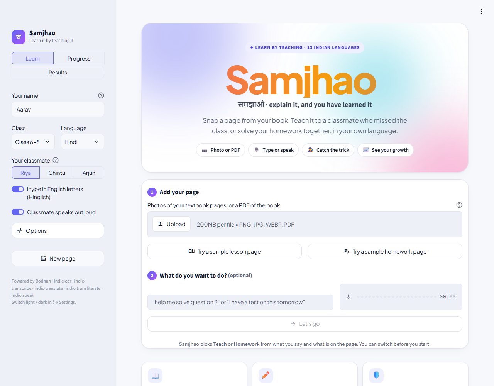
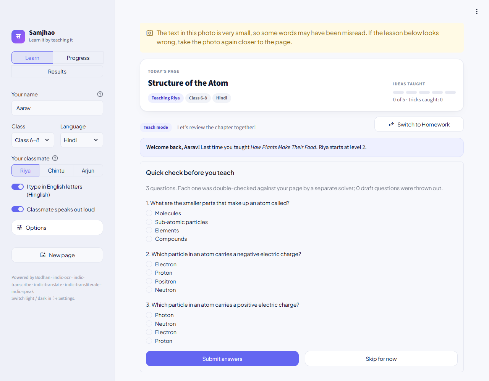
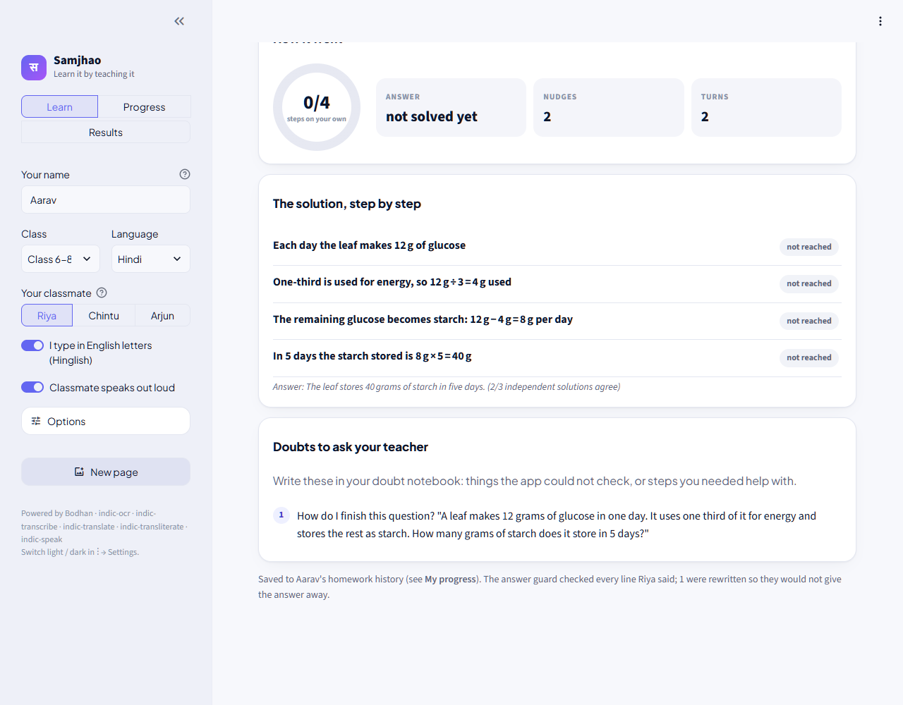
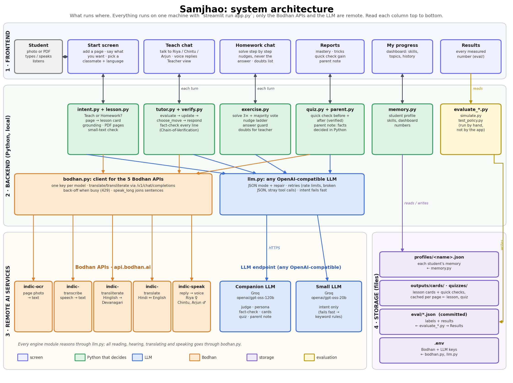

# Samjhao: a teach-back tutor

> *Samjhao* (समझाओ) means "explain it". A **Feynman-technique** tutor: a student photographs a textbook page and **teaches it** to an AI classmate who missed the class. The classmate asks questions, and sometimes says something wrong on purpose for the student to catch. A **Homework mode** helps solve exercise questions step by step, nudging instead of giving the answer, and an **intent matcher** picks the right mode from what the student says.

**Bodhan models:** indic-ocr, indic-transcribe, indic-transliterate, indic-translate, indic-speak (all five)
**Languages:** English plus 12 Indian languages (Hindi, Bengali, Tamil, Telugu, Marathi, Gujarati, Kannada, Malayalam, Odia, Punjabi, Assamese, Urdu); typed Hinglish works
**Format:** Streamlit app (light and dark) + walkthrough notebook + command-line tools



**Contents:** [In one minute](#in-one-minute) · [Using the app](#using-the-app-step-by-step) · [Setup](#setup) · [Run](#run) · [How it works](#how-it-works) · [Files](#every-file-and-what-it-does) · [Evaluation](#evaluation) · [Research](#research-behind-it) · [Bodhan API notes](#bodhan-api-notes) · [Limitations](#limitations)

## In one minute

Explaining an idea to someone else is one of the best tests of whether you understand it (the Feynman technique). Most study apps ask the student questions. Samjhao turns it around: **the student does the explaining**, in their own language, by typing or speaking.

- **Teach mode** (lesson pages). The student explains the page to a classmate (Riya, Chintu or Arjun). The classmate asks about gaps, asks "why", and plants a believable mistake ("plants get their food from the soil, right?"). Catching it is the real test.
- **Homework mode** (exercise pages). The student solves a question from the page step by step. If they are stuck, the classmate nudges: first a question, then a half-finished hint, and only then does it work out one step. It never gives the final answer away.
- **It picks the mode for you.** Add a page, optionally say what you want ("help me with question 3"), and a small, fast LLM chooses Teach or Homework (you can switch).
- **Everything the AI says is checked.** Every classmate line is fact-checked against the page before the student sees it. Homework answers, which are not printed in the book, are worked out three times and used only if they agree.
- **It measures learning.** A three-question quick check before and after gives a learning gain; a report, a progress dashboard and a spoken note for parents follow.

The guiding rule of the design: **the LLM judges and talks; plain Python decides what happens next; and everything the LLM says is checked.** That keeps the tutor predictable, testable and honest.

## Using the app, step by step

**1. Set up the sidebar.** Your name (the tutor remembers you), your class (sets how hard it is), the language you will talk in, and your classmate: **Riya** (curious explorer, female voice), **Chintu** (playful, male voice) or **Arjun** (sharp debater, male voice). Turn on *I type in English letters* to type Hinglish. Light or dark mode: ⋮ → Settings.

**2. Add your page.** Upload 1 to 4 photos of one lesson, or a **PDF of the whole book** and pick the start page and how many pages. No page handy? Use **Try a sample lesson page** or **Try a sample homework page**.

**3. Say what you want (optional).** Type it, or record it with the mic: "explain this chapter", "I have a test tomorrow", "help me solve question 2". Press **Let's go**. Samjhao reads the page with `indic-ocr`, picks **Teach** or **Homework**, and shows why, with a **Switch** button. If the photo is too small to read reliably, it tells you to retake it closer.

| The start screen in dark mode | A tiny photo: the small-text warning, and memory ("Welcome back") |
|---|---|
|  |  |

**4a. Teach.** Optionally answer the 3-question quick check, then explain the page by typing or speaking. The classmate answers in your language, out loud. Watch for the planted mistake! Turn on **Teacher view** (sidebar → Options) to see, under every reply, the score, the next move, the level and the fact-check with the page's own words as evidence.

| Teaching Riya in Hinglish, Teacher view on | The report |
|---|---|
|  |  |

In this chat the student typed romanized Hindi, which `indic-transliterate` turned into Devanagari and `indic-translate` into English for grading. Riya replies in Hindi with audio (`indic-translate` → `indic-speak`). Teacher view shows the fact-check at work: Riya's first draft used a word the student had not taught yet ("green"), so it was blocked and rewritten. Then she planted "plants get most of their food from the soil", and the fact-checker confirmed it is the planned mistake, quoting the page.

**4b. Homework.** Pick a question (the one you named is preselected) and solve it together. Say "I don't know" and you get a nudge, not the answer.

| "I don't know" gets a question, then a half-finished hint | Report: steps, the 3-solve answer check, doubts for the teacher |
|---|---|
|  |  |

**5. Finish.** Press **Finish session** (or the classmate wraps up). The report shows what you explained, which tricks you caught, the quick-check gain, and, for homework, a **"Doubts to ask your teacher"** list. Teach reports also offer a **note for parents**, written in their language and spoken.

**6. See your progress and the evidence.** **Progress** shows ideas mastered, three thinking skills and their trend, and what to practise next. **Results** shows every measured number from the [Evaluation](#evaluation) below.

| Progress dashboard (dark mode) | Results view |
|---|---|
|  |  |

## Setup

You need **Python 3.10+**, **Bodhan API keys** ([console.bodhan.ai](https://console.bodhan.ai)) and a key for **any OpenAI-compatible LLM**. Groq's free tier works well and is what every result here used.

```bash
cd examples/teach_back_tutor
python -m venv .venv
source .venv/bin/activate          # Windows: .venv\Scripts\activate
pip install -r requirements.txt
cp .env.example .env               # Windows: copy .env.example .env
```

Then fill in `.env`:

| Variable | What it is |
|---|---|
| `BODHAN_API_KEY` | Your Bodhan key. If the console gave you **one key per model**, set `BODHAN_OCR_KEY`, `BODHAN_TRANSCRIBE_KEY`, `BODHAN_TRANSLATE_KEY`, `BODHAN_TRANSLITERATE_KEY`, `BODHAN_SPEAK_KEY` instead (a per-model key wins) |
| `LLM_API_KEY` | Key for the companion LLM |
| `LLM_BASE_URL` | Its OpenAI-compatible endpoint; `.env.example` has ready-made values for Groq, OpenAI and Gemini |
| `LLM_MODEL` | The main model, e.g. `openai/gpt-oss-120b` on Groq |
| `LLM_REASONING_EFFORT` | Optional, for reasoning models: `low` keeps turns fast |
| `INTENT_MODEL` | Optional: the small model that picks Teach or Homework (default `openai/gpt-oss-20b`; if it is unavailable, keyword rules decide) |

## Run

Check your keys, then start the app:

```bash
python smoke_test.py     # one call to each Bodhan model and the LLM: all should say OK
streamlit run app.py     # opens http://localhost:8501
```

Other ways in:

```bash
jupyter notebook teach_back_tutor.ipynb   # the pipeline step by step, with explanations
python tutor.py --student Aarav           # teach in the terminal (uses the lesson card in eval/)
python lesson.py my_page.jpg              # build a lesson card from your own photo
pip install pytest && pytest test_policy.py   # 43 offline tests, no keys needed
```

**Troubleshooting**

| You see | Why | What to do |
|---|---|---|
| "The reading service is busy or out of credit" | Bodhan returned 429: either a burst limit (retried automatically) or an account budget that has run out | Wait a minute; if it persists, check your credit in the Bodhan console |
| A reply takes a long time | The LLM's free tier is rate-limiting; `llm.py` waits as long as the server asks | Normal on free tiers; a paid tier or a less busy model is faster |
| "The text in this photo is very small" | The photo has too few pixels per word to read reliably | Take the photo closer, filling the frame with the page |
| "indic-ocr could not read this page" | Handwriting or very faded print | Use a clear photo of a printed page |
| "No exercise questions on this page" | Homework mode needs questions on the page | Use Teach mode, or a page with exercises |

## How it works

### The system: what runs where



Samjhao runs on one machine. Read each column top to bottom:

1. **Frontend** (`app.py`, Streamlit). The screens the student sees. It keeps the live session in memory and calls the backend on every turn.
2. **Backend** (plain Python, local). The engine: `intent.py` picks the mode, `lesson.py` turns pages into a lesson card, `tutor.py` and `verify.py` run Teach mode, `exercise.py` runs Homework mode, `quiz.py` and `parent.py` do the quick check and the parent note, `memory.py` remembers each student. All of them reach the outside world through just two small clients: **`bodhan.py`** and **`llm.py`**.
3. **Remote AI services.** **Bodhan does everything to do with language**: reading the page, hearing the student, transliterating Hinglish, translating, and speaking. **The LLM does the reasoning**: grading, the classmate's words, fact-checking, lesson cards and quiz questions. A second, smaller LLM only picks the mode.
4. **Storage: plain files, no database.** Each student's memory (`profiles/`), cached lesson cards and quizzes (`outputs/`), the keys (`.env`), and the evaluation labels and results (`eval/`, committed so the Results view works out of the box).

### What happens on every turn


Each time the student says something in Teach mode, five steps run:

| Step | Who | What |
|---|---|---|
| 1. evaluate | LLM, JSON, temperature 0.2 | Credit per idea (`explained` / `partial` / `not_covered`), whether a planted mistake was caught, new or corrected wrong ideas, answer quality 0-3 |
| 2. update | Python | Mastery only goes up within a session; tracks tricks and wrong ideas; adapts the level 1-3; writes the classmate's notebook |
| 3. choose_move | Python | Fixed priority: hint or reveal a pending trick → probe a wrong idea → wrap up → go deeper → plant a mistake → clarify a vague part → ask about a gap |
| 4. respond | LLM, persona | Writes the classmate's line for that move, **from its notebook only** (it never sees the lesson card's explanations, so it really "missed the class") |
| 5. verify | LLM ×2, then Python | Chain-of-Verification: list the line's claims with a check question each; answer the checks from the page alone; Python blocks the line if a claim is contradicted, if it uses a lesson word nobody has said yet, or if a planned trick is missing; one rewrite with the problems as feedback |

Homework mode runs the same loop with its own steps (`exercise.py`): which solution steps the student explained → update → the **nudge ladder** (a question about what to find next → a half-finished guess → work out the step) → the classmate's line → an **answer guard** in plain Python that blocks any line giving away the final answer or the next step.

Keeping the decisions in Python makes the tutor predictable and testable (`test_policy.py`), and lets the LLM do only what it is good at: understanding and wording. The fact-check adds one or two short LLM calls per turn (about 1-3 s) and can be turned off in the sidebar.

### Where each Bodhan API is used

| Bodhan model | Where | What for |
|---|---|---|
| `indic-ocr` | `lesson.py` | Reads each page photo or rendered PDF page into text (pages in parallel) |
| `indic-transcribe` | `app.py` | The student's spoken answer, and the spoken "what do you want" request, into text |
| `indic-transliterate` | `app.py` | Typed Hinglish ("paudhe khana banate hain") into Devanagari |
| `indic-translate` | `app.py`, `parent.py` | Student's words → English for grading; the classmate's reply and the parent note → the student's or parent's language |
| `indic-speak` | `app.py`, `parent.py` | Speaks every classmate reply (Riya female voice; Chintu and Arjun male voices, each in their own style) and the parent note |

### Design choices worth knowing

- **Strict credit.** Agreeing with the classmate or repeating its words counts as at most `partial`. Otherwise a student who says "yes, right" to everything would score full marks. A student who still holds a wrong idea about a concept loses one level of credit on it.
- **Grounding.** Lesson-card items whose evidence quote is not on the page (at least 80% of the words) are dropped, so the tutor cannot test the student on something the page does not say.
- **Adaptive level.** The level rises after two good answers in a row, or after catching a planted mistake. It falls after two weak answers or a twice-missed trick. Higher levels ask "why" and "what if" and plant harder mistakes.
- **Every student gets tested.** Mistakes are planted on ideas the student has explained; if they have explained nothing by turn 4, the classmate plants one anyway. Agreeing with "plants eat soil" shows which wrong idea they hold.
- **Class sets the difficulty; the student picks the classmate.** Class 1-5: one easy trick. Class 6-8: two, up to medium, one "why" required. Class 9-12: three, up to hard, two "why" required.
- **Honest wrap-up and parent note.** Python turns the report into plain facts first ("did NOT notice this was wrong"); the LLM only words them, so it cannot turn a miss into praise.
- **Fails safe.** If the intent model is unavailable, keyword rules pick the mode; if the fact-checker's own output is broken, the line still goes through the Python checks; a homework solve that fails simply does not vote.

## Every file and what it does

| Layer | File | What it does |
|---|---|---|
| Frontend | `app.py` | The Streamlit app: start screen, Teach and Homework chats, reports, Progress and Results views, light and dark themes |
| Backend | `intent.py` | Teach or Homework? A small LLM reads what the student asked and the page; keyword rules as fallback; finds "question 3" |
| | `lesson.py` | Photos or PDF pages → text (`indic-ocr`) → a grounded lesson card, cached per set of pages; photo preparation and the small-text check |
| | `tutor.py` | The Teach engine: evaluate, update, choose_move, respond (from the notebook), report; the classmates and class settings |
| | `verify.py` | Chain-of-Verification fact-check of every classmate line, plus the leaked-word and give-away checks |
| | `exercise.py` | Homework mode: find the questions, the self-consistent answer key, the nudge ladder, the answer guard, doubts for the teacher |
| | `quiz.py` | The before/after quick check; each question verified by an independent solver |
| | `memory.py` | Each student's memory (one JSON file in `profiles/`) and the numbers behind the dashboard |
| | `parent.py` | The parent note: facts in Python → LLM wording → `indic-translate` → `indic-speak` |
| Clients | `bodhan.py` | Client for the five Bodhan APIs; one key per model; back-off when busy |
| | `llm.py` | Client for any OpenAI-compatible LLM; JSON mode with repair; retries for rate limits, broken JSON and stray tool calls |
| Evaluation | `evaluate_judges.py` | Grader, fact-checker and homework answer key against labels → `eval/results.json` |
| | `evaluate_public.py` | The grader against real students' answers (SciEntsBank); data is downloaded, not committed → `eval/public.json` |
| | `evaluate_language.py` | The same graded turns typed in Hinglish and spoken in Hindi (all five Bodhan models) → `eval/language.json` |
| | `evaluate_pages.py` | Real photos, a multi-page PDF lesson and deliberately damaged pages → `eval/pages.json` |
| | `simulate.py` | Simulated students in Teach mode (`--all`) and Homework mode (`--homework`) |
| | `test_policy.py` | 43 offline tests of everything Python decides (no keys needed) |
| Tools | `smoke_test.py` | One call to each Bodhan model and the LLM, to check your keys |
| | `make_sample_page.py` | Draws the two sample pages in `sample_data/` |
| | `teach_back_tutor.ipynb` | The pipeline step by step, with explanations |
| Data | `eval/` | Labels (`*_labels.json`), the frozen lesson card, and all results |
| | `sample_data/` | A sample lesson page and a sample exercise page |

## Evaluation

Every LLM decision in this recipe is checked, and so is the Bodhan path around it. All numbers come from scripts in this folder; their raw results are in `eval/` and in the app's **Results** view. Each result names the model that produced it.

| What is tested | How | Result |
|---|---|---|
| Everything Python decides | `pytest test_policy.py`, 43 offline tests | all pass |
| The grader (LLM-as-a-judge) | 16 hand-labelled student turns | 95% concept credit, 0 over-credits, 100% planted mistakes; identical on a second run |
| The grader on public data | SciEntsBank: 20 real students' science answers, graded by experts | 70% agree (3-way); 0 of 10 wrong answers given credit |
| The fact-checker (Chain-of-Verification) | 27 labelled statements, 7 held out | 100% precision and recall |
| Homework answer key (self-consistency) | 10 labelled exercises | 10/10 |
| Grading in Hindi (all five Bodhan models) | The 16 labelled turns, typed as Hinglish and spoken in Hindi | same scores as English |
| indic-ocr on damaged photos | One book page blurred, hazed, shrunk, tilted, compressed; the PDF's own text is the answer key | 88-99.8% word recall |
| Real pages | 11 photos and PDF pages, incl. hazy, handwritten, 300-year-old print | 10/11 start a session; 2 misreads now flagged |
| A 4-page lesson from a PDF book | OCR per page vs the PDF text; which pages the lesson card draws on | 99.3-100% recall per page |
| The whole tutor | Simulated strong / partial / confused students | ranked correctly; wrong claims and leaks blocked live |
| Homework mode | Simulated students who can solve, are stuck, or slip | 6/6 solved; 0 answers leaked; 1 give-away draft blocked |

**How to reproduce each result**, and where its data comes from:

| Test | Command | Data / labels (source) | Results file |
|---|---|---|---|
| Python logic | `pytest test_policy.py` | built into the tests, no keys needed | terminal |
| Grader vs hand labels | `python evaluate_judges.py --only judge` | `eval/judge_labels.json`: 16 turns written by the author, on the frozen page `eval/photosynthesis_card.json` | `eval/results.json` |
| Grader vs real students | `python evaluate_public.py --scientsbank 20` | SciEntsBank (SemEval-2013 Task 7; Dzikovska et al., 2013), downloaded from Hugging Face `nkazi/SciEntsBank` | `eval/public.json` |
| Fact-checker | `python evaluate_judges.py --only verifier` | `eval/verifier_labels.json`: 27 true/false statements about the frozen page, 7 held out | `eval/results.json` |
| Homework answer key | `python evaluate_judges.py --only homework` | `eval/exercise_labels.json`: 10 exercises with known answers | `eval/results.json` |
| Hindi typed and spoken | `python evaluate_language.py` | the 16 turns of `eval/judge_labels.json`, put through all five Bodhan models | `eval/language.json` |
| OCR, real and multi-page | `python evaluate_pages.py <photos> --pdf <book.pdf> --pdf-page 20 --pdf-lesson 16-19` | *Introduction to Political Science* (OpenStax, CC BY 4.0; its embedded text is the answer key) and the author's own photos (not committed: copyright) | `eval/pages.json` |
| Simulated students | `python simulate.py --all` and `--homework` | an LLM role-playing students (see section 6) | `eval/results.json`, `outputs/` |

The labelled sets in `eval/` were written by the recipe author, so they are small (one page, 16 turns, 27 statements, 10 exercises) and worth an independent review; that is why the grader is also checked on a public dataset of real students' answers labelled by experts.

### 1. The grader vs a teacher's labels

`python evaluate_judges.py`: 16 student turns with 20 concept labels, including agreeing, echoing, off-topic, mis-heard speech, and caught or missed planted mistakes.

| Grader version | Concept credit | Planted mistake caught/missed | Quality 0-3 in expected range | Over-credits |
|---|---|---|---|---|
| v2 | 100% (20/20) | 100% (4/4) | 100% (16/16) | 1 per run, on a different turn each run |
| v3, current: "explained" needs every part of the idea | 95% (19/20) | 100% (4/4) | 88% (14/16) | 0 |

v3 came from a simulated conversation where the grader, deep into a long chat, credited "the leaf is like a pizza oven" as explaining glucose production. Requiring every part of the idea removed over-credits at the cost of being slightly harsh (two clear answers scored quality 1 instead of 2). For a children's tutor we prefer that trade: telling a student they have mastered an idea they have not is the worse error. Re-run on a new day with a new API key (`openai/gpt-oss-120b`), every number above came out the same.

**On real students' answers (SciEntsBank).** Our own labels are small and written by us, so the grader is also checked against SciEntsBank (SemEval-2013 Task 7; Dzikovska et al., 2013): real school students' answers to science questions, graded by experts. Each question's reference answer becomes a one-idea lesson card, and the expert label maps onto the grader's verdict (correct → explained, partially correct → partial, contradictory or irrelevant → not explained). `python evaluate_public.py --scientsbank 20` (5 answers per label, fixed seed; `openai/gpt-oss-120b`):

| Expert label | Grader agreed |
|---|---|
| correct | 4/5 |
| partially correct | 3/5 |
| contradictory (a wrong idea) | 5/5 |
| irrelevant | 2/5 |
| **overall, 3-way** | **70%** |

No contradictory or irrelevant answer got full credit (0 of 10), and every wrong idea was caught. The disagreements lean generous in a specific way: vague answers that *sound* scientific ("because the magnetism is flowing", "the covered container can conceal heat") got partial credit where the experts gave none, and two partly correct answers were credited in full. Real children's answers are messier than our hand-written turns, which is why this is the more honest number; 20 items is a small sample, and the next step is the full set and a stricter rule for "partial".

### 2. The fact-checker vs labelled statements

Each statement is said by the classmate; false ones must be blocked, true ones must pass.

| Version | Precision | Recall | Held-out accuracy |
|---|---|---|---|
| v1 | 100% | 80% | - |
| v2 (quantity words kept in the check questions) | 100% | 100% | 100% (7 statements written after the fix) |

v1 missed "plants need *only* water": the planning step asked "do plants need water?", which the page answers yes. v2 tells the planner to keep words like *only / all / none* in the check question; the held-out statements were written afterwards to test that the fix generalises rather than fits the 20. Reviewing v1 also found one wrong label (turn 14; corrected and noted in `eval/judge_labels.json`) and one metric bug (agreeing with a planted mistake is recorded as a missed plant by design, not as a student error). The second run reproduced 100% / 100%.

### 3. Homework mode's answer key

Against 10 exercises with known answers (`eval/exercise_labels.json`: 4 arithmetic word problems, 6 reasoning questions): one solve was right 100% of the time, and the 3-solve vote answered 10/10 with 0 wrong-but-trusted, on two separate runs. These questions were easy enough that voting had nothing to fix, so voting is a safety net here rather than a measured gain; harder problems (for example GSM8K, which `evaluate_public.py --gsm8k 30` can run) are where it should pay off. The first run scored 9/10 only because our scorer compared "leaves." with its full stop; the scorer was fixed and the run repeated.

### 4. Does grading survive Hindi? (all five Bodhan models)

`python evaluate_language.py` sends the labelled student turns through the app's real input paths and grades them with the same grader against the same labels:

- **Typed Hinglish:** `indic-translate` turns the English turn into Hindi; the LLM writes it as a student would type it in romanized Hindi ("paudhe suraj ke prakash, paani aur carbon dioxide ka upyog karke..."); the app then runs `indic-transliterate` → `indic-translate`.
- **Spoken Hindi:** `indic-speak` reads the Hindi aloud; the app runs `indic-transcribe` → `indic-translate`.

| Input path (15 turns) | Concept credit | Over-credits | Planted mistakes | Quality in range |
|---|---|---|---|---|
| English (baseline) | 94% | 0 | 100% | 87% |
| Typed Hinglish | 94% | 0 | 100% | 100% |
| Spoken Hindi | 94% | 0 | 100% | 87% |

The language round trip costs the student nothing. (The 16th turn was not run: the Bodhan account's budget ran out mid-test; see Bodhan API notes.)

### 5. Pages: damaged, real, and a multi-page book lesson

`python evaluate_pages.py`. **Damaged copies** of one page from *Introduction to Political Science* (OpenStax, CC BY 4.0), with the PDF's own text layer as the answer key:

| Damage | indic-ocr word recall |
|---|---|
| clean (150 dpi render) | 99.5% |
| slight blur | 99.5% |
| hazy (dim, low contrast) | 99.5% |
| low resolution, 600 px wide | 99.4% |
| very low resolution, 400 px wide | 98.3% |
| tilted 6 degrees | 99.8% |
| hazy + blur + low resolution | 99.2% |
| heavy blur | 88.3% |

**Real pages**, end to end (OCR → lesson card → exercise finder). Test photos are not committed (textbook copyright); the results are in `eval/pages.json`.

| Page | Size | Words read | Card items grounded | Exercise questions | What the app does |
|---|---|---|---|---|---|
| Sample lesson page (this repo) | 1240×1020 | 157 | 8/8 | 0 | Teach session |
| Sample exercise page (this repo) | 1240×1020 | 127 | 8/8 | 4 | Teach or Homework |
| Stomata page (rendered) | 1240×900 | 84 | 6/6 | 0 | Teach session |
| NCERT Class 9 Science, chapter opener, phone photo (.webp) | 1073×1500 | 248 | 9/9 | 0 | Teach session |
| Handwritten grammar worksheet (photo) | 452×678 | 83 | 9/9 | 5 | Teach or Homework |
| NCERT "Structure of the Atom", tiny scan | 300×402 | 490 | 7/7 | 3 | **Misread**, now flagged |
| Latin pharmacopoeia, 1600s, hazy | 652×470 | 695 | 6/6 | 0 | **Misread**, now flagged |
| Halley's compound interest, 1700s print, hazy | 480×640 | 360 | 8/8 | 0 | Teach session |
| Dutch handwritten letter, 1600s | 682×1000 | - | - | - | indic-ocr cannot read it; the app says so |
| Political Science PDF, p. 20 | 1275×1651 | 608 | 7/7 | 0 | Teach session |

The most useful finding: the tiny atom scan was read as *"In Clavier X, we have learnt that assume and monokles are the fundamental building blocks of reason"* (the page says "In Chapter 3 … atoms and molecules … of matter"), and its lesson card still passed the grounding check, because grounding compares the card with the OCR text, and that text was itself wrong. indic-ocr gives no confidence score, so the app now measures **image pixels per word read**: the two misread photos had 246 and 440, every clean page 850 or more. Below 500 the student is told the text may be misread and to retake the photo closer. The threshold is calibrated on these 11 pages only. The handwritten letter used to surface as a raw `502 BadGateway`; the app now explains it in plain words.

**A 4-page lesson from a PDF book** (pages 16-19, section 1.5 "Empirical Political Science", about 2,300 words):

| Page | Words | indic-ocr word recall |
|---|---|---|
| 16 | 605 | 99.7% |
| 17 | 708 | 99.3% |
| 18 | 537 | 100% |
| 19 | 460 | 100% |

The lesson card drew 5 ideas and 4 tricks, none dropped, from pages 16 (3 items), 17 (2) and 18 (4), but none from page 19: a card of 3-5 ideas cannot cover four dense pages, which is why lessons stop at 4 pages and why a chapter index is the next step (Future work). Each prompt then carries about 2,300 words of page text.

### 6. Simulated students

`simulate.py` has an LLM role-play three students talking to the tutor and checks the scores match what each one knows. The partial and confused students never see the page, only a short memory of it, so they cannot give perfect answers by accident.

Latest run (tutor and students `openai/gpt-oss-20b`, class 6-8, fact-check on):

| Simulated student | Understanding | Planted mistakes caught | Wrong claims / leaked words blocked | Lines rewritten | Turns |
|---|---|---|---|---|---|
| strong (has read the page) | 100% | 2/2 on their own | 0 / 1 | 1 | 5 |
| partial (remembers half) | 100% | 2/2 on their own | 1 / 1 | 3 | 8 |
| confused (thinks plants eat soil) | 60% | 0/1 (agreed "plants get most of their food from the soil") | 2 / 4 | 6 | 13 |

What it showed:

- **The fact-checker earns its place.** The weaker the student, the more the classmate's drafts went wrong (leaking lesson words, or stating something the page contradicts), and every one was caught and rewritten before the student saw it.
- **"Knows too much."** The partial student was only told "sunlight, water, something from the air, in the leaves", yet explained the rest from the model's own training, and the grader correctly credited those true statements. Same in every run and every model we tried, and reported for LLM-simulated students in general ([arXiv 2511.06078](https://arxiv.org/abs/2511.06078)). Every simulated student also scored 3/3 on the quick check *before* teaching, so learning gain can only be measured with real students.
- **A bug it found, now fixed.** The confused student's 60% included *partial* credit on "the soil's role" for saying the misconception itself ("plants get their food from the soil"), which was flagged as an error at the same time. The report now drops a concept one level while the student still holds a wrong idea about it (explained → partial, partial → not covered), so stating a misconception never earns credit for that idea; covered by a test.
- Earlier runs found the three bugs described under the grader and in the design choices: the hint that stated the answer, the clarify loop, and the lenient grader.

An earlier run with `qwen/qwen3.8-27b` as tutor scored the three students 100% / 50% / 30% (understanding) and 2/2, 1/1, 0/1 (tricks). The engine itself takes about 4.3 s per turn; on Groq's free tier, rate-limit waits pushed that to about 23 s (the harness reports both).

**Memory across sessions** (`python simulate.py --profile partial --sessions 2`):

| | Session 1 | Session 2 (with memory) |
|---|---|---|
| Classmate's opening | "I totally missed that class... can you tell me what we talked about?" | "I remember we covered this, but I got a bit mixed up about what plants actually need, what chlorophyll does, and what they make." |
| Understanding | 50% | 70% |
| Planted mistakes caught | 1/1 | 2/2 |
| Weak concepts at the end | 3 | 2 |

The simulated student does not actually study between sessions, so the gain comes from the tutor going straight to the weak spots. It is one run, not a benchmark.

### 7. Homework mode with simulated students

`python simulate.py --homework`: simulated students help the classmate with two exercises from the frozen page, a sum ("a leaf makes 12 g of glucose and uses one third...") and a why-question ("a plant kept in a dark cupboard..."). The answer key came from 3 independent solves each time. Tutor and students `openai/gpt-oss-20b`; the stuck student never sees the page.

| Student | Question | Solved | Steps on their own | Nudges | Drafts blocked by the answer guard | Answer leaked to the student |
|---|---|---|---|---|---|---|
| can solve | sum | yes | 4/4 | 0 | 0 | 0 |
| stuck | sum | yes | 3/4 | 1 | 1 | 0 |
| slips once | sum | yes | 3/4 | 0 | 0 | 0 |
| can solve | why | yes | 5/5 | 0 | 0 | 0 |
| stuck | why | yes | 4/5 | 0 | 0 | 0 |
| slips once | why | yes | 5/5 | 0 | 0 | 0 |

The guard did its job: one of the classmate's drafts for the stuck student gave the next step away, was blocked and rewritten, and no answer ever reached a student before they said it. The limit is the same "knows too much" effect as above: even told to be stuck and denied the page, the model mostly worked these questions out itself, so the nudge ladder was barely needed. A scripted stuck student shows it working: answering "I don't know how to start" and then "I don't know, you tell me?" got first a question ("what part of the 12 g do we need to figure out first?") and then a half-finished guess ("each day the leaf makes 12 g of glucose... what should we do with that number next?"), never the answer (see the screenshot). The ladder's rules are also covered by the offline tests.

### Reliability fixes the testing forced

Running all of the above against free tiers broke things a real classroom would also break, and each is now handled:

- **Groq rejects broken JSON with a 400** instead of returning it, which crashed a simulation mid-session. `llm.chat_json` now treats it as bad JSON and retries (3 tries); if the fact-checker's own output stays broken, the line still goes through the Python checks and is marked "not fact-checked" instead of failing the student's turn; a broken homework solve simply does not vote.
- **Bodhan rate limits short bursts** (`429 Maximum rate limit reached`, seen with 9 parallel OCR calls); `bodhan.py` now backs off and retries.
- **Budgets run out mid-run** (the Bodhan account's ₹10 budget, Groq's 200,000 tokens a day). The evaluation scripts save after every item and resume where they stopped, and every result records the model that produced it.

## Research behind it

Samjhao is built from five published ideas. For each one: what the paper found, what we took from it, where it lives in the code, and why it matters here.

| Paper | What it found | What we took | Where in the code | Why we need it |
|---|---|---|---|---|
| **Feynman Bot**: Rajesh & Khan, IEEE TALE 2024 ([arXiv 2506.09055](https://arxiv.org/abs/2506.09055)) | Learners who explained material to an LLM bot gained more (post − pre test: 3.83 vs 2.17) than with passive review; they preferred typing to speaking | Learning by explaining as the core activity, and **learning gain = score after − score before** as the measure | Teach mode (`tutor.py`); the quick check before and after (`quiz.py`) | Gives an objective number for "did the student learn", not just a feeling |
| **AlgoBo / TeachYou**: Jin et al., CHI 2024 ([arXiv 2309.14534](https://arxiv.org/abs/2309.14534)) | An LLM playing a learner "knows too much" and gives away answers it was never taught; fix: keep an explicit knowledge state and answer only from it (Reflect-Respond) | The classmate's **notebook**: it writes every reply only from what the student has taught it, plus a check that blocks lesson words the student has not said yet | `tutor.py` (notebook, `PERSONA_PROMPT`), `verify.py` (leaked-word check) | Without it the classmate would explain the page itself, and the student would stop teaching |
| **Chain-of-Verification (CoVe)**: Dhuliawala et al., Findings of ACL 2024 ([arXiv 2309.11495](https://arxiv.org/abs/2309.11495)) | An LLM catches its own errors better if it plans check questions and answers them **independently** of its draft, then revises | The factored variant on **every classmate line and every quiz question**, with the page as the only source and Python making the final call | `verify.py`, `quiz.py` | A tutor that says something false to a child is worse than no tutor; the classmate only lies when it is a planned, checkable trick |
| **LLM-as-a-judge**: Zheng et al., NeurIPS 2023 ([arXiv 2306.05685](https://arxiv.org/abs/2306.05685)) | LLMs can grade well, but only trust them after measuring agreement with human labels | Our grader and fact-checker are measured against hand labels and against experts' grades of real students' answers | `evaluate_judges.py`, `evaluate_public.py` | The student's score comes from an LLM; this is the evidence that the score means something |
| **Self-consistency**: Wang et al., ICLR 2023 ([arXiv 2203.11171](https://arxiv.org/abs/2203.11171)) | Sampling several reasoning paths and taking the majority answer is more accurate than one answer | The homework answer key: solve **3 times independently**, use the answer only if a majority agree, otherwise do not grade | `exercise.py` (`solve`) | Exercise answers are not printed in the book, so the key must be checked before the student is graded against it |

**Datasets used for evaluation** (downloaded by the script, not committed):

- **SciEntsBank** (SemEval-2013 Task 7, Student Response Analysis; Dzikovska et al., 2013): real school students' answers to science questions, graded by experts as correct, partially correct, contradictory or irrelevant. Used to check our grader against people other than us (`evaluate_public.py`).
- **GSM8K** (Cobbe et al., 2021, [arXiv 2110.14168](https://arxiv.org/abs/2110.14168)): grade-school maths word problems with verified answers, the benchmark the self-consistency paper used. Supported by `evaluate_public.py --gsm8k`; not yet run (see Evaluation, section 3).
- ***Introduction to Political Science*** (OpenStax, CC BY 4.0): the PDF book used for the damaged-page and multi-page tests; its embedded text is the answer key for OCR.

**How Samjhao differs from these:** the classmate *pretends not to know* and plants checkable mistakes (Feynman Bot's bot simply listens); every grade is grounded in quotes from the student's own page; the teaching policy is plain, tested Python rather than a prompt; and it runs for school students in Indian languages, typed or spoken, through Bodhan. The "knows too much" problem AlgoBo describes showed up in our own simulated students too (see Evaluation), as reviews of LLM-simulated learners also report ([arXiv 2511.06078](https://arxiv.org/abs/2511.06078)).

## Future work

- **Chapter knowledge base.** Today one lesson is up to 4 pages, all of which fit in the prompt, and everything a student taught is kept by Python (session state, notebook, memory), so nothing is "forgotten". For a whole chapter or book, the next step is a small JSON index of lesson cards across pages (concept, page, the student's mastery) so a later page can build on an earlier one. Retrieval over embeddings (RAG) should not be needed at that size.
- **Real students.** Every result here is from hand labels and simulated students; a small classroom study with separate before/after question sets is the proper test.
- **Maths beyond arithmetic.** Homework mode checks numeric answers by comparing the numbers; equations, diagrams and units need a stronger checker (for example, running the calculation in Python).

## Bodhan API notes

Things we ran into, and what the recipe does about them:

- **`POST /translate` and `POST /transliterate` return 404** (also reported in issue #34). The same models work through `POST /v1/chat/completions` with `model: indic-translate` / `indic-transliterate` and `target_language` / `language` plus `script` as top-level fields; `bodhan.py` uses that route. The transliteration route is not in the docs.
- **One key per model.** The console issued a separate key per model. `bodhan.py` reads `BODHAN_<MODEL>_KEY` and falls back to `BODHAN_API_KEY`.
- **indic-speak length.** About 30 seconds of speech per request, so `bodhan.speak_long()` speaks sentence by sentence (three requests in parallel) and joins the WAVs.
- **indic-transcribe** sometimes mis-hears a word (धूप "sunlight" came back as थूक "spit"). The grader is told to judge meaning and not penalise mis-heard words; the Hindi evaluation above shows grading is unchanged through speech.
- **indic-transliterate goes one way**: romanized → native script (which is what a student typing Hinglish needs). Asking for `script: roman` / `latin` returns Devanagari unchanged.
- **Busy and budget errors are both HTTP 429.** Short bursts (for example 9 parallel OCR calls) get `Maximum rate limit reached`; `bodhan.py` backs off and retries (2 → 30 s). An account that has spent its budget gets `Max budget limit reached` / `ExceededBudget`, which no retry fixes. The evaluation scripts save progress after every item, so a stopped run resumes where it stopped. Running every evaluation here once costs roughly ₹10 of Bodhan credit.

## Limitations

- Up to 4 pages per lesson, so one lesson fits one session. A whole book can be uploaded as a PDF, but the student picks the pages; there is no chapter-level view yet (see Future work).
- Homework mode's answer key comes from the LLM, not the book. Majority agreement makes a wrong key much less likely but not impossible, and questions without a majority are not graded. It has no memory-based adaptation or parent note yet; its sessions appear in the dashboard's homework history.
- The lesson card is cached per image file. A new photo of the same page builds a new card, so memory carries over by topic and concept name only.
- A turn in the app takes several seconds (transcribe → translate → grade → reply → translate → speak). Free LLM tiers add rate-limit waits. On Groq's free tier, `openai/gpt-oss-120b` allows 8,000 tokens per minute and 200,000 per day: enough for one student at a time, but the full evaluation suite uses about a day's quota, so parts of it were run on `openai/gpt-oss-20b` (each result names its model).
- "Ideas mastered" is per lesson page: an idea stays mastered once explained (unless the student later states a wrong idea about it). There is no shared skill taxonomy across subjects, and no question bank or past papers; practice comes from re-teaching the weak ideas on the same page.
- Voice is push-to-record, one answer at a time, not live streaming; `indic-transcribe` takes about 30 seconds of audio per request.
- Scores come from an LLM grader. The hand-label check and the simulation show they track understanding, but the label sets are small (16 turns, 27 statements, one page) and author-written; they are a guide for the student and parent, not an exam mark.
- The fact-checker can only block what the page contradicts. A claim the page does not mention stays "unverified" and is allowed through (it is shown as such in Teacher view).
- The quick check reuses the same three questions before and after, so part of the gain can be the testing effect; the Feynman Bot study used separate question sets.
- Student profiles are local JSON files with no accounts or access control. Do not use real children's names in a shared deployment.
