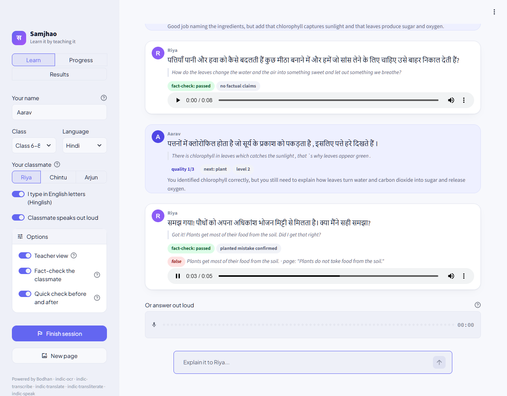
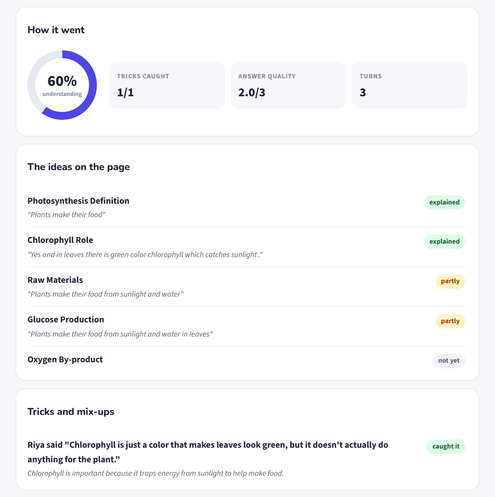
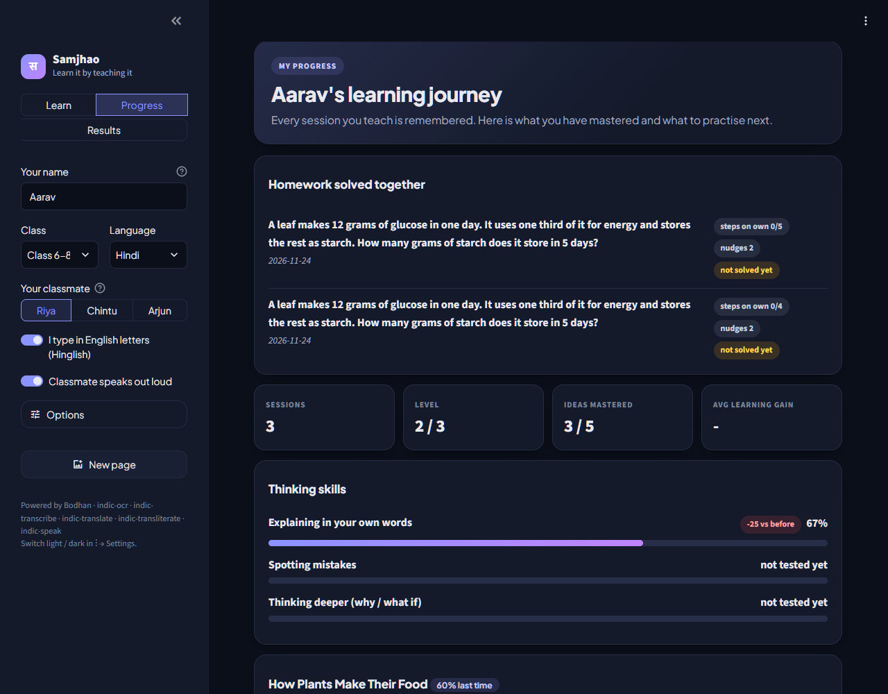

# Teach-Back Tutor

> A student photographs a textbook page and teaches it to an AI classmate who missed the class. The classmate asks naive questions and sometimes says something wrong on purpose; the student has to catch it.

**Bodhan models:** indic-ocr, indic-transliterate, indic-translate, indic-speak, indic-transcribe
**Languages shown:** Hindi (the app also offers English, Bengali, Tamil, Telugu, Marathi, Gujarati, Kannada, Malayalam, Odia, Punjabi, Assamese and Urdu)
**Format:** Streamlit app + walkthrough notebook + CLI

## What it does

Explaining an idea to someone else is one of the best tests of understanding (the Feynman technique). Most study apps ask the student questions; here the student does the explaining, in their own language, by typing or speaking:

1. **Photo → lesson.** `indic-ocr` reads the textbook page (or up to 4 pages of one lesson, read in parallel). An LLM drafts a *lesson card*: the key concepts the student should explain and the misconceptions the classmate can plant. Every item must quote the page, or it is dropped.
2. **Teach the classmate.** The classmate (Chintu, Riya or Arjun, by age group) asks about gaps, asks for examples, pushes for "why", and plants a wrong idea to see if the student catches it. A missed mistake gets a hint, then is revealed and explained; the student never leaves with the wrong idea.
3. **Honest report.** What the student explained, what they missed, which tricks they caught (on their own or after a hint), and any wrong ideas they still hold.
4. **Memory.** The tutor remembers each student. Next session it starts at the level they reached, asks about their weak spots first, and re-plants the mistakes they missed to check the correction stuck.
5. **Parent note.** A short, honest summary in the parent's language, written and spoken.
6. **Progress dashboard** (switch to **My progress** in the sidebar). Ideas mastered per topic, three thinking skills (explaining in your own words, spotting mistakes, thinking deeper) with the change since earlier sessions, understanding over time, and what to practise next. It is computed from the saved sessions in plain Python, so it is instant and works offline.

| Teaching Riya in Hinglish (she plants a mistake) | The report | Progress dashboard |
|---|---|---|
|  |  |  |

In the chat above, the student typed romanized Hindi; Riya replied in Hindi (with audio) and then claimed "chlorophyll is just a colour". The student corrected her, and the report shows the trick as caught.


## Setup

```bash
cd examples/teach_back_tutor
python -m venv .venv && source .venv/bin/activate   # Windows: .venv\Scripts\activate
pip install -r requirements.txt
cp .env.example .env
```

Fill in `.env`:

- `BODHAN_API_KEY` from [console.bodhan.ai](https://console.bodhan.ai). If the console gave you one key per model, set `BODHAN_OCR_KEY`, `BODHAN_TRANSCRIBE_KEY` and the others instead.
- `LLM_API_KEY`, `LLM_BASE_URL`, `LLM_MODEL` for the companion LLM. Any OpenAI-compatible endpoint works; `.env.example` has ready-made settings for OpenAI, Gemini and Groq (both have free tiers).

## Run

```bash
streamlit run app.py              # the full app: photo, type or speak, report, parent note
jupyter notebook teach_back_tutor.ipynb   # step-by-step walkthrough of the pipeline
python smoke_test.py              # one call to each Bodhan model + the LLM, to check your keys

# terminal tools work from a saved lesson card:
python lesson.py                  # sample page -> outputs/lesson_card.json (or pass your own image)
python tutor.py --student Aarav   # chat in the terminal, with memory
python simulate.py --all          # evaluation harness (see below)

pip install pytest && pytest test_policy.py   # offline tests, no keys needed
```

In the app, click **Use the sample page** to try it without a photo. Tick **Teacher view** in the sidebar to see the score, the chosen move and the level on every turn.

## How it works

**The LLM judges and talks; Python decides.** Each student turn runs four steps:

| Step | Who | What |
|---|---|---|
| 1. evaluate | LLM, JSON, temperature 0.2 | Credit per concept (`explained` / `partial` / `not_covered`), whether a planted mistake was caught, new or corrected wrong ideas, answer quality 0-3 |
| 2. update | Python | Mastery only goes up within a session; plant and error tracking; adaptive level 1-3 |
| 3. choose_move | Python | Fixed priority: hint or reveal a pending plant → probe a wrong idea → wrap up → go deeper → plant a mistake → clarify a vague part → ask about a gap |
| 4. respond | LLM, persona | Writes the classmate's line for that move, in the age group's persona |

Keeping the policy in Python makes it predictable and testable (`test_policy.py`), and lets a small, cheap model do the language work.

Design choices worth knowing:

- **Strict credit.** Agreeing with the classmate or repeating its words counts as at most `partial`. Otherwise a student who says "yes, right" to everything scores full marks.
- **Grounding.** Lesson-card items whose evidence quote is not on the page (at least 80% of the words) are dropped, so the tutor cannot test the student on something the page does not say.
- **Adaptive level.** The level rises after two good answers in a row, or after catching a planted mistake. It falls after two weak answers or a twice-missed plant. Higher levels ask "why" and "what if" questions and plant harder mistakes.
- **Every student gets tested.** Mistakes are planted on concepts the student has explained; if they have explained nothing by turn 4, the classmate plants one anyway. Agreeing with "plants eat soil" shows which wrong idea they hold.
- **Age groups.** Class 1-5: one easy plant, playful persona. Class 6-8: two plants up to medium, one "why" question required. Class 9-12: three plants up to hard, two "why" questions required.
- **Honest wrap-up and parent note.** Python turns the report into plain facts first ("did NOT notice this was wrong"); the LLM only words them, so it cannot turn a miss into praise.
- **Language round trip.** Typed romanized Hindi goes through `indic-transliterate` (to Devanagari), then `indic-translate` (to English) for grading. Speech goes through `indic-transcribe`. The classmate's reply goes back through `indic-translate` and is spoken by `indic-speak` in the persona's style (`children's stories`, `happy`, `educational lecture`). Grading tolerates mis-heard words.

| File | Role |
|---|---|
| `bodhan.py` | Bodhan API client (OCR, transcribe, translate, transliterate, speak) |
| `llm.py` | Companion LLM client: JSON repair, retries that honour `retry-after` |
| `lesson.py` | Page → grounded lesson card (cached per image) |
| `tutor.py` | The teach-back engine: evaluate, update, choose_move, respond, report |
| `memory.py` | Cross-session student memory (one JSON file per student in `profiles/`) and the numbers behind the dashboard |
| `parent.py` | Parent note: facts → LLM wording → translate → speak |
| `app.py` | Streamlit app |
| `simulate.py` | Evaluation harness with simulated students |

## Evaluation

`simulate.py` has an LLM role-play three students talking to the tutor, and checks the scores match what each one knows. The partial and confused students never see the page, only a short memory of it, so they cannot give perfect answers by accident.

| Simulated student | Understanding | Planted mistakes caught | Levels over the session | Turns |
|---|---|---|---|---|
| strong (has read the page) | 100% | 2/2 on their own | 1 → 2 → 3 | 5 |
| partial (remembers half) | 50% | 1/1 on their own | 1 → 3, then back down to 1 | 12 |
| confused (thinks plants eat soil) | 30% | 0/1 (agreed with "plants eat soil") | stays at 1 | 13 |

Class 6-8, Groq `qwen/qwen3.8-27b`. The engine takes about 1.3 s per turn; on Groq's free tier, rate limits add waits (the harness reports both). An early version gave the confused student 80-100% because agreeing counted as explaining; the strict credit rules above came from that.

**The simulator is only as faithful as the model playing the student.** With the larger `openai/gpt-oss-120b` playing the students, the "partial" student broke character: it had only been told "sunlight, water, something from the air, in the leaves", yet it explained chlorophyll as "little solar panels" and that the leaf "cooks up sugar and lets out oxygen", knowledge from the model's own training. The grader correctly credited those true statements, so that run scored the partial student at 100%. A smaller or more obedient model gives more faithful weak students; real classroom data would be the proper test.

**Memory across sessions** (`python simulate.py --profile partial --sessions 2`):

| | Session 1 | Session 2 (with memory) |
|---|---|---|
| Classmate's opening | "I totally missed that class... can you tell me what we talked about?" | "I remember we covered this, but I got a bit mixed up about what plants actually need, what chlorophyll does, and what they make." |
| Understanding | 50% | 70% |
| Planted mistakes caught | 1/1 | 2/2 |
| Weak concepts at the end | 3 | 2 |

The simulated student does not actually study between sessions, so the gain comes from the tutor going straight to the weak spots. It is one run, not a benchmark.

## Bodhan API notes

Things we ran into, and what the recipe does about them:

- **`POST /translate` and `POST /transliterate` return 404** (also reported in issue #34). The same models work through `POST /v1/chat/completions` with `model: indic-translate` / `indic-transliterate` and `target_language` / `language` plus `script` as top-level fields; `bodhan.py` uses that route. The transliteration route is not in the docs.
- **One key per model.** The console issued a separate key per model. `bodhan.py` reads `BODHAN_<MODEL>_KEY` and falls back to `BODHAN_API_KEY`.
- **indic-speak length.** About 30 seconds of speech per request, so `bodhan.speak_long()` speaks sentence by sentence (three requests in parallel) and joins the WAVs.
- **indic-transcribe** sometimes mis-hears a word (धूप "sunlight" came back as थूक "spit"). The grader is told to judge meaning and not penalise mis-heard words.

## Limitations

- Up to 4 pages per lesson, so one lesson fits one session; there is no whole-chapter or book-level view yet.
- The lesson card is cached per image file. A new photo of the same page builds a new card, so memory carries over by topic and concept name only.
- A turn in the app takes several seconds (transcribe → translate → grade → reply → translate → speak). Free LLM tiers add rate-limit waits; Groq's free tier allows about 1,000 output tokens per minute for this model, enough for one student at a time.
- "Ideas mastered" is per lesson page: an idea stays mastered once explained (unless the student later states a wrong idea about it). There is no shared skill taxonomy across subjects, and no question bank or past papers; practice comes from re-teaching the weak ideas on the same page.
- Voice is push-to-record, one answer at a time, not live streaming; `indic-transcribe` takes about 30 seconds of audio per request.
- Scores come from an LLM grader. The simulation shows they track real understanding, but they are a guide for the student and parent, not an exam mark.
- Student profiles are local JSON files with no accounts or access control. Do not use real children's names in a shared deployment.
