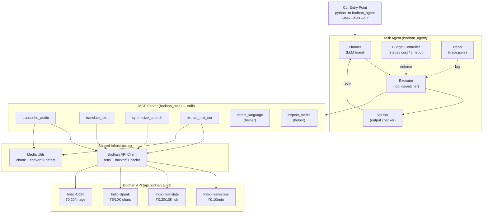
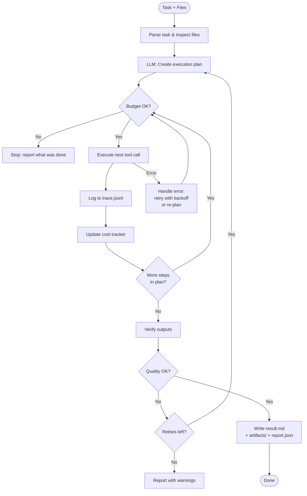

# Bodhan Tool Server & Task Agent

> MCP server exposing Bodhan's four Indic models as tools, plus a task agent that uses them to complete multi-step language tasks.

**Assignment:** [Agentic Engineer Take-Home — Bodhan AI](https://github.com/Bodhan-AI/Bodhan-AI-Cookbook)  
**Author:** Balavignesh A.U ([@Bala1415](https://github.com/Bala1415))  
**Branch:** `assignment/tool-agent-Bala1415`

---

## Quick Start

```bash
# Clone and setup
git clone https://github.com/Bala1415/Bodhan-AI-Cookbook.git
cd Bodhan-AI-Cookbook/examples/tool-agent-Bala1415
cp .env.example .env   # Fill in your API keys
pip install -e ".[dev]"

# Run the task agent
python -m bodhan_agent \
  --task "Transcribe this Hindi voice note and give me English subtitles" \
  --files path/to/inputs/ \
  --out ./out

# Run the MCP server standalone (stdio)
python -m bodhan_mcp
```

## System Dependencies

- **Python** ≥ 3.10
- **ffmpeg** — required for audio chunking (`winget install -e --id Gyan.FFmpeg` on Windows, `apt install ffmpeg` on Linux)

## Architecture



## Agent Flow



## Tool Design

| Tool | Model | Cost | Why This Granularity | Handles Internally |
|------|-------|------|---------------------|-------------------|
| `transcribe_audio` | Indic-Transcribe | ₹0.10/min | 1:1 with model — clear for 3rd-party clients | Auto-chunks >30s, format validation, language detection |
| `translate_text` | Indic-Translate | ₹0.20/10K tok | 1:1 with model — explicit source/target | Chunks >32K context, language validation, markdown preservation |
| `synthesize_speech` | Indic-Speak | ₹6/10K chars | 1:1 with model — voice selection explicit | Chunks long text, concatenates audio, labels as AI-generated |
| `extract_text_ocr` | Indic-OCR | ₹0.20/image | 1:1 with model — handles PDFs transparently | PDF→images, per-page OCR, merges markdown |
| `detect_language` | None (pure code) | Free | Essential helper — no API cost | Unicode script analysis, Devanagari disambiguation |
| `inspect_media` | None (pure code) | Free | Planner needs file metadata | File type, duration, page count, dimensions |

**Why 1:1 mapping?** The evaluators connect their own MCP client, so clear per-model tools with self-documenting schemas maximize usability. The helpers (`detect_language`, `inspect_media`) give the planner free intelligence before expensive calls.

## Where the LLM Is Used, and Why

| Decision Point | What It Decides | Fallback |
|---------------|----------------|----------|
| Task analysis | Understanding what the user wants | N/A — required |
| Tool selection | Which tool to call next with what args | Structured function calling |
| Result interpretation | Whether output is satisfactory | Verification checks |
| Error recovery | Whether to retry, re-plan, or stop | Budget controller forces stop |
| Impossible task detection | Whether a task can be done at all | Known unsupported languages list |

The LLM **never** writes Indian-language text, transcribes audio, reads images, or generates speech.

## Bodhan Models Used

| Model | Hosted/Self-hosted | Settings |
|-------|--------------------|----------|
| Indic-Transcribe | Hosted (api.bodhan.ai) | Default |
| Indic-Translate | Hosted (api.bodhan.ai) | Default, 32K context |
| Indic-Speak | Hosted (api.bodhan.ai) | Default voices per language |
| Indic-OCR | Hosted (api.bodhan.ai) | table_format=markdown, max_tokens=4096 |

## Configuration

Environment variables (see `.env.example`):

| Variable | Purpose |
|----------|---------|
| `BODHAN_TRANSCRIBE_KEY` | Indic-Transcribe API key |
| `BODHAN_TRANSLATE_KEY` | Indic-Translate API key |
| `BODHAN_SPEAK_KEY` | Indic-Speak API key |
| `BODHAN_OCR_KEY` | Indic-OCR API key |
| `LLM_BASE_URL` | OpenAI-compatible LLM endpoint |
| `LLM_MODEL` | LLM model name (tested with `gemini-2.0-flash`) |
| `LLM_API_KEY` | LLM API key |

## Output Layout

Each task run produces:

```
out/
  result.md        # What was done, final answer, assumptions
  artifacts/       # Files produced: audio, subtitles, Markdown
  trace.jsonl      # One line per step: plan, tool, args, result, latency, cost
  report.json      # Status, steps, verification results, total cost and time
```

## Testing

```bash
make test         # All tests
make test-unit    # Unit tests only (no API calls)
make test-e2e     # End-to-end tests (requires API keys)
make check        # Lint + test
```

## MCP Client Compatibility

The MCP server works with any stdio-based MCP client. Tested with the `mcp` Python SDK.

To connect from another MCP client:
```json
{
  "mcpServers": {
    "bodhan": {
      "command": "python",
      "args": ["-m", "bodhan_mcp"],
      "cwd": "/path/to/this/repo"
    }
  }
}
```

## Trade-offs and Known Limitations

- **No streaming HTTP transport** — stdio only (stretch goal not implemented)
- **Indic-Speak sometimes repeats/omits content** — mitigated by back-transcription verification
- **Only English ↔ 22 scheduled Indian languages** — French, Spanish, etc. result in clear error
- **ffmpeg required** for audio processing — documented in setup
- **OCR processes one page per API call** — sequential, not parallel (to respect concurrency limits)
- **Voice library is a subset** — only most common voices are cataloged; model accepts others

## Cost and Runtime

| Task Type | Estimated Cost | Estimated Runtime |
|-----------|---------------|-------------------|
| Transcribe 3-min audio | ~₹0.30 | ~15s |
| Translate 1-page text | ~₹0.01 | ~5s |
| OCR 8-page PDF | ~₹1.60 | ~30s |
| TTS 500 chars | ~₹0.30 | ~10s |
| Multi-step (OCR+Translate+TTS) | ~₹2–5 | ~1–3 min |

## AI Assistance

This project was built with the assistance of Google Antigravity (Gemini/Claude-based coding agent), used for code generation, architecture planning, and documentation. Every line was reviewed and understood by the author.
