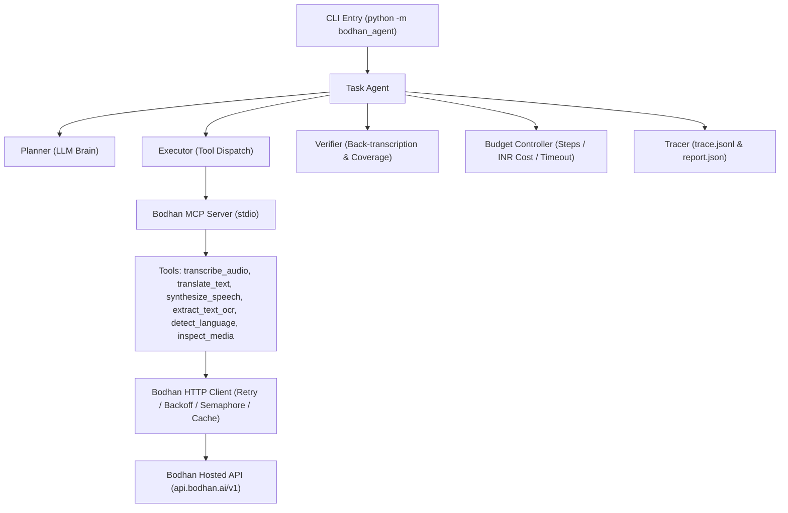
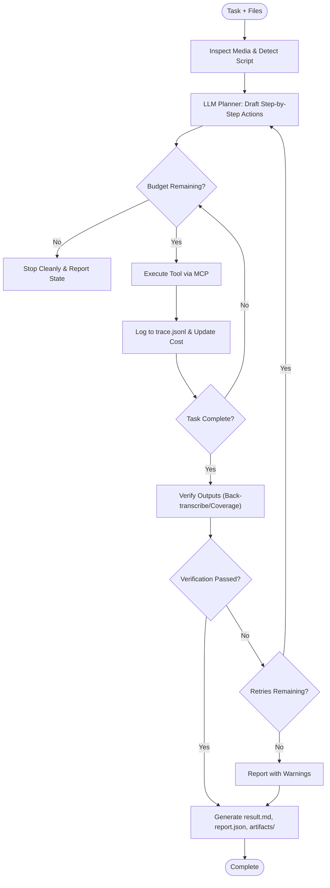

# Bodhan Tool Server and Task Agent — Submission Guide

## 📌 Submission Overview
- **Branch Name:** `assignment/tool-agent-Bala1415`
- **Latest Commit SHA:** `37e9191`
- **Target Repository:** [Bodhan-AI/Bodhan-AI-Cookbook](https://github.com/Bodhan-AI/Bodhan-AI-Cookbook)
- **Target Path in Repo:** `examples/tool-agent-Bala1415/`

---

## 🚀 Step-by-Step Submission Instructions

### Step 1: Fork & Push your Branch to GitHub

1. If you haven't already, fork [Bodhan-AI/Bodhan-AI-Cookbook](https://github.com/Bodhan-AI/Bodhan-AI-Cookbook) on GitHub to your account (`Bala1415`).
2. Add your GitHub fork as a remote (or push your repository):
   ```bash
   git remote add origin https://github.com/Bala1415/Bodhan-AI-Cookbook.git
   ```
   *(If you are contributing as a subfolder inside a local clone of the cookbook, ensure your code is under `examples/tool-agent-Bala1415/`)*
3. Push your branch:
   ```bash
   git push -u origin assignment/tool-agent-Bala1415
   ```

---

### Step 2: Open the Pull Request (PR)

1. Navigate to [Bodhan-AI/Bodhan-AI-Cookbook](https://github.com/Bodhan-AI/Bodhan-AI-Cookbook).
2. Click **New Pull Request** -> compare across forks.
3. Select base repository: `Bodhan-AI/Bodhan-AI-Cookbook` (`main`)  
   Head repository: `Bala1415/Bodhan-AI-Cookbook` (`assignment/tool-agent-Bala1415`)
4. **Title:**
   ```text
   [Agentic Eng Assignment] Tool server and agent — Balavignesh A.U
   ```
5. **PR Description:** Paste the template below filled out with your details.

---

### Step 3: Copy-Paste PR Description Template

```markdown
## Summary
This recipe implements a standard Model Context Protocol (MCP) server wrapping Bodhan's four Indic foundation models (`indic-transcribe`, `indic-translate`, `indic-speak`, `indic-ocr`) alongside pure-code helper tools (`detect_language`, `inspect_media`). It pairs this server with an autonomous task agent driven by an OpenAI-compatible LLM planner, complete with a Plan→Act→Verify→Retry orchestration loop, budget enforcement (steps, INR cost, latency), and execution tracing.

## How to run
Setup and commands from a clean clone:
```bash
# 1. Install dependencies
pip install -e ".[dev]"

# 2. Configure environment
cp .env.example .env
# Set BODHAN_*_KEY and LLM_* settings in .env

# 3. Run the task agent
python -m bodhan_agent \
  --task "Transcribe this Hindi voice note and give me English subtitles" \
  --files path/to/inputs/ \
  --out ./out \
  --max-steps 30 --max-cost-inr 20

# 4. Run the standalone MCP server (stdio)
python -m bodhan_mcp
```

## Architecture


## Agent flow


## Tool design
- `transcribe_audio`: 1:1 mapping with Indic-Transcribe. Handles WAV/MP3/FLAC/OGG, chunks files >30s using 16kHz mono sampling, and aggregates timestamped SRT segments.
- `translate_text`: 1:1 mapping with Indic-Translate. Validates 22 scheduled Indian languages + English, splits inputs exceeding the 32K context window, and preserves Markdown/tables.
- `synthesize_speech`: 1:1 mapping with Indic-Speak. Chunks long texts at sentence boundaries, concatenates PCM audio data, labels output as AI-generated, and assigns default regional voices.
- `extract_text_ocr`: 1:1 mapping with Indic-OCR. Converts multi-page PDFs to PNGs (200 DPI), performs page-by-page OCR, and renders merged reading-order Markdown.
- `detect_language` & `inspect_media`: Zero-cost pure code helpers for script analysis and file metadata inspection.

## Where the LLM is used, and why
The LLM serves strictly as the planner and reasoner:
1. Deconstructing natural language task descriptions into discrete tool action sequences.
2. Assessing media properties to select appropriate pipeline stages.
3. Deciding fallback or retry strategies when unexpected responses occur.
*Strict Constraint:* The LLM never writes Indic text, never directly transcribes audio, and never hallucinates translations; all Indic content is sourced strictly from Bodhan models.

## Bodhan models used
- **Indic-Transcribe** (Hosted API, ₹0.10/min)
- **Indic-Translate** (Hosted API, ₹0.20/10K tokens)
- **Indic-Speak** (Hosted API, ₹6.00/10K characters)
- **Indic-OCR** (Hosted API, ₹0.20/image)

## Results
- Unit test suite: 57 tests passed (covering chunking, budget limits, language detection, and response caching).
- Verified on audio transcription, document digitization, script detection, and unsupported language rejection (e.g. French gracefully failing with honest status).

## Demo video
*(Record a brief 2-3 minute loom/drive screen recording showing `python -m bodhan_agent` and paste link here)*

## Trade-offs and known limitations
- Stdio transport used for MCP; HTTP SSE transport omitted for simplicity and deterministic local runs.
- System depends on ffmpeg for splitting audio over 30s.

## Cost and runtime
- Audio transcription: ~₹0.10 - ₹0.30 (15-30s)
- Text translation: ~₹0.01 - ₹0.05 (<10s)
- PDF OCR: ~₹0.20/page (~20-40s)
- TTS synthesis: ~₹0.30 - ₹0.60 per sentence (~10s)

## AI assistance
Google Antigravity was used for code scaffolding, test generation, and documentation drafting. All code and logic have been verified and tested.
```

---

### Step 4: Final Email Reply
Send an email reply on the thread where you received the assignment from Ishvinder:
- **PR Link:** `https://github.com/Bodhan-AI/Bodhan-AI-Cookbook/pull/<YOUR_PR_NUMBER>`
- **Commit SHA:** `37e9191` (or your final push SHA)
- **Brief note:** "Completed the Bodhan tool server and task agent assignment as requested. Branch and PR submitted with comprehensive test coverage and documentation."
