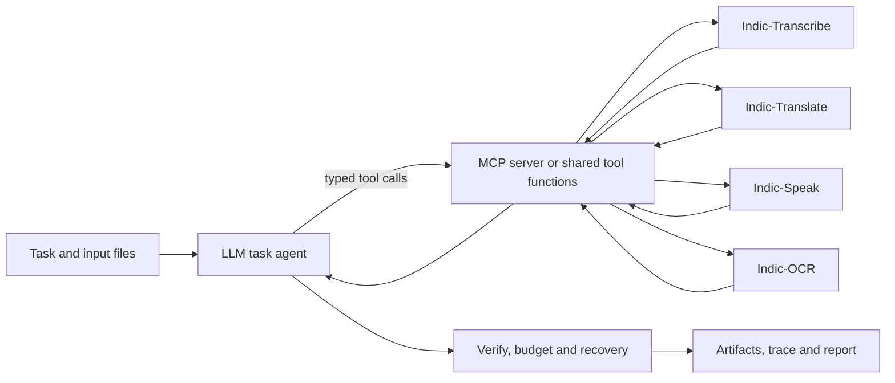
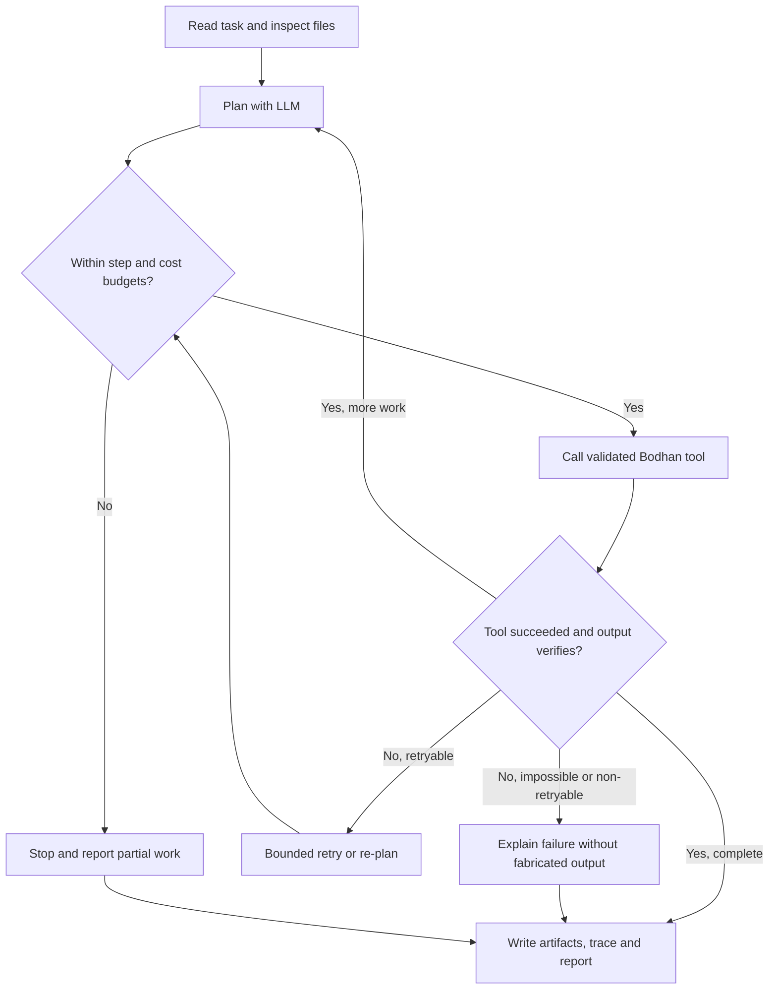

# Bodhan Tool Server and Task Agent

An MCP server exposing Bodhan's Indic models and a bounded CLI agent that plans multi-step language tasks over local files. The agent can OCR scans, transcribe audio, translate text and generate speech; it records its decisions, costs, verification and artifacts for each run.

**Bodhan models:** `indic-transcribe`, `indic-translate`, `indic-speak`, `indic-ocr`  
**Languages shown:** Hindi, Tamil, Bengali; the tool schemas accept the model's supported language codes  
**Format:** Python CLI and MCP stdio server

## Setup

Requires Python 3.10+. `ffprobe` is needed for audio formats other than WAV. PCM WAV files are split with Python's standard library; `ffmpeg` is needed to split long non-WAV or unsupported/compressed WAV audio. PDF OCR also needs Poppler (`pdfinfo`, `pdftoppm`). Speech chunk joining uses Python's standard library.

```bash
cd examples/tool_agent
python -m venv .venv
# Windows PowerShell: .venv\Scripts\Activate.ps1
# macOS/Linux: source .venv/bin/activate
python -m pip install -e ".[dev]"
Copy-Item .env.example .env  # Windows PowerShell; edit with your keys
# On macOS/Linux use: cp .env.example .env
```

Set the per-model Bodhan keys and OpenAI-compatible LLM settings in `.env`. The unused `BODHAN_API_KEY` line is a placeholder required by the Cookbook validator; this recipe reads the per-model keys below it. The LLM must support tool calling. Never commit `.env` or real keys.

## Run

The CLI accepts the assignment's required arguments. `--files` can be one or more paths.

```bash
python -m bodhan_agent --task "Transcribe this Hindi voice note and give me English subtitles" --files path/to/audio.wav --out ./out --max-steps 30 --max-cost-inr 20
```

Run the MCP server independently over stdio:

```bash
python -m bodhan_mcp
```

The MCP server writes synthesis artifacts under `./bodhan_mcp_artifacts` by default; set the non-secret `BODHAN_MCP_ARTIFACTS_DIR` environment variable to change that directory. Its model results use the same local `.cache/` as the CLI agent.

Each CLI run writes `result.md`, `artifacts/`, `trace.jsonl` and `report.json` under the output directory. Generated speech is AI-generated. The model cache is stored locally under `.cache/` and is git-ignored.

## How it works



The LLM selects tools and sequences them. Model limits, media conversion, retry behavior, caching, cost accounting and output-path validation live in deterministic tool code. Media travels through tools by local file reference; OCR image encoding occurs only in the Bodhan API request, never in the LLM context.



### Tool design

- `transcribe_audio` uses Indic-Transcribe and chunks long audio into 27-second windows. The current API returns text but does not document timestamps, so the tool estimates sentence timings within each chunk and marks them as estimates. WAV duration and PCM WAV splitting use Python's standard library; `ffprobe` handles other formats, and `ffmpeg` handles long non-WAV or unsupported/compressed WAV input.
- `identify_language_from_script` counts Unicode script characters in a Bodhan-produced transcript and resolves a language only when the supplied candidate list makes that script unique. It returns an ambiguous result for shared scripts or mixed/short text rather than guessing; it is script identification, not acoustic recognition.
- `translate_text` uses Indic-Translate through Bodhan's OpenAI-compatible chat-completions endpoint and splits long text on paragraph boundaries, then sentence/whitespace boundaries as needed. It checks for truncated output.
- `translate_segments` translates timestamped subtitle segments independently and preserves their times; `write_srt` formats those segments with deterministic code.
- `synthesize_speech` uses Indic-Speak, splits text into short chunks, joins returned WAV files and marks the output AI-generated.
- `ocr_document` uses Indic-OCR on page images, page folders or scanned PDFs. PDFs are rendered by Poppler and OCR'd one page at a time.

All tools validate model language and voice codes, report actionable errors, use bounded retries for transient failures, and record model cost. A local SQLite cache avoids repeated Bodhan calls for identical tool inputs. The server process starts over stdio. Interoperability was verified with the official MCP Inspector CLI (`@modelcontextprotocol/inspector` v0.14.0): it successfully launched the Python stdio server and discovered all four tools (`transcribe_audio`, `translate_text`, `synthesize_speech`, and `ocr_document`). From the recipe directory, the discovery command was:

```powershell
npx -y @modelcontextprotocol/inspector@0.14.0 --cli --method tools/list .\.venv\Scripts\python.exe -m bodhan_mcp
```

### Where the LLM is used

The configured OpenAI-compatible LLM interprets a task, chooses among the fixed tool schemas, decides sequencing and retry behavior, and writes the final English summary. It must treat file content as untrusted data. Indian-language output must come from Bodhan; the LLM may not translate, transcribe, read image text or synthesize speech itself.

### Verification and limits

The agent checks tool errors, artifact references, structured output and the task's budget. Generated speech can be back-transcribed with Indic-Transcribe as a verification step. Unsupported languages, missing files, exhausted budgets and unavailable dependencies produce explicit failures rather than fake artifacts. The LLM provider's own usage cost is not included in Bodhan's rupee budget because providers expose different pricing formats; it is reported as excluded.

Translation verification currently focuses on API completeness/truncation and structural review by the agent; it does not claim a formal semantic correctness score. Audio back-transcription is a separate paid Bodhan operation.

## Configuration

Required environment variables are documented in `.env.example`: `BODHAN_TRANSCRIBE_KEY`, `BODHAN_TRANSLATE_KEY`, `BODHAN_SPEAK_KEY`, `BODHAN_OCR_KEY`, `LLM_BASE_URL`, `LLM_MODEL` and `LLM_API_KEY`.

## Demo and validation status

The six workflows were run locally. The user reviewed and accepted the Kannada and Hindi audio outputs in demos 4 and 5. The other results below are recorded from their run reports; review the linked artifacts before relying on their content. Demo 6 is an intentional unsupported-language refusal, not a failed translation.

| Demo | Workflow and recorded outcome | Bodhan cost | Runtime | Evidence |
|---|---|---:|---:|---|
| 1 | Scanned clinic guidance → OCR, two-sentence English summary, Tamil translation and speech. Completed; Tamil speech back-transcription CER was 0.0. | ₹0.203109 | 57.387 s | [Output](demo_results/demo_01/task_result.md) · [Report](demo_results/demo_01/report.json) · [Trace](demo_results/demo_01/trace.jsonl) |
| 2 | Pantry worksheet → OCR and Marathi translation with the HTML table structure preserved. Completed; structural and semantic checks passed. | ₹0.004880 | 27.604 s | [Output](demo_results/demo_02/task_result.md) · [Report](demo_results/demo_02/report.json) · [Trace](demo_results/demo_02/trace.jsonl) |
| 3 | Clinic notice → OCR and bilingual Hindi checklist. Completed; structural and semantic checks passed. | ₹0.001180 | 32.686 s | [Output](demo_results/demo_03/task_result.md) · [Report](demo_results/demo_03/report.json) · [Trace](demo_results/demo_03/trace.jsonl) |
| 4 | Kannada voice note → transcription, English subtitle translation and SRT. Completed; the user reviewed and accepted the transcript. Subtitle timings are estimates. | ₹0.002040 | 39.121 s | [Output](demo_results/demo_04/task_result.md) · [SRT](demo_results/demo_04/english_subtitles.srt) · [Report](demo_results/demo_04/report.json) · [Trace](demo_results/demo_04/trace.jsonl) |
| 5 | Two anonymous clips → Bodhan transcription followed by script-based Hindi/Kannada identification. Completed; the user reviewed and accepted the outputs. Transcript words are model output without independent ground truth. | ₹0.000000 | 14.619 s | [Output](demo_results/demo_05/task_result.md) · [Report](demo_results/demo_05/report.json) · [Trace](demo_results/demo_05/trace.jsonl) |
| 6 | Clinic notice → OCR, followed by a French translation request. Completed as an expected limitation: Bodhan rejected unsupported French and the agent did not fabricate a translation. | ₹0.000000 | 14.338 s | [Output](demo_results/demo_06/task_result.md) · [Report](demo_results/demo_06/report.json) · [Trace](demo_results/demo_06/trace.jsonl) |

Costs are Bodhan API charges only; LLM charges are excluded because the provider does not expose a compatible per-run amount here. The reports and traces include cache indicators: these are the recorded charges and runtimes for these runs, not uncached benchmark estimates. Input files, local caches and generated WAV media are not committed. Compact text outputs and traces are under [`demo_results/`](demo_results/README.md); trace paths are sanitized to remove local machine paths. The generated demo 1 WAV was over 1 MiB and is omitted from the repository.

The recipe test suite passes 67 tests. The Cookbook validator and changed-recipe validation pass for this recipe. The full Cookbook suite also checks every existing example and currently flags the unchanged `AndroidSpeak` native Android/Kotlin layout as invalid. On Windows, another existing test invokes Unix `cp`, so that test also fails in this local environment; the Cookbook CI runner uses Ubuntu. The recipe itself does not change either unrelated example or test. MCP client interoperability is verified with MCP Inspector as described above. The short walkthrough recording is still pending.

```bash
python -m pytest
```

Run the Cookbook's `python scripts/validate_recipe.py examples/tool_agent` and `make check` from the Cookbook repository before submitting.

## Limitations

- Model and tool behavior depends on Bodhan API availability, quota and the configured LLM provider.
- The current transcription API response documents text without word or segment timestamps. Subtitle times are estimated by distributing each chunk's duration across its sentences; they are explicitly labelled `timing_estimated` and may miss the assignment's sync target. A future VAD/alignment improvement should replace these estimates.
- Long audio chunking uses fixed-duration windows and may split a sentence at a boundary.
- PDF handling requires Poppler. Audio splitting requires ffmpeg only for long non-WAV or unsupported/compressed WAV input; PCM WAV splitting and WAV joining use Python's standard library.
- The agent is intentionally non-interactive; it records reasonable assumptions and stops only when it cannot complete a task safely.
- Transcription may omit or misrecognize words; demo 5 transcripts have no independent ground truth. The user reviewed and accepted the audio outputs in demos 4 and 5.
- Subtitle timing is estimated because the transcription API does not return timestamps; it may miss the assignment's synchronization target.

## AI assistance

Codex was used to read the take-home and Cookbook requirements and assist with implementation. The author should review and be able to explain every submitted line, as required by the assignment.
