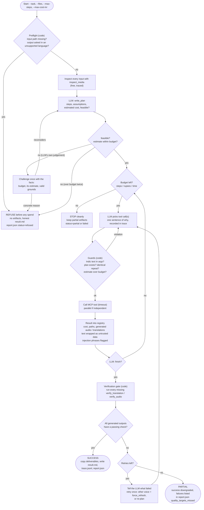

# Agent loop

## Where the model stops and code starts

| Decision | Who | Why |
|---|---|---|
| Which tools to call, in what order, with which language/voice | LLM | Needs understanding of the request. |
| Summaries and English text to be translated | LLM | Only English; never Indian-language text. |
| Judging an ambiguous request (assumptions) | LLM | Recorded under *Assumptions*. |
| Refusing missing files / unsupported target languages | Code | Cheap, certain, and must happen before any spend. |
| Budget, timeouts, retries, caching, deduplication | Code | Must hold even if the model misbehaves. |
| Rejecting Indian-language text written by the LLM | Code | Structural enforcement of the ground rule. |
| Declaring success | Code | Only when every generated output has a passing verification. |
