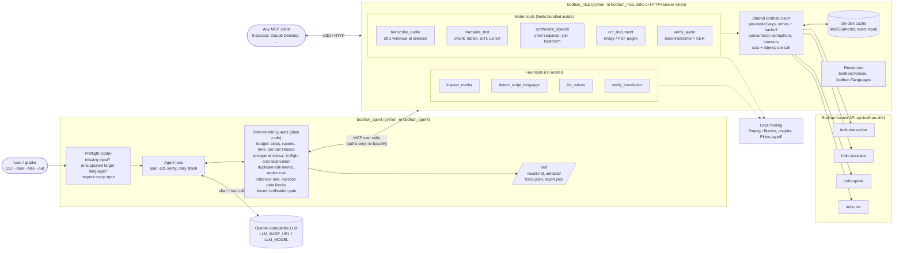

# Architecture

## One line per part

| Part | Role |
|---|---|
| **MCP server** (`src/bodhan_mcp/`) | Nine typed tools + two resources. Validates input, handles each model's limits, returns structured results or structured errors. Works with any MCP client, with or without the agent. |
| **Shared client** (`client.py`, `cache.py`) | The only code that talks to Bodhan. Per-model keys, retry with exponential backoff, a global concurrency limit, per-call timeouts, a content-addressed cache, and cost/latency on every call. |
| **Agent** (`src/bodhan_agent/`) | An LLM-driven loop around the MCP tools. The LLM decides *what* to do; plain code enforces *what is allowed*. |
| **Guards** (`guards.py`) | Budget, pre-spend refusal, Indic-text rule, injection scanning, unsupported-language refusal, verification gate. None of it can be argued away by the model. |
| **Outputs** | `result.md` (answer, assumptions, artifacts, verification, cost), `artifacts/`, `trace.jsonl` (one line per step), `report.json` (machine-readable summary, targets missed). |

All speech recognition, translation, speech synthesis and OCR go to the four Bodhan models through the server's tools. There is no other model of any of those kinds anywhere in the code, not even as a fallback.
