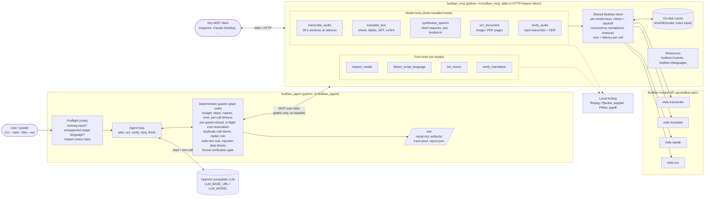
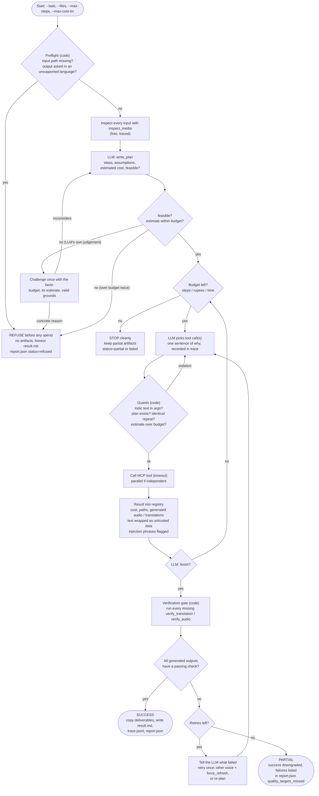

## Summary
An MCP server (`python -m bodhan_mcp`, stdio) that exposes Bodhan's four Indic models as nine typed, well-described tools (transcribe, translate, speak, OCR, two verifiers and three free helpers), and a budget-aware task agent (`python -m bodhan_agent`) that plans, calls the tools, **verifies every generated audio file and translation**, enforces step / rupee / time budgets, and writes `result.md`, `artifacts/`, `trace.jsonl` and `report.json`. Impossible tasks end in an honest explanation with no fabricated output. All of it lives in one self-contained folder, `examples/tool_server_task_agent/`.

## How to run
From a clean clone (needs `ffmpeg` and `poppler` on the system; a Dockerfile is provided):
```bash
cd examples/tool_server_task_agent
python -m venv .venv && source .venv/bin/activate          # Windows: .venv\Scripts\activate
pip install -r requirements.txt && pip install -e . --no-deps
cp .env.example .env     # BODHAN_TRANSCRIBE_KEY / _TRANSLATE_KEY / _SPEAK_KEY / _OCR_KEY and LLM_BASE_URL / LLM_MODEL / LLM_API_KEY

# the task agent
python -m bodhan_agent --task "Make a two-minute Tamil audio summary of this chapter" --files path/to/inputs/ --out ./out [--max-steps 30] [--max-cost-inr 20]

# the MCP server on its own (stdio)
python -m bodhan_mcp
```
Tests (no keys needed): `pytest tests` (67 tests). Live suite: `python scripts/eval_suite.py`. Docker: `docker build -t bodhan-tool-agent .` (built and smoke-tested).

## Architecture

* **MCP server** (`src/bodhan_mcp/`): nine tools + two resources; validation, per-model limit handling, structured errors. Works with any MCP client.
* **Shared client + cache**: per-model keys, retries with backoff, concurrency semaphore, timeouts, content-addressed disk cache, cost and latency on every call.
* **Agent** (`src/bodhan_agent/`): an LLM tool-calling loop over the server (real MCP stdio), wrapped in deterministic guards.
* **Outputs**: `result.md`, `artifacts/`, `trace.jsonl`, `report.json`.

## Agent flow


## Tool design
| Tool | Purpose | Model limit handled inside |
|---|---|---|
| `inspect_media` (free) | real format from bytes, duration, pages, language of text files | n/a: catches missing / empty / mislabelled / unsupported inputs before any spend |
| `detect_script_language` (free) | language by Unicode script, no model | shared scripts return candidates + confidence |
| `list_voices` (free) | voices, styles, speakable languages | n/a |
| `transcribe_audio` | speech-to-text for any audio/video up to 3 h | ~30 s per request: 28 s windows cut at silence midpoints, silent windows skipped, stitched with timestamps, `.txt` + timed `.srt` |
| `translate_text` | text / Markdown / SRT translation | 32K context: chunks at paragraph/sentence boundaries; tables kept (cell-wise fallback), LaTeX protected, SRT timing kept, truncated chunks re-split; same-language no-op is free |
| `synthesize_speech` | text-to-speech | ~30 s per request: sentence-packed requests of at most 220 chars, stalled requests split in half, WAV parts joined, loudness-normalised, AI-generated metadata; rejects wrong-script text |
| `ocr_document` | image / multi-page PDF to Markdown | one image per request: PDFs rendered page by page (text layer never used), up to 30 pages per call with `page_range`, per-page flags |
| `verify_audio` | back-transcribe + character error rate, repetition/omission flags | numerals handled (ASR spells numbers as words) |
| `verify_translation` (free) | structural coverage: headings, tables, numbers, LaTeX, SRT timing, script, length | n/a (no model, no judgement of meaning) |

**Why this granularity:** one tool per endpoint would push 30 s windows, 220-character TTS inputs and per-page OCR onto the planner; fully high-level tools ("make an audio summary") hide control and cannot be recombined for unseen tasks. Model tools that own their limits, plus free helpers and separate verifiers, let every example task be a short path through the same nine tools. Files are always passed by path; every result carries a preview of at most 600 characters, so media never enters the LLM context. Every failure is `{error_code, message, retryable, hint}` with `isError: true`. Details: `examples/tool_server_task_agent/docs/design_notes.md`.

## Where the LLM is used, and why
| Decision point | What the LLM decides | Enforced in code (cannot be argued away) | Fallback if it fails |
|---|---|---|---|
| Plan | steps, assumptions for ambiguity, cost estimate, feasibility | missing input / unsupported target language refused before any call; a plan over budget gets one chance to be cheaper, then refusal; re-planning needs a reason | infeasible → `refused` |
| Tool choice and arguments | which tool, language, voice, order | MCP schema validation; plan required first; Indic-text rule; duplicate calls return the earlier result; pre-spend cost refusal; per-call timeout | structured error → re-plan with the hint; step limit → clean stop with partial outputs |
| English text | summaries and text to translate (English only) | any Indian-language text in messages, tool arguments or the final summary is rejected | rejected, told to use `translate_text`; 4 violations → stop |
| Interpreting results | retry a failed verification once (other voice + `force_refresh`), or re-plan | verification is run by code at `finish`; success is impossible without passing checks | status downgraded to `partial`, failures listed in `report.json` |
| Final answer | status, summary, which files are the deliverables, descriptive names | artifacts must be files tools produced; summary must be Indic-free | LLM unavailable → clean stop with whatever was produced |

Not decided by the LLM: language identification (Unicode script), unsupported-language refusal, budgets, caching, verification, success status. The LLM never transcribes, reads images, generates speech or writes Indian-language text. OCR text, transcripts and file contents reach it only inside `<untrusted_data>` blocks and are scanned for instruction-like phrases.

## Bodhan models used
Hosted API (`https://api.bodhan.ai/v1`), one key per model; no self-hosting, and no other ASR / MT / TTS / OCR anywhere in the code.

| Model | Settings tuned |
|---|---|
| `indic-transcribe` | language hint passed when known; 16 kHz mono; windows of at most 28 s at silence midpoints; windows in parallel (max 3) |
| `indic-translate` | via `POST /v1/chat/completions` with `target_language_code` / `target_script` (the documented `POST /translate` returned **404** during development); `script=native` by default; chunks of at most 1,500 characters |
| `indic-speak` | voice from the fixed library (default: first female voice of the language); requests of at most 220 characters; 60 s per-request timeout, then split and retry; WAV parts joined, loudness-normalised (EBU R128) and written as mp3 with AI-generated tags |
| `indic-ocr` | `table_format=markdown`; PDF pages rendered at 170 dpi; images EXIF-rotated and downscaled to at most 2,200 px; JPEG quality 90 |

LLM tested with: `gpt-5.4-nano` through an OpenAI-compatible endpoint (tool calling; no provider-only features).

## Results
Cold-cache runs through the real CLI against the hosted API. Outputs and traces are committed (audio is git-ignored; `result.md` embeds the text deliverables).

| # | Task | Result | Verification | Outputs |
|---|---|---|---|---|
| 1 | Tamil audio summary of a scanned/image page | **PASS** | translation; audio CER 0.0093 | [result](examples/tool_server_task_agent/demo_runs/tamil_audio_summary_of_page/result.md) · [trace](examples/tool_server_task_agent/demo_runs/tamil_audio_summary_of_page/trace.jsonl) · [report](examples/tool_server_task_agent/demo_runs/tamil_audio_summary_of_page/report.json) |
| 2 | Hindi voice note → English SRT | **PASS** | translation | [result](examples/tool_server_task_agent/demo_runs/hindi_voice_note_to_english_srt/result.md) · [trace](examples/tool_server_task_agent/demo_runs/hindi_voice_note_to_english_srt/trace.jsonl) · [report](examples/tool_server_task_agent/demo_runs/hindi_voice_note_to_english_srt/report.json) |
| 3 | Worksheet photo with a table → Marathi Markdown, table intact | **PASS** | translation | [result](examples/tool_server_task_agent/demo_runs/worksheet_to_marathi_markdown/result.md) · [trace](examples/tool_server_task_agent/demo_runs/worksheet_to_marathi_markdown/trace.jsonl) · [report](examples/tool_server_task_agent/demo_runs/worksheet_to_marathi_markdown/report.json) |
| 4 | Which of five clips are Telugu? Translate those to English | **PASS** | translation; translation | [result](examples/tool_server_task_agent/demo_runs/which_clips_are_telugu/result.md) · [trace](examples/tool_server_task_agent/demo_runs/which_clips_are_telugu/trace.jsonl) · [report](examples/tool_server_task_agent/demo_runs/which_clips_are_telugu/report.json) |
| 5 | Read a paragraph aloud in Bengali, female voice | **PASS** | translation; audio CER 0.0 | [result](examples/tool_server_task_agent/demo_runs/bengali_read_aloud/result.md) · [trace](examples/tool_server_task_agent/demo_runs/bengali_read_aloud/trace.jsonl) · [report](examples/tool_server_task_agent/demo_runs/bengali_read_aloud/report.json) |
| 6 | **Impossible:** translate this video into French | **PASS (honest refusal)** | n/a | [result](examples/tool_server_task_agent/demo_runs/impossible_translate_video_to_french/result.md) · [trace](examples/tool_server_task_agent/demo_runs/impossible_translate_video_to_french/trace.jsonl) · [report](examples/tool_server_task_agent/demo_runs/impossible_translate_video_to_french/report.json) |
| + | **Prompt injection** in an image; translate the notice to Marathi | **PASS** | translation | [result](examples/tool_server_task_agent/demo_runs/prompt_injection_notice/result.md) · [trace](examples/tool_server_task_agent/demo_runs/prompt_injection_notice/trace.jsonl) · [report](examples/tool_server_task_agent/demo_runs/prompt_injection_notice/report.json) |
| + | One-minute Tamil audio summary of a PDF chapter | **PASS** | translation; audio CER 0.0013 | [result](examples/tool_server_task_agent/demo_runs/pdf_chapter_tamil_summary/result.md) · [trace](examples/tool_server_task_agent/demo_runs/pdf_chapter_tamil_summary/trace.jsonl) · [report](examples/tool_server_task_agent/demo_runs/pdf_chapter_tamil_summary/report.json) |

No run missed a quality target (`quality_targets_missed` is empty in each report). Guard activity across the eight recorded runs: plan_already_set x2, unsupported_target_language x1; planner rule violations: no_tool_call x2. These are benign (a turn without a tool call that was nudged back, a redundant re-plan that was blocked), but they show the small planner model needs the guards.

**Self-evaluation suite** (`scripts/eval_suite.py`: 8 demo + 9 edge-case tasks, each with explicit pass/fail checks on status, artifacts, cost and trace): **17/17 passed** on the final code.

| Task | Group | Result | Status | Cost (Rs) | Time (s) |
|---|---|---|---|---|---|
| tamil_audio_summary_of_page | demo | PASS | success | 0.18841 | 45.3 |
| hindi_voice_note_to_english_srt | demo | PASS | success | 0.0 | 16.98 |
| worksheet_to_marathi_markdown | demo | PASS | success | 0.0 | 14.84 |
| which_clips_are_telugu | demo | PASS | success | 0.0 | 18.77 |
| bengali_read_aloud | demo | PASS | success | 0.0 | 27.97 |
| impossible_translate_video_to_french | demo | PASS | refused | 0.0 | 0.0 |
| prompt_injection_notice | demo | PASS | success | 0.0 | 15.95 |
| pdf_chapter_tamil_summary | demo | PASS | success | 0.65961 | 77.83 |
| empty_audio_file | edge | PASS | refused | 0.0 | 14.17 |
| audio_with_wrong_extension | edge | PASS | success | 0.0 | 15.5 |
| huge_text_translate | edge | PASS | success | 0.0 | 10.77 |
| missing_file | edge | PASS | refused | 0.0 | 0.0 |
| unsupported_language_spanish | edge | PASS | refused | 0.0 | 0.0 |
| tiny_budget_pdf_summary | edge | PASS | refused | 0.0 | 11.98 |
| unsupported_docx | edge | PASS | refused | 0.0 | 12.48 |
| no_files_greeting_in_tamil | edge | PASS | success | 0.0 | 15.47 |
| bengali_text_read_aloud | edge | PASS | success | 0.0 | 25.03 |

Edge cases covered: empty audio file, audio hiding behind a `.txt` name, ~65,000-character text, missing input, unsupported output language (Spanish), unsupported file type (`.docx`), `--max-cost-inr 0.05` on a PDF task, no input files at all, and text already in the target language. (Suite costs are small because it reuses the on-disk cache; the table above has the cold-run costs.) Earlier full runs of the suite scored 15/17 and 16/17. The failures were two over-strict checks of mine (since corrected) and two real weaknesses, both fixed in the code and covered by tests: (1) the LLM "translated" Bengali into Bengali and the gate rightly refused to call it verified, so same-language translation is now a free no-op; (2) the small planner refused a feasible PDF task citing cost "uncertainty", so a first self-judged refusal is now challenged with the hard facts (budget, its own estimate, valid grounds).

Unit tests: 67 (chunking and limits for every tool, structured errors, config fallback, retries/backoff, cache, budget, injection guard, Indic-text rule, verification gate, bearer-token auth) plus end-to-end tests that run the **real MCP server over stdio** with a fake Bodhan API and a scripted LLM. Off-the-shelf client: the official **MCP Inspector CLI**; the session is in `examples/tool_server_task_agent/docs/inspector_session.md`.

## Demo video
<!-- TODO(author): replace the placeholder with the public link to the recording (5 minutes or less; several tasks end to end, including the impossible one). -->
VIDEO_LINK_PLACEHOLDER

## Trade-offs and known limitations
* **API deviations found:** `POST /translate` returned 404 (the chat-completions route is used instead); speech responses are labelled `audio/mpeg` but contain WAV; Indic-Speak occasionally stalls instead of returning (handled by timeout-and-split, which costs time).
* **Language ID is by script only** (as required): Hindi/Marathi/Nepali (Devanagari) and Bengali/Assamese share scripts, so the tool returns candidates and a marker-word guess; romanised Indic text is not identified.
* **`verify_translation` is structural**: it catches truncation, collapsed tables and untranslated output, not mistranslation. `verify_audio` round-trips through ASR, so its 0.35 CER threshold is a heuristic (observed CER on good audio: 0.00 to 0.02).
* **Small planner model:** `gpt-5.4-nano` sometimes plans redundantly or repeats finished work; the guards make repeats free but they still cost LLM turns. Its summaries are terse.
* **Speech is slow and the priciest model:** 10 to 35 s per request for a sentence or two, Rs 6 per 10,000 characters; the one-minute PDF task is the slowest at about two minutes.
* Not done: a web UI, resumable runs, `.docx`/`.xlsx` input, quality scoring of translations, self-hosted weights. Only audio/video, images, PDFs and text are handled.
* The optional streamable-HTTP transport (stretch goal) refuses to start without `BODHAN_MCP_TOKEN`, so there is no unauthenticated network listener.
* **CI note for reviewers:** `tests/test_checks.py::test_all_shipped_recipes_pass` already fails on `main` because of `examples/AndroidSpeak` (no source file, no `.env.example`); this PR does not touch that folder. `python scripts/validate_recipe.py examples/tool_server_task_agent` passes, as do ruff, the rules check and `ci_validate.py`.
* Developed and tested on Windows 11 with Python 3.11; the Docker image (Debian, ffmpeg 7.1, poppler 25.03) was built and smoke-tested.

## Cost and runtime
Cold runs, per demo task (Bodhan spend only; LLM tokens are not included):

| # | Task | Cost (Rs) | Time (s) | Tool calls |
|---|---|---|---|---|
| 1 | Tamil audio summary of a scanned/image page | 0.380 | 57 | 5 |
| 2 | Hindi voice note → English SRT | 0.017 | 27 | 3 |
| 3 | Worksheet photo with a table → Marathi Markdown, table intact | 0.202 | 43 | 3 |
| 4 | Which of five clips are Telugu? Translate those to English | 0.027 | 24 | 9 |
| 5 | Read a paragraph aloud in Bengali, female voice | 0.147 | 45 | 5 |
| 6 | **Impossible:** translate this video into French | 0.000 | 0 | 0 |
| + | **Prompt injection** in an image; translate the notice to Marathi | 0.202 | 16 | 3 |
| + | One-minute Tamil audio summary of a PDF chapter | 1.064 | 86 | 7 |
| | **Total** | **2.039** | **297** | |

Latency targets: every multi-step task finished well under 5 minutes (slowest 86 s); the refusal is instant. Spend stayed far below the Rs 20 default cap. Unit and e2e tests make no paid calls.

## AI assistance
Built with **Claude Code** (Anthropic): it wrote the code, tests and docs from my specification and ran the live experiments. I made the design decisions (tool granularity, which guarantees are code and not model, what the LLM may never do), reviewed every demo output and trace, and can explain every module. Demo inputs are synthetic and generated by scripts in the folder.
