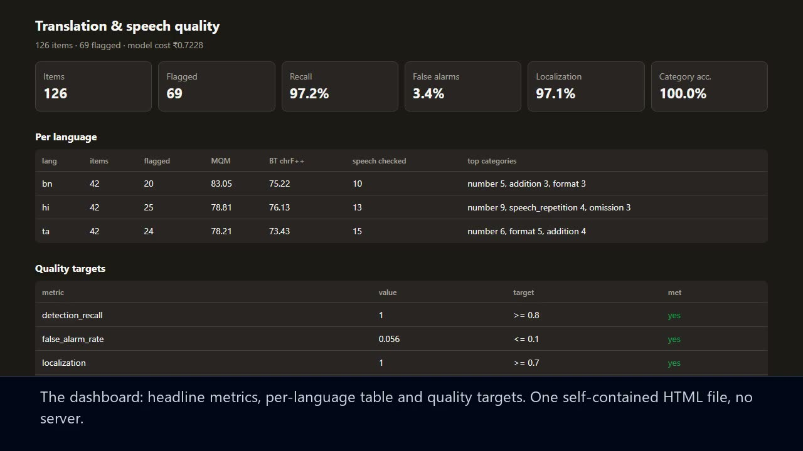

# Translation and speech quality harness

> Finds, localizes and explains errors in Indic-Translate translations and Indic-Speak audio, calibrated against human labels, for model teams that need to know what broke and where.

**Bodhan models:** indic-translate, indic-speak, indic-transcribe
**Languages shown:** Hindi, Tamil, Bengali (any Indic-Translate target is accepted)
**Format:** CLI (`python -m bodhan_eval`)

## What it does

Input is a JSONL dataset of English sources. Each item can optionally carry a reference, a system translation, audio and human labels. The harness:

1. Runs cheap deterministic checks.
2. Round-trips through Bodhan models: back-translation, plus back-transcription of the audio.
3. Asks an LLM judge with a written rubric.
4. Merges all evidence into flags. Each flag has a **category, severity, exact span and evidence**.
5. Tunes per-category thresholds on human labels and reports precision and recall.
6. Diffs the run against a baseline.

An error injector creates labelled test cases so the harness can measure itself.

Design notes, diagrams, rubric and calibration details are in **[docs/DESIGN.md](docs/DESIGN.md)**.

## Demo video

[](docs/demo/quality_harness_demo.mp4)

[Watch the demo (about 4 minutes, MP4, 1 MB)](docs/demo/quality_harness_demo.mp4). It shows a full run on the demo dataset, the files it writes, the HTML dashboard with filters, the results against each quality target, my own labels, the unseen languages, the baseline diff, the cached-rerun determinism check, and the tests. It has on-screen captions and no voiceover. Every command and number in it comes from a real run or report file.

## Setup

```bash
cd examples/translation_quality_harness
python -m venv .venv && source .venv/bin/activate   # Windows: .venv\Scripts\activate
pip install -r requirements.txt                       # pinned deps + this package (editable)
cp .env.example .env                                  # fill in the keys
```

There are no system dependencies: audio I/O uses `soundfile`, which ships libsndfile in its wheel, so ffmpeg isn't needed. A `Dockerfile` is included:

```bash
docker build -t bodhan-eval .
docker run --env-file .env -v "$PWD:/app" bodhan-eval --dataset data/demo.jsonl --langs hi,ta,bn --out report
```

**Keys** (`.env`):

| Variable | Used for |
|---|---|
| `BODHAN_TRANSLATE_KEY` | `indic-translate`: generation and back-translation |
| `BODHAN_SPEAK_KEY` | `indic-speak`: audio generation (only with `--generate`) |
| `BODHAN_TRANSCRIBE_KEY` | `indic-transcribe`: back-transcription |
| `BODHAN_API_KEY` | optional fallback for any of the three above |
| `LLM_BASE_URL`, `LLM_MODEL`, `LLM_API_KEY` | the judge (any OpenAI-compatible endpoint) |

If the LLM variables are missing, the judge is skipped with a warning. Deterministic and round-trip checks still run.

## Run

```bash
python -m bodhan_eval \
  --dataset path/to/data.jsonl \
  --langs hi,ta,bn \
  --out ./report \
  [--generate] [--baseline ./previous_report] [--calibration labels.jsonl] [--max-cost-inr 50]
```

| Flag | Meaning |
|---|---|
| `--generate` | create missing translations, and audio for a sample (`--speech-sample`, default 0.3) |
| `--baseline DIR` | write `diff.md` against a previous report |
| `--calibration FILE [FILE ...]` | label files: item labels (`{id, lang?, labels}`), per-flag human verdicts (`{id, lang, category, verdict}`), or an answered `review_queue.csv` |
| `--thresholds FILE` | reuse thresholds from a previous `calibration.json` (calibrate once, apply to new data) |
| `--max-cost-inr N` | hard cap on Bodhan spend (default 50); over-budget checks are skipped and counted |
| `--no-judge` | deterministic + round-trip checks only |
| `--judge-repeats N` | items re-judged to measure consistency (default 20) |
| `--fail-on-regression N` | CI mode: exit 3 if more than N items regressed vs `--baseline` |
| `--cache-dir DIR` | model output cache (default `.cache`); a warm rerun costs ₹0 |

**Dataset format.** Only `id`, `source` and `lang` are required:

```json
{"id": "sci-042", "source": "Water boils at 100 °C at sea level.", "lang": "hi", "reference": "...", "translation": "...", "audio": "audio/sci-042.hi.wav", "labels": [{"type": "number", "severity": "major", "span": [14, 20]}]}
```

- `audio` paths are relative to the dataset file.
- `labels: []` marks an item as labelled clean.
- Label spans are half-open character offsets into `translation`, or into `source` for translation omissions. Add `"ref": "source"` or `"ref": "translation"` to a label to override this.

**Output:**

```
report/
  summary.md          headline numbers, per-language/category tables, quality targets, top failures
  summary.json        metrics per language and per error category, MQM-style score, cost
  items.jsonl         per item: checks run, flags (category, severity, span, evidence), metrics
  calibration.json    thresholds, precision/recall per category, held-out targets, judge consistency
  diff.md             with --baseline: regressions and improvements with examples
  review_queue.csv    flags near their threshold, with source and translation, for human labelling (feed back via --calibration)
  dashboard.html      self-contained page: metrics, targets, filterable flags with highlighted spans
  run.json            wall time, rupees spent this run, calls per model (not part of the deterministic report)
  run.log.jsonl       structured log: every check, every candidate, per item
  audio/              synthesized audio (with --generate)
```

### Build the demo dataset

The demo sources in `data/sources.en.jsonl` are 42 short educational English texts written for this recipe, including Markdown tables, lists and LaTeX. Run them through 3 languages to get 126 items:

```bash
# 1. Translate, synthesize audio for ~30%, inject one labelled error into ~55% of items.
python -m bodhan_eval.inject --sources data/sources.en.jsonl --langs hi,ta,bn \
  --out data/demo.jsonl --truth data/demo.truth.jsonl --audio-dir outputs/demo_audio --max-cost-inr 8

# 2. Evaluate. Labels on the labelled half calibrate thresholds.
python -m bodhan_eval --dataset data/demo.jsonl --langs hi,ta,bn --out docs/sample_report --max-cost-inr 10 \
  --calibration data/human_labels.jsonl

# 3. Measure against full ground truth (all injected labels).
python -m bodhan_eval --dataset data/demo.jsonl --langs hi,ta,bn --out outputs/truth_report --calibration data/demo.truth.jsonl
```

**Demo audio.** The generated WAV files are kept out of git: [Google Drive folder](https://drive.google.com/drive/folders/1KU-Bz7bzfQW5TQtf37iiO8ghya1l_GOW?usp=sharing). Unzip each folder into `outputs/` so that the `audio` paths resolve: `demo_audio/` (38 files, `data/demo.jsonl`), `unseen_audio/` (26 files) and `gu_audio/` (6 files). Without them, those 38 items skip the speech checks with a logged reason. Alternatively, rerun step 1 to regenerate them (≈ ₹2.5).

**Labels, and who made them.**
- **Injected labels** (`data/demo.truth.jsonl`, and the labelled half inside `data/demo.jsonl`) are marked `"annotator": "injector"`. They are exact, because the injector made the errors.
- **Human labels** are in [`data/human_labels.jsonl`](data/human_labels.jsonl), all marked `"annotator": "human:deep-karia"`. They are my own judgments of 22 flags from the review queue. Each line says, for one item, whether a flagged category is a real `error` or a false alarm (`clean`), with a one-line note. 14 are real errors and 8 are false alarms, across bn, hi and ta, covering 7 of the 10 error types.
- Pass both with `--calibration data/demo.truth.jsonl data/human_labels.jsonl`. Human verdicts are scored separately (see *Human-reviewed flags* below) and never overwrite the injected labels.

Generated audio stays out of git (`outputs/`).

### Tests

```bash
pytest -q
```

The tests cover normalization, span alignment, each deterministic check, speech alignment and chunking, calibration metrics and the injector. An end-to-end test runs a 10-item dataset with offline stub backends and checks that a cached rerun produces byte-identical reports.

## How it works

1. **Load:** validate each line. Bad lines are logged, skipped and counted.
2. **Text checks** (free): script and untranslated runs, numbers (native digits and Indian grouping normalized), Markdown and LaTeX structure. Where a reference exists, chrF++ against it.
3. **Back-translation** (`indic-translate` → en): clause-level content coverage gives a reference-free omission/addition signal. Names and acronyms that don't come back give a term signal.
4. **LLM judge:** rubric v2, given the hints from steps 2–3. It marks spans by token index and never writes Indian-language text.
5. **Speech:** waveform analysis (silence, noise, clipping), then `indic-transcribe` in ≤28 s windows. Word alignment separates contiguous omissions and repetitions from scattered ASR noise. Speaking rate against the language median sanity-checks duration.
6. **Merge:** candidates with the same category and overlapping spans are clustered, and agreement between checks raises the score.
7. **Calibrate:** per-category thresholds are tuned on the labels. Targets are reported on a held-out half.
8. **Report and diff.**

## Results

All numbers below are measured live on hosted Bodhan models. The judge was `claude-sonnet-5-5`, through Anthropic's OpenAI-compatible endpoint. Ground truth is the injector's labels, plus my own judgments of 22 flags (*Human-reviewed flags* below).

### Demo dataset (hi, ta, bn)

The demo dataset has 126 items (42 sources × 3 languages): 69 with one seeded error (6–8 of each of the 10 types), 57 clean, and 38 with audio. Thresholds were tuned on a hash-split half, and the targets are reported on the other half.

| Target | Held-out half | All items | Goal |
|---|---|---|---|
| Detection recall | **96.9%** | 92.8% | ≥ 80% |
| False alarms on clean items | **3.1%** | 1.8% | ≤ 10% |
| Localization (span overlaps the seeded error) | **100%** | 93.8% | ≥ 70% |
| Category accuracy | **87.1%** | 100% | ≥ 70% |
| Judge consistency (20 items re-judged) | **100%** (hi, bn, ta) | | ≥ 90% |
| Determinism (cached rerun) | byte-identical reports, ₹0, ~1 s | | identical |

| Lang | Seeded | Clean | Recall | False alarms | Localization | Category accuracy |
|---|---|---|---|---|---|---|
| bn | 19 | 23 | 94.7% | 4.3% | 88.9% | 100% |
| hi | 27 | 15 | 88.9% | 0% | 95.8% | 100% |
| ta | 23 | 19 | 95.7% | 0% | 95.5% | 100% |

| Category | P | R | | Category | P | R |
|---|---|---|---|---|---|---|
| addition | 1.00 | 0.86 | | speech_garbled | 1.00 | 1.00 |
| format | 0.86 | 1.00 | | speech_omission | 1.00 | 1.00 |
| mistranslation | 1.00 | 0.71 | | speech_repetition | 1.00 | 1.00 |
| number | 0.78 | 1.00 | | term | 0.75 | 1.00 |
| omission | 1.00 | 0.71 | | wrong_language | 1.00 | 1.00 |

### Unseen languages: nothing tuned on them

Six languages that are not in the demo were built the same way (`data/unseen_langs.jsonl`, `data/unseen_gu.jsonl`, with `.truth.jsonl` ground truth alongside). They were scored **with thresholds learned only on hi/ta/bn** (`--thresholds`), which is the situation of the hidden run.

| Languages | Items (seeded / clean) | Recall | False alarms | Localization | Category accuracy | Judge consistency |
|---|---|---|---|---|---|---|
| ur, ml, mr, pa, or | 105 (58 / 47) | **93.1%** | 4.3% | **100%** | **98.1%** | 95% |
| gu | 21 (12 / 9) | **91.7%** | **0%** | **100%** | **100%** | 100% |

Per language (ur, ml, mr, pa, or):

| Lang | Seeded | Clean | Recall | False alarms | Localization | Category accuracy |
|---|---|---|---|---|---|---|
| ml | 13 | 8 | 92.3% | 12.5%* | 100% | 100% |
| mr | 9 | 12 | 100% | 0% | 100% | 100% |
| or | 10 | 11 | 70.0% | 0% | 100% | 100% |
| pa | 13 | 8 | 100% | 0% | 100% | 92.3% |
| ur | 13 | 8 | 100% | 12.5%* | 100% | 100% |

\*Both "false alarms" are real Indic-Translate errors on items the injector left clean:

- `md-003.ml` dropped the `###` heading marker.
- `math-001.ur` turned `$180^\circ$` into plain "180 degrees".

Odia's misses are 2 mistranslations, 1 term and 1 noise burst that the ASR read straight through.

Telugu also ran end to end live with `--generate`, speech included: 0 flags on 4 clean items.

### Human-reviewed flags

`python -m bodhan_eval --dataset data/demo.jsonl --langs hi,ta,bn --out report --calibration data/demo.truth.jsonl data/human_labels.jsonl`

I judged 22 flags from the review queue myself. The queue holds flags **near their threshold**, so this is a deliberately hard sample, and it is a different measurement from the injector metrics above, which are unchanged.

| Judged | Real errors | False alarms | Harness flag precision | Recall | Agreement |
|---|---|---|---|---|---|
| 22 | 14 | 8 | **88.9%** (8 of 9 flags) | 57.1% | 68.2% |

- **Precision.** Of the 9 flags the harness raised among these rows, 8 were real errors. The 1 false alarm was a `term` flag on "Sun" in Tamil: the entity check couldn't see that `சூரிய` means sun.
- **Recall.** 8 of 14 real errors were flagged in their own category. Of the other 6, 2 were flagged under a different category (a dropped number caught as an omission). The 4 truly missed are all LLM-judge findings that scored just under their calibrated threshold: 1 addition (a stray "2." appended in Hindi), 1 mistranslation ("before" for "after" in Tamil) and 2 omissions. Margin thresholds trade these for fewer false alarms.
- **Depends on the thresholds.** The table is from the run that tunes thresholds on all 126 injected labels. In [docs/sample_report/](docs/sample_report/summary.md), which tunes only on the half of the labels shipped in `data/demo.jsonl`, the same 22 verdicts give precision 62.5%, recall 71.4% and agreement 54.5%. Thresholds fitted on fewer labels flag more, which trades precision for recall.
- **Cleared correctly: 7 of 8.** Spelled-out numbers ("तीन"), paraphrased back-translations and LaTeX formulas that look like untranslated text were all correctly not flagged.

Per category (`calibration.json` → `human_review`, and the "Human-reviewed flags" section of `summary.md`):

| Category | Real errors flagged | False alarms | Missed | Cleared |
|---|---|---|---|---|
| addition | 0 | 0 | 1 | 3 |
| format | 2 | 0 | 0 | 1 |
| mistranslation | 3 | 0 | 1 | 0 |
| number | 0 | 0 | 2 | 2 |
| omission | 2 | 0 | 2 | 0 |
| term | 1 | 1 | 0 | 0 |
| wrong_language | 0 | 0 | 0 | 1 |

### Findings for the Bodhan model team

The flags outside the injected ground truth were inspected by hand. Most are genuine model errors:

- **Indic-Translate drops LaTeX on degree expressions.** `$180^\circ$` becomes "180 ডিগ্রী" / "180 degrees" in **bn, mr and ur** (`math-001`). This is systematic, not one-off.
- **Numbers changed.** "552 members" became **৫৪২** (`civ-003.bn`), and ₹10,000 became ₹10 (`fin-001.hi`).
- **Hedges dropped.** "one of the highest" became "the highest" (`geo-002.gu`).
- **Markdown lost.** A `###` heading lost its marker (`md-003.ml`).
- **Indic-Speak** in Hindi: the 3 voices (Kavya, Suhani, Amit) are equally faithful on clean text, with 99.3% comparable-word coverage and 0 speech flags each ([docs/voices_hi/voices.md](docs/voices_hi/voices.md)).

### What each layer contributes

- **Judge.** Without it (`--no-judge`), recall is 74%, and mistranslation and term recall are 0. Every other category is caught by deterministic and round-trip checks.
- **Per check.** `calibration.json` → `per_check` scores every check and the judge on its own, before merging. `audio_signal` (garbled), `back_transcription` (repetition) and `length_ratio` (omission) each have P = 1.0. `back_transcription` → `speech_garbled` (unexpected extra words) had P = 0, so it is capped to corroboration only.
- **Margin thresholds.** Max-F1 tuning alone puts the cut on the weakest labelled positive. Moving it to the midpoint between the nearest negative and positive raised unseen-language recall from 89.7% to 93.1%, with no change on hi/ta/bn.

### Checker noise found on live data and handled

- **Spoken forms.** Indic-Transcribe writes digits and math as spoken words ("100" → "वन हंड्रेड", `x` → "எக்ஸ்"). Only those words are set aside; the words around them are still compared.
- **Unicode variants.** ASR and text disagree on Odia ୱ/ଵ, nukta and candrabindu. These are folded before comparison.
- **Spoken-only loops.** Looped spoken math has no written form, so repetition is also detected inside the transcript itself.
- **Non-English back-translation.** It is ignored rather than turned into omission flags.
- **Rate limits.** Bodhan 429 bursts (17–55 s `retry-after`) get up to 12 attempts.

The sample report is in [docs/sample_report/](docs/sample_report/summary.md), with `dashboard.html` alongside. It is a run on `data/demo.jsonl` with my human labels (`--calibration data/human_labels.jsonl`), so threshold calibration uses the labelled half and the report includes the *Human-reviewed flags* section.

## Stretch goals

| Stretch goal (from the brief) | Status | Where |
|---|---|---|
| MQM-style severity weighting with an aggregate quality score per language | Done | `mqm_score` per language in `summary.json` / `summary.md` (minor 1, major 5, critical 10, per 100 source words) |
| Review queue: export uncertain items as CSV, re-calibrate from the answers | Done | `review_queue.csv` (flags within ±0.15 of their threshold, with source and translation). Fill `human_label` (`error` or `clean`) and pass the file to `--calibration`. 22 rows are answered in [`data/human_labels.jsonl`](data/human_labels.jsonl) and scored in the *Human-reviewed flags* section |
| Static HTML dashboard with filters by language, category and severity | Done | `dashboard.html` in every report: metrics, targets, per-language table, every flag with its span highlighted, filters by language, category, severity, check and text |
| Comparison mode for Indic-Speak voices or generation settings | Done | `python -m bodhan_eval.voices --configs Kavya,Amit,Kavya:news ...` ranks voice/style configs by back-transcription fidelity and speech flags. Live Hindi result in [docs/voices_hi/voices.md](docs/voices_hi/voices.md) |
| CI mode that exits non-zero when a regression passes a threshold | Done | `--baseline DIR --fail-on-regression N` exits 3 |

Also beyond the brief:
- `--thresholds` reuses a calibration on new data.
- Held-out target reporting, with margin-based thresholds.
- Per-check precision and recall.
- "Why missed" diagnostics in `summary.md`.
- Seven unseen languages measured (ur, ml, mr, pa, or, gu, te).

## Cost and runtime

| Step | Measured |
|---|---|
| Build demo dataset (126 translations, ~40 re-translations, TTS for 38 items) | ₹2.48 |
| Evaluate 126 items: back-translation | ₹0.07 |
| Evaluate: back-transcription of 38 audio items | ₹0.65 |
| Unseen-language sets (126 items in 6 languages): build + evaluate | ₹2.98 |
| Voice comparison (Hindi, 3 voices × 6 items) | ₹1.44 |
| Cached rerun | ₹0 |

Total Bodhan spend for all of the development and measurement above: about ₹9.7 (one new-account credit).

**Per 100 items:**

| Scenario | Bodhan cost |
|---|---|
| Text-only checks | ≈ ₹0.06 |
| With speech checks on supplied audio | ≈ ₹1.8 |
| Generating audio too (`--generate`) | add ≈ ₹6 |

The LLM judge is billed by the LLM provider, not Bodhan.

**Runtime:**

- The first uncached run took 7.8 min for 126 items. Most of that was Bodhan rate-limit (HTTP 429) back-off, which is honoured via `retry-after`.
- With Bodhan outputs cached, the judge pass took 95 s.

**API note.** The Bodhan keys used here are gateway keys that do not serve the documented `POST /translate` route (it returns 404). The client tries `/translate` first, then switches to `POST /v1/chat/completions` with `model: indic-translate` and a `target_language` field. Truncation is read from `finish_reason == "length"`.

## AI assistance

The code, tests and docs were written with an AI coding assistant under my direction. I chose the design, reviewed the changes, checked the live-API behaviour and the measured results, and can explain every line. The 22 verdicts in `data/human_labels.jsonl` are mine: I read each flagged example and confirmed or corrected the verdict. The one-line notes next to them were drafted with the assistant.

## Limitations

- **Wrong language in the same script** (for example Marathi instead of Hindi) is left to the judge. The script check can't see it.
- **Speech spans** for signal-level problems (noise, silence) are mapped to text proportionally, assuming a constant speaking rate.
- **Back-translation and back-transcription** are themselves Bodhan models. Their errors are reduced by alignment heuristics and corroboration, not eliminated.
- **Term consistency across items** (the same term rendered two ways in different items) is not checked. Only consistency within an item is checked, via the judge.
- **Threshold quality** depends on the number of labels per category. Categories with fewer than 3 labelled positives use the defaults. In the sample report, `number` has only 2 labelled positives and keeps the default threshold, so its precision there is low.
- **Missed errors:**
  - Additions and terms that the judge rates as minor (score below threshold).
  - Speech omissions of a few short words that fall within ASR noise.
- **Speech coverage:** speech checks cover only items with audio. Generated audio uses one default voice per language.
