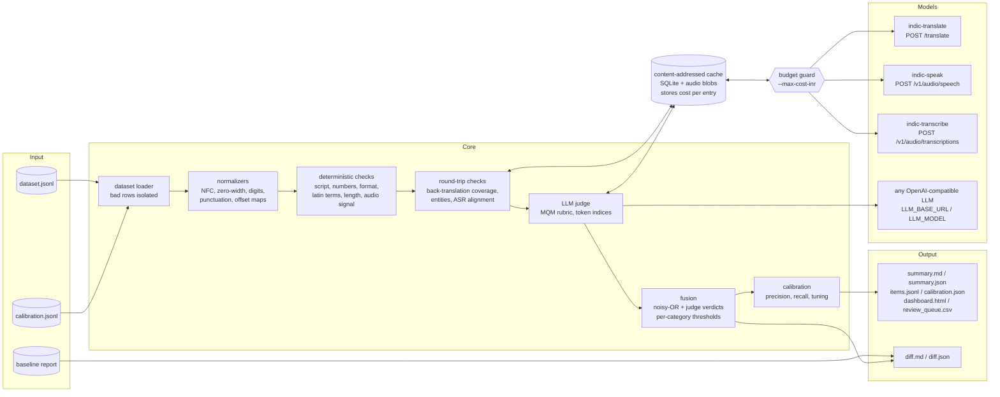

# Harness design

This document covers the architecture, the order in which checks run, every check, the judge rubric, how results combine into flags, and how the harness is calibrated. Design decisions and their alternatives are in [DECISIONS.md](DECISIONS.md).

## Architecture



| Module | Responsibility |
|---|---|
| `models.py` | Pydantic contracts: `Item`, `Label`, `Signal`, `Flag`, `CheckResult`, `ItemResult`; category and severity aliases |
| `config.py` | Environment settings, hosted prices, tunable `Thresholds` (defaults in `default_thresholds.json`) |
| `languages.py` + `languages.json` | Script ranges, voices, tiers and same-script markers per language; adding a language is a data change |
| `cache.py` | SHA-256 keyed SQLite cache, atomic file writes, audio blobs |
| `budget.py` | INR cost model, reservation before every paid call, cold-cache cost attribution |
| `clients/` | Retrying HTTP, Bodhan clients (translate, speak, transcribe), OpenAI-compatible LLM client with structured-output fallback |
| `text/` | Normalization with offset maps, segmentation, numbers, Markdown/LaTeX structure, alignment, speakable text |
| `audio/` | Decoding, resampling, frame statistics (silence, clipping, spectral flatness) |
| `checks/` | One module per check family, each appending `Signal`s with spans and evidence |
| `judge/` | Rubric, prompt builder, parser, Indic-text redaction guardrail, majority voting |
| `fusion.py` | Signals plus judge verdicts become scored flags; MQM penalty |
| `calibration.py` | Label matching, metrics, per-category threshold tuning |
| `inject/` | Programmatic text and audio error injection, LLM index-only term aligner, English-perturbation route |
| `reporting/` | Summary, diff, static dashboard, review queue export and import |
| `pipeline.py` / `cli.py` | Phase orchestration with bounded concurrency; the required command line |

## Execution flow

```mermaid
flowchart TD
    A[Read JSONL] --> B{Row valid?}
    B -- no --> B1[record in bad_rows, continue]
    B -- yes --> C{--langs filter}
    C -- out --> C1[count filtered]
    C -- in --> D{translation present?}
    D -- no, --generate --> D1[indic-translate source] --> E
    D -- no --> D2[skip text checks]
    D -- yes --> E[Cheap deterministic checks<br/>script and language, numbers, format, Latin terms, reference chrF++]
    E --> F{audio?}
    F -- supplied --> F1[decode, frame statistics]
    F -- missing, --generate, sampled, budget ok --> F2[indic-speak per sentence chunk] --> F1
    F -- none --> G
    F1 --> G{whole-text failure found?<br/>wrong script or empty}
    G -- yes --> G1[skip round trip and judge: already decided]
    G -- no --> H[Cache lookup]
    H -- hit --> I
    H -- miss --> H1{budget allows?}
    H1 -- no --> H2[degrade: record skip reason, deterministic only]
    H1 -- yes --> H3[call with retries, backoff, jitter] --> I
    I[Round-trip checks<br/>back-translation coverage and entities,<br/>numbers re-checked with BT witness,<br/>ASR alignment: omission, truncation, repetition, garbling]
    I --> J[Barrier: fit per-language length and speech-rate models on this run]
    J --> K[Length outliers, duration sanity]
    K --> L{judge policy}
    L -- all or suspicious item --> M[LLM judge: confirm or reject each finding,<br/>add errors only a reader can see]
    L -- off or unavailable --> N
    M --> N[Fusion: noisy-OR, judge adjustment, per-category threshold]
    N --> O{--calibration given?}
    O -- yes --> O1[tune thresholds on calibration items,<br/>re-decide every item from stored confidences]
    O -- no --> P
    O1 --> P[Write reports atomically]
    P --> Q{--baseline?}
    Q -- yes --> Q1[diff.md, diff.json<br/>--fail-on-regression exit 3]
```

Checks are ordered by cost. Everything that runs on text alone is free and runs first. Back-translation and transcription are cheap (paise per item) and run for every item that still needs a decision. Speech synthesis is the expensive step: it runs only with `--generate`, only for missing audio, only for the `--speech-sample` share, and only while the budget allows. The LLM judge runs last, so it sees all the evidence and can rule on it.

## Checks

| Check | Stage | Categories | What it does | Span |
|---|---|---|---|---|
| `script_language` | deterministic | wrong_language, omission | Letters (and their marks) per Unicode script, ignoring Latin words copied from the source. Flags a low share of the expected script, runs of a foreign Indic script, runs of 4+ English words copied from the source, and same-script sibling languages (Marathi in Hindi by function words, Assamese letters `ৰ ৱ` in Bengali) | foreign run, English run, sentence, or whole text |
| `numbers` | deterministic, re-run with BT | number | Multiset of numbers after folding native digits; pairs missing and extra values as substitutions; accepts power-of-ten conversions when the source has scale words (3 million = 30 lakh) and numbers spelled out in the source; symbol parity (`% ° ₹ $`); unit changes in the English round trip | changed number in translation and in source |
| `format` | deterministic | format, number | Per-line Markdown signatures (heading level, list item, table row with cell count, separator, math block) aligned with difflib; LaTeX segments compared after whitespace normalization (`\text{}` contents may be translated; a digits-only change is a number error); unbalanced `$`, braces, `**`, code fences; changed link targets and inline code | the broken line or delimiter |
| `latin_terms` | deterministic | term | A Latin-script term kept in the translation must match the source spelling | the misspelled term |
| `length_ratio` | after barrier | omission, addition | Robust z-score (median/MAD) of log(length ratio) per language, fitted on the run itself; sentence-count mismatch | none (evidence for the judge) |
| `reference_chrf` | deterministic | evidence only | chrF++ against the reference when one exists | none |
| `back_translation` | round trip | omission, addition, term | Translation back to English with indic-translate. Stemmed content-word coverage per source clause (missing clause) and per back-translated sentence (added content); source names fuzzy-matched in the round trip. Scores scale down when global coverage is low, so a bad round trip does not become flags | source clause, translation sentence |
| `audio_signal` | deterministic | speech_garbled, speech_omission, speech_repetition | Frame RMS with an adaptive silence threshold, internal pauses longer than 1.2 s, clipped-sample runs, spectral-flatness noise stretches, silent clips, duration against a per-language speech-rate model fitted on the run | time range mapped to translation text |
| `back_transcription` | round trip | speech_omission, speech_repetition, speech_garbled | indic-transcribe in 25 s windows cut at quiet points; weighted word alignment against the speakable text, with digits and Latin words as wildcards. Contiguous deletions become omission (truncation when they reach the end), inserted runs copying their neighbours become repetition, dense dissimilar stretches become garbled. Near-miss substitutions count as ASR noise | translation span and estimated time |
| `llm_judge` | judge | all translation categories | MQM rubric over numbered tokens, back-translation and check findings; verdict per finding plus new errors | token range mapped to characters |

## Separating checker noise from system errors

Back-translation and back-transcription are produced by Bodhan models that make their own mistakes, so neither is trusted on its own:

- **Two witnesses for numbers.** A number change is hard evidence only when the translation itself differs from the source. If the round trip disagrees with the translation, the score drops; if the round trip recovers a number the translation spelled out, the missing-number signal is dropped.
- **Round-trip reliability.** Every back-translation signal is multiplied by a reliability factor from the global source coverage of that round trip. A round trip that paraphrases everything yields weak signals, not many flags.
- **ASR error shape.** Recognisers produce scattered near-miss spellings. Those align as similar-word substitutions and are reported as `near_miss_substitutions`, never flagged. Only contiguous structures (deletion runs, duplicated runs, dense unrelated stretches) become signals, and a deletion run is down-weighted when the rest of the transcript is also poor.
- **Normalization before comparison.** NFC with grapheme-aware clustering, zero-width removal, native digits to ASCII, danda and quote normalization, and for ASR nukta and candrabindu folding. Spans always map back to the original text.
- **The judge as adjudicator.** Every finding is shown to the judge with a verdict request. A rejection scales soft signals down to 35% and hard structural signals to about 68%, so a judge cannot erase a broken table but can erase a paraphrase the coverage check misread.

## LLM judge rubric

The full prompt is in [`judge/rubric.py`](../src/bodhan_eval/judge/rubric.py) (`RUBRIC_VERSION` is part of the cache key). In short:

- **Evaluate, never fix.** The source and translation are shown as numbered tokens and the judge must refer to translation text only by token indices. Explanations are English. Any target-language letters that appear in judge prose are removed by `redact_indic` and counted in `redacted_chars`, so the judge never writes Indian-language text into the report.
- **Seven categories** (omission, addition, mistranslation, number, term, format, wrong_language) and three MQM severities (minor 1, major 5, critical 10).
- **Back-translation is a hint, not evidence.** An error must be visible in the translation itself.
- **Fluency is not accuracy.** Every clause, number, name and negation must be conveyed.
- **Legitimate variation is listed explicitly** (native digits, spelled numbers, transliterated units and terms, Indian grouping, idiom, reordering).
- **Precision bar.** "Would a careful bilingual reviewer mark this as wrong because it changes, drops or adds what the reader learns?"
- **Calibrated confidence** from 0 to 100, plus English `source_says` and `translation_says` glosses that ground the finding.

The judge runs at temperature 0 with `response_format=json_object`. Providers that reject a parameter get the same request without it (remembered for the run), replies are parsed with a tolerant JSON extractor, one repair turn is attempted for invalid JSON, and an empty reply caused by a reasoning model running out of tokens is retried once with twice the budget.

Other LLM decision points: the injector's term aligner asks the LLM which translation token renders a source name (indices only). Speech checks do not use the LLM; transcripts are compared deterministically.

## How results combine into flags

1. Signals of the same category whose spans overlap form a candidate.
2. Base confidence is a noisy-OR over distinct checks: `1 - prod(1 - max score per check)`.
3. Judge adjustment: confirmed candidates are lifted to at least `0.5 + 0.5 * 0.75`; rejected soft candidates keep 35% of their confidence and hard ones about 68%. When the judge names a different category at the same place for a soft candidate, the judge's category wins.
4. Judge-only findings keep the judge's confidence multiplied by a severity prior (minor 0.6, major 0.9, critical 1.0), because they have no second witness.
5. A flag is reported when its confidence reaches the category threshold. Everything below is kept in `items.jsonl` under `rejected` with its confidence, which is what makes re-tuning possible without any model call.
6. Each item gets an MQM penalty (sum of severity weights) and a quality score `100 - penalty / source_words * 100`, floored at 0.

## Calibration

`--calibration labels.jsonl` runs the full pipeline on the labelled items, then tunes thresholds from their stored confidences:

1. For each category with at least 3 labels, choose the threshold, among midpoints between observed confidences, that maximizes that category's F1.
2. Then, while the clean-item false-alarm rate is above 10%, raise the single threshold whose next step removes the most false alarms per unit of recall lost.
3. Apply the tuned thresholds to every item of the main dataset and write them to `thresholds.json`, which can be reused with `--thresholds`.

Matching rules: a label is detected when a flag in its area overlaps its span or has its category. Only labels without both category and span fall back to any same-area flag. A translation flag cannot detect or localize a speech label, or vice versa. Localization divides overlapping labels by **detected labels with spans**, following the assignment. `localization_recall` additionally divides by all labels with spans, including missed errors (zero-width spans are widened by 2 characters). Category accuracy divides category-correct labels by detected labels. Precision requires both category agreement and span overlap when a label has a span; rejected judge candidates use this same rule. Spans refer to the translation unless the label says `"field": "source"`; without a field, overlap with either side counts. A label typed `omission` without an `area` matches text or speech omission. Label types are mapped through aliases (`number_or_unit`, `entity`, `truncation`, `garbled_audio`, and others) so hidden-set naming does not need code changes.

`calibration.json` reports, for the calibration set (before and after tuning) and for the dataset when it has labels: headline metrics, precision, recall and F1 per category, metrics per language, precision per check, judge-only precision, confirmed-finding precision and how often the judge rejected a labelled error, plus the tuning log.

**Judge consistency.** `--judge-repeats N` re-judges a deterministic sample (`--judge-repeat-sample`, default 30) N more times with distinct cache keys and seeds. A verdict is (has errors, set of categories); consistency is the share of re-judgements equal to the first, reported overall and per language. `--judge-votes K` majority-votes K samples per item for production runs.

## Determinism and cost

Every model output is cached under the SHA-256 of its exact request (model, payload, parameters, rubric version), together with the INR it cost. A rerun reads everything from cache, spends INR 0, and writes byte-identical `items.jsonl`, `summary.*`, `calibration.json`, `dashboard.html`, `review_queue.csv` and `thresholds.json`: these contain no timestamps, sort their keys and round their floats. Run-specific facts (wall time, cache hits, INR spent this run, projected minutes for 200 items) go to `run.json`, and structured per-event logs to `run.log.jsonl`.

`--max-cost-inr` is enforced before each paid call by reserving an upper bound (speech from input characters; transcription from duration; translation from the requested maximum output tokens, then settled from `usage.completion_tokens`). Calls reserve only after entering the model semaphore, so queued requests do not consume the budget prematurely. When the cap is reached, the remaining paid checks are skipped with a recorded reason and the deterministic checks still run. This tracker covers Bodhan services; judge-provider billing is separate and `run.json` records its token usage.
