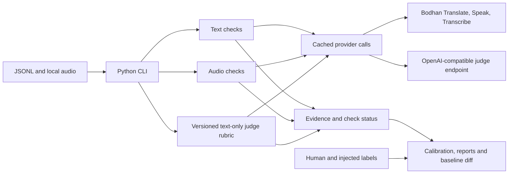
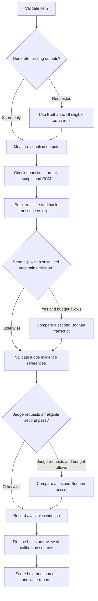

# Evaluation design

## Architecture

## Per-item workflow

## Evidence rules

| Check | Signal | Decision |
| --- | --- | --- |
| Quantities | Compare Unicode-normalized numeric forms and common unit tokens. | Flag changed quantities. A missing numeric form can be equivalent prose, so judge it in context. |
| Entities | Find missing literal URLs and acronyms. | URLs are strong evidence. Acronyms and names may be rendered differently in the target language. The judge evaluates semantic preservation. |
| Format | Compare Markdown block structure, table shape, and LaTeX tokens. | Preserve the affected token or original line for review. |
| Reference score | Compute chrF++ on rows with a reference. | Record the score alongside the checks. Multiple translations can express the same meaning. |
| Back-translation and judge | Compare the candidate and available signals against the source. | Accept schema-valid findings with exact original text spans. The [written rubric](src/bodhan_eval/judge.py) defines categories, severity, and confidence levels. |
| Audio signal | Measure duration, quiet windows, and saturation in mono PCM. | Use sample positions for audio evidence. Report decoded duration even if transcription is unavailable. |
| Back-transcript | Compare script and transcript with character alignment. | Omissions and repetitions use sustained alignment differences. Character error rate alone remains weak evidence because the recognizer can make errors. |

The judge sees only the evaluation inputs and check evidence. It returns English rationale and evidence coordinates. The program extracts Indic excerpts from existing text. A parseable verdict with usable evidence can enter the response cache.

For a sustained uncertain omission on a clip of 3 to 14 seconds, the runner uses smaller ASR windows once. A recognisable second transcript must support the same missing span before the harness raises its strength. If the alternate transcript contains the missing text, it clears the finding. On longer clips the judge can request a second segmentation. All passes share the budget and provider limits.

## Calibration and reporting

All rows with identical English source text stay in one split. An explicit split takes precedence for the whole group. Unassigned sources in the external label file enter calibration. Threshold fitting uses reviewed, non-injected calibration rows and requires positive and negative support for each tuned category. It selects among a small fixed set of ordinal evidence thresholds using F0.5 to weight precision. The calibration report lists support behind the selected and default thresholds. Weak findings remain visible as unconfirmed evidence.

The held-out report includes overall and per-language metrics. Detection matches labels and flags one to one using overlap when available, with category agreement as a possible recovery for an imprecise span. Localization then measures overlap independently. Per-category precision and recall require the correct category and overlap when the annotation supplies comparable coordinates. Missing labels and incomplete checks are visible in the denominator accounting.

Uncached judge repeats compare category, severity, and evidence coordinates. Model cache keys include the payload and media content. The same successful result can be replayed without model cost. Canonical reports contain the represented historical usage. The run log contains active request and retry counts.

Baseline comparisons pair findings by overlapping evidence in a shared coordinate field. An unchanged passage can retain its finding when text before it moves. Severity changes appear separately. A matching category by itself does not establish a persistent defect.

## Trade-offs

- A user-supplied audio file without a known script supports signal checks and transcription. Omission and repetition relative to an intended script are unavailable in that case.
- Hosted ASR returns text. Script and transcript spans use original character offsets. Waveform measurements supply time intervals. Transcription alone cannot provide word timestamps.
- Script cues have limited power for languages that share a script. Proper names, number words, and legitimate transliteration need semantic review.
- The injector can measure specific mutations precisely. Source perturbation through Indic-Translate can also introduce unrelated changes. Human review gives different evidence from seed labels.
- Translation does reserve against a bounded output-token count. The run keeps a conservative reservation after an ambiguous transport error because the provider may have billed the attempt.
