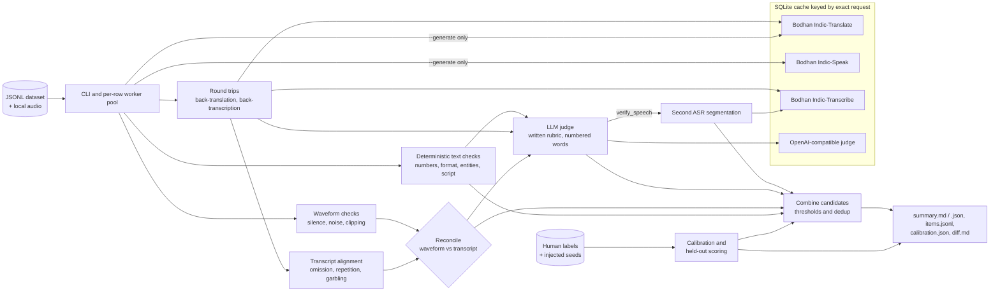
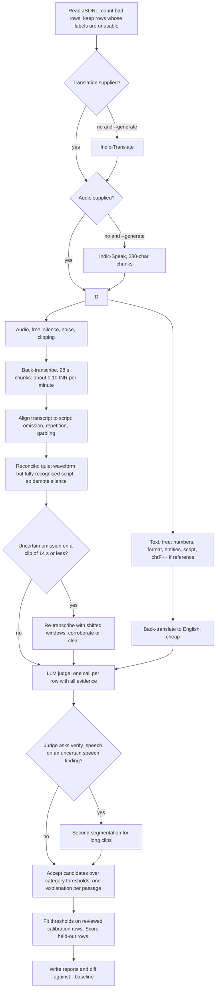

# Harness design

The harness turns each dataset row into **candidate findings**. Each finding has a category, a severity, an exact span, the evidence text, the check that produced it, and an evidence strength. Calibrated per-category thresholds decide which candidates become reported **flags**. Weaker candidates stay in `items.jsonl` as `unconfirmed`, so a reviewer can audit what was held back.

## Architecture

All model calls pass through one `Providers` boundary (`providers.py`). It handles the following:

- **Cache:** responses are stored in SQLite, keyed by the exact request payload and media bytes.
- **Budget:** a spend ledger in integer micro-rupees enforces `--max-cost-inr` before each dispatch.
- **Retries:** up to five attempts with jittered exponential backoff. A rate limit (429) sets a shared cooldown for that key.
- **Concurrency:** separate limits for Bodhan and for the judge.
- **Error codes:** stable codes per failure (`credit_exhausted`, `http_429`, `invalid_judgment`, and so on).

Every translation, speech and recognition call goes to `https://api.bodhan.ai`. Only the judge uses `LLM_BASE_URL`.

## Flow from dataset to report

The cheap and free checks run first, in parallel for the two modalities. Paid round trips happen once per row. The extra ASR pass only runs when the cheaper evidence leaves a speech question open. TTS runs only with `--generate` for missing audio. It is the most expensive call (₹6 per 10,000 characters), and the run never repeats it because responses are cached.

## Checks

| Check | Kind | Categories | How it decides | Typical strength |
| --- | --- | --- | --- | --- |
| Quantities (`text_checks.number_findings`) | deterministic | number | Normalizes native digits in all 13 scripts, Indian and Western grouping, times, dates and scale words (lakh, crore, million) before pairing values. It pairs quantities by shared labels, table cells and unit phrases before falling back to global pairing. | 0.88 for a changed value. 0.55 for a missing-only value, which is likely spelled out and so never flagged. |
| Format (`format_findings`) | deterministic | format | Compares CommonMark block structure, raw table cells per row, inline delimiters (`**`, backticks, `~~`), link syntax, and LaTeX skeletons with `\text{}` ignored. `$5` is treated as currency, not math. Spans point at the candidate. | 0.90–0.98 |
| Entities (`entity_findings`) | deterministic | entity | Exact URLs and acronyms. Names and terms are left to the judge. | 0.98 for URLs |
| Script (`script_findings`) | deterministic | wrong_language | Masks code, URLs and LaTeX, then checks each sentence for the expected script. Untranslated English is caught by 3- and 4-word shingles shared with the source. | 0.80–0.97 |
| chrF++ | deterministic | (metric only) | Recorded when a reference exists. Never flags on its own. | n/a |
| Back-translation | Bodhan | (evidence for judge) | English round trip of the candidate. The judge treats it as a hint, never as proof. | n/a |
| Waveform (`audio_checks.signal_checks`) | deterministic | garbled_audio | Silence is 25 dB below the clip's own loud frames (with a −60 dBFS floor). Normal edge padding is ignored. Noise is at least 1 s of loud frames with a zero-crossing rate of 0.35 or more. Clipping is checked too. | 0.99 for a gap of 2.5 s or more. 0.9 for noise of 1.5 s or more. |
| Transcript alignment (`speech_findings`) | deterministic, over Bodhan ASR | speech_omission, speech_repetition, garbled_audio | Character alignment after normalization. Omission is a sustained deleted script span. Repetition is leftover transcript text that duplicates script content already heard. Garbling is a high error rate after removing explained repeats. | 0.84–0.89. 0.61–0.68 when weak. |
| Reconcile (`reconcile_signal_with_transcript`) | deterministic | — | If the recognizer heard 90% or more of the script, a "silence" finding contradicts it and drops to 0.5. | n/a |
| Speech recheck (`corroborate_speech`) | Bodhan ASR | speech_omission, speech_repetition | Re-transcribes with shifted windows. It confirms a finding (0.87) or clears it. | n/a |
| LLM judge (`judge.py`) | LLM | the 7 text categories | Gets the source and candidate as numbered words, plus back-translation, transcript, reference and deterministic suspicions. It returns typed findings with word ranges. | 0.85 for clear, 0.63 for uncertain |

## Where the LLM adds signal, and how its output is constrained

Deterministic checks are precise for surface defects: digits, markup, script and silence. They cannot see meaning. The judge covers the categories that need it:

- omission
- addition
- mistranslation (including flipped polarity such as open/closed)
- entity renderings
- same-script language confusion

The judge also decides when an extra speech check is worth paying for, through `verify_speech`.

The rubric in [judge.py](src/bodhan_eval/judge.py) controls the judge's output in several ways:

- **Word numbers, not characters.** The judge sees every segment as `[0]word [1]word …` and answers with `first_word` and `last_word`. The harness maps those back to exact character offsets in the original text. An LLM counts words reliably and Indic code points unreliably. In the first live runs, character offsets caused most of the judge's rejected findings.
- **No Indic text from the model.** The LLM may read Indian-language text but never write it. Evidence text is always cut from the original. Any non-English letters in the model's rationale are stripped before storage, while the finding itself is kept.
- **Checker noise is named.** The rubric says back-translation and back-transcription are produced by other systems and can be wrong. Each finding must be confirmed against the candidate itself. Deterministic suspicions are passed in as hints to confirm or ignore.
- **Robust parsing.** The harness uses JSON mode and temperature 0 where the endpoint supports them, and falls back to a plain request on HTTP 400. It extracts the verdict object from replies that contain reasoning, prose or code fences. Unusable replies are sampled again, up to five attempts. Only valid verdicts enter the cache.
- **Consistency is measured on every run.** `--judge-repeat` (default 10) judges a sample of rows a second time, independently. The report shows the agreement on category, severity and span. The repeat is cached under its own key, so a replay reproduces the figure at no cost.

## Combining evidence into flags

1. Each check emits candidates with an ordinal strength. Strength reflects how much the check can prove, not a probability.
2. A candidate becomes a flag when its strength reaches its category's threshold. The default is 0.72.
3. Overlapping text candidates are merged, and the strongest explanation wins. A changed digit is therefore reported once as `number`, not again as a judge `mistranslation` of the same word. Speech findings are only merged within their own category.
4. Candidates below threshold remain in `items.jsonl` under `unconfirmed`.

## Calibration against human labels

- **Inputs.** Labels can come from the dataset or from `--calibration labels.jsonl`, keyed by `id`/`lang` or by the opaque `review_id` of the blind review packet. Rows with the same English source always share one split, so a mutation never leaks its control into the other split.
- **Fitting.** Thresholds are fitted only on reviewed (human or provided) calibration rows. Injected seeds are not used for fitting. A category's threshold moves only with at least three positive and three negative reviewed items. Fitting chooses from five fixed levels (0.58–0.92) by F0.5, which weights precision because false alarms are a stated target. The `tuning_support` block in `calibration.json` shows the support behind every threshold, including the ones left at the default.
- **Scoring.** Held-out rows are scored for precision and recall per category and language, localization, and category accuracy, plus the flag rate on unmutated controls.

## Error injector

`python -m bodhan_eval.demo` creates labelled variants from generated controls without any LLM. Every Indian-language string comes from Bodhan or from the original output.

- **Text, programmatic:**
  - change a digit, or swap a unit symbol
  - break a LaTeX delimiter, a table separator, a table cell, bold, a heading or a link
  - paste the English source, or one untranslated English sentence
  - delete a translated sentence
  - insert a sentence from another item's Bodhan translation
- **Text, perturbing the English and re-translating with Indic-Translate:**
  - drop a sentence
  - append a neutral sentence
  - flip a word to its antonym (a general opposites lexicon)
  - rename an entity
- **Audio:**
  - truncate the tail, or cut the middle
  - repeat the whole clip, or loop a middle phrase
  - insert 3 s of silence, or 2 s of broadband noise

Each variant records its method and an exact span on the axis where the defect lives: `source` for omissions, `translation` for most text errors, and `audio_ms` for audio. Review packets hide the method behind an opaque `review_id`.

## Trade-offs and known limits

- **No word timestamps from ASR.** Repetition intervals on the audio axis are estimated from the transcript position at an even speaking rate. The transcript excerpt stays attached as the exact anchor.
- **Same-script language confusion** (Hindi vs Marathi, Bengali vs Assamese) depends on the judge.
- **A clip that is only low-level hiss** (above −60 dBFS but without speech structure) is caught only through the transcript, as an omission.
- **Source perturbation through Indic-Translate can change more than the intended word.** The label covers the largest changed region.
- **The judge's recall on subtle mistranslations varies by model and language.** The per-language table in `calibration.json` shows this directly.
