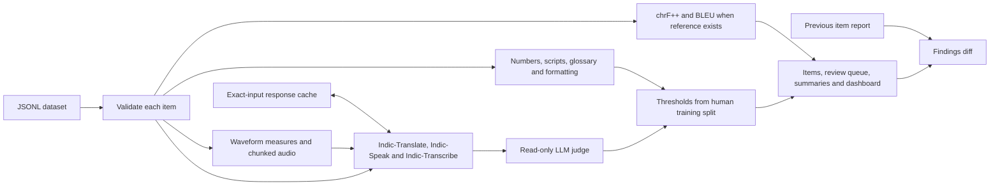
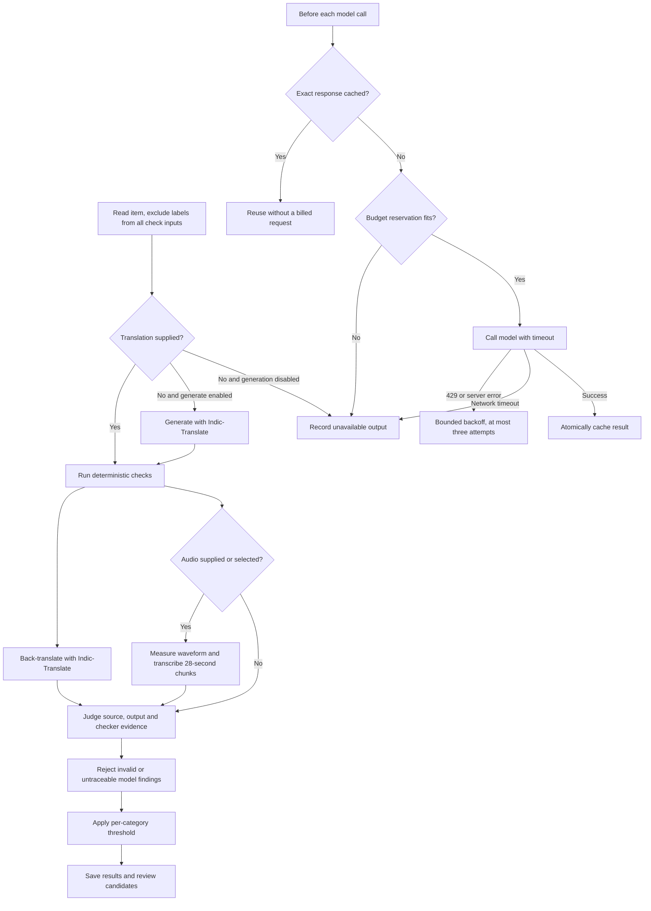

# Translation and speech quality harness

Evaluate supplied translations and speech, generate missing outputs with Bodhan when requested, and review localized findings across languages. Each finding includes its category, severity, field, character span and supporting evidence. A baseline comparison shows which findings appeared or disappeared.

**Models used** — Indic-Translate, Indic-Speak, Indic-Transcribe and a separate text-only LLM judge.

## Setup

Python 3.10 or later and ffmpeg are required. A GPU is unnecessary.

```bash
cd examples/translation_speech_quality
python -m venv .venv
. .venv/bin/activate
pip install -r requirements.txt && pip install --no-deps -e .
cp .env.example .env
# Fill the three model keys and LLM settings in .env.
```

The dependencies in `requirements.txt` are pinned. The Dockerfile provides the same entry point in a container. Get model keys from the [Bodhan console](https://console.bodhan.ai/). Separate model keys are required. An external private environment file can also be supplied using `--env-file /path/to/private.env`.

## Run

The default evaluates only translations and audio already supplied in the dataset. `--generate` creates missing translations and generates a stable sample of missing audio outputs. Every supplied audio file is checked regardless of sampling.

```bash
python -m bodhan_eval \
  --dataset data/demo.jsonl --langs hi,ta,bn --out outputs/report \
  --max-cost-inr 7 \
  --llm-input-inr-per-million 25 --llm-output-inr-per-million 150

# Generate missing audio for six items, selected independently of labels.
python -m bodhan_eval \
  --dataset data/demo.jsonl --langs hi,ta,bn --out outputs/generated \
  --generate --speech-sample 6 --max-cost-inr 7 \
  --llm-input-inr-per-million 25 --llm-output-inr-per-million 150

# Compare a subsequent run and fit thresholds from external human labels.
python -m bodhan_eval \
  --dataset new.jsonl --langs hi,ta,bn,mr --out outputs/new \
  --baseline outputs/report --calibration labels.jsonl --max-cost-inr 20 \
  --llm-input-inr-per-million 25 --llm-output-inr-per-million 150
```

The example LLM prices are conservative INR estimates used for the tested Gemini model. Set these two flags to your own provider's current input and output prices per million tokens. They can also be configured as `LLM_INPUT_INR_PER_MILLION` and `LLM_OUTPUT_INR_PER_MILLION`. Without a supplied price, conservative fallback estimates of ₹100 input and ₹1,000 output per million tokens are used; these are budget estimates, not a claim about your provider’s bill. A free provider can use explicit zero prices. Request reservations use output-token caps and a conservative input bound. Timed-out requests retain the entire reservation and are not resubmitted, because they may have been billed.

An explicitly limited mode runs without credentials or network access.

```bash
python -m bodhan_eval --dataset data/demo.jsonl --langs hi,ta,bn \
  --out outputs/deterministic --offline --no-judge --no-roundtrips
```

This mode exercises text checks and reference metrics. It does not assess semantic errors or speech through a model. `--offline` alone replays previously cached calls and reports missing cache entries as unavailable.

## How it works





The checks and design choices are described in [DESIGN.md](DESIGN.md). There is no general-purpose LLM translation, speech synthesis or transcription. The judge can read multilingual text, but its non-English output must quote an exact supplied span. It has no tools or ability to execute dataset instructions.

## Input and outputs

`id`, `source` and `lang` are required. Optional fields include `translation`, `reference`, `audio`, `voice`, `glossary` and `labels`. Relative audio paths resolve against the dataset file's directory. Bad items are counted and skipped, and duplicate IDs are rejected.

```json
{"id":"example-1","source":"School opens at 9.","lang":"hi","audio":"audio/example-1.wav"}
```

`labels` never influence checks or model prompts. Use a separate `--calibration` JSONL file to fit thresholds. Each record has `id` and `labels`. Records supplied through that flag are treated as human annotations unless `annotation_source` explicitly says otherwise. For example, a label can contain `type`, `severity`, `field` and a two-integer `span`.

Character spans use Python Unicode code-point offsets into the named original field. Speech alignment evidence also includes spans into normalized strings, identified by `span_space`. Audio findings use `field=audio_seconds` and time intervals.

| Artifact | Purpose |
|---|---|
| `summary.md`, `summary.json` | Status, language and error-category counts, measured detection targets |
| `items.jsonl` | All findings, review candidates, source fields and checks |
| `calibration.json` | Human split, chosen thresholds and held-out precision/recall |
| `review.csv` | Uncertain items ready for human review |
| `dashboard.html` | Local searchable report, with all text HTML-escaped |
| `diff.md` | Findings and status changes when a baseline is provided |
| `execution.json` | Cost reservations, elapsed time and cache/API counts for this invocation |
| `trace.jsonl` | Call identity hashes, cache use, retry status, costs and latency |
| `audio/` | AI-generated audio selected by `--generate` |

Assessment files are stable for fully cached reruns. Per-invocation cost and runtime are intentionally recorded separately because a cache replay costs zero model calls. `--fail-on-regression N` exits with code 2 if the number of flagged items increases by more than N. Incomplete checks or invalid items produce exit code 1 while retaining all partial reports.

## Demo dataset and results

The demo contains 108 items in Hindi, Tamil and Bengali, comprising 54 clean controls and 54 programmatic corruptions. Human translations come from FLORES-200 under CC-BY-SA 4.0. Source lines, archive hash and synthetic-wrapper details are in [data/provenance.json](data/provenance.json). No new human quality annotations have been added. Clean controls use the reference as their supplied output, so their reference metrics are an integrity check and do not estimate independent translation quality.

The injector deletes target spans, changes a digit or an explicit glossary term, removes a LaTeX delimiter, appends unsupported English content, or replaces a translation with its source. It writes machine-generated labels, never labels them as human. Omission source spans are approximate and explicitly marked. To reproduce the dataset, download the [FLORES-200 archive](https://dl.fbaipublicfiles.com/nllb/flores200_dataset.tar.gz) and run `python scripts/build_demo.py /path/to/flores200_dataset.tar.gz`.

See [RESULTS.md](RESULTS.md) for the tested commands, observed API behavior, measurements, cost and remaining limitations. The publication status of the demo recording is recorded there as well.

## Tests

```bash
pip install pytest==9.1.1
pytest tests -q
```

Tests cover Unicode digits, localized number handling, exact spans, format integrity, malformed items, label leakage, bounded retries, concurrent cache reuse, timeout billing, audio windows and a ten-item CLI run. HTTP fixtures are used only in unit tests. Model-backed demo reports identify the real provider and model used.

## Limitations

The script check cannot distinguish languages sharing a script, and Romanized text needs review. An unchanged copy of a sufficiently long English source is stronger evidence of untranslated output. Exact agreement with a supplied reference moves conflicting translation findings to review; the reference may itself be wrong. Results are also reported with references removed so this policy cannot hide reference-free failures. Missing digits may be spelled out naturally, so those checks remain candidates. A glossary must be explicit to avoid guessing valid name transliterations. Reference metrics are reported without a universal quality cutoff. The default confidence threshold is an uncalibrated review policy until enough human-labelled items are supplied.

ASR and back-translation can introduce errors. Their disagreements alone do not establish a defect in the system under test. Acoustic silence and clipping checks cannot establish whether an otherwise plausible waveform is intelligible. The judge can make mistakes, and consistency estimates are based only on the repeated sample.

Audio generated by the demo uses the fixed Bodhan voice library and is labelled AI-generated. Longer audio is transcribed in nonoverlapping 28-second windows, which may lose a word across a boundary. The configurable sampling limits generated speech cost, and all supplied audio is evaluated. Model prices and server enforcement can change, so cost fields report estimates derived from the documented prices and provided judge rates.

## AI assistance

Codex helped implement the harness, write and run tests, build the demo dataset from licensed human translations, inspect API responses, and prepare the documentation. The applicant should review the source and results before submitting and be ready to explain the implementation in the interview.
