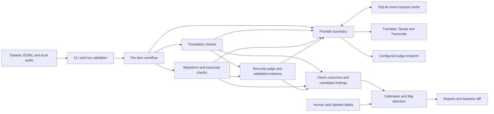
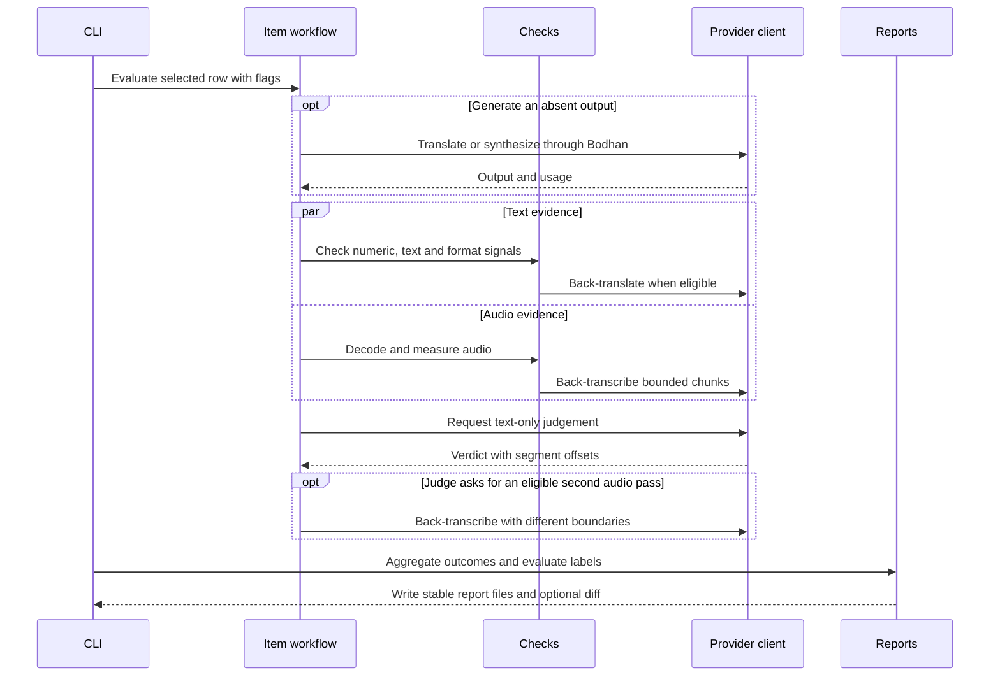
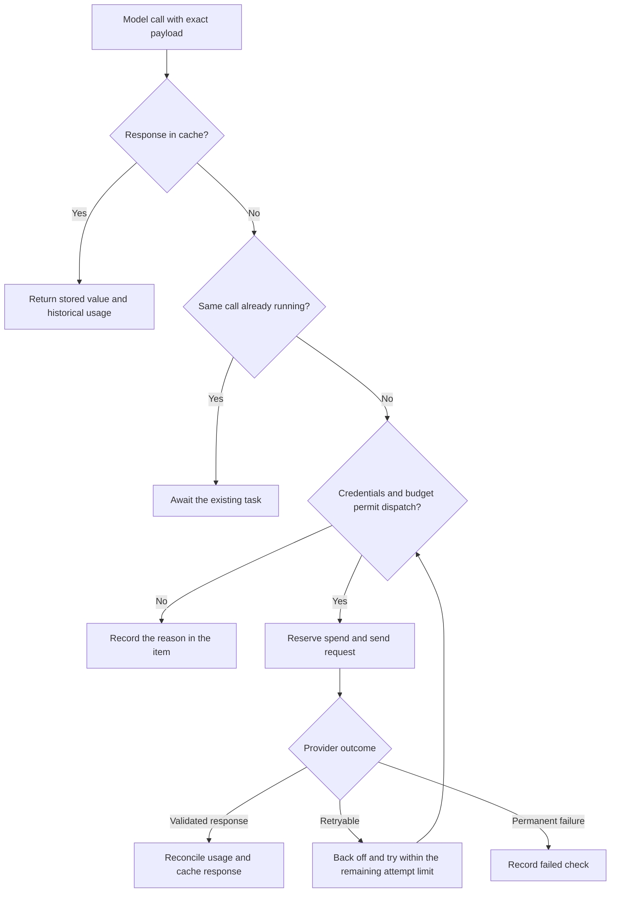
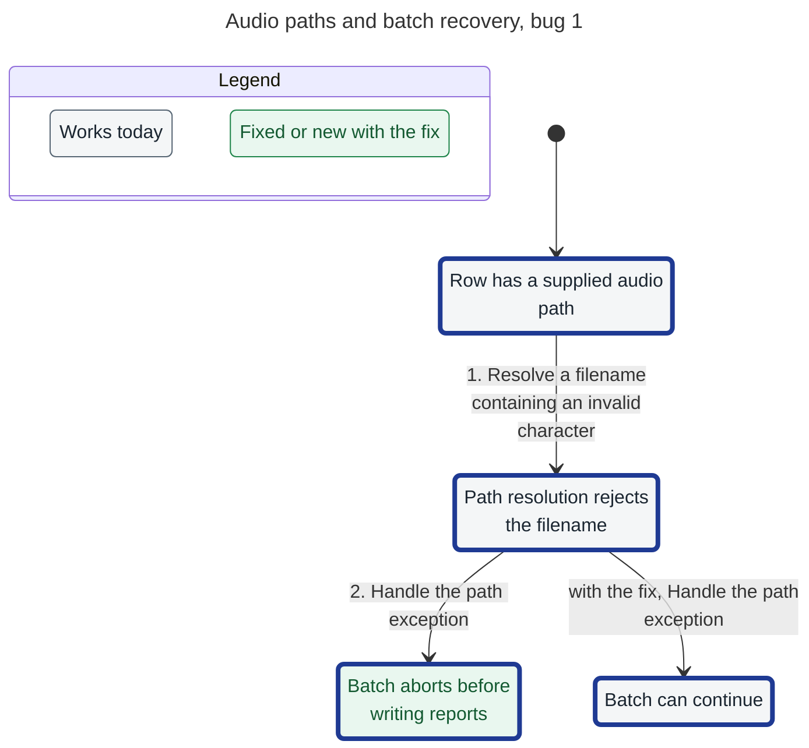
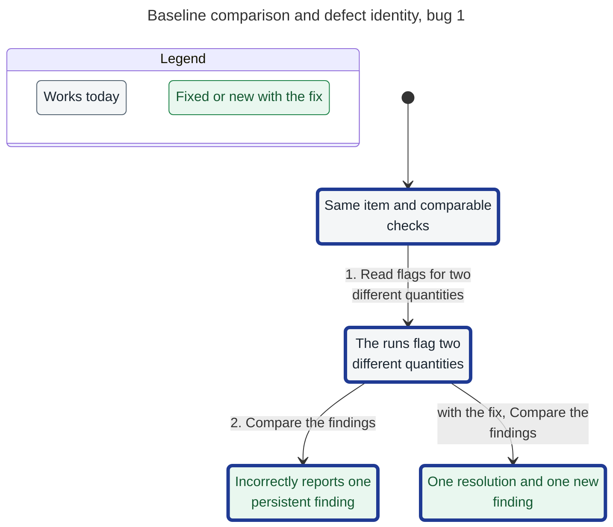

# Learning the Bodhan translation and speech quality harness

The initial audit reviewed `abee459`. This guide explains that assessment, the follow-up fixes, and the live evidence needed for the interview.

## Current status

The offline suite now covers 26 tests. Malformed paths stay with their row. Baseline comparisons track expected quantities and compare checks that completed in both runs. Calibration preserves localized evidence before assigning category-only matches. The quantity checker catches swaps in uniquely shared labels, labelled fields, and Markdown table cells. A sustained uncertain omission on an eligible short clip gets one second segmentation.

On 17 November 2026, the 10-item hosted pilot completed across Hindi, Tamil, and Bengali using all three Bodhan models and Groq `openai/gpt-oss-120b` as judge. The run took 135.8 seconds and recorded ₹0.685645 in Bodhan spend or reservations. Indic-Speak retried ten HTTP 429 responses and recovered. The cache replay took 1.36 seconds, served 60 responses from the cache, and made zero requests. All four required reports matched byte for byte. The pilot used source-only inputs and did not measure detection accuracy.

In a separate offline smoke, all 216 source passages were deliberately supplied as untranslated candidates. Both CLI runs flagged all 216 as wrong-language examples and made zero model requests. All four canonical reports matched byte for byte. This exercises keyless batch handling and reproducibility.

## Historical assessment

**Initial engineering rating at `abee459` · 7/10.** The architecture is worth keeping. The CLI follows the brief, the checks and provider logic are easy to locate, and the reports expose evidence. The initial weak spots were failure isolation, finding identity across runs, and confidence in speech and judgement rules. The follow-up tests establish the new offline behavior. The live quality targets remain separate.

| Dimension | My rating | Reason |
| --- | ---: | --- |
| Architecture | **8/10** | A small CLI, one provider boundary, pure checks, and shared evidence types fit the assignment. The reporting layer currently makes some policy decisions that belong with coverage and matching. |
| Code quality and reliability | **7/10** | Explicit statuses, a reproducible install, source comments, and targeted tests help. The audit reproduced a row error that escapes to the CLI and a comparison that loses defect identity. Provider behavior needs contract tests. |
| Fit to the build requirements | **7/10** | Most requested mechanisms exist. Calibration splits, lookup conventions, and the baseline policy need refinement. Completing the demo requires real outputs, a reviewed subset, and published evidence. |
| Submission readiness | **5/10** | The package has been built on Linux. Speech and judge performance, paid caching, cold runtime, and the required final artifacts remain unverified. Full Cookbook validation also has a reproducible upstream failure. |

These scores are a code-review judgement. The brief’s hidden-set rubric gives 30 points to detection quality. There is currently no measured hidden-set result, so assigning a projected grade would give false precision.

### Requirement-by-requirement status

| Brief asks for | Current implementation and offline evidence | Remaining validation or submission work |
| --- | --- | --- |
| JSONL, optional outputs and labels, score-only mode, and `--generate` | Exact required command and flags. Supplied text and audio are accepted independently. Bad JSON is counted. Missing and malformed audio paths stay with their row. Hosted generation completed on all ten pilot rows. | Verify hosted checks on partial inputs. |
| Reference and reference-free translation checks | chrF++, quantity and literal-entity checks, script heuristics, Markdown and LaTeX checks, Indic-Translate back-translation, and a judge. Offline tests cover quantity swaps and correct reordering. | Measure all seven categories, including false alarms on natural unit expressions and code-mixing. Quantities with different translated labels still need semantic evidence. |
| Speech omission, repetition, and bad audio | Waveform measurements, Indic-Transcribe, character alignment, and a second segmentation for eligible uncertain omissions. Controlled transcripts cover corroborated, recovered, and empty rechecks. | Measure detection and false alarms on real audio, including garble, clipping, and silence. |
| LLM judge with category, severity, and exact evidence | Written rubric, configurable endpoint, validated segment references, and local evidence extraction. An unusable verdict stays out of the cache. Groq returned a usable verdict on every pilot row. | Measure judge localization and fresh agreement on reviewed data. |
| Human calibration and category precision and recall | Source-group splits, fitted category thresholds and support counts, attribution, and per-check reports. Localized evidence is matched first. Category-only matches cannot displace it. | Collect human labels and verify independent holdout support. Confirm the brief's bare span coordinates and external label format. |
| Error injector | Controlled changes to actual candidates, source perturbations translated by Bodhan, and waveform edits. | Run it on live outputs. Verify that every intended error is present and that clean controls have been reviewed. |
| Reports with cost and baseline diff | Required files, grouped totals, separate execution telemetry, and per-row evidence. Baseline tests cover persistent wrong values, a replacement defect, and skips that cannot produce false resolutions. The hosted pilot recorded Bodhan cost and judge tokens. | Compare real injected examples against their controls and reconcile demo costs with provider billing. |
| Thirteen supported codes and 100+ demo items across Hindi, Tamil, and Bengali | The CLI accepts the 13 production codes. The repository contains 216 source cases from 72 original English passages. | A source corpus is the input to the demo. Publish a processed dataset with injected errors, a labelled subset, and audio links. Smoke-test an additional language such as Gujarati. |
| One-command install, tests, and hosted targets | Pinned direct dependencies, Dockerfile, 26 offline tests, and verified 10-item hosted cache replay. | Measure 200 speech-enabled items cold. The full Cookbook gate still fails on upstream AndroidSpeak. |
| Public submission | Local assignment branch and recipe documentation. | Address or report the upstream gate with evidence. Link the real sample report and five-minute recording in the PR. Email the PR link and final SHA after review. |

## What the project does

Suppose a teacher’s source says that water boils at 100 °C at sea level. The translated sentence changes the value to 10 °C. The harness links the finding to the actual string `10 °C` where possible. An English explanation gives the reason. If the translated text is correct and its audio omits a sentence, the harness measures the audio and compares the intended script with a Bodhan back-transcription. It can then show the area of disagreement and whether it has enough evidence to flag it.

A **check** records what a component did. A **finding** is a candidate for a particular error with evidence. A **label** is human assessment or injector truth used to measure the evaluator. Keeping those concepts separate is the most important design choice. A check may finish and find no issue. A finding may be too weak to publish as a flag. A row with no label contributes coverage information but cannot count as a verified clean example.

### The architecture in four minutes

Layers answer different questions. The CLI owns **how to run** the evaluation. The workflow owns **which operation is appropriate**. Checks own **what an observation means**. The provider client owns **how to call and meter models**. Calibration and reports own **how to turn evidence into a result a reviewer can inspect**. Keep the provider and report policy explicit during the debrief so a new speech check cannot silently add spend or change a metric denominator.

### Trace one run through the code

## File map

Read down the table on your first pass. All source links point to the modules inside this recipe.

| File | What it owns | Where to start |
| --- | --- | --- |
| [README.md](README.md) | Install, run, dataset fields, pilot and demo commands, and report references. | Setup, then Run. |
| [DESIGN.md](DESIGN.md) and [DECISIONS.md](DECISIONS.md) | Design explanation and the evidence behind implementation choices. | Find the trade-off before editing a public contract. |
| [pyproject.toml](pyproject.toml) and [requirements.txt](requirements.txt) | Package discovery, Python requirements, and pinned direct dependencies. The metadata reads the same dependency list. | `pip install -e .` installs `bodhan_eval` from `src/`. |
| [Dockerfile](Dockerfile) and [.dockerignore](.dockerignore) | Linux recipe image with FFmpeg. The build context excludes local state and credentials. | The entry point is `python -m bodhan_eval`. |
| [.env.example](.env.example) and [.gitignore](.gitignore) | Public environment variable names and local exclusions for real keys, outputs, and cached responses. | The three per-model Bodhan keys and the three judge settings. |
| [data/demo.jsonl](data/demo.jsonl) | Original source texts in English, each assigned to one of the three demo languages. | It feeds `--generate`. The checked-in file has source text; live candidates and audio are generated separately. |
| [__init__.py](src/bodhan_eval/__init__.py) | Declares the package. | Runtime starts in `__main__.py`. |
| [__main__.py](src/bodhan_eval/__main__.py) | CLI flags, env loading, logging, concurrent row scheduling, report call, and process exit status. | `args_for_cli()`, `run()`, `main()`. |
| [schema.py](src/bodhan_eval/schema.py) | Input validation, canonical categories, language-to-voice mapping, and evidence types. | `Item`, `Span`, `Finding`, `Evaluation`, `load_items()`. |
| [workflow.py](src/bodhan_eval/workflow.py) | Resolves supplied inputs, generates missing material, orchestrates checks, and records outcomes. | `evaluate_item()`, then `prepare_translation()`, `prepare_audio()`, and `judge_checks()`. |
| [text_checks.py](src/bodhan_eval/text_checks.py) | Unicode normalization, numeric representations, literal entities, script cues, Markdown structure, and LaTeX. | `number_findings()` and `normalize_with_offsets()`. |
| [audio_checks.py](src/bodhan_eval/audio_checks.py) | PCM decoding, WAV framing, TTS splitting, signal measurements, and character alignment. | `decode_audio()`, `chunks()`, `signal_checks()`, and `speech_findings()`. |
| [judge.py](src/bodhan_eval/judge.py) | Rubric, numbered text segments, schema validation, coordinate recovery, and repeat verdict signature. | `RUBRIC`, `judge_input()`, `parse_judgment()`. |
| [providers.py](src/bodhan_eval/providers.py) | HTTP endpoints, cache and request sharing, retries, budget reservations, and usage parsing. | Follow one `translate()` or `transcribe()` call through `_call()` and `_request()`. |
| [calibration.py](src/bodhan_eval/calibration.py) | External labels, source-group splits, threshold fitting, matching, and scoring. | `fit_thresholds()`, `accepted()`, `pairs()`, and `measure()`. |
| [report.py](src/bodhan_eval/report.py) | Stable row/report serialization, per-language and per-category aggregates, and baseline comparison. | `row_for()`, `write_reports()`, and `baseline_diff()`. |
| [demo.py](src/bodhan_eval/demo.py) | Builds a reproducible mutated dataset and an equivalent baseline from real generated outputs. | `controls_from_report()`, `inject()`, then the text, semantic, and audio variant functions. |
| [tests/test_checks.py](tests/test_checks.py) | Local checks for Unicode offsets, quantities, structure, entities, script, audio, and judge parsing. | Play through the number change and the silence injection. |
| [tests/test_reports.py](tests/test_reports.py) | Threshold and label tests, baseline tests, a no-key CLI run, and the opt-in hosted replay test. | `test_cli_ten_real_input_cases_without_credentials` and `test_live_ten_items_with_cache`. |
| [tests/test_providers.py](tests/test_providers.py) | HTTP fixtures for cache validation, budget enforcement, and retry timing. | `test_unusable_judge_verdict_does_not_poison_cache`. |
| `sample_data/` and `outputs/` | Cookbook layout and local generated artifacts. | The empty tracked files preserve the directory paths. Generated audio stays outside Git. |

## How a row works

### 1. Read and validate the dataset

`main()` loads an ignored `.env` from the working directory and opens `run.jsonl`. `run()` reads JSONL via `load_items()`. The dataset requires `id`, `source` and `lang`. Keys are unique by `(id, lang)`, so the Hindi and Tamil versions of the same lesson can share an ID. The CLI filters by the requested languages, validates known label shapes, and records malformed JSON and invalid items separately. `--calibration` overlays human labels from a separate JSONL. The original injected labels survive that overlay in `seed_labels`.

An omitted `labels` field stays unknown. An empty list means the annotator reviewed the row and recorded no defect. Mixing those states would inflate the clean denominator. The assignment’s sample permits a bare span. The current parser preserves the two numbers but does not infer their coordinate axis. It can still use the category for matching and record localization coverage separately.

### 2. Choose or generate the inputs

`prepare_translation()` prefers the supplied translation. An empty supplied string is evidence of omission. With `--generate` it calls Indic-Translate for a missing non-English candidate. For an English target it reuses the existing English source.

`prepare_audio()` resolves supplied audio from the dataset directory. A supplied translation acts as the script for that audio. If the row provides only audio, its intended script is unknown for an Indic target. Even if `--generate` creates a translation for that row, the new translation is not assumed to be what the existing clip says. For new audio, the workflow uses the actual translation as the script. It splits near sentence or word boundaries at up to 280 characters, calls Indic-Speak, and merges compatible WAV parts. The file is named by its content and reused on replay.

### 3. Observe translation and speech

On the text side, `number_findings()` first pairs quantities with uniquely shared literal labels. It handles a noun after a unit such as `5 g of salt`, an explicit field such as `Salt: 5 g`, and a Markdown cell identified by its row and column. Those labels let the check catch a salt and sugar swap while allowing the items to move. The remaining values go through the global multiset and explicit-unit checks. A translated label may lose its literal correspondence, so the judge still needs to evaluate those relationships.

Literal URLs and acronyms feed entity checks. Markdown and LaTeX checks compare structural signatures and formula content. A provided reference also gives a chrF++ score. This measures similarity on a scale of 0 to 100 and supplies evidence for the reviewer.

On the speech side, FFmpeg decodes one stream to mono PCM at 16 kHz. The signal checks scan 100 ms windows for quiet regions and sustained clipping. ASR chunks are capped at 28 seconds. When a cut is needed, the code looks backwards for a lower-energy boundary. It concatenates transcript text from the chunks. If the script is known, JiWER aligns normalized characters and reports substitutions, deletions, and insertions. The offset map takes an edit in normalized text back to the script or transcript. Time intervals shown for silence and clipping come from samples. Speech content mismatches use text spans because no word-level timestamp arrives from the transcription endpoint.

### 4. Ask for judgement and decide where to spend again

The text-only judge gets numbered source and candidate segments, a reference if present, back-translation, transcript and check signals. It sees no labels. The rubric asks for one of seven text categories, severity, ordinal strength, and an English explanation tied to a segment and half-open code-point offsets. The parser checks bounds and extracts the original substring itself. A syntactically valid span can still point to the wrong phrase. Localizing meaning is one of the things to measure in the judge pilot.

For clips from 3 to 14 seconds, a sustained uncertain omission triggers a second pass with smaller ASR windows. The second transcript must recognise part of the script and show the same missing region before the harness raises the candidate's strength. If the alternate transcript recovers the missing text, the harness clears the candidate. On longer clips the judge can request a narrower segmentation when the initial alignment suggests omission or repetition. Most eligible clips already receive the initial ASR pass. Measure the cost and recall before considering selective initial ASR.

### 5. Fit thresholds and produce reports

Deterministic checks and the judge emit evidence strengths, such as `0.88` for a numeric change and `0.85` for a clear judge verdict. These are implementation ranks, not probabilities. `fit_thresholds()` tries a fixed set of thresholds per category and uses F0.5 to favor precision. A category needs both positive and negative reviewed calibration examples to move away from the `0.72` default. Injected labels do not tune thresholds unless there is a separate human review applied through the label file. The same English source stays in one split so a corrupted version cannot train the threshold used to assess a matching control.

`accepted()` applies the selected thresholds and removes overlaps within a category on the same coordinate field. `measure()` first pairs overlapping labels and evidence one to one. It assigns category-only matches from the labels and findings left over. The report shows how many detections relied on category alone. Category precision and recall require the correct category and, when the label declares a coordinate field, an overlapping interval. A detection with a declared label field and no overlap remains a localization miss.

`row_for()` writes `scored`, `partial`, or `unscored` with the underlying check outcomes. The row-level word `scored` means at least one quality check ran and no recorded operation had an error, skip, or partial outcome. A field marked `unavailable` can still exist on that row. Look at the per-check coverage before interpreting it as evidence across both modalities.

| File | Question it answers |
| --- | --- |
| `items.jsonl` | What ran on this row, what did it find, and what is the exact supporting text or interval? |
| `summary.md` and `summary.json` | What coverage and findings were observed, how did the benchmark cohorts score, and what cost is represented? |
| `calibration.json` | Which thresholds were used and how did the held-out labels agree with the judge and checks? |
| `diff.md` | Which items and findings moved between comparable runs? |
| `run.jsonl` | Which requests actually ran this time, how long did they take, and where did calls fail, retry, or use the cache? |

## Provider calls, cache, and budget

`Providers` is the one boundary for paid work. The canonical cache key hashes the operation, URL, payload and, for ASR, the bytes of the WAV chunk. Model IDs and rubric text are inside the payload. Keys are used for request authorization and stay out of cache identifiers and reports. A successful response goes into SQLite with its usage. A matching request in the same process can share an in-flight task. If the response is already stored, the caller can use it without dispatching anything. A fresh judge repeat intentionally bypasses the cache.

`_request()` checks the credentials, claims an HTTP semaphore, and reserves the estimated Bodhan spend in integer micro-rupees before dispatch. It reconciles when usage arrives. Uncertain billing after a transport failure retains the reservation. It allows up to three attempts, backs off on transient failures, and stops calls for a key if the provider reports exhausted credit. Judge tokens are recorded separately. The current `--max-cost-inr` applies to Bodhan operations, so a configured live judge can still spend when that value is zero. Confirm the scope with Bodhan before submission.

The report’s successful-call usage answers what the evaluation work represents. It stays constant when responses come from cache. The log answers what the process did just now. A successful replay should have the same canonical report bytes, zero dispatched requests, and cache hits. The offline CLI test shows byte stability for local evidence. The opt-in live test is needed to prove replay of actual model results.

## Audit statecharts

The pstack statechart tool ran TLC on two small TLA+ models of `abee459` and on proposed policy variants. The numbered blue paths show the defects in that revision. Green styling marks states that are fixed or newly reachable in the proposed models. The Python follow-up now covers both repairs with regression tests. The models omit HTTP calls, scheduling order, payloads, and full matching rules. The handoff bundle contains the overview and numbered charts as Mermaid and PNG, the models and mappings, TLC summaries, the original reproduction script, and regeneration commands.

### A malformed audio path can stop the entire batch

**Rule** A bad audio path must leave other rows able to finish and reach a report.

1. The CLI reads two valid JSON objects. The first has an audio path with an embedded null character. The second is a normal text row.
2. `prepare_audio()` resolves the first path. The resulting `ValueError` is outside its row-level exception list. The exception crosses `asyncio.gather()` and reaches the CLI error handler before `write_reports()`.
3. The actual reviewer entry point exited with code 2. `items.jsonl` was absent.

The follow-up fixes this at the file-path boundary. Documented path failures become an item-level audio outcome. The test retains text scoring on the affected row and verifies the healthy second row appears in the report. [Path handling](src/bodhan_eval/workflow.py) · [Batch dispatch](src/bodhan_eval/__main__.py)

### A baseline can mark a replacement defect as persistent

**Rule** Fixing one defect and introducing a different one should appear as one resolution and one regression.

1. The evaluator checks the same source, `Use 5 g of salt and 20 g of sugar.` The earlier candidate changes the salt to `6 g`. The next candidate fixes the salt and changes the sugar to `21 g`. The real numeric checker emitted two distinct spans across the two reports.
2. `baseline_diff()` reduces both findings to `(number, major)` and intersects the counts.
3. The actual report recorded `persistent_flags = 1`. It recorded no resolution or new finding.

The current implementation prefers stable source or reference anchors when both reports have them. A change from 6 g to 7 g can point to the same expected 5 g and remain a persistent defect. For findings without anchors, the matcher projects unchanged text through new offsets. The diff only draws conclusions from checks that completed in both runs. A skipped judge cannot hide a completed numeric comparison or produce a false resolution of a judge finding. [Baseline comparison](src/bodhan_eval/report.py)

## Where to improve, in order

### Improvements started offline

| Priority | Do this | Exit check |
| --- | --- | --- |
| **P1** | Isolate media-path failures. Keep the row’s eligible text checks. | Passed. The two-row CLI run emits both rows and reports the first audio error for missing and malformed paths. |
| **P1** | Match individual baseline defects and compare independent coverage. | Passed. A replacement gives one resolution and one regression. Wrong values for the same expected quantity remain persistent. Skipped and unperformed checks cannot create a false resolution. |
| **P1** | Keep weaker calibration matches from displacing stronger evidence. | Passed. A two-label regression retains its one localized match and reports the other separately as category-only. |
| **P1** | Check quantities attached to literal labels and corroborate short omissions. | Passed on controlled examples. Swaps are detected in text, fields, and tables. Correct reorderings stay clean. Alternate transcripts can corroborate or clear a short omission. |
| **P2** | Strengthen the judge cache boundary. | Passed with HTTP protocol fixtures. A malformed verdict remains actionable. A valid replacement can run and returns from SQLite on replay. |
| **P2** | Distinguish external calibration sources from held-out labels. Preserve authorship and display support. | Implemented. Confirm Bodhan’s external file and bare span conventions before interpreting live metrics. |
| **P2** | Verify budgets, provider retry classification, and the item lifecycle. | The zero-credit dispatch and Retry-After tests pass. Measure ordinary timeouts and credit exhaustion against hosted behavior before tuning throughput. |

In the initial audit, a five-second clip with a transcript missing its second sentence yielded an omission candidate with strength `0.68`. The default threshold suppressed it and the clip was ineligible for verification. The follow-up test makes the second transcript decisive only when there is meaningful evidence. The test still uses controlled transcripts. Measure real TTS truncation and recognizer misses with labelled audio.

An unusable verdict no longer enters the reusable judge cache. In the boundary test, the next request succeeds and subsequent replay sends no request. The hosted pilot also replayed Groq verdicts without a request.

### After the hosted pilot

1. **Build the study dataset.** Reuse the pilot cache and check the remaining Bodhan balance before generating at least 108 control rows across the three demo languages. Run the error injector on real outputs. Review variants and clean controls blind to the seeded labels where possible. Record reviewer provenance and keep the source groups intact. Use an additional live Gujarati case to test routing outside the demo set.
2. **Measure quality and failure cost.** Freeze thresholds before evaluating the holdout. Record seeded recall, clean false alarms, localization, category accuracy, and fresh judge agreement with counts. Compare the brief’s targets of 80%, 10% maximum, 70%, 70%, and 90% respectively. Run 200 speech-enabled items cold and report whether the wall time meets 30 minutes. Compare cost and runtime per 100 items with and without speech checks.
3. **Prepare the submission.** Publish the evaluated sample report and link the generated audio externally. Record the full workflow and report review in five minutes or less. Recheck the recipe on a clean Linux install and document the upstream AndroidSpeak validation issue if it persists. Review the public diff and linked files before sending the PR link and exact SHA.

Skip stretch features until the pilot, reporting fixes, and quality measurements are in hand. The decision log already gives us a place to record each change and the evidence behind it.

## Prepare for the interview

Start with one number finding you can trace from the dataset through `number_findings()`, `Finding.span`, `accepted()`, and `items.jsonl`. Then show a speech disagreement and explain which evidence came from the waveform and which came from the recognizer. Finish with a baseline example that resolves one defect and introduces another. This demonstrates why intermediate evidence matters and where the pipeline makes decisions.

For a live request to add a check, work in this order.

1. Pick the existing category and define the evidence the reviewer can verify. Prefer original coordinates.
2. Put deterministic logic in `text_checks.py` or `audio_checks.py`. Return a `Finding` when there is a specific issue. Put raw coverage measurements in the corresponding check result.
3. Call the check from `workflow.py` and reuse the normal acceptance and report path. If a paid operation is needed, route it through `Providers`.
4. Test a positive case, a plausible clean case, and the evidence span. If the check changes calibration behavior, record the metric effect on a held-out group in `DECISIONS.md`.
