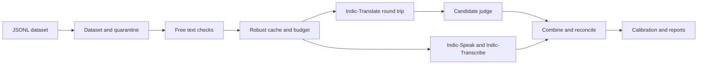

# Design

## Architecture

## Check order

1. Normalize and deterministic number, format, language, and length checks.
2. Sentence-level Indic-Translate round trips only for candidates.
3. OpenAI-compatible LLM confirmation only for candidates or ambiguity.
4. Supplied audio back-transcription and deliberate generated-audio samples.

The scheduler is deterministic. Its decisions are logged per item. The LLM reads Indic text but never writes or rewrites it.
