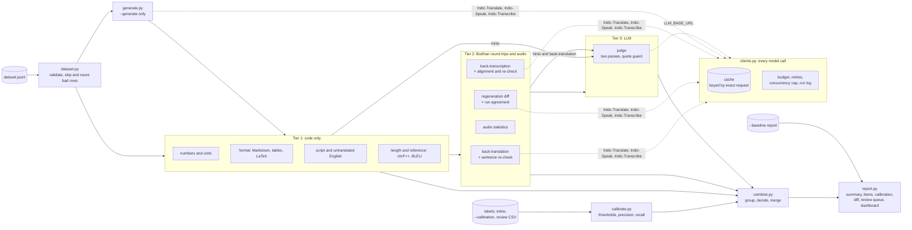

# Design notes

How the harness decides that something is wrong, where it is, and how sure it is.

Four rules shape every part:

1. **Cheap and exact first.** Code-only checks run on every item. Model round trips run after them. The LLM judge is asked only about meaning.
2. **No flag from one noisy signal.** Back-translation and back-transcription make their own mistakes. A noisy finding needs a second, independent signal, or it goes to the review queue.
3. **Code computes every span.** The judge quotes text, and code finds the quote. A quote that is not in the text is discarded.
4. **No constant tuned on the demo.** Thresholds come from statistics of the current run, per language, and from the labels passed in at run time.

## Architecture

| Module | Role |
| --- | --- |
| `__main__.py`, `pipeline.py` | Command line, and the order of stages |
| `config.py` | One table of language facts (prompt name, script, voices) for every code, and prices |
| `dataset.py` | Reads JSONL; bad or partial rows are logged, skipped and counted |
| `clients.py`, `cache.py` | Bodhan and LLM clients. Every call: cache lookup, budget reservation, retries with backoff, log line |
| `normalize.py` | Digit mapping, protected spans, script detection, sentence split; all same-length, so spans need no remapping |
| `checks_text.py` | Tier 1 checks and the robust in-run statistics |
| `checks_roundtrip.py` | Back-translation, regeneration diff, run agreement |
| `checks_speech.py` | Audio reading, statistics, chunked transcription, alignment, re-check |
| `judge.py`, `judge_examples.json` | Rubric, worked examples, parsing, guards, two passes |
| `combine.py` | Candidates into flags |
| `calibrate.py` | Labels, thresholds, metrics with Wilson intervals |
| `report.py` | Every report file |
| `generate.py`, `inject.py` | Missing outputs, and labelled error injection |

## Flow from dataset to report

```mermaid
flowchart TD
    A[Read dataset, filter --langs] --> B{--generate?}
    B -- yes --> C[Translate missing rows; speak missing audio<br/>sentence by sentence]
    B -- no --> D
    C --> D[Tier 1 on every item with a translation:<br/>numbers, format, script, length, reference]
    D --> E[Back-translation of every translation]
    E --> E2{omission suspect?}
    E2 -- yes --> E3[Back-translate again sentence by sentence;<br/>found there = checker noise]
    E2 -- no --> F
    E3 --> F[Regeneration diff, unless we generated it]
    F --> G[Run agreement per language:<br/>>= 8 items and >= 80% reproduced = diff is exact]
    G --> H{audio present?}
    H -- no --> J
    H -- yes --> H1[Audio statistics, no model]
    H1 --> H2{silent?}
    H2 -- yes --> J[garbled, nothing to transcribe, no cost]
    H2 -- no --> H3[Transcribe in pieces under 30 s, align with text]
    H3 --> H4{mid-text omission?}
    H4 -- yes --> H5[Transcribe only that stretch;<br/>heard there = checker noise]
    H4 -- no --> J
    H5 --> J[Judge pass 1, with code findings as hints]
    J --> K{found something, code had hints,<br/>or 1 in 5 by id hash?}
    K -- yes --> L[Judge pass 2; finding counts only if both agree]
    K -- no --> M
    L --> M[Calibrate thresholds on labelled items]
    M --> N[Combine candidates into flags for every item]
    N --> O[Write report; diff against --baseline]
    O --> P{--fail-on-regression N exceeded?}
    P -- yes --> Q[exit 1]
    P -- no --> R[exit 0]
```

**When the costly checks run.**
- Speech is the expensive step. It is generated only with `--generate`, and only for rows without audio.
- Transcription is skipped for silent audio, which is decided from the samples alone.
- The sentence-level re-checks run only for an omission suspect.
- The second judge pass runs only when it can change a decision, plus a 1-in-5 sample that keeps the consistency measurement honest on clean items.
- `--max-cost-inr` reserves the budget before each call, under a lock, so parallel calls cannot overshoot it.
- A check that cannot run becomes `not_run` with a reason, never a flag and never a crash.

## The checks

Every check returns **candidates**: a category, a strength class (exact, noisy or weak), a strength from 0 to 1, spans and evidence.

### Tier 1: code only

- **Numbers and units.** Numbers are taken from both sides after digit mapping (`७२` and `৭২` become `72`) and matched by value. The match is exact first, then with hundred, thousand, lakh and crore scaling, so "910 million" matches "91 கோடி". A number on both sides that disagrees is a *changed* number, which is exact evidence. A source number with no partner is only noisy, because the translator writes some numbers as words. It is dropped if the back-translation carries it. Units and currency beside matched numbers are compared too.
- **Format.** Headings, lists, table rows and cells, separator rows and HTML tags are compared in order. LaTeX, code, fenced blocks and URLs are compared as a set, since translation may move them inside a sentence. Text inside `\text{}` may be translated.
- **Script.** Each word gets its majority script. 20% or more of letters in a foreign non-Latin script means the wrong language. A run of four or more English words copied word for word from the source means untranslated text. Names written in title case are excused.
- **Length and reference.** These are robust z-scores against the language's median in this run (at least 8 items, otherwise languages are pooled; beyond 3 robust standard deviations). Length is weak support. chrF++ and BLEU against a reference are reported, and the reference outlier is noisy.

### Tier 2: Bodhan round trips

- **Back-translation.** For each source sentence, the check counts how many content words reach the back-translation. Under 40% makes an omission suspect. The same test in reverse finds additions. A suspect is re-checked by back-translating the translation one sentence at a time. If the content shows up there, the first round trip lost it, and the suspect is dropped as checker noise.
- **Regeneration diff.** A fresh greedy translation is diffed word by word against the supplied one.
  - Words only in the fresh translation mean an omission.
  - Words only in the supplied one mean an addition.
  - A replacement is a number if it involves digits, a term if it involves Latin letters, and a mistranslation otherwise.
  - The span is exact in the translation.
- **Run agreement.** This is the share of a language's items that this run reproduces exactly. With 8 or more items and 80% or more agreement, diff regions are exact evidence. Otherwise they are noisy. Trust in the diff is measured in each run, not assumed. A language whose median similarity is below 0.5 triggers a warning, because its outputs probably came from another system.

### Tier 2: speech

- **Audio statistics** use no model. The audio is cut into 20 ms frames, and five measures are taken:
  - silence;
  - clipping;
  - inner pauses over 2 s;
  - contrast, since speech has gaps between syllables and steady noise has none;
  - speaking rate and end energy, compared with the language's median.
- **Back-transcription** is done in pieces under 30 s. The transcript is aligned word by word with the translation; numbers and formulas become wildcards, because they are read out unpredictably. Mismatches are classified by **shape**, never by error rate. Indic-Speak's model card reports about 18% character error on clean audio, so a rate threshold would flag clean speech.
  - Missing tail: truncation. Exact if it is at least a third of the text, else noisy.
  - Missing middle: omission. The stretch is re-transcribed alone, and if it is heard there, the suspect is checker noise.
  - Extra words that copy their neighbours, or a phrase heard more often than it is written: repetition. It is located where the phrase is written. The stretch is then re-transcribed alone, with 3 s on each side. If the phrase is heard there more often than it is written, that is a second, independent signal (`transcript_recheck`), because a transcriber loop depends on its context.
  - Almost no words for more than 2 s of audio, or similarity far below the language's own floor: garbled.
  - Single-word slips are ignored as transcriber noise.

## The judge

The judge is the only part that understands meaning. It reads the source, the translation, the back-translation and the code findings, which are passed as hints that may be wrong.

**Rubric** (full text in `judge.py`):
- Seven categories, each with a "not this" case. For example, mistranslation excludes "a valid synonym or freer but faithful phrasing", and number excludes "1 million written as 10 lakh".
- Three severities:
  - **critical** reverses or invalidates the meaning, or could cause harm (a dose, a date, a negation);
  - **major** changes or loses meaning a reader needs;
  - **minor** is noticeable, but the meaning is intact.
- Method: list the source's facts, check each in the translation, look for additions, ignore fluency, confirm machine evidence in the text itself, and report nothing rather than guess.
- Four worked examples come first. They are real Indic-Translate outputs with programmatic errors.

**Guards in code, not only in the prompt:**
- Dataset text is fenced and marked as data, so instructions hidden inside it are not followed.
- The reply is parsed as strict JSON, else as the first complete object. It is retried once, then the judge is `not_run`.
- Every quote must be found in the text after normalization, or the finding is dropped and logged.
- Explanations have every Indian-script character removed. There is no output field for a correction. The LLM never writes Indian-language text.

**Consistency.** A finding counts as judge evidence only when both passes report the same category at overlapping positions. The share of items with the same verdict in both passes is reported per language as judge consistency: 95% on the demo.

**Other LLM uses.** One English paragraph at the top of `summary.md`. It gets only the numbers, has a Latin-only guard, and falls back to a fixed sentence. The error injector never uses the LLM.

## From candidates to flags

1. **Group.** Candidates on one item whose spans overlap, on either side, form one group. Text and speech never mix.
2. **Decide.**
   - An exact candidate flags.
   - A judge finding agreed in both passes flags if it is major or critical and another check sits in the same group, even a weak one. It goes to review if it is minor, or if the judge is alone. On the demo, the judge alone raised 12 flags, none on an injected error.
   - Two different noisy checks flag, unless the judge called the item clean in every pass, which sends it to review.
   - One noisy check flags only with a weak signal beside it. Otherwise it goes to review, or is dropped as checker noise if the judge called the item clean.
   - Weak signals alone are dropped.
   - The judge's clean verdict never counts against a speech group. The judge reads the text, not the audio.
3. **Merge.**
   - Category: the exact check's category, else the one most checks agree on, else the judge's. A mistranslation whose source side is a name or acronym becomes a term. That means one to four capitalised Latin words, excluding a lone capitalised word that starts a sentence.
   - Severity: the judge's, else the highest hint. Rules raise a changed dose, money amount or date to critical, and a lost negation to critical. A single dropped or added word is minor.
   - Span: the narrowest from the strongest class.
   - Confidence: 1 − ∏(1 − strength) over the different checks.
4. **Weighted score.** Minor 1, major 5, critical 10, per 1,000 source words, per language.

## Calibration

- Labels come from the dataset rows, from `--calibration` (JSONL), or from a filled `review_queue.csv`. Label names go through an alias table, so `"Number or unit"` and `number` both score.
- **Thresholds.** Each check has a minimum strength, kept per check and category, set to the lowest value that keeps its false alarms on labelled-clean items at or under 2%.
  - A threshold moves only with at least 10 labelled-clean items and 5 labelled errors that the check touches. Otherwise the default is kept and the reason is written down.
  - It never moves so far that it loses more than half the check's labelled errors.
  - One procedure calibrates every check, including a new one.
- **Metrics** in `calibration.json`:
  - precision, recall and false-alarm rate, overall, per category and per language, with Wilson intervals;
  - localization and category accuracy;
  - per-check thresholds;
  - judge consistency;
  - how often the judge overturned a code suspicion, and how often code overruled a clean verdict;
  - the precision of flags the judge raised alone (always 0 flags now, since those go to review);
  - how many suspicions were dropped as checker noise.
- **Matching.** An item is detected if it has any flag. A label is located by a flag whose span overlaps it on either side. Speech labels, which have no text span, match by category.
- **Holdout.** `tools/holdout.py` splits items by SHA-256 of the id, so all languages of one source land in the same half. It calibrates on half A and scores half B; the README reports half B. The one constant that was chosen while looking at demo data is the one-third missing-tail cut-off for exact truncation. It is the same for every language, and on half B it raised no false alarm.

## Reproducibility and failure

- The cache key is a fingerprint of the exact request: model, route, parameters and input bytes. API keys are not part of it.
- Translation always sends `temperature: 0`.
- The report's cost is the cost of the answers it used, so a cached rerun shows the same number and the report files are byte-identical. Money actually spent goes to `run_log.jsonl`.
- Retries cover 429, 5xx and the gateway's transient 403s, with backoff and `Retry-After`.
- A daily LLM quota fails fast for the rest of the run, and the judge is `not_run` on the items it could not reach.
- `x-ratelimit-limit-parallel-requests` lowers the client's concurrency.
- Translations too long for one call are split by paragraph. Items over 12,000 characters are judged in groups of aligned paragraphs.
- Run with no LLM configured, no keys, or no budget, the harness still writes every report file. The missing checks are `not_run` with their reason.
