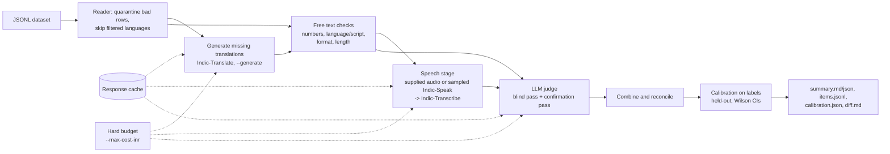

# Design

`python -m bodhan_eval` reads a JSONL dataset, runs a cost-ordered cascade of checks, optionally asks an
LLM judge to confirm candidates, and writes a deterministic report. The scheduler is plain code, not a
free-roaming agent: it decides which checks run, in what order, when to spend money, and when to stop on
budget, and logs each decision with a reason in the per-item `decisions` list.

## Architecture



## Flow: dataset to report

```mermaid
flowchart TD
    A[Row read] --> B{Valid JSON, known language,<br/>usable audio?}
    B -- no --> Q[Quarantine with reason, continue]
    B -- yes --> C{Translation present?}
    C -- no, --generate --> G[Indic-Translate, cost estimated first]
    C -- no, otherwise --> S[Skipped, counted]
    C -- yes --> T
    G --> T[Tier 0, free: numbers, script/language,<br/>format skeleton vs source, per-language length outlier]
    T --> K{Candidate or ambiguity?<br/>suppressed length flag,<br/>addition/omission/term/mistranslation}
    K -- no --> R[Record flags]
    K -- yes --> J{Judge configured<br/>and budget left?}
    J -- no --> U[Mark unchecked, record why]
    J -- yes --> J1[Blind pass, then confirmation pass]
    J1 --> J2[Keep findings both passes agree on;<br/>quotes resolved to spans by the harness]
    J2 --> R
    U --> R
    R --> SP{Audio supplied or sampled?}
    SP -- yes --> AU[Silence, duration, ASR repetition checks]
    SP -- no --> E[Report]
    AU --> E
```

Costly steps (Indic-Speak synthesis, Indic-Transcribe, the LLM judge) run only on a deliberate sample
or on candidates. Before each call the budget estimates the cost; when the cap would be exceeded the
step is skipped and the skip and the money saved are recorded.

## Checks

| Check | Tier | What it does |
|---|---|---|
| `text_numbers` | 0 | Compares numbers (Unicode digits normalised) between source and translation; flags missing and extra values with source and translation spans. |
| `text_language` | 0 | Dominant Unicode script vs the target language's script table; flags untranslated or wrong-script text. |
| `text_format` | 0 | Compares the Markdown/LaTeX skeleton of the translation with the **source**: headings, lists, table shape, code fences, math delimiters, LaTeX commands, links, URLs, `{placeholders}`, HTML tags, bold. No reference needed. |
| `text_length` | 0 | Length-ratio outlier using a median + MAD computed **per language** from the run's own items. Languages with fewer than 8 items abstain. Only produces a *suppressed candidate* for the judge, never a final flag by itself. |
| reference scores | 0 | chrF++ and BLEU with bootstrap CIs where a reference exists. Evidence only, never a flag. |
| speech acoustic | 0 | Silence ratio, duration limit. |
| speech ASR | 2 | Back-transcription with Indic-Transcribe, number-masked n-gram repetition check. |
| LLM judge | 3 | Blind pass then confirmation pass on candidates only. |

## Judge

- Output is English only: category, severity, a verbatim `target_quote`, a verbatim `source_quote`, a rationale.
  The harness resolves quotes to spans by substring search and discards findings it cannot resolve. Indic
  characters are stripped from rationales. The LLM never writes, rewrites or translates Indic text.
- Written rubric (in `judge.py`, `JUDGE_RUBRIC`): category definitions, a three-level severity scale, and the
  verbatim-quote rule. Temperature 0. The first balanced JSON object is parsed.
- Inputs are wrapped as untrusted data with a per-call nonce; prompt-injection patterns are detected and recorded.
- A finding is kept only if the blind and confirmation passes agree on category and span.
- Judge consistency can be measured on a sample with the cache bypassed (`--judge-consistency-n`).

## How results combine

Each check returns flags with evidence and a detector name. Flags with the same category, modality and
span are merged keeping the highest confidence. Single noisy signals carry `suppressed_reason` and are
not reported as findings; they only select items for the judge. If the judge is unavailable those items
are listed as *unchecked* rather than silently passed.

## Calibration

`--calibration` accepts the dataset itself or a labels-only file (`id`, `lang`, `labels`); labels attach to the
run's items by `(id, lang)`. Labels for items missing from the run are ignored with a warning in
`calibration.json`; they never abort the run. A label span may point into the translation or the source:
`--span-ref auto` (default) matches against whichever predicted span overlaps best, `translation` and
`source` restrict matching to one. A match needs category equality and IoU >= 0.3 on the chosen span;
a prediction or label with no usable span matches on category alone.

Labelled items are split by source text into dev and test. Thresholds are swept on dev only and reported
on held-out test items with Wilson intervals and support counts; categories without support are marked
`insufficient_support`. Own labels are tagged `annotator: "self"` and injector labels `annotator: "injector"`
and are never mixed. Where no sweep is possible the documented defaults in `config.py` are used and the
report says so.

## Determinism and failure handling

Report files use sorted keys, sorted items, rounded floats, no timestamps and `\n` line endings; run
metadata is in a separate `run_meta.json`. A rerun from cache is byte-identical at zero model cost. Bad
rows, unknown languages, missing ffmpeg, API errors and budget exhaustion never stop the run; each is
counted and reported.

## Known limitations (not implemented or not measured)

- **No back-translation check.** The round-trip module is a stub and is not scheduled, so semantic
  errors (mistranslation, term, omission inside normal-length text) are only seen by the judge when a
  deterministic check already flagged the item. Recall for those categories is low.
- Speech omission/truncation (WER/CER against the input text) and clipping are not checked.
- Localization is matched at IoU >= 0.3; the brief's 70% overlap target is not enforced as a match threshold.
- Injector-based recall and false-alarm numbers have not been produced; the only labelled data is 80
  self-annotated rows of IN22 reference text.
- Calls run sequentially; there is no concurrency yet.
