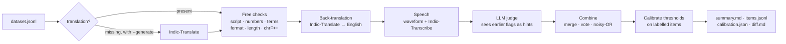

# Translation & Speech Quality Harness

An agentic evaluation harness for **Bodhan Indic-Translate** and **Indic-Speak** outputs. Give it
English source texts (and optionally translations, reference translations and audio); it finds
concrete errors, points at the exact words (or seconds of audio) that are wrong, explains why,
and writes a report you can diff between model versions.

It checks for:

| Area | Categories |
|---|---|
| Translation | omission, addition, mistranslation, number/unit, term/entity, Markdown/LaTeX format, wrong language or script |
| Speech | missing or cut-off speech, repetition, garbled speech (noise, silence, distortion) |

Every flag carries a category, a severity (minor / major / critical), a calibrated confidence, a
character span on the text (and a time span for audio), and the evidence from each check that
agreed. No language-specific rules: a new language is one line in
[`languages.yaml`](src/bodhan_eval/config/languages.yaml).

## Setup

Requires Python 3.10+. No system packages: the `soundfile` wheel bundles libsndfile, and
ffmpeg isn't used.

```bash
cd examples/translation_speech_quality_harness
python3 -m venv .venv
.venv/bin/pip install -r requirements.txt     # pinned; also installs the package (-e .)
cp .env.example .env
```

Or with Docker:

```bash
docker build -t bodhan-eval .
docker run --rm --env-file .env -v "$PWD/report:/app/report" bodhan-eval \
  --dataset sample_data/demo_injected.jsonl --langs hi,ta,bn --out ./report
```

Edit `.env`:

| Variable | Needed for |
|---|---|
| `BODHAN_TRANSLATE_KEY`, `BODHAN_SPEAK_KEY`, `BODHAN_TRANSCRIBE_KEY` (or one `BODHAN_API_KEY` for all three) | back-translation, `--generate`, speech checks |
| `LLM_BASE_URL`, `LLM_MODEL`, `LLM_API_KEY` | the LLM judge, through any OpenAI-compatible chat API |
| `ANTHROPIC_API_KEY` (optional, instead of the three above) | the judge through the Anthropic SDK; used only when `LLM_BASE_URL` is unset |
| `BODHAN_TRANSLATE_RPM` (optional) | steady pacing under the translate rate limit |

Check the keys and API formats with one tiny call per model (under ₹0.10):

```bash
.venv/bin/python scripts/smoke_api.py --lang hi
```

No keys at all? `make check` / `pytest` and the offline end-to-end test still run.

## Run

The interface (extra flags are optional):

```bash
.venv/bin/python -m bodhan_eval --dataset path/to/data.jsonl --langs hi,ta,bn --out ./report \
  [--generate] [--baseline ./previous_report] [--calibration labels.jsonl] [--max-cost-inr 50]
```

`bodhan-eval` is the same command. Evaluate the demo set with its supplied translations and
planted errors, calibrating on the hand labels:

```bash
.venv/bin/python -m bodhan_eval --dataset sample_data/demo_injected.jsonl --langs hi,ta,bn \
  --out ./report --calibration sample_data/human_labels.jsonl --max-cost-inr 5
```

For the speech checks, unzip the [demo audio](#demo-data-sample-report-and-audio) into
`sample_data/` first. Without it, the audio items are logged and scored as text only.

Generate missing translations and audio with Bodhan first, then evaluate them
(speech on half the items):

```bash
.venv/bin/bodhan-eval --dataset sample_data/demo.jsonl --out outputs/gen \
  --generate --speech-sample 0.5 --max-cost-inr 12
```

Compare against an earlier run and fail CI on a regression:

```bash
.venv/bin/bodhan-eval --dataset sample_data/demo.jsonl --out outputs/new \
  --baseline outputs/run --fail-on-regression 1.0     # exit 3 if the score drops > 1 point
```

Calibrate thresholds, then apply them to held-out data:

```bash
# plant known errors into generated outputs (programmatic; --retranslate adds paid ones)
.venv/bin/python scripts/run_to_dataset.py outputs/gen/items.jsonl outputs/gen/dataset.jsonl
.venv/bin/python -m bodhan_eval.inject --dataset outputs/gen/dataset.jsonl --out outputs/inj --rate 0.5
# calibrate on the injected errors plus your hand labels
.venv/bin/bodhan-eval --dataset outputs/inj/injected.jsonl --out outputs/cal \
  --calibration sample_data/human_labels.jsonl
# evaluate new data with those thresholds (honest, out-of-sample numbers)
.venv/bin/bodhan-eval --dataset new.jsonl --out outputs/heldout \
  --thresholds outputs/cal/calibration.json
```

Useful options: `--offline` (cache only, never calls a model), `--no-judge`,
`--judge-repeats N` (consistency check), `--voice NAME`, `--concurrency N`, `--seed N`.
Run `.venv/bin/bodhan-eval --help` for the full list.

### Input format

One JSON object per line. Only `id`, `lang` and `source` are required.

```json
{"id": "hi-001", "lang": "hi", "source": "Water boils at 100 °C at sea level.",
 "translation": "समुद्र तल पर पानी 100 °C पर उबलता है।",
 "reference": "…", "audio": "audio/hi-001.wav",
 "labels": [{"type": "number", "severity": "major", "span": [18, 21], "annotator": "candidate"}]}
```

Bad lines (invalid JSON, missing fields, unknown languages, duplicate ids, missing audio files)
are logged, counted in the report and skipped. They never stop the run. Label types are
matched loosely ("Term/Entity", "number or unit", "truncation" all work).

### Output

| File | Contents |
|---|---|
| `summary.md` | quality score, per-language table, detection accuracy, top failures with the flagged words highlighted, cost |
| `summary.json` | the same numbers, machine-readable |
| `items.jsonl` | per item: final flags, every candidate, every check's evidence, skipped steps |
| `calibration.json` | thresholds, precision / recall / F1 per category (when labels exist) |
| `judge_consistency.json` | agreement when the judge re-judges the same items |
| `diff.md` | new / fixed / changed flags and score changes vs `--baseline` |
| `logs/run.jsonl` | one JSON event per step, including API timings and retries |

**Quality score** = 100 × (1 − total severity weight of final flags ÷ English source words),
with weights minor 1, major 5, critical 10. 100 means no flags.

## How it works



**Checks propose, the combiner decides.** Each check emits *candidate* flags with its own
confidence and evidence:

- **Free, rule-based checks** run on every item: script and language detection from Unicode
  script shares, number and unit matching across digit systems (`१२`, `১২` and `12` are equal),
  verbatim URLs, code and names, and Markdown / LaTeX structure.
- **Back-translation** translates the output back to English and aligns it sentence by sentence
  with the source. A source sentence with no counterpart suggests an omission, an extra
  sentence an addition, and both in the same place a mistranslation. Missing names and numbers
  are checked too. It understands Indian number scales, so "400 million" equals "40 crore".
- **Speech** transcribes the audio and aligns the transcript with the text. Only *runs* of
  missing words count, because ASR always gets odd single words wrong. Numbers, other-script
  words and spelled-out acronyms are "soft": TTS reads "2023" as words, and that's not an error.
  Waveform checks find silence, clipping and noise.
- **The LLM judge** gets the source, the translation as numbered tokens, the back-translation
  and the earlier flags as hints. It answers with token *index ranges*, which map back to exact
  character spans. It never writes Indian-language text: any it produces is removed during
  validation.

The **combiner** groups candidates that overlap, picks the category by a reliability-weighted
vote, and combines the confidences of *independent* checks with noisy-OR. Two checks agreeing
gives more confidence than one, while one check repeating itself adds nothing. Numbers inside an
added or untranslated sentence are folded into that flag instead of being reported again.

**Calibration** picks a confidence threshold per category: the best F1 score, with at most 10%
of clean items flagged. Labels come from the **error injector**, which plants known errors
(deleted sentences, changed digits, inserted sentences, restored English, broken tables,
flipped meanings re-translated by Bodhan, cut or repeated audio, inserted noise or silence),
and from **hand labels** (`--calibration`). Unmatched flags on injected items are never counted
as false positives, because the rest of that output may contain real errors.

**Cost and robustness.** Every model call is cached by its exact request, so re-runs are free
and `--offline` runs are deterministic. A budget (`--max-cost-inr`) is reserved before each
paid call. A paid step that can't run (out of budget, rate limited, API error, the LLM
declining) is skipped and recorded for that item; the run never aborts. After a rate-limit
response, all calls to that service back off together.

**Documentation:** the flow chart above, the architecture diagram and design notes (each
check, the judge rubric, calibration against human labels, and how results combine into flags)
are in [`docs/design.md`](docs/design.md). The judge rubric itself is
[`judge/rubric.md`](src/bodhan_eval/judge/rubric.md).

## Demo data, sample report and audio

| File | What it is |
|---|---|
| [`sample_data/demo.jsonl`](sample_data/demo.jsonl) | the 108 English source items (36 each for hi / ta / bn), text only |
| [`sample_data/demo_injected.jsonl`](sample_data/demo_injected.jsonl) | the same items with Bodhan translations; 56 carry a planted error with its label (`"annotator": "injector"`), 52 are untouched controls |
| [`sample_data/human_labels.jsonl`](sample_data/human_labels.jsonl) | my hand labels for 30 controls (`"annotator": "candidate"`), used with `--calibration` |
| [`docs/sample_report/`](docs/sample_report/) | the report from the demo run: [`summary.md`](docs/sample_report/summary.md), [`diff.md`](docs/sample_report/diff.md) (against the run before hand labels), `summary.json`, `calibration.json`, `items.jsonl` |
| [Demo audio (zip, 32 MB)](AUDIO_LINK) | the 54 Indic-Speak clips (untouched and with planted audio errors). Unzip into `sample_data/` so `audio/<id>.wav` resolves. Generated audio is kept out of git |

The Cookbook keeps datasets in `sample_data/`, so the demo set lives there rather than in the
`data/` folder the assignment's default layout suggests.

## Demo video

[Watch the demo (≤ 5 min)](VIDEO_LINK): a full run on the demo dataset and a walk through the
report.

## Results on the demo set

`sample_data/demo.jsonl`: 108 items (36 each in Hindi, Tamil and Bengali). Single sentences,
paragraphs with numbers and names, Markdown tables and LaTeX, drawn from Simple English
Wikipedia (CC BY-SA 4.0, source URL per item) plus 11 items written for this recipe (CC0).
Rebuild it with `scripts/build_demo_dataset.py`.

| | |
|---|---|
| Generation (108 translations, 54 audio clips) | ₹7.92 Bodhan. Speech takes ~17 s per request; translate is limited to ~25 requests/min |
| Planted errors found (56 planted, 52 controls) | 49 / 56 (88%); addition, number, wrong language and speech cut-off 100% |
| Real Bodhan errors found (30 hand-labelled controls, 15 errors) | 12 / 15 (80%), 1 false alarm |
| Clean items wrongly flagged | 3% of 39 (budget 10%) |
| Category accuracy when found | 94% |
| Span overlap with labels (IoU) | 0.88 |
| Judge consistency (3 re-judgements) | verdict 100%, flags 91% |

Thresholds were calibrated on the planted errors plus 30 hand-labelled controls
([`sample_data/human_labels.jsonl`](sample_data/human_labels.jsonl), made with
`scripts/make_label_sheet.py`). These are in-sample numbers, so treat them as optimistic.

On the *untouched* Bodhan outputs, the harness found real errors: "two bishops" → "two
queens", "the Thar" (desert) → "Thar car", "is still the largest" → "was", "more than 55,000"
→ "about", longitude rendered as latitude, and audio cut off before the end.

**Why hand labels matter.** Without them, untouched outputs count as "assumed clean". Their real
mistranslations then look like false alarms, and calibration raised the mistranslation
threshold until recall was 0%. With the 30 hand-labelled controls, mistranslation recall is
8 / 9.

**Known limits.**
- **Term errors** are the weakest category: 3 / 8 found. The 3 real term errors in the
  hand-labelled controls were only seen at confidence 0.45, below the 0.50 threshold. Lowering
  the threshold would let in many more paraphrase false alarms ("Bangla" vs "Bengali").
- Precision on the 22 controls that weren't hand-labelled is a lower bound, because they may
  contain real errors.
- Speech spans of injected audio errors are approximate in the text (exact in time).
- Back-translation adds paraphrase noise, which is why its candidates get modest confidence.
- **Runtime target likely missed** on a cold cache: 200 items with speech in under 30 min.
  Back-translation runs per sentence, because Bodhan merges lines sent in one batch.
  Indic-Translate allowed about 25 requests/min in our tests, so about 900 calls take
  35-40 min. Speech requests (~17 s each) run in parallel and add little. Cached re-runs take
  seconds.
- Which items get speech checks is a seeded sample (`--speech-sample`), not a decision by the
  LLM or the cheap checks.

**What I'd do next:** route speech checks to the items where they pay off (numbers, names,
long text, or items the cheap checks are unsure about) instead of a random sample; add a
transliteration check for names to lift term recall; and calibrate on a held-out labelled set
to get out-of-sample numbers.

## Tests

```bash
.venv/bin/python -m pytest -q && .venv/bin/ruff check src tests scripts
```

`tests/test_e2e_offline.py` runs the real CLI on 10 recorded items with no network and no keys,
and checks that two runs produce identical reports. The other tests cover normalization, span
alignment, each deterministic check, the combiner, calibration, the injector, the clients
(retries, budget, provider fallbacks) and the reports. Re-record its fixture with
`scripts/record_e2e_fixture.py` after changing a prompt.

## Credits and licenses

- Demo source text: Simple English Wikipedia contributors, CC BY-SA 4.0 (per-item `source_url`),
  and CC0 items written for this recipe.
- Built with AI assistance (Claude Code). All code was reviewed and tested.
