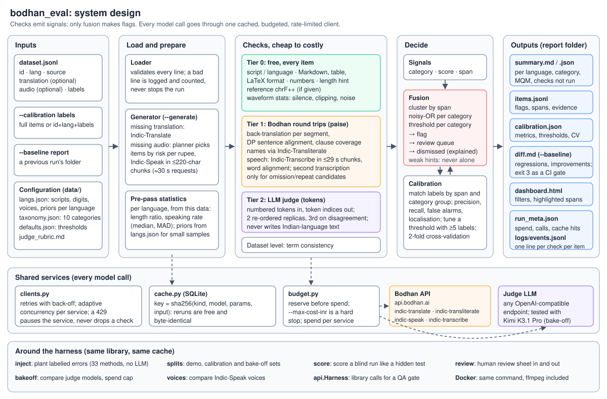
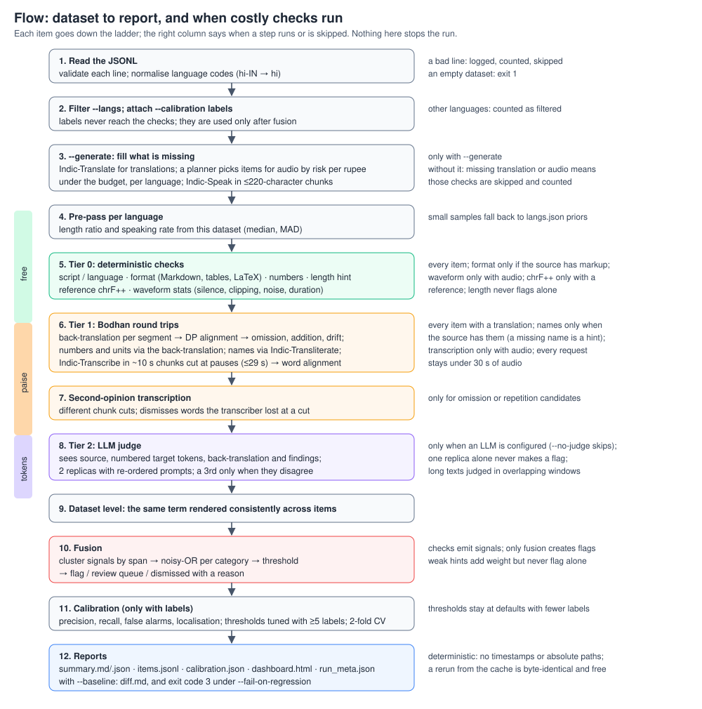

# Translation and Speech Quality Harness for Bodhan Indic models

An agentic evaluation harness that finds, localises and explains quality problems in **Indic-Translate** translations and **Indic-Speak** audio. Every flag says what is wrong, where (character span in the translation or the source), how severe, how confident, and the evidence behind it. It calibrates itself against human labels, compares runs, gates CI on regressions, and works on languages it has never seen.

**Bodhan models:** indic-translate, indic-transliterate, indic-speak, indic-transcribe (round trips included; no other MT/TTS/ASR and no learned quality-estimation model)
**Languages shown:** Hindi, Tamil, Bengali; Telugu and Marathi as held-out; any language in `src/bodhan_eval/data/langs.json` works
**Format:** CLI (`python -m bodhan_eval`) and Python library (`bodhan_eval.api`)

## What it does

Input: a JSONL file of English sources with optional reference translations, system outputs (text and/or audio) and human labels. Output: a report folder with per-item flags and evidence, per-language and per-category summaries with an MQM-style score, the checks that could not run, calibration against labels, cost, a static dashboard, and a diff against a baseline run. Cheap deterministic checks run first, Bodhan round trips next, the LLM judge and the costly speech checks only where they pay off. The LLM only reads and classifies: it never writes Indian-language text, and it answers with token indices, so every span is copied by code.

## Setup

```bash
cd examples/translation_speech_quality_harness          # in the Cookbook; or clone github.com/mysticalseeker24/indic-quality-harness
python -m venv .venv && source .venv/bin/activate     # Windows: .venv\Scripts\activate
pip install -r requirements.txt                       # pinned; or: make setup (adds test tools)
cp .env.example .env                                  # Bodhan keys + judge LLM (any OpenAI-compatible endpoint)
make check                                            # ruff, mypy and the test suite; no keys needed
```

System dependency: `ffmpeg`, only for non-WAV audio. Or Docker: `docker build -t bodhan-eval .` then `docker run --env-file .env -v "$PWD:/work" bodhan-eval --dataset /work/data/demo.jsonl --langs hi,ta,bn --out /work/report`.

## Run

```bash
python -m bodhan_eval \
  --dataset data/demo.jsonl \
  --langs hi,ta,bn \
  --out ./report \
  [--generate] [--baseline ./previous_report] [--calibration labels.jsonl] [--max-cost-inr 50]
```

Writes `summary.md`, `summary.json`, `items.jsonl`, `calibration.json`, `diff.md` (with `--baseline`), plus `dashboard.html`, `run_meta.json` and `logs/events.jsonl` (one line per check per item, so every flag traces back to its evidence). Reruns are byte-identical and free: every model output is cached by its exact input, and `--max-cost-inr` reserves budget before each paid call.

| Optional flag | Default | What it does |
|---|---|---|
| `--judge-models a,b,c` | `LLM_MODEL` | judge model(s) on the same endpoint (several = a jury) |
| `--judge-replicas N` / `--judge-max-replicas N` | 2 / 3 | re-ordered prompts per item; a tie-break when they disagree |
| `--llm-extra-body JSON` | none | e.g. `'{"reasoning": {"effort": "low"}}'` |
| `--fail-on-regression` (+ `--max-new-major N`) | off / 0 | with `--baseline`: exit code 3 when there are more new major or critical problems than allowed (CI gate) |
| `--no-judge`, `--no-speech` | | skip a tier |

Tools around the harness:

| Command | What it is for |
|---|---|
| `python -m bodhan_eval.score --report R --gold gold.jsonl [--labels review.jsonl] [--exclude calibration.jsonl]` | score a finished blind run the way a hidden test would (recall, false alarms, precision, localisation, category accuracy, per category, language, severity and label source) |
| `python -m bodhan_eval.inject --dataset clean.jsonl --out gold.jsonl --with-models` | plant labelled errors: 33 methods over all 10 categories (text edits, re-translated English perturbations, waveform edits); never calls the LLM |
| `python -m bodhan_eval.splits ...` | the unlabelled demo set, a balanced calibration subset and the judge bake-off set from the labelled gold |
| `python -m bodhan_eval.review export/import ...` | a review sheet for a human and its answers back as labels |
| `python -m bodhan_eval.bakeoff --dataset labelled.jsonl --models a,b --max-usd 8` | compare judge models (estimate first, hard spend cap) |
| `python -m bodhan_eval.voices --dataset D --voices "hi=Kavya,Amit" --sample 15 --max-cost-inr 18` | compare Indic-Speak voices on the same texts |

Library: `from bodhan_eval.api import Harness; Harness(max_cost_inr=5).check_translation(source, translation, "hi")` returns flags; `check_speech(text, wav, "hi")` and `evaluate(items)` likewise.

## How it works



1. **Load** the JSONL: every line validated, bad lines counted (never fatal), language codes normalised; `--calibration` labels attached but never shown to the checks.
2. **Generate** (only with `--generate`): missing translations with `indic-translate`; missing audio with `indic-speak` for the items a planner picks by risk per rupee under the budget. Speech is synthesised in chunks of at most 220 characters and transcribed in chunks of at most 29 s, so every audio request stays near Bodhan's 30-second guideline.
3. **Pre-pass:** per-language length ratio and speaking rate from the data itself (median, MAD).
4. **Tier 0 (free):** script / language, Markdown-table-LaTeX format, numbers, a length hint, reference chrF++ when given, waveform statistics.
5. **Tier 1 (Bodhan round trips):** segment-wise back-translation with DP sentence alignment (omission, addition, drift; numbers and units); names via `indic-transliterate`; speech via `indic-transcribe` with word alignment, and a second transcription with different cuts only for omission and repetition candidates.
6. **Tier 2 (LLM judge):** the rubric in `src/bodhan_eval/data/judge_rubric.md`; the translation shown as numbered tokens, answers as token indices (so the LLM never writes Indian-language text and every span is exact); two replicas with re-ordered prompts, a third only on disagreement.
7. **Fusion:** signals that point at the same place are clustered and combined (noisy-OR) per category; above the category threshold a flag, near it the review queue, explained away a dismissal with its reason. Weak hints (length, a name not found) never flag alone.
8. **Calibration** (with labels): precision, recall, false alarms, localisation and category accuracy per category and language; a threshold is tuned only with ≥5 labels, with 2-fold cross-validation next to the in-sample numbers.
9. **Reports:** summary, items, calibration, dashboard, and with `--baseline` a diff (and an exit code for CI).



Every check, the judge rubric, fusion and calibration in detail: [docs/ARCHITECTURE.md](docs/ARCHITECTURE.md). The blind exam: [docs/EXAM.md](docs/EXAM.md).

## Results

**Demo set:** 180 items (60 NCERT-style passages from Wikipedia × hi/ta/bn, a quarter with Markdown, tables or LaTeX; sources and licences in `data/SOURCES.md`), translated and spoken by Bodhan with `--generate`, then 75 errors planted by the injector. Scored out of sample: the 40 calibration items are excluded.

| Measure (125 scored items, judge Kimi K3.1 Pro) | Value |
|---|---|
| Planted errors caught | **60 / 61 (98 %)** |
| All labelled errors caught (incl. real Bodhan errors) | 87 % (items: 90 %) |
| False alarms on clean items | 0 / 24 |
| Precision of flags | 88 % |
| Localisation (flag overlaps the error) / category correct | 84 % / 96 % |
| Cross-validated on the calibration subset (2-fold) | item recall 85 %, false alarms 0 % |
| MQM-style score per language | hi 93.9, bn 93.9, ta 91.2 |

With GPT-6 Luna as the judge the same run catches 92 % of all labels (localisation 92 %); the real-error labels come from a review of Luna-judged flags, which favours Luna.

**Bodhan's own errors.** The un-injected outputs were not clean. Every one of the 124 flags the harness raised on the 180 generated outputs was reviewed against its evidence (`data/clean_run_review.jsonl`): 101 real, 10 debatable, 13 false alarms (fixed since: D46-D48, after which the speech fixes found 10 more real errors and no new false alarms). Highlights a model team can act on:

- **Indic-Speak silently skips text in parentheses or brackets** (36 cases). Confirmed with a controlled test: the same Hindi sentence lasts 10.67 s with the bracket, 10.41 s with the bracketed words deleted, 12.54 s with commas instead; the transcript lacks the words only in the first two.
- Speech around numbers: "80% से अधिक प्रदान करती" spoken as a string of decimals; a skip from one "বন্য বাঘ" to the next; looping.
- Translation: "achieved in 2025" became "will be achieved" in all three languages; "Agra", "tax resistance", "hypotenuse", "2 significant figures", "50 to 55 km" dropped; "transpiration" → water vapour, "stratosphere" → atmosphere, "electric current" → electricity (ta); 12.011 → 12.01; Markdown headings and a whole table flattened.

The demo's real-error labels come from that review (marked `ai-review`), so they only cover what some check flagged: the planted-error recall is the unbiased number.

**Judge bake-off** (50 labelled items, half clean, 10 in held-out Telugu; $5.76 spent):

| Judge | Harness recall / false alarms | Judge-alone P / R | Order consistency | $ / 100 items |
|---|---|---|---:|---:|
| **`moonshotai/kimi-k3.1-pro` (default)** | **96 % / 4 %** | 90 % / 96 % | 94 % | 0.34 |
| `openai/gpt-6-luna` | 96 % / 8 % | 87 % / 96 % | 72 % | 0.06 |
| `google/gemini-4-hydrogen` | 93 % / 0 % | 96 % / 93 % | 94 % | 1.99 |
| `google/gemini-4-neon` | 100 % / 12 % | 81 % / 93 % | 96 % | 5.19 |
| `deepseek/deepseek-v4.1-flash` | 96 % / 12 % | 89 % / 89 % (15 % invalid) | 78 % | 0.12 |
| `anthropic/claude-sonnet-5.5` | 93 % / 20 % | 57 % / 93 % | 62 % | 1.60 |
| `openai/gpt-6.2-sol` | 100 % / 28 % | 49 % / 100 % | 86 % | 0.96 |
| `meta-llama/llama-3.1-8b-instruct` | 85 % / 92 % | 23 % / 78 % | 30 % | 0.01 |

Every model answered in strict `json_schema`. Tested with Kimi K3.1 Pro (reasoning effort low); the harness runs with any OpenAI-compatible model.

**Independent blind exam** (full write-up, protocol and every number: [docs/EXAM.md](docs/EXAM.md)). An independent exam built in a separate project (only Bodhan models, never seen by this repo or tuned on): 146 items in 6 languages (hi, ta, bn, and te, mr, gu; **Gujarati never demoed**), 98 with audio, about half clean, plus a 20-item calibration file. Run **once**, judge Kimi K3.1 Pro, numbers as they came out:

| Measure | Value |
|---|---|
| Labelled errors caught | **91.6 %** (83 labels; items with an error: 96 %) |
| False alarms on clean items | **4.2 %** (3 of 71) |
| Precision / localisation / category correct | 81.5 % / 93.4 % / 98.7 % |
| By severity | critical 10 / 10, major 94 %, minor 82 % |
| Per language (recall / false alarms) | hi 92 / 0 %, ta 86 / 9 %, bn 93 / 0 %, te 100 / 9 %, mr 86 / 8 %, **gu 93 / 0 %** |
| Text categories (addition, mistranslation, number, omission, term, wrong_language) | 100 % caught; format 93 % |
| Speech | omission 6 / 7, garbled 5 / 7, repetition 3 / 6 |
| Cost / runtime | ₹3.83 Bodhan + $1.24 judge; 37.6 min for 166 items (shared the transcription quota with another run) |

Weakest spots, as measured: speech repetition and garbled speech (the transcriber smooths some of them over), and precision of number flags (57 %).

**Exam run B** (a second version of the same 146 items, with `--baseline` run A): `diff.md` lists 18 new problems and 16 fixed ones per language, severity-sorted with evidence (e.g. a number changed 7.25 → 2.75 in Hindi, a unit changed l → ml in Gujarati); ₹0.98 + $0.13, 3.6 min. The whole exam (both runs) cost ₹4.81 + $1.37.


**Voices** (`python -m bodhan_eval.voices`, 15 demo texts per language, every voice speaks the same text, ₹11.8; [sample_report/voices.md](sample_report/voices.md)): the two voices of each language get flagged on the same items (paired difference at most 1 item: hi Kavya/Amit 3/3, ta Anitha/Arun 5/4, bn Ishita/Sourav 3/2), with transcript CER within 3 points; Arun speaks fastest (16.5 characters/s against about 13.5). The speech errors come from the text front end (brackets, numbers), not from the voice.

## Sample report

[`sample_report/`](sample_report/) holds the demo run's text outputs: `summary.md`, `summary.json`, `calibration.json`, `scorecard.md`, `dashboard.html` (open it in a browser) and `items.jsonl`. Audio (180 WAVs, 234 MB zipped; unzip at the repository root so the paths in `data/demo.jsonl` resolve): [release demo-audio-v1](https://github.com/mysticalseeker24/indic-quality-harness/releases/tag/demo-audio-v1).

## Demo video

[Demo video (≤ 5 min): a full run on the demo dataset and a walk through the report](https://github.com/mysticalseeker24/indic-quality-harness/releases/tag/demo-video)

## Limitations

- **Spoken numbers are not verified.** A number read out as words is accepted as that number; whether it is the *right* number is not checked (no number-to-words tables per language). Missing words and loops around it are caught (D47).
- **A single cut word** in speech (under 2 words or 10 characters) is not reported: the transcriber drops short words too often.
- **Units and symbols read out in English inside tables** can make the transcript look garbled (one false alarm on the real outputs).
- **Names written as exonyms or translated** (BCE → கி.மு, Satluj → শতদ্রু) cannot be matched by transliteration; a missing name is therefore only a hint and the judge decides (D46).
- **Format localisation:** a deleted table divider row is detected but not located; with several bold pairs, an unmatched `**` is reported at the last marker.
- **The judge nitpicks** sometimes (near-synonyms, "universal" in a term that already means it); replicas, rubric and calibration keep it at 4 % false alarms on the bake-off set.
- **Labels for real errors** in the demo come from a review of the harness's own flags (not a human), so recall on real errors is not measured; planted errors measure it.

## Cost and runtime

Per 100 items, checking only (no `--generate`): about **₹8 with speech checks** (transcription ₹7.6, back-translation ₹0.2) and **₹0.2 without**, plus the judge: about **$0.75** with Kimi K3.1 Pro (measured on the exam: $1.24 for 166 items; $0.06 with GPT-6 Luna). Generating the outputs costs extra (speech synthesis ≈ ₹23 per 100 items of ~400 characters). Runtime is bound by Bodhan's rate limits, which the harness waits out instead of dropping checks (D43): 146 exam items plus 20 calibration items (98 with audio) took 37.6 min while another run shared the transcription quota; the time is Bodhan's rate limits (HTTP 429 waits), not computation: the 180-item demo re-run from cache takes about 3 min with fresh judge calls and 12 s without. Reruns from the cache take seconds and cost nothing.

## AI assistance

- **Design and research:** Claude (claude.ai) helped read the assignment and the Bodhan API docs, compare check designs, and draft the architecture, test plan and build plan.
- **Implementation:** Claude Code wrote code and tests phase by phase against that plan. Each phase ended at a gate: `make check` (ruff, mypy, pytest) plus that phase's acceptance tests.
- **Review and labels:** Claude Code reviewed the flags on the real Bodhan outputs against their evidence (verdicts in `data/clean_run_review.jsonl`, marked `ai-review`), because a full human listening review did not fit the schedule.
- **Decisions:** the author approved every default, threshold and interface change, chose the judge, set the spending caps for live API runs, and reviewed every change; every line is explainable in the debrief.
