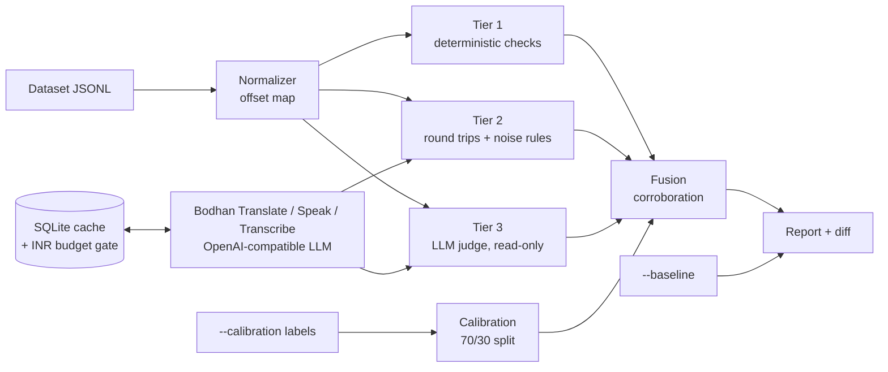
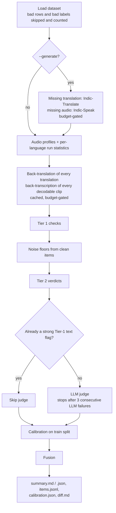

# Translation and Speech Quality Harness (`bodhan_eval`)

Scores Bodhan **Indic-Translate** translations and **Indic-Speak** audio. Each error is flagged with a category,
severity, span and evidence, and the harness can diff two runs. It works on any of the 13 Indic-Speak production languages.

- **Sample report** (138-item demo run): [summary.md](sample_report/summary.md) · [summary.json](sample_report/summary.json) · [items.jsonl](sample_report/items.jsonl) · [calibration.json](sample_report/calibration.json) · [diff.md](sample_report/diff.md)
- **Demo video (≤ 5 min):** https://drive.google.com/file/d/1HsVgEvA-_jwvPhZZN5ZGttzmzpG432dd/view?usp=sharing
- **Demo audio (66 WAV clips, kept out of git):** https://drive.google.com/drive/folders/168vTwFUSj-ircB_yihuWdIxclYzgoF9m?usp=sharing
- **Jump to:** [architecture](#architecture) · [flow chart](#flow-chart) · [checks](#checks) · [design notes](#design-notes) · [results](#results) · [limitations](#known-limitations) · [cost and runtime](#cost-and-runtime) · [data licences](#data-licences)

## Setup

Python 3.10+. Audio is read with `soundfile` + `numpy`, so no `ffmpeg` binary is needed (the `Dockerfile` installs `libsndfile1`).

```bash
cd examples/translation_speech_quality_harness
python -m venv .venv && source .venv/bin/activate   # Windows: .\.venv\Scripts\Activate.ps1
pip install -r requirements.txt
pip install --no-deps -e .
cp .env.example .env
```

Fill in `.env` (never committed). Empty values mean "not set".

```ini
BODHAN_API_KEY=...          # shared key; BODHAN_TRANSLATE_KEY / _SPEAK_KEY / _TRANSCRIBE_KEY override it per model
LLM_BASE_URL=https://api.groq.com/openai/v1   # any OpenAI-compatible endpoint
LLM_MODEL=openai/gpt-oss-20b
LLM_API_KEY=...
# LLM_CONCURRENCY=4         # optional; use 1 on free tiers with tight tokens-per-minute limits
```

Without keys the run still completes. Checks that need a model are skipped, and `summary.md` says which and why.

## Run

```bash
python -m bodhan_eval --dataset path/to/data.jsonl --langs hi,ta,bn --out ./report \
  [--generate] [--baseline ./previous_report] [--calibration labels.jsonl] [--max-cost-inr 50]
```

Dataset rows need only `id`, `source` and `lang`. `reference`, `translation`, `audio` and `labels` are optional.

Common runs:

```bash
# Zero cost: works from a clean clone with no .env, no cache and no audio (takes seconds)
python -m bodhan_eval --dataset sample_data/demo.jsonl --langs hi,ta,bn --out outputs/demo \
  --calibration sample_data/demo.jsonl --max-cost-inr 0

# Full run with the judge, a 20-item judge consistency test and a baseline diff
python -m bodhan_eval --dataset sample_data/demo.jsonl --langs hi,ta,bn --out outputs/full \
  --calibration sample_data/demo.jsonl --baseline sample_report --judge-rerun 20 --max-cost-inr 1

# A language not in the demo, generating translations and audio (hard INR cap)
python -m bodhan_eval --dataset sample_data/unseen_mr.jsonl --langs mr --out outputs/mr --generate --max-cost-inr 0.5

make check   # tests, lint, guardrails (no non-Bodhan models, no secrets, no Indic literals in prompts), layout
```

Useful extras:
- `--judge-max-items N`: cap the judge (default: every eligible item; `0` turns it off).
- `--llm-concurrency N`: parallel judge calls.
- `--offline`: use the cache only.
- `--ci`: exit 1 on a significant regression against `--baseline`.

**Output folder:**
- Report files: `summary.md`, `summary.json`, `items.jsonl`, `calibration.json`, and `diff.md` (with `--baseline`).
- Generated thresholds: `thresholds.generated.json`, plus `thresholds.json` (with `--calibration`).
- A rerun from cache rebuilds all of the above byte-identical, at ₹0.
- Only `run_meta.json` (runtime, spend, cache hits) and `logs/run.jsonl` (per-item, per-check structured log) change between runs.

The demo's 66 audio files are not committed; to run speech checks on `sample_data/demo.jsonl`, download them from the [demo audio folder](https://drive.google.com/drive/folders/168vTwFUSj-ircB_yihuWdIxclYzgoF9m?usp=sharing) into `sample_data/audio/`. Rows whose audio is missing are counted, and their speech checks are skipped.
To rebuild the demo set (translations, audio and injected errors), run `python scripts/build_demo.py --help`.

## How it works

Cheap checks run first. Costly ones run only where they can change a verdict. Every model output is cached by its exact input.

1. **Tier 1, free:** numbers, script, Markdown/LaTeX format, length, reference chrF++, API truncation, audio silence/clipping/noise, speaking rate.
2. **Tier 2, Bodhan round trips:** back-translation to English with Indic-Translate, and back-transcription with Indic-Transcribe.
   Every divergence is classed as `system_error`, `checker_noise` or `uncertain`, so the checkers' own mistakes are not flagged.
3. **Tier 3, LLM judge:** it reads the translation and returns errors with verbatim quotes. It never writes Indic text.
   Items that already fail a Tier-1 check skip it.
4. **Fusion:** a judge error counts only if its quote is found in the translation **and** an independent check agrees.
   Otherwise it goes to a review queue that is shown in the report but never counted.

### Architecture



### Flow chart



### Checks

Each check is one function that returns `list[Flag]` (category, severity, span, evidence, confidence).
Spans are character offsets into the original text, or seconds for audio.
*Strong* flags count. *Weak* signals are reported but never count on their own.

| Check | Categories | Counts (strong) when |
|---|---|---|
| `numbers` | number_unit | a source number is replaced, or a unit changes (handles `१,००,०००` vs `100,000`, number words) |
| `script` | wrong_language_script, omission | output is empty, copies the source, is in the wrong script, or leaves ≥ 4 English words outside code/math/URLs |
| `format` | format | headings, lists, tables, code fences, inline code, LaTeX or link URLs differ line by line |
| `length_ratio` | omission, addition | weak only: a length outlier for its language in this run |
| `reference_chrf` | metric | chrF++ when a reference is given |
| `api_truncation` | omission | the translation API stopped at its length limit |
| `audio_sanity` | speech_garbled | clipping, long silence, noise bursts, noise-floor outlier, undecodable audio |
| `audio_duration` | speech truncation / repetition | weak only: speaking time per character is an outlier |
| `back_translation` | omission, addition, number_unit | the round trip loses or adds content beyond the clean noise floor **and** another check agrees |
| `asr_roundtrip` | speech_* | words lost, repeated or garbled beyond the clean floor, confirmed by the audio |
| `llm_judge` | the 7 text categories | its quote is found in the translation **and** a compatible check agrees |

To add a check, write one function with `@register(...)` in `src/bodhan_eval/checks.py` and add a test.

### Codebase map

Every module in `src/bodhan_eval/` is flat and single-purpose (13 modules + package entrypoints):

| File | Responsibility |
|---|---|
| `config.py` | `.env` settings, 23-language table, 10-category taxonomy, thresholds, structured logging |
| `infra.py` | HTTP retry/backoff, SQLite content cache, INR budget ledger, statistics (Wilson CI, robust-z, McNemar) |
| `dataset.py` | JSONL dataset and label loader (skips and counts bad rows, bad labels, missing audio) |
| `text.py` | Unicode chunk normalizer with offset map, script profile, protected regions, segmentation, spans |
| `audio.py` | WAV I/O (`soundfile`) and 20 ms frame-level acoustic profiling (`numpy`) |
| `clients.py` | Async Bodhan (`indic-translate`, `indic-speak`, `indic-transcribe`) and OpenAI-compatible LLM clients + `--generate` |
| `checks.py` | Tier-1 check registry and all 8 zero-cost deterministic text and audio checks |
| `roundtrip.py` | Tier-2 back-translation and ASR comparison, checker-noise separation, clean noise floors, router |
| `judge.py` | Tier-3 read-only LLM judge prompt and runner, corroboration fusion (`review_queue`), `--judge-rerun` consistency |
| `calibration.py` | 70/30 hash split, train-set confidence cutoff sweep, held-out metrics |
| `report.py` | Deterministic report writer (`summary.md`/`.json`, `items.jsonl`, `calibration.json`) and McNemar `diff.md` |
| `pipeline.py` | 7-pass orchestrator and CLI (`argparse`, invoked via `__main__.py`) |
| `inject.py` | Programmatic text and audio error injector (zero LLM imports), driven by `scripts/build_demo.py` |

## Design notes

- **Normalization** (`text.py`):
  - Handles NFC, zero-width characters, Malayalam chillu, digits from any script (mapped to ASCII), and Indic/Urdu punctuation.
  - Keeps an offset map, so every span points into the original text.
  - Judge quotes are matched exactly, then normalized, then with punctuation stripped. There is no fuzzy matching, and a quote that is not found is never stored.
- **Checker noise** (`roundtrip.py`):
  - ASR differences that are only spelling, matras, digits written as words, or transliteration count as noise.
  - Noise floors are the 5th/95th percentiles of the run's own clean items: per language when there are ≥ 15 clean items, otherwise pooled.
  - Nothing is keyed to the demo data or to a specific language.
- **Judge** (`judge.py`):
  - English-only prompt at temperature 0. It gives a binary verdict first, then errors with quotes.
  - Invalid JSON gets one repair retry.
  - Consistency is measured with `--judge-rerun N` (the same request, cached separately).
- **Calibration** (`calibration.py`):
  - Items are split 70/30 by `sha256(id)`.
  - The judge's confidence cutoff is tuned on the train split to maximise F1 with ≤ 10% false alarms.
  - Headline metrics come from the held-out split, with Wilson 95% intervals.
- **Robustness:**
  - A bad row, label, audio file or check is logged, skipped and counted. It never stops the run.
  - API calls are async, with concurrency limits, retries with backoff, `Retry-After` handling and timeouts.

## Results

We report both the **development set** (`sample_data/demo.jsonl`, seed 7) and a **fresh-seed verification set** (`seed 19`, evaluated once on untouched code and frozen thresholds).

- **Development-set disclosure:** The held-out split of `sample_data/demo.jsonl` (138 items, 46 each in Hindi, Tamil and Bengali; 72 items with one programmatically injected error + 5 `reviewed_preexisting` real Bodhan format defects) was partly inspected while developing post-hoc error-analysis fixes. Following an audit, three overfitted changes (a shared antonym list in `back_translation`, a regex style-nitpick filter in `parse_judgment`, and lowering `duration_confirm_z` from `2.0` to `0.7`) were reverted. The retained post-hoc changes are:
  1. Clause-level back-translation recall (`min_clause_recall`) and sentence-level precision (`min_sent_precision`) in `roundtrip.py` (minimum segment length of `>= 15` characters: set during development, applied to all languages, checked on seed 19), plus fallback character spans `(0, len(translation))` for unlocalized back-translation omission/addition flags.
  2. Fuzzy-aware entity replacement detection (`entities_swapped`, `rapidfuzz >= 0.70`) in `roundtrip.py`, plus `COMPATIBLE` cross-corroboration between `term_entity` and `mistranslation`/`omission` in `judge.py`.
  3. Bounded `digit_vs_word` ASR noise rules (`len(ref) <= 2*num_tokens + 1`, `len(hyp) <= 4*num_tokens + 1`, no internal repeat) and single-word / mid-word stem repetition detection in `_find_repeat` (`>= 5`-character prefix/suffix stem match: set during development, applied to all languages, checked on seed 19) in `roundtrip.py`.
  4. 1-character boundary adjacency (`tol = 1.0`) for zero-width integer omission spans in `text.py`.
- **Fresh-seed test (`--seed 19`, untouched code):** Included as `sample_data/fresh_seed19.jsonl` (text only; 8 each across the 8 free programmatic categories = 64 injected items + 5 `reviewed_preexisting` labels on the same 138 clean bases). Regenerating it from scratch requires first building the clean base outputs in `outputs/demo_build/` (via `build_demo.py prepare` and `--generate`), then running:
  ```bash
  python scripts/build_demo.py inject --seed 19 \
    --per-category "format=8,number_unit=8,omission=8,addition=8,wrong_language_script=8,mistranslation=0,term_entity=0,speech_omission_truncation=8,speech_repetition=8,speech_garbled=8" \
    --out outputs/fresh_seed/fresh.jsonl --audio-dir outputs/fresh_seed/audio --offline --max-cost-inr 0
  ```
  It was evaluated once without changing any code or thresholds. **`mistranslation` and `term_entity` were not re-tested on fresh data** because generating new instances requires paid Bodhan re-translations.
- **No human labels were added for seeded errors**, and **weak signals are never counted as recall**. Programmatic injections are likely easier to catch than real model errors.

### Headline vs. targets (held-out split and all 138 items, Wilson 95% intervals)

| Metric | Target | Development set (`demo.jsonl`, seed 7)<br/>Held-out (`n=44`) | Development set (`demo.jsonl`, seed 7)<br/>All items (`n=138`) | Fresh-seed, untouched code (`seed 19`)<br/>Held-out (`n=44`) | Fresh-seed, untouched code (`seed 19`)<br/>All items (`n=138`) |
|---|---|---|---|---|---|
| Detection recall (items) | ≥ 80% | **84.0%** [65.3–93.6] (21/25), met | **85.1%** [75.3–91.5] (63/74) | **94.7%** [75.4–99.1] (18/19), met | **84.8%** [74.3–91.6] (56/66) |
| False alarms, strict | ≤ 10% | **5.3%** [0.9–24.6] (1/19), met | **4.5%** [1.6–12.5] (3/66) | **19.2%** [8.5–37.9] (5/26), **MISSED** | **10.8%** [5.6–19.9] (8/74) |
| False alarms, reviewed | ≤ 10% | **5.3%** [0.9–24.6] (1/19), met | **1.6%** [0.3–8.3] (1/64) | **16.0%** [6.4–34.6] (4/25), **MISSED** | **8.3%** [3.9–17.0] (6/72) |
| Localization (span overlap) | ≥ 70% | **100.0%** [85.1–100.0] (22/22), met | **93.9%** [85.4–97.6] (62/66) | **100.0%** [83.2–100.0] (19/19), met | **98.3%** [91.0–99.7] (58/59) |
| Category accuracy | ≥ 70% | **86.4%** [66.7–95.2] (19/22), met | **90.9%** [81.6–95.8] (60/66) | **94.7%** [75.4–99.1] (18/19), met | **96.6%** [88.5–99.1] (57/59) |
| Judge consistency (same verdict) | ≥ 90% | **85.0%** [64.0–94.8] (17/20), **MISSED** | — | not re-run | — |
| Determinism | identical rerun at ₹0 | met | met | met | met |

- Secondary judge-consistency line (`demo.jsonl`, `--judge-rerun 20`): **Same counted judge flags after fusion: 100.0% [83.9–100.0] (20/20)** (the 3 raw verdict disagreements on Bengali items were uncorroborated `judge_only` findings that fusion sent to `review_queue` in both passes).

### Per-category recall (all 138 items, counted flags only; weak signals never counted)

| Category | Development set (`demo.jsonl`, seed 7) | Fresh-seed, untouched code (`seed 19`) |
|---|---|---|
| `format` | **100.0%** [77.2–100.0] (13/13) | **100.0%** [77.2–100.0] (13/13) |
| `number_unit` | **100.0%** [67.6–100.0] (8/8) | **100.0%** [67.6–100.0] (8/8) |
| `wrong_language_script` | **100.0%** [67.6–100.0] (8/8) | **100.0%** [67.6–100.0] (8/8) |
| `addition` | **87.5%** [52.9–97.8] (7/8) | **87.5%** [52.9–97.8] (7/8) |
| `omission` | **75.0%** [40.9–92.8] (6/8) | **75.0%** [40.9–92.8] (6/8) |
| `speech_garbled` | **100.0%** [67.6–100.0] (8/8) | **75.0%** [40.9–92.8] (6/8) |
| `speech_omission_truncation` | **50.0%** [21.5–78.5] (4/8) | **87.5%** [52.9–97.8] (7/8) |
| `speech_repetition` | **50.0%** [21.5–78.5] (4/8) | **37.5%** [13.7–69.4] (3/8) |
| `term_entity` | **100.0%** [51.0–100.0] (4/4) | *not re-tested on fresh data (`n=0`)* |
| `mistranslation` | **0.0%** [0.0–49.0] (0/4) | *not re-tested on fresh data (`n=0`)* |

Per-language and per-category tables, top failures and missed errors are in [sample_report/summary.md](sample_report/summary.md).

## Known limitations

1. **Pure semantic mistranslations without entity or number changes** (`0/4` counted recall on `demo.jsonl`) and subtle omissions (`6/8` on both `demo.jsonl` and `fresh.jsonl`): the LLM judge flags them, but when back-translation stays inside the clean chrF++ noise floor there is no independent second check to corroborate the judge, so fusion routes them to `review_queue`.
2. **Short audio truncations and repetitions** (`duration_confirm_z = 2.0`): short cuts or 1-word loops (`4/8` truncations and `4/8` repetitions on `demo.jsonl`; `7/8` truncations and `3/8` repetitions on `fresh.jsonl`) often shift speaking time per character by less than 2 robust standard deviations, leaving `asr_tail_missing` / `asr_repeat` uncorroborated (`uncertain`). Conversely, when different items are left clean under a new seed (`fresh.jsonl`), genuine ASR or back-translation quirks on clean items raised held-out reviewed false alarms to `16.0% (4/25)` (`8.3% (6/72)` across all 72 reviewed-clean items).
3. **Judge variance:** `openai/gpt-oss-20b` agreed on 17/20 raw binary verdicts (`85.0% [64.0–94.8]`, missing the 90% target; `hi 7/7`, `ta 6/6`, `bn 4/7`). Secondary metric: counted judge flags after fusion agreed on `20/20 (100.0%)`.
4. **If the LLM is down,** judging stops after 3 consecutive failures. Those items get Tiers 1 and 2 only, and the report says so.

## Cost and runtime

From the live demo runs' `run_meta.json` and `logs/run.jsonl` (138 items, 66 with audio):
- **Round trips:** 135 back-translations + 66 transcriptions took 494 s.
  - Translate rate limits (45 HTTP 429s, pauses of about 60 s) held back-translation to ≈16 calls/min.
  - Transcription calls took ≈1.7 s each.
- **Judge:** 109 calls took 674 s on Groq's free tier (8k tokens/min, ≈6.2 s per item). Uncontended calls take ≈1.6 s.
- **Rerun from cache:** ≈1.4 s, ₹0.

**Estimate for 200 items in 3 languages with speech checks** (audio supplied):
- Back-translation ≈ 12–13 min; transcription overlaps with it.
- Judge (≈150 items at 4 in parallel) ≈ 1–2 min.
- **Total ≈ 15 min.** With a free-tier LLM, ≈ 28–30 min.
- `--generate` adds speech synthesis (≈4.3 s per clip at concurrency 2). This was not measured end to end.

**Cost per 100 items:**

| Configuration | Bodhan cost |
|---|---|
| With speech checks | ≈ ₹0.55 (₹0.06 translate + ₹0.49 transcribe) |
| Text only | ≈ ₹0.06 |
| `--generate` | + ≈ ₹1.79 (mostly Indic-Speak) |

The judge is billed by your LLM provider. The whole project used ₹4.02 of Bodhan credit.

## Data licences

- **Demo sentences:** 38 English sentences and their human Hindi, Tamil, and Bengali references sampled with a fixed seed from the Hugging Face `google/fleurs` test TSVs (`raw_transcription` column, CC BY 4.0; underlying text from FLoRes-101, CC BY-SA 4.0), saved in `sample_data/fleurs_sources.jsonl`.
- **Markdown passages:** 8 short English Markdown/LaTeX passages written for this recipe (CC0), saved in `sample_data/markdown_sources.jsonl`.
- **Translations, audio, and error injection:** `sample_data/demo.jsonl` (138 items = 46 sources × 3 languages) was built with `scripts/build_demo.py` by generating translations and audio with Bodhan `indic-translate` / `indic-speak`, programmatically injecting 72 errors (`bodhan_eval.inject`, seed 7), and tagging 5 reviewed pre-existing Bodhan defects (`sample_data/known_issues.jsonl`). Generated audio is kept out of git.

Details and citations: [sample_data/LICENSE_DATA.md](sample_data/LICENSE_DATA.md).

## AI assistance

- **Claude Code:** planning, API probing, Blocks 1–5 (normalization, Tier-1 checks, injector, round trips), and the final pre-submission audit and fixes.
- **Antigravity:** live judge runs, calibration, reports and baseline diff, packaging and docs.
