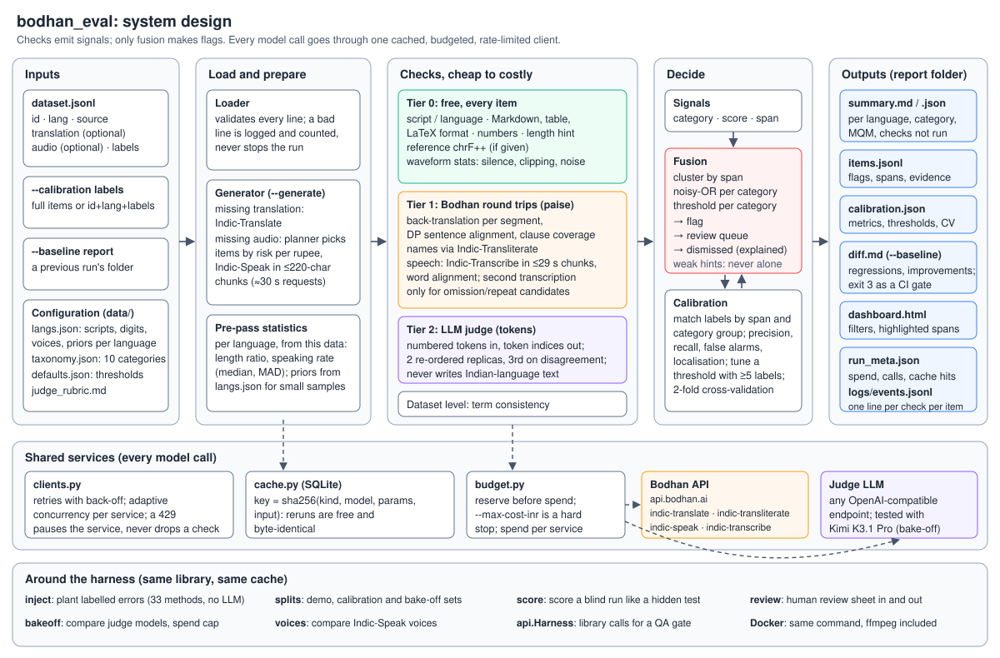
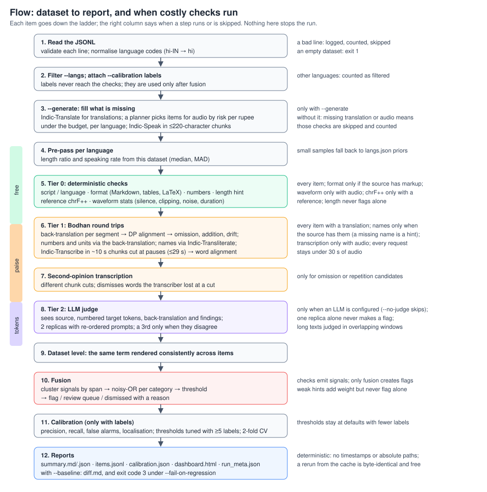

# Architecture and design notes

> Implemented and tested end to end; the numbers quoted in README.md and docs/EXAM.md come from real runs only.

## 1. Architecture

## 2. Flow and when costly checks run

Cost ladder: tier 0 is free; back-translation and transliteration cost fractions of a paisa per item; the judge costs LLM tokens (we pay only for the 2nd/3rd opinion where needed); speech synthesis is the expensive step, so the planner selects items by risk score per rupee under the budget, stratified by language; transcription is cheap, and the second opinion runs only for candidates.

## 3. The checks

| Check | Tier | Catches | How | Noise guard |
|---|---|---|---|---|
| `script` | 0 | wrong language/script, untranslated English | letter share by Unicode script range from `langs.json`; English runs with stopwords (a number or kept name inside a run neither ends it nor counts as English); same-script languages told apart by function words and marker letters | Latin allowed for names/acronyms/formulas copied from the source and inside math/code/URLs |
| `format` | 0 | broken Markdown, tables, LaTeX, code, links | line-kind alignment, table column counts, math segments compared by normalised key, delimiter and brace balance | `\text{}` contents ignored; digits-only formula changes left to `numbers` |
| `numbers` | 0 (+BT) | changed/missing/added numbers, units, months | multiset of canonical numbers after digit normalisation; unit/month families via back-translation | number written in words is explained by the back-translation; English number words in source accepted |
| `length` | 0 | omission/addition hint | robust z-score of log length ratio vs this language's median in the dataset | never flags alone (max score 0.35) |
| `reference` | 0 | — | chrF++ and BLEU when a reference exists | metrics only |
| `back_translation` | 1 | omission, addition, meaning drift | segment-wise back-translation; monotonic DP sentence alignment; clause coverage | content must be missing from the *whole* back-translation; partial findings stay below threshold unless corroborated |
| `entities` | 1 | wrong/garbled names and terms; inconsistency across items | source entities → Latin match, or Indic-Transliterate rendering found by sliding-window similarity, or confirmed by back-translation | all three paths must fail |
| `judge` | 2 | mistranslation and everything above | LLM with written rubric (`data/judge_rubric.md`), numbered tokens in, token indices out, strict JSON schema | one replica alone stays below threshold; replicas use re-ordered prompts and cannot see each other; spans validated |
| `audio_stats` | 0 | garbled audio, duration anomalies | 20 ms frames: level relative to the clip's speech level, spectral flatness, clipping runs; speaking rate vs language median | thresholds relative to each clip; duration only corroborates |
| `asr` | 1 | speech omission/truncation, repetition, garbled | chunks cut at pauses near every 10 s (up to 29 s to keep a sentence whole) → Indic-Transcribe → word-level Levenshtein alignment → contiguous gaps and repeated n-grams; chunk boundaries become time anchors for every speech finding | contiguous runs only; duration must agree; second-opinion transcription on long chunks cut away from the first cuts dismisses ASR misses |

## 4. The judge

- **Why token indices.** The translation is shown as `[0]पानी [1]समुद्र …`. The judge returns `target_tokens: [4, 4]`, so the LLM never writes Indian-language text (a hard rule), spans map exactly back to characters, and impossible indices are rejected. Span marking by quotation is a known weakness of generative judges.
- **Rubric.** `src/bodhan_eval/data/judge_rubric.md`: seven translation categories, explicit "do not report" list (paraphrase, style, register, accepted transliteration, native vs Latin numerals), MQM severities, JSON-only answer.
- **Answer format.** A strict JSON schema mirrors the rubric's answer shape. If the endpoint refuses it, the client falls back to JSON mode, then to a plain prompt whose answer is parsed for a JSON object; the format that worked is remembered per model and reported in `run_meta.json`.
- **Reliability.** Temperature 0, cached by exact prompt. Two replicas with sections re-ordered (measures order robustness; identical re-asks would always agree from cache), a third only when they disagree on a category (`--judge-max-replicas`, default 3); an invalid answer is replaced the same way. Each replica sees only the earlier checks' findings, never another replica's verdict. A separate repeat-consistency sample (`--judge-repeat-sample`, default 10 % of items chosen by hash) re-sends the first prompt unchanged; it is a measurement and adds no evidence. Order consistency is reported overall and per language, repeat consistency and the tie-break rate overall. The judge sees deterministic findings and back-translations but is told both may be wrong.
- **Jury.** `--judge-models a,b,c` spreads replicas over several models on the same endpoint (replica k → model k mod M, every model votes at least once); each vote is its own evidence source in fusion.
- **Long texts.** Over 1,200 whitespace tokens, the translation is judged in windows of whole sentences that share one sentence with their neighbours; the source window is the proportional range plus 15 % on each side, widened to whole sentences, and the prompt says so. Token indices are mapped back to the full text. Items needing more than 8 windows are skipped (cost guard).
- **Bias control.** LLM judges over-report MISTRANSLATION/MAJOR and struggle to say "no error"; one judge replica alone never reaches a flag (only the review queue), two agreeing replicas do, and calibration tunes the per-category thresholds from labels.
- **Choosing the model.** `python -m bodhan_eval.bakeoff --dataset labelled.jsonl --models a,b --out outputs/bakeoff --max-usd 5` runs tiers 0–1 once, then only the judge per model, and reports judge-alone precision/recall per category, both consistency rates, invalid-output rate, tokens and $ per item, and harness recall / false alarms with that judge (default thresholds, so models compare on equal terms). It prints a cost estimate and refuses to start above `--max-usd`, stops taking items once real spend reaches it, and reruns from cache for free.

### Where in the text a speech finding is (K5)

Indic-Transcribe returns text, not word timings, so time positions come from two things. (1) Speaking time: between two known points, position follows only the frames with sound, so a pause or an inserted silence does not drag later positions forward. (2) Anchors: every ASR chunk has a known time range, and the word alignment tells which text words its transcript covers, so each chunk maps its time range to exactly those characters, whatever the speaking rate elsewhere. That is why the primary transcription is cut near every 10 s (same per-second price, more anchors), while a chunk may stretch to 29 s rather than cut a sentence. `audio_stats` runs first and places silences, noise and clipping with one proportional anchor; once the transcript exists, `asr` re-places those findings with its anchors (`details.located_by`).

## 5. From signals to flags

Each check emits `Signal(category, score, span, source_span, evidence)`. `fusion.py`:
1. **Clusters** signals of compatible categories whose spans overlap (translation or source side).
2. **Combines** evidence with noisy-OR over the strongest signal per check (each judge replica is its own source): `P = 1 − Π(1 − sᵢ)`.
3. Picks the **category** with most total evidence (ties by precedence in `taxonomy.json`) and the **narrowest span**.
4. `P ≥ threshold[category]` → flag; within 0.2 below → review queue; otherwise kept only in logs.

Typical outcomes: a changed digit (0.9) flags alone; judge replica (≈0.45) + back-translation clause omission (≈0.45) → 0.70 flags; a single judge replica → review queue.

## 6. Calibration

Labels (inline or `--calibration`) are matched to flags by span overlap and category group. Reported: precision/recall/F1 per category, recall and false-alarm rate per language, localisation, category accuracy (group and exact), per-check precision/recall *before* fusion (which check carries which category), judge consistency. Thresholds are tuned per category by grid search on F1 over the fused scores (categories with < 5 labels keep defaults; ties → the more conservative threshold). Because tuning and scoring on the same items is optimistic, metrics are also reported with 2-fold cross-validation.

### Measuring the harness: injector and scorecard

- **Injector** (`python -m bodhan_eval.inject`, package `inject/`): plants one known error per chosen item, with a label (category, severity, span, `annotator: injector:<method>`). 33 methods across all 10 categories, each with a fixed severity (table in `inject/core.py`): programmatic text edits (delete a phrase/clause/sentence, repeat or insert a sentence, swap a word or name, change a digit or drop a decimal point, break a table/heading/bold/formula, leave English), `--with-models` edits (change one aligned English sentence — negation, antonym, relation, quantifier, unit, month, extra clause — translate it alone with Indic-Translate and splice it in; the label is where the two single-sentence translations differ), and waveform edits at word gaps (truncation, cut, repetition, silence, noise, clipping) labelled through the same proportional time map the waveform check uses. The RNG is seeded per item and per method, so reruns are byte-identical and an item's fate never depends on other items. The injector holds no LLM client (tested). A translation edit leaves the old audio stale: it is re-synthesised with `--with-models`, otherwise dropped.
- **Splits** (`python -m bodhan_eval.splits --gold <labelled demo> [--heldout-gold ...] [--extra-labels <review>] --out-dir data`): from the labelled demo it writes the unlabelled `demo.jsonl` the harness runs on, a 40-item calibration subset (half clean; error items round-robin over categories, each pick from the language least represented so far) and the judge bake-off set (text categories only, plus 10 items of a held-out language and every human-reviewed item). Seeded; input files are never rewritten.
- **Scorecard** (`python -m bodhan_eval.score --report <run> --gold <labels> [--labels <review>] [--exclude <calibration subset>]`): scores a finished blind run the way a hidden test would — recall (labels and items), false-alarm rate on clean items, precision, localisation, category accuracy, per category, language, severity and label source (injector method or annotator), plus how many missed labels the review queue holds. Matching is `calibrate.match_item`, so the numbers agree with `calibration.json`.

### Reports and extras

- **summary.md / summary.json**: per language (items, flagged, uncertain, MQM-style score: 100 minus severity penalties per source word, minor 1 / major 5 / critical 10), per category with severities, the 10 worst failures with evidence, a table of **checks that could not run** (ran / skipped or not applicable / failed, with reasons: zero flags on an unchecked item must not read as clean), calibration, cost, data problems.
- **diff.md** (`--baseline`): flags matched by category group and span overlap; regressions and improvements by severity. `--fail-on-regression` turns it into a CI gate (exit 3 above `--max-new-major`).
- **dashboard.html**: one static page per report; filters by language, category, severity and check; spans highlighted in source and translation; data inserted with `textContent` only.
- **Library** (`bodhan_eval.api.Harness`): `check_translation`, `check_speech`, `evaluate`; a run context per call, so it is thread-safe; independent of the CLI.
- **Voice comparison** (`python -m bodhan_eval.voices`): the same texts spoken by each voice, speech checks per clip, paired counts.

## 7. Engineering

- **Cache**: SQLite, key = SHA-256 of `{kind, model, params, exact input}` (audio by content hash); stores the price of each output, so a rerun reports the same "cost of outputs used" while spending ₹0.
- **Budget**: reserve the estimated cost before every paid call; refuse (and record `skipped: budget`) if it would cross `--max-cost-inr`.
- **Concurrency and retries**: thread pool across items; one adaptive limit per service (translate, transliterate, speak, transcribe, llm): HTTP 429 halves it (minimum 1; parallel 429s from one window count once), 20 successes in a row add one back up to `--concurrency` (AIMD, like TCP). Bodhan and the LLM share one retry policy: a 429 pauses the whole service for its `Retry-After` (capped at 60 s; otherwise exponential back-off with jitter) and is waited out for up to 15 min per call (D43); 5xx/timeouts back off without halving, up to 5 attempts. The OpenAI SDK's own retries are off, because they cannot exempt 429. Budget is reserved once per logical call, so retries never count twice.
- **Determinism**: report files have no timestamps or absolute paths and are serialised with sorted keys; runtime and money spent live in `run_meta.json`.
- **Logs**: `logs/events.jsonl`, one line per item × check with status, duration, signals and cache hits, so every flag traces to its evidence.
- **Extensibility**: languages via `langs.json`, label vocabularies via `taxonomy.json` aliases, thresholds via `defaults.json`, checks via a small plug-in class.

## 8. Algorithms used (and why)

| Problem | Technique | Complexity |
|---|---|---|
| Source ↔ back-translation sentence alignment | Monotonic dynamic programming (match, skip, 2:1/1:2 merges) — Gale–Church style on lexical overlap | O(n·m) |
| Transcript ↔ text alignment | Word-level Levenshtein opcodes (rapidfuzz, C) | O(n·m) |
| Locating a transliterated name | Sliding-window fuzzy match over token windows | O(n·w) |
| Number comparison | Multiset (Counter) difference + nearest-position pairing for "changed" | O(n log n) |
| Span offsets after normalisation | Per-character offset maps (start/end arrays) | O(n) |
| Evidence fusion | Interval-overlap clustering + noisy-OR | O(k²) per item, k small |
| Threshold tuning | Grid search per category + 2-fold cross-validation | O(g·N) |
| Outlier detection (length, speaking rate) | Robust z-scores (median, MAD) per language | O(N log N) |
| Repetition loops | n-gram counting (hash maps) | O(n) |
| Silence/noise/clipping | Vectorised frame statistics, FFT spectral flatness | O(n log f) |
| Budgeted speech sampling | Greedy by risk under a cost cap, round-robin across languages | O(N log N) |
| Caching | Content-addressed hashing (SHA-256) | O(1) lookups |
