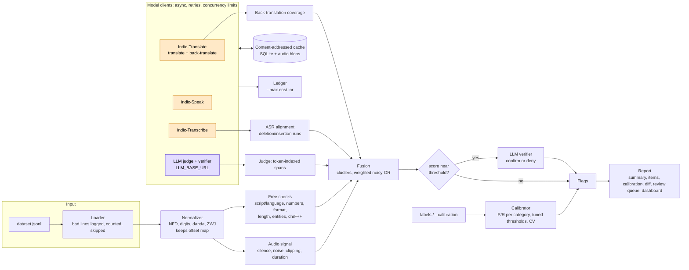
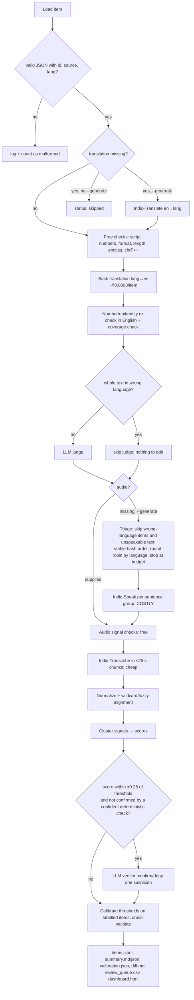

# Harness design notes

This document explains every check, the judge rubric, how signals become flags, and how the harness is calibrated against labels.
The README has setup and usage; `DECISIONS.md` lists the non-obvious choices and the alternatives that were rejected.

## 1. Architecture



Code map: `checks/` (one file per check, all registered through `checks/base.py`), `judge/` (rubric + judge + verifier),
`fuse.py`, `calibrate.py`, `pipeline.py` (orchestration and cost policy), `clients.py`, `cache.py`, `budget.py`,
`text/` (normalization, alignment, markup, numbers), `inject/` (error injector), `report/`.

## 2. Flow from dataset to report



When costly checks run: speech synthesis only with `--generate`, only for triaged items, and never past `--max-cost-inr`.
Transcription runs on every item with audio, because it costs ₹0.10 per minute. The verifier runs only on uncertain clusters,
and the judge is skipped where a deterministic check has already proved the error.

## 3. The checks

Every check emits **Signals**: a category, a severity, a confidence, a span, and evidence. A signal is a suspicion, not a verdict.

| Check | Kind | What it catches | How | Why it can or cannot flag alone |
|---|---|---|---|---|
| `script_lang` | free | wrong language/script, untranslated sentences | Unicode-script share of letters and combining marks, per sentence. Math, code, URLs and source names/acronyms are masked. Function-word fingerprints separate same-script languages (hi/mr/ne, bn/as) | Deterministic and high precision, so it flags alone |
| `numbers` | free + BT | changed digits, dates, quantities, units | Numbers extracted after digit normalization (२५/২৫/௨௫ → 25, 1,00,000 = 100,000) and compared as multisets. A one-for-one swap is localized on the wrong number. Units are compared in English through the back-translation | A digit swap flags alone (0.92–0.97). A number that disappears from the digits but survives in the back-translation (spelled out) drops to 0.2 |
| `format` | free | broken tables, LaTeX, Markdown | Structure signature: table cells per row, `$` balance, math fingerprints (verbatim except `\text{}`), `\begin/\end`, headings, code fences, bold markers, link URLs, list items | Deterministic, so it flags alone |
| `length` | free | omission/addition hint | log length ratio vs a **robust per-language baseline estimated from the dataset itself** (median/MAD). No per-language constants | Max confidence 0.6 × weight 0.5, so never alone |
| `entities` | free + BT | names/terms lost or replaced | Source entities (capitalised spans, acronyms, alphanumerics) must appear verbatim, or as a consonant-skeleton match in the romanized translation (`indic_transliteration`), or in the back-translation | Both independent views must miss it; 0.6 × 0.75 stays below threshold unless the judge agrees |
| `backtranslation` | cheap model | omission, addition | Content-word coverage per source sentence in the back-translation, and the reverse | Back-translation paraphrases and has its own errors: 0.5 × 0.6, never alone |
| `reference` | free | low similarity to a reference | chrF++ (sacrebleu) on normalized text, reported as a metric | A valid translation can differ from the reference: 0.35 × 0.5, never alone |
| `judge` | LLM | all 7 translation categories | Rubric below; token-indexed spans | Weight 0.9: a confident judge (≥ ~0.65) can flag; a hesitant one needs corroboration or the verifier |
| `audio_signal` | free | garbled audio, truncation/repetition hints | Frame RMS in dB relative to the clip's own 95th percentile, giving internal silences ≥1.2 s; spectral flatness for noise ≥0.4 s; clipping; spoken-chars-per-second vs a dataset baseline (`duration_z`) | Silence/noise are direct measurements and can flag. `duration_z` only adjusts ASR confidence |
| `asr_alignment` | cheap model | speech omission/truncation, repetition, garbled | ASR text vs the speakable translation, both speech-normalized, aligned with a fuzzy, wildcard-aware Levenshtein | See §4 |

## 4. Separating checker noise from system errors

**Back-translation.** It is never trusted alone. It contributes in three narrow ways: it can *excuse* a number (it is spelled out),
*excuse* a name (still there in English), or add a moderate-confidence coverage signal. It is also shown to the judge,
labelled as possibly wrong.

**ASR (back-transcription).** The spike showed what Indic-Transcribe does to correct audio: it writes numbers as spoken words
(Hindi `हंड्रेड` for "100"; Bengali `একশো`), splits compounds (`வெப்பநிலையில்` → `வெப்ப நிலையில்`) and drops punctuation.
None of that is a TTS error. So:

1. Both sides are speech-normalized (punctuation and symbols removed, nukta dropped, candrabindu → anusvara).
2. Reference tokens containing digits or Latin script are **wildcards** that may match 0–6 ASR tokens at no cost.
3. Substitution cost is `1 − similarity`, so near-miss spellings and split compounds cost little.
4. Only **structure** counts as a TTS error: a *contiguous deletion run* (≥10% of words at the end means truncation; ≥12% inside
   means omission), an *insertion run that copies its neighbours* (repetition), or a run of ≥3 very dissimilar words (garbled).
   Scattered substitutions, which are typical ASR noise, never form these runs.
5. Duration corroborates. If the audio is shorter than this language's typical speech rate predicts, an omission gains +0.15
   confidence; if it is normal or long, the omission loses 0.2, because it is probably an ASR miss.

## 5. The judge

Rubric: [`src/bodhan_eval/judge/rubric.md`](../src/bodhan_eval/judge/rubric.md) (MQM-style; versioned as `judge-v2`).

- **Inputs:** English source, the translation **verbatim** (numbers, symbols and formatting are judged from this), the same translation as
  **numbered word tokens** (used only to point), the back-translation (marked "may be wrong") and the reference if any.
  v1 showed only the token view; because tokens drop punctuation and symbols, the judge reported "missing `=`", "365 25 without a
  decimal point" and "table collapsed" on correct translations. The pre-warm run on clean items exposed this (see D14).
- **Output:** `{"errors": [{category, severity, tokens: [first, last], source_quote, explanation, confidence}]}`.
- **Never writes Indic text (enforced in code):** the judge localizes with token numbers, so it never needs to quote Indic text.
  `sanitize()` strips any non-Latin letters from everything the LLM writes, and the item is logged. A correction can never reach a report.
- **Fluency bias:** the rubric says explicitly that fluent output can be wrong and asks for meaning errors only, not style.
- **Determinism:** temperature 0, exact-input cache. One repair retry if the JSON is unparseable; after that the item has no judge signals
  (it is noted, and it does not crash).
- **Consistency:** a fixed hash-chosen sample (30 by default) is judged twice as independent requests. The share with the same verdict
  (error vs no error) and the same category set is reported, also per language.
- **Verifier:** clusters whose score is within ±0.25 of a fixed band centre (0.55; deliberately independent of calibration so repeated runs
  re-verify the same clusters and reuse cached verdicts) get a focused question about that one suspicion
  ("is this a real error, not a paraphrase or a checker mistake?"). A confirmation adds a signal; a denial multiplies the
  score by `1 − 0.8 × confidence`. This is the agentic step: spend LLM calls only where they change a decision.

## 6. How signals become flags

Signals of the same category whose translation spans or source spans overlap form a **cluster**, which is one suspected error.

```
score(cluster) = (1 − Π (1 − w[check] × confidence)) × (1 − 0.8 × verifier_denial)
flag if score ≥ threshold[category]
```

- Weights (`thresholds.json`) are priors on how far each checker's confidence can be trusted on its own: deterministic checks 1.0,
  judge/verifier 0.9, entities 0.75, back-translation 0.6, length/reference 0.5.
- Noisy-OR means independent evidence accumulates. Back-translation (0.30) plus a hesitant judge (0.54) gives 0.68, which flags;
  either alone does not.
- The flag takes its span from the strongest located signal and its severity from the deterministic checks if any, else the judge.
  It keeps the evidence of every contributing signal.

## 7. Calibration

`calibrate.py` uses every labelled item (inline `labels`, or a `--calibration` JSONL of `{id, labels}`). `labels: []` means verified clean;
a missing `labels` field means unlabelled.

- **Metrics:** detection recall, false-alarm rate on clean items, localization (span overlap; a zero-length label span gets ±6 chars of
  tolerance) and category accuracy, plus precision/recall/F1 per category, per language, and **per check**.
- **Tuning:** for each category with ≥6 labelled positives, the threshold on a 0.30–0.90 grid (capped so calibration can never silence a deterministic check) that maximises F1 (ties go to the middle of the best-F1 plateau: the max-margin choice; picking the edge
  would reject anything slightly weaker than the training examples). Thresholds are then raised for whichever category causes the most false alarms until the false-alarm
  rate on clean items is ≤10%. Categories with too few labels keep the shipped default, so a small calibration set cannot wreck them.
- **Honesty:** `cross_validated` reports grouped 5-fold CV. Thresholds are tuned on 4 folds and measured on the held-out fold, and all
  items derived from the same source sentence (every language, clean and injected) share a fold. Read this number, not the
  in-sample one, when estimating performance on a hidden set.

## 8. Error injector

`python -m bodhan_eval.inject` builds labelled test data from English sources. No LLM is used, so no LLM writes any language.

- **Translation errors:** delete a sentence or clause (omission); insert a sentence from another same-language item (addition);
  shift one digit, keeping its script (number); remove a table pipe, a `$`, a closing `**`, a heading marker, a LaTeX backslash, or
  change a link URL (format); leave a sentence or the whole text in English, or translate into a sibling language such as Marathi for a
  Hindi item (wrong language). **Mistranslation and term errors** swap a word or name in the *English* source (`release → absorb`,
  `Newton → Galileo`), re-translate with Indic-Translate, and label the character diff against the clean translation.
- **Speech errors:** speech is synthesized sentence by sentence, so segment boundaries are exact. Then: cut the final segment
  (truncation), drop a segment (omission), duplicate one (repetition), or overwrite it with a noise burst or insert a 2–3 s silence (garbled).
- Labels carry `"annotator": "injector"`. Clean items have `labels: []` and `"label_source": "assumed clean: unreviewed Indic-Translate output"`.
  Real system errors in those "clean" items therefore count as false alarms, so our false-alarm figure is pessimistic.

## 9. Determinism and cost

- Every model call is cached by a SHA-256 of its exact request (model, text, target language, voice, audio hash, LLM messages,
  sample index, extra body). A rerun makes zero calls and produces byte-identical `items.jsonl`, `summary.*` and
  `calibration.json`; `tests/test_e2e.py` checks this.
- Reported cost is the **attributed** cost of the outputs used (cached or not), which is deterministic.
  Actual spend, cache hits and wall time go to `run_meta.json`.
- LLM daily-quota exhaustion switches the LLM client to cache-only: cached verdicts are still used, and misses are noted per item (D17).
- `--max-cost-inr`: each paid call reserves its estimated cost first. A credit-exhausted 429 or a budget overrun stops further paid
  calls; affected items are processed with what is available and the gap is noted per item.
