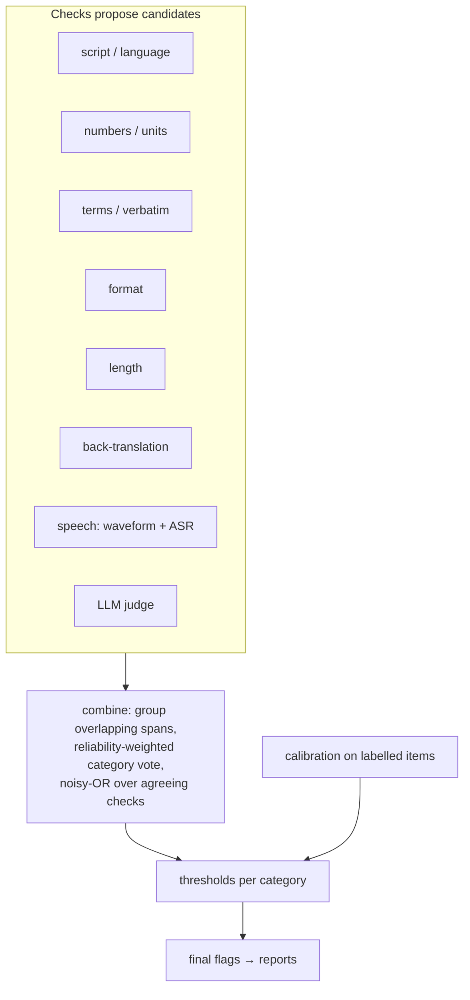

# Design notes

Why the harness is built the way it is. The README covers usage; this file covers decisions,
the facts they rest on, and what is still open.

## Goals and constraints

- **Find concrete, located errors**, not only a score: every flag has a category, severity,
  character span (and time span for audio) and the evidence behind it.
- **Any Bodhan language without code changes.** No language-specific rules: scripts come from
  `languages.yaml`, digits are normalised through Unicode, every threshold applies to every
  language. Dataset-specific rules are out of bounds.
- **Cheap and repeatable.** Paid calls are cached by exact request, budgeted, and skippable;
  `--offline` runs are deterministic.
- **Robust to bad input and failing services.** Bad lines are skipped and counted; a paid step
  that fails is recorded per item; the run never aborts.

## Architecture

| Module | Role |
|---|---|
| `normalize.py` | tokenizer with offsets into the original text, sentence splitting, numbers in any digit system |
| `align.py` | token alignment (Levenshtein opcodes) and monotonic sentence alignment (1-1, 2-1, 1-2) |
| `checks/translation.py` | free checks: script, numbers, terms, format, length |
| `checks/backtranslation.py` | back-translation alignment, entity and number evidence |
| `checks/speech.py`, `checks/audio.py` | transcript alignment; waveform silence / clipping / noise / duration |
| `judge/` | rubric and judge: numbered tokens in, token ranges out |
| `combine.py`, `calibrate.py`, `report.py` | merging, thresholds, reports |
| `inject/` | known-error injection for calibration |
| `clients/` | Bodhan client (cache, budget, retries, rate gate), Claude / OpenAI-compatible judge clients |

## Key decisions

**Spans are always on the original text.** Text is tokenised first and each token is normalised
afterwards, so every comparison can be mapped back to exact character offsets.

**Checks propose, the combiner decides.** A single check is rarely conclusive: back-translation
paraphrases, ASR mishears, the judge over-reports. Each check emits candidates with its own
confidence. The combiner merges candidates that overlap and combines *independent* checks with
noisy-OR (one check counted once), so agreement raises confidence and repetition does not.
Numbers or names inside an inserted or untranslated sentence are absorbed into that flag: one
error, one flag.

**Back-translation is per sentence.** Each translation sentence maps to exactly one English
segment, so an omission or addition lands on the right sentence instead of a proportional
guess. To stay under the translate rate limit, all of an item's sentences are first sent in one
request, one per line. Bodhan usually merges the lines, so the client falls back per sentence
and stops batching after a few failures. Cached per-sentence results are reused for free.

**Splits are not additions.** A translation that splits one source sentence into two or three is
recognised: an unmatched back-translated piece whose words are already in the neighbouring
source sentence is not new content.

**The LLM never writes Indian-language text.** The judge sees the translation as numbered
tokens and answers with token index ranges and English quotes from the source. Any non-Latin
text in its reply is removed, so it can neither invent text nor be trusted to quote it. The
judge runs on Claude through the official Anthropic SDK with structured outputs (schema-valid
JSON). Current Claude models reject `temperature`, so run-to-run stability is measured
(`--judge-repeats`) instead of assumed.

**Speech: runs, not words.** ASR gets scattered single words wrong even on perfect audio, so only
contiguous runs of missing tokens count as omissions, and only a run reaching the end counts as
truncation. Tokens that legitimately differ between TTS input and ASR output are "soft": numbers
(read aloud as words), other-script words, and dotted acronyms. Soft tokens neither start nor
end a missing stretch, but don't break one either. Garbled speech needs both a high error rate
in a window and, for high confidence, a waveform finding (noise, silence) in the same place.

**Calibration respects what labels cover.** Injected items label only the planted error, so other
flags on them are never counted as false positives. Untouched controls are "assumed clean",
which makes their precision a lower bound. Ties between thresholds keep the one closest to the
default, so a handful of labels can't drag a threshold to an extreme. `--thresholds` reuses a
calibration on new data for honest, out-of-sample numbers.

**Deterministic everything.** Sampling uses seeded hashes of item ids. Reports contain no
timestamps. The dataset builder gives a byte-identical file from the same downloads. The e2e
test checks that two offline runs give identical `items.jsonl` and `summary.md`.

## Bodhan API facts (checked against the live server, 2026-11-20)

- **Translate:** the documented `POST /translate` returns 404 on the live server. The working
  route is `POST /v1/chat/completions` with `model: "indic-translate"`, exactly one user turn
  (the text) and `target_language` / `script` as extra fields. The gateway writes the prompt and
  rejects system turns. Truncation is `finish_reason == "length"`; usage is in `completion_tokens`.
- **Translate rate limit:** about 20-30 requests/min. 429s come without `Retry-After`, so the
  client's rate gate doubles the spacing on every 429 and shrinks it again on success.
- **Speak:** `POST /v1/audio/speech` returns a WAV (PCM16, 24 kHz, mono). About 17 s per request.
  Text is chunked to about 25 s of speech per request. Each language has a documented default
  voice in `languages.yaml`.
- **Transcribe:** `POST /v1/audio/transcriptions`, `{text}` only (no timestamps or confidences),
  at most 30 s of audio per request. Longer audio is cut at its quietest point before 30 s.
  Only `indic-transcribe` exists; no Core / Flex model id is documented.

## Lessons from real runs

Reviewing every flag on untouched outputs found real Bodhan errors (bishops → queens, "Thar" →
"Thar car", "is still" → "was", dropped "more than", latitude for longitude, truncated audio).
It also found harness false positives, each fixed with a regression test:

- "400 million" vs "40 crore": back-translation evidence now compares scale-word values.
- Sentence splits read as additions: neighbour coverage check.
- "No.1", "km2", "Twenty20": number extraction rules.
- Spelled-out acronyms in speech: soft tokens.
- Numbers of an inserted sentence reported separately: absorbed into the addition.
- A number splitting one missing speech stretch into two: soft tokens bridge.
- Injector bugs (swapping units / table headers as "names"; restoring an identical table rule
  as "untranslated").

**Hand labels changed the calibration.** The first calibration counted real Bodhan
mistranslations in untouched controls (bishops → queens, "Thar car", "is still" → "was", at
judge confidence 0.60) as false positives. It raised the mistranslation threshold to 0.65, and
recall dropped to 0%. After 30 controls were hand-labelled with `scripts/make_label_sheet.py`
(15 real errors, 16 clean items), mistranslation recall rose to 8 / 9 and overall recall on
planted errors to 49 / 56. Clean items wrongly flagged stayed at 3%. Most of the sheet's
low-confidence (0.45) candidates were false alarms. Labelling them as such is what lets the
thresholds sit at 0.45–0.50.

## Open items

- **Term recall (3 / 8).** Real term errors tend to show up only as low-confidence
  back-translation evidence (0.45). A term-specific signal (e.g. a transliteration check of
  source names against the translation) would be needed to raise it without paraphrase false
  alarms.
- Out-of-sample numbers: the demo figures are in-sample. A held-out labelled set run with
  `--thresholds calibration.json` would give honest ones.
- A second ASR opinion for borderline speech flags, e.g. re-transcribing a slightly altered
  copy of the audio, since there is no second model.
- A broken `$…$` makes the number check read `$` as a currency sign.
- The judge sometimes reports a spurious omission next to a real addition.
