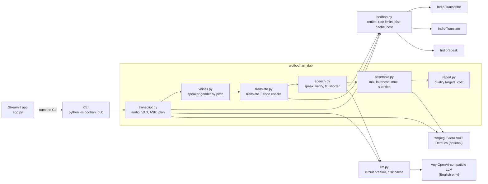
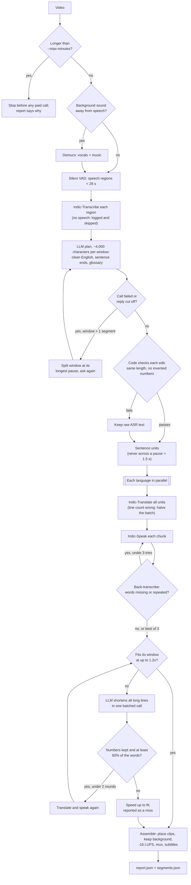

# Design notes

How the video dubbing pipeline is put together, where the LLM makes decisions, and how it checks and recovers.

## Architecture

| Stage | Module | What it does |
|---|---|---|
| Audio and speech regions | `transcript.py`, `audio.py` | Extract 16 kHz mono audio; separate music with Demucs if there is background sound; find speech with Silero VAD, regions under 28 s. |
| Transcription | `transcript.py` | Indic-Transcribe on each region. Its text gets the region's start and end. |
| Plan | `transcript.py` | The LLM cleans the English and marks sentence ends; code joins segments into sentence units and checks every edit. |
| Voices | `voices.py` | Pitch per unit; one voice per detected speaker gender, so each speaker keeps one voice. |
| Translation | `translate.py` | Indic-Translate, all units in one request so terms render the same way; kept terms protected by placeholders; numbers and labels checked. |
| Speech | `speech.py` | Indic-Speak per chunk; each chunk back-transcribed and regenerated if words are missing or repeated; lines that run long are shortened and spoken again. |
| Assembly | `assemble.py` | Place each clip at its time, keep the background, normalise speech to -16 LUFS, mux, write SRT. |
| Report | `report.py`, `__main__.py` | `report.json` with every quality target, each miss and why, calls, retries, latency, cost. |

## Workflow

## Where the LLM is used, and why

The LLM only reads and writes English. All Indian-language text comes from Indic-Translate, and all speech from Indic-Speak. Every LLM answer is checked in code, and the pipeline finishes without the LLM if it has to.

| Decision | What the LLM decides | Checked in code | If the LLM fails |
|---|---|---|---|
| Plan the transcript | Punctuation and casing, misheard words, numbers as digits, where sentences end, glossary terms | An edit must keep the segment's word count (loosely) and invent no small numbers, or the raw text is kept. Words never move between segments, so timing is exact. A next segment starting in lowercase continues the sentence. | The window is split in two and asked again; a single segment that still fails keeps its raw text as its own unit. |
| Shorten long lines | A shorter English version of each line whose speech will not fit its slot | Every number kept; at least 60% of the original words. One batched retry for failures. | The line is sped up instead and the miss is reported. |

Why these two places: ASR text has no punctuation and splits sentences at pauses, and fragments translate badly. Joining fragments into sentences needs language judgment, but timing does not, so the LLM marks sentence ends and code builds the units. For duration drift, shortening the English before translation keeps the target text natural, where speeding speech up past 1.2x sounds rushed; the LLM must never edit the Indian-language text, so it edits the source.

What is plain code and why: speech detection, timing windows, voice choice (pitch), and every check. These have right answers that code can compute, so an LLM would only add cost and variance.

**Calls are few, and fit any model.** One plan call per window of about 4,000 characters (one call for a 5-minute lesson). Shortening is batched: one call per language per round, at most 20 lines, and a batch whose reply is cut off at the model's output limit is split in half and asked again. Reasoning models that put their thinking in the reply (`<think>`, `<reasoning>`) are handled. A run makes about 5 to 12 LLM calls.

**When the LLM is missing or down.** A circuit breaker in `llm.py` turns the LLM off for the rest of the run after the first call that fails for good (3 tries for timeouts, connection errors, 429 and 5xx; at once for 401, 403 and 404). Later calls fail immediately and the fallbacks above apply, so a dead endpoint costs seconds, not minutes. `report.json` records `llm.available` and why.

## How sync is kept

- Each unit's dub starts at its source time. It may start up to 0.2 s early, into a pause, and run up to 2.0 s into the following pause, keeping 0.15 s of silence before the next unit.
- Speech that is still too long after shortening is time-stretched with ffmpeg `atempo` (pitch kept). Above 1.2x it is reported as a miss with its reason.
- The dub track is built at exactly the video's length, so the output matches the input duration.
- Silence stays silent: units never span a pause over 1.5 s, regions with no transcribed speech are skipped and logged, and nothing is spoken outside a source speech region.

## How quality is checked

- **Repeats and omissions in Indic-Speak.** Every chunk (about 160 characters) is transcribed back with Indic-Transcribe and compared with the text sent. More than 25% of the text missing, or the speech 1.5x longer than the text, means a repeat or omission: the chunk is regenerated, up to 3 tries, and the best one kept. Per-unit CER is reported.
- **Translation.** Numbers must match the source, and kept terms and letter labels (AOC, OB) must survive; problems are logged per unit.
- **Terminology.** The planner's glossary is shown to later windows so terms are spelled the same way; `--glossary keep:` terms are protected through translation with placeholders.
- **Everything per unit** goes to `segments.<lang>.json` and `run.jsonl`, so any line can be traced from ASR text to final audio.

## How failures are recovered

- **Bodhan API:** 5 tries with exponential backoff on 429 and 5xx; client-side rate limits per model (transcription and translation 15 a minute, speech 8, measured on the hosted API); every call cached on disk by its exact input, so reruns are free; `POST /translate` falls back to the documented chat route on 404.
- **One unit fails:** it is skipped with its reason and the rest go on. A later shortening round that fails keeps the earlier audio.
- **One language fails:** the others finish; partial outputs and the report are still written, and the exit code is 1.
- **Input too long:** rejected before any paid call (`--max-minutes`, default 15.5).
- **No speech at all:** no API calls; each language gets the original video, marked "No speech found: not dubbed".
