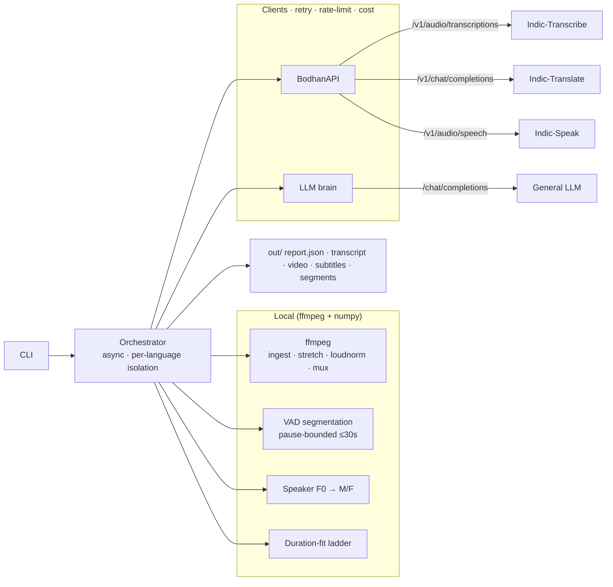
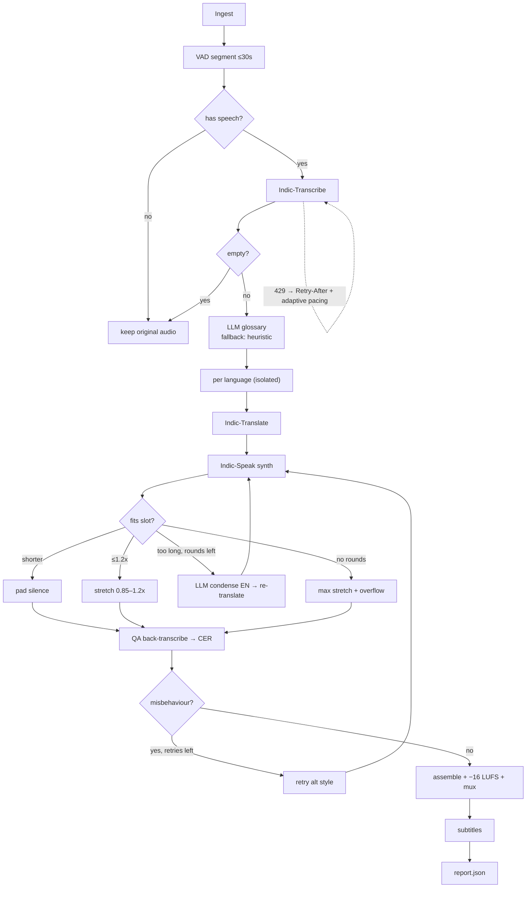

<!-- Copy everything below into the PR description box. Replace <...> placeholders. -->

## Summary

`bodhan_dub` is an agentic pipeline that dubs an English video into Indian languages using
**only Bodhan's Indic models** (Indic-Transcribe, Indic-Translate, Indic-Speak), with a
general LLM as the planning brain. For each requested language it produces a synced dubbed
MP4, subtitles (SRT/VTT), the English transcript, and a machine-readable run report. It runs
unattended on unseen videos; output is labelled AI-dubbed with fixed library voices.

## How to run

```bash
# from a clean clone of this recipe folder
pip install -e ".[dev]"          # pinned, compile-free deps; needs ffmpeg (bundled fallback included)

# offline smoke — no keys/credit
python -m bodhan_dub --input sample.mp4 --langs hi,ta,bn --out ./out --mock

# live
cp .env.example .env             # fill BODHAN_* and LLM_* keys
python -m bodhan_dub --input video.mp4 --langs hi,ta,bn --out ./out --burn-subs
```

Required interface (unchanged): `--input --langs --out [--glossary --voices --code-mixed]`.
Exit codes: `0` all languages ok · `1` a language failed (partial outputs + report still
written) · `2` config error.

## Architecture



**Stages:** ingest (ffmpeg → 16 k ASR + 24 k mix) · segment (VAD → pause-bounded ≤30 s, also
the timeline) · transcribe (Indic-Transcribe/segment) · glossary (LLM) · speakers (pitch F0) ·
translate (Indic-Translate/segment) · TTS+fit (Indic-Speak + duration ladder) · QA
(back-transcribe → CER) · assemble (place dubs, keep music, −16 LUFS, mux) · subtitles · report.
The **decisive fact**: Indic-Transcribe returns no timestamps and caps at 30 s, so the timeline
is **derived by VAD** — which also gives sentence-safe chunking and silence/music preservation.

## Workflow



## Where the LLM is used, and why

Strictly text-side decisions — it **never writes Indic text, transcribes, or synthesizes**:

| Decision point | What it decides | Fallback if the LLM fails |
|---|---|---|
| **Glossary build** | Terms (names, acronyms, numbers, technical) to keep consistent | Regex/heuristic term extraction |
| **Condense English** | Shorten the English source when a dub overruns its slot, preserving facts | Deterministic clause/word trim |

The brain is non-critical: on any LLM error/timeout/rate-limit it degrades to the fallback, so
a run never fails because of the LLM. It reads `LLM_BASE_URL/LLM_MODEL/LLM_API_KEY` (any
OpenAI-compatible endpoint) and uses only standard chat fields (no provider-only features).

## Bodhan models used

| Model | Endpoint | Hosted/self | Settings |
|---|---|---|---|
| **Indic-Transcribe** | `POST /v1/audio/transcriptions` | hosted | `model=indic-transcribe` (Core), `language`; audio sliced to pause-bounded ≤30 s windows |
| **Indic-Translate** | `POST /v1/chat/completions` | hosted | `model=indic-translate`, single-user prompt naming the target; `native` / `code-mixed` script |
| **Indic-Speak** | `POST /v1/audio/speech` | hosted | `model=indic-speak`, `voice` (M/F per speaker), `instructions={lang[,style]}`; PCM16/24 k |

Reliability: retries with Retry-After + exponential backoff, a **per-model adaptive rate
limiter** (paces request starts, slows on 429), and a concurrency cap.

## Results

Full live run on the demo lesson (`English.mp4`, 5 min 29 s → **Hindi**):

| Target | Result |
|---|---|
| Segments dubbed | **45 / 45** |
| Segment sync (±300 ms) | **45 / 45** |
| Speed change (0.85–1.2×) | **45 / 45** |
| Mean back-transcription CER | **0.12** |
| Loudness | **−16.08 LUFS** (target −16 ±1) |
| Output length vs input | within ±100 ms |

Hosted outputs (media kept out of git):
[input video](https://drive.google.com/file/d/1iCP6765xJwXnIz663Fc9WQmjuW3ypYbg/view?usp=drive_link) ·
[dubbed Hindi video + subtitles](https://drive.google.com/file/d/1kPAKJSAHg5Qz0VAjCA1p6aGCO4QbwjJe/view?usp=drive_link) ·
[report.json](https://drive.google.com/file/d/1gOgeOOGj9VCLdj7oGZDqKfTQGmpCtrUt/view?usp=drive_link) ·
[subtitles.hi.srt](https://drive.google.com/file/d/134zjmnZcwzttWOHjA94cFOpim2pIMtCw/view?usp=drive_link)

Example EN→HI (CER ≈ 0):
> *Period one of chapter six, lines and angles* → *अध्याय छह रेखाएँ और कोण का पहला पीरियड*

> **Note on languages:** the full hosted demo above is **Hindi**; the ₹10 trial credit was
> exhausted on the full-length run. Tamil and Bengali use the **identical** code path (only
> `--langs` changes) — reproduce them with `--langs ta,bn`. An offline `--mock` run exercises
> all three languages end-to-end with no credit.

## Demo video

<LINK — ≤5 min, public, no sign-in: full run on the demo input + outputs (Hindi, Tamil, Bengali)>

## Trade-offs and known limitations

- **No cross-segment term substitution.** The rules forbid rewriting Indic text and
  Indic-Translate has no glossary field, so terminology is kept consistent on the English side
  and canonical renderings are reported — not spliced into other segments.
- **VAD vs true diarization.** Speakers are labelled by a pitch (F0) M/F heuristic (matches the
  one-male/one-female voice reality); it won't separate two same-gender speakers.
- **Energy VAD** (default) can misjudge loud music as speech; the empty-transcript guard and
  music-bed fallback keep that graceful, and `--vad webrtc/silero` are available.
- **Rate limits.** Hosted trial keys throttle aggressively; the adaptive limiter handles it but
  a strict key run is slower (tune `--rate-interval`). Back-transcription QA doubles ASR calls.

## Cost and runtime

Per the full Hindi run (hosted prices; Indic-Speak dominates):
**≈ ₹0.95 per minute of input, per language** (≈ ₹5.2 for 5.5 min in one language — speak ₹4.5,
transcribe incl. back-transcription QA ₹1.0, translate ₹0.03). A 5-min video in 3 languages
finishes within the 30-minute target on hosted APIs.

## AI assistance

Built with **Claude Code**: scaffolding modules, drafting the ffmpeg/HTTP plumbing, and writing
tests. Architecture decisions (VAD-derived timeline, the duration-fit ladder, the LLM-as-brain
boundary, compile-free dependencies, the adaptive rate limiter) were directed and reviewed by
me, and every line is explainable.
