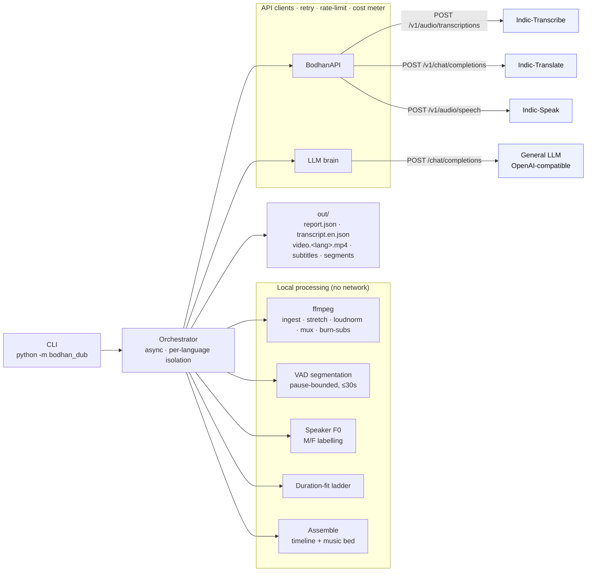
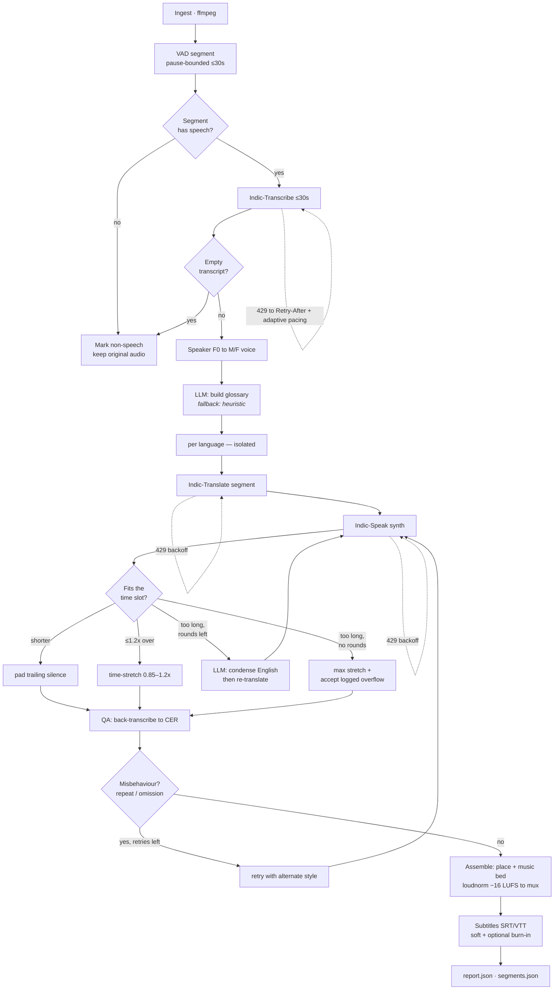

# bodhan_dub — English → Indian-language video dubbing

An agentic pipeline that dubs an English video into Indian languages using **only
Bodhan's Indic models** (Indic-Transcribe, Indic-Translate, Indic-Speak). For each
requested language it produces a dubbed MP4 with synced speech, a subtitle file, the
English transcript, and a machine-readable run report. It runs unattended on videos
it has never seen.

> Output audio is **AI-dubbed** with fixed library voices (Indic-Speak does not
> clone voices). It does not imitate the original speaker.

---

## Why this design

**Indic-Transcribe returns only `{"text": ...}` — no timestamps — and caps at 30 s
per request.** The spec needs per-segment timestamps, so the pipeline *derives* the
timeline itself with **voice-activity detection (VAD)**. Segments are **pause-bounded
speech runs**, which means a single decision solves three of the stated hard parts at
once:

| Hard part | How VAD segmentation handles it |
|---|---|
| **Window limits** (≤30 s) | Each pause-bounded run is well under 30 s; a rare run that isn't is split at its quietest internal frame. |
| **Chunking must not break sentences** | Cuts land in silence (natural pauses), so sentences stay whole. |
| **Silence & music stay non-speech** | The non-speech complement is kept verbatim as a music/effects bed and never transcribed, so no narration is hallucinated. |

The remaining hard parts are handled explicitly (see [How the hard parts are handled](#how-the-hard-parts-are-handled)).

---

## Architecture



**One line per stage** — **ingest** (ffmpeg → 16 kHz ASR audio + 24 kHz mix bed) ·
**segment** (VAD → pause-bounded ≤30 s windows that double as the timeline) ·
**transcribe** (Indic-Transcribe per segment) · **glossary** (LLM extracts terms to keep
consistent) · **speakers** (pitch F0 → M/F voice) · **translate** (Indic-Translate per
segment) · **TTS + fit** (Indic-Speak then the duration-fit ladder) · **QA**
(back-transcribe → CER, misbehaviour) · **assemble** (place dubs + keep music, −16 LUFS,
mux) · **subtitles** (SRT/VTT, soft + optional burn-in) · **report** (per-segment JSON).

- **Shared stages run once** (ingest, segment, transcribe English, glossary, speakers);
  **per-language stages are isolated** so one language failing never stops the others.
- **The LLM is the brain, never the mouth.** It builds the glossary, condenses the
  **English** source when a dub overruns, and judges retries. It **never writes
  Indian-language text, never transcribes, never synthesizes** — every ASR/MT/TTS call
  goes to a Bodhan model; target text always comes back from Indic-Translate.

## Workflow




---

## Setup

Requires **Python ≥3.10** and **ffmpeg**. (If system ffmpeg is absent, a static binary
from the `imageio-ffmpeg` dependency is used automatically — handy for local dev.)

```bash
# 1. install (pinned, compile-free deps)
pip install -e ".[dev]"

# 2. try it with NO keys/credit — deterministic mock clients
python -m bodhan_dub --input sample.mp4 --langs hi,ta,bn --out ./out --mock

# 3. run for real — copy .env.example to .env and fill in keys
cp .env.example .env            # then edit
python -m bodhan_dub --input path/to/video.mp4 --langs hi,ta,bn --out ./out
```

Generate a throwaway sample clip for the mock run (no media committed to git):

```bash
PYTHONPATH=tests python tests/fixtures/make_sample.py sample.mp4
```

**Prefer a guided tour?** Open [`walkthrough.ipynb`](walkthrough.ipynb) — it runs the whole
pipeline in mock mode and inspects every artifact (transcript, report, fit decisions), then
shows the real metrics from a live run. It executes with no keys/credit.

### Docker

```bash
docker build -t bodhan-dub .
docker run --rm --env-file .env -v "$PWD":/work bodhan-dub \
  --input /work/video.mp4 --langs hi,ta,bn --out /work/out
```

---

## How it works

**ingest** (ffmpeg → 16 k ASR + 24 k mix) → **segment** (VAD → pause-bounded ≤30 s windows that
*are* the timeline, since Indic-Transcribe gives no timestamps) → **transcribe** per segment →
**glossary** (LLM) → **translate** per segment → **TTS + duration-fit** (pad / stretch /
LLM-condense-&-re-translate) → **QA** (back-transcribe → CER, misbehaviour retry) → **assemble**
(place dubs, keep music, −16 LUFS, mux) → **subtitles** + **report**. Shared stages run once;
per-language stages are isolated so one language's failure never stops the others.

## Run

```
python -m bodhan_dub \
  --input path/to/video.mp4 \
  --langs hi,ta,bn \
  --out ./out \
  [--glossary glossary.yaml] [--voices voices.yaml] [--code-mixed]
```

The four required flags above never change. Extra (optional) flags:

| Flag | Default | Purpose |
|---|---|---|
| `--mock` | off | Offline run with deterministic fixtures (no keys/credit). |
| `--burn-subs` | off | Also write `video.<lang>.subbed.mp4` with subtitles hardcoded into the frames. |
| `--sub-font` | per-script | Font for burned-in subtitles (default: a script-appropriate system/Noto font). |
| `--concurrency N` | 2 | Max concurrent Bodhan API calls. |
| `--rate-interval S` | 1.0 | Seconds between request starts per model; adapts up automatically on HTTP 429. Raise it for tightly rate-limited keys. |
| `--asr-model` | `indic-transcribe` | Indic-Transcribe model id (Core/Flex). |
| `--vad` | `energy` | VAD backend: `energy` (default, no extra deps), `webrtc`, or `silero`. |
| `--resume` | off | Reuse cached stage results (per-stage, content-addressed). |
| `--log-level` | INFO | Structured JSON log verbosity. |

**Languages.** `--langs` accepts any production-tier Indic-Speak code (`hi, ta, bn, te,
kn, ml, mr, gu, pa, or, as, ur`). Hindi, Tamil and Bengali are demoed.

**Exit codes:** `0` all languages ok · `1` at least one language failed (partial
outputs + report still written) · `2` configuration error.

---

## Output layout

```
out/
  report.json              # per-language status, timings, retries, QA, cost
  transcript.en.json       # English segments with VAD-derived start/end times
  hi/
    video.hi.mp4           # dubbed video + a soft (toggleable) subtitle track
    subtitles.hi.srt       # (+ subtitles.hi.vtt)
    segments.hi.json       # source text, translation, audio duration, fit action, QA
    seg/seg_0000.wav ...   # per-segment dubbed audio
  ta/ ...
  bn/ ...
```

**Subtitles come in up to three forms:** the required **sidecar `.srt`/`.vtt` files**;
a **soft, toggleable track muxed into `video.<lang>.mp4`** (enable it in your player —
e.g. QuickTime `View ▸ Subtitles`); and, with `--burn-subs`, an extra
`video.<lang>.subbed.mp4` with the captions **hardcoded into the frames** (always visible,
any player). Burn-in needs a font covering the script — handled automatically on macOS and
in Docker (Noto fonts); override with `--sub-font`.

---

## How the hard parts are handled

**Duration drift** (translated speech runs longer). A strict ladder in
[`fit.py`](src/bodhan_dub/pipeline/fit.py), never an unnatural speed-up:
1. shorter than slot → place and pad with trailing silence;
2. fits within the speed cap → time-stretch (clamped to **0.85×–1.2×**, pitch-preserving);
3. still too long → the LLM **condenses the English**, Indic-Translate re-translates,
   Indic-Speak re-synthesizes, and we re-plan (bounded rounds);
4. rounds exhausted → apply max stretch, accept the measured overflow, borrow adjacent
   silence — all logged and reported.

**Context & terminology.** The LLM builds a glossary (names, acronyms, numbers,
technical terms) from the whole transcript, merged with an optional `--glossary` file.
It steers the English side and the condensing prompt so key terms are never dropped.
See [Terminology consistency](#terminology-consistency) for the honest limits.

**Model misbehaviour** (Indic-Speak repeats/omits). Each dubbed segment is
**back-transcribed with Indic-Transcribe**; per-segment **character error rate** vs the
translation and a length-ratio/repeat heuristic flag misbehaviour, which triggers an
automatic retry with an alternate delivery style (bounded).

**Speakers.** Indic-Transcribe has no diarization and most languages ship one male +
one female voice, so a dependency-free **pitch (F0) heuristic** labels each segment M/F
against the video's own pitch distribution and assigns a consistent voice per speaker
(overridable via `--voices`).

**Silence & music.** The non-speech complement of the VAD mask is kept from the original
audio; empty transcripts (music misdetected as speech) are marked non-speech and fall
back to the original rather than inventing narration.

---

## Quality reporting

`report.json` measures each spec target (they are targets, not gates — misses are
reported, not fatal): segment sync (±300 ms), speed change (0.85×–1.2×), coverage
(every segment dubbed or skipped with a reason), content fidelity (back-transcription
CER), total length (±100 ms), loudness (−16 LUFS via ffmpeg EBU R128), per-stage/per-
language timings, retries, and cost in INR (from audio-minutes / output-tokens / input-
chars at the published hosted prices).

---

## Design notes & trade-offs

- **Lean, compile-free dependencies** (`httpx, tenacity, numpy, soundfile, PyYAML,
  python-dotenv, imageio-ffmpeg`). All audio work — decode, resample, time-stretch,
  loudnorm, mux — is delegated to **ffmpeg**, so there is no torch/scipy/librosa to
  break across Python versions. Verified installing and running on Python 3.14.
- **LLM via raw OpenAI-compatible HTTP** (`LLM_BASE_URL/LLM_MODEL/LLM_API_KEY`), so your
  provider drops in with no SDK coupling.
- **Resilience:** retries with exponential backoff + jitter on every Bodhan call, a
  global concurrency semaphore, per-segment and per-language failure isolation, and
  `--resume` caching so a crash doesn't re-spend credit.
- **Structured logs:** one JSON object per event stamped with stage/lang/segment, so you
  can trace exactly why any line sounds the way it does.

### Terminology consistency

The ground rules forbid the LLM (or us) from writing/rewriting Indic text, and
Indic-Translate has no glossary parameter. So we keep terminology consistent **without**
substituting target strings: the glossary constrains the English side and the condensing
step (terms are never dropped or paraphrased away), and each term's canonical
Indic-Translate rendering is recorded for review. We deliberately do **not** splice
model-translated terms into other segments' output, which would amount to rewriting Indic
text by hand.

---

## Testing

```bash
pytest
```

- `test_segment.py` — windowing stays ≤30 s, cuts at silence, drops blips, exact
  non-speech complement (pure logic over synthetic VAD masks).
- `test_fit.py` — the pad→stretch→condense→overflow ladder and speed clamping.
- `test_subtitles.py` — SRT/VTT timestamp formatting and numbering.
- `test_e2e_smoke.py` — full pipeline on a 30 s generated clip through mocked clients,
  plus a per-language failure-isolation test (one language faults, others still finish,
  exit code 1, report written).

---

## Configuration (env only — no other secrets)

| Variable | Purpose |
|---|---|
| `BODHAN_TRANSCRIBE_KEY` / `BODHAN_TRANSLATE_KEY` / `BODHAN_SPEAK_KEY` | Per-model Bodhan keys |
| `BODHAN_OCR_KEY` | Optional (OCR stretch goal) |
| `BODHAN_BASE_URL` | Bodhan API base (default `https://api.bodhan.ai`) |
| `LLM_BASE_URL` / `LLM_MODEL` / `LLM_API_KEY` | The general-purpose LLM brain |


### LLM compatibility (the model we tested with)

The brain works with **any OpenAI-compatible `/chat/completions` endpoint**, read from
`LLM_BASE_URL` / `LLM_MODEL` / `LLM_API_KEY`. Requests use **only standard fields**
(`model`, `messages`, `temperature`) — **no provider-only features** (no `response_format`,
`tools`, reasoning params, or routing). For extra robustness the client fails fast on 4xx,
retries transient 5xx/429, and retries once without `temperature` if a model rejects it.

Above all, the **brain is non-critical**: if the LLM is unreachable, rate-limited, or
returns unusable output, glossary and condensing **fall back to deterministic logic**, so
a different provider can never fail the run — it only changes dub-length polish quality.

- **Tested with:** `nvidia/nemotron-3-ultra-550b-a55b:free` via OpenRouter
  (`LLM_BASE_URL=https://openrouter.ai/api/v1`), and the deterministic fallback path.
- Any standard model works — e.g. OpenAI `gpt-4o-mini`. Set your own in `.env`.

**Demo input:** Class 9 mathematics lesson —
[input video](https://drive.google.com/file/d/1iCP6765xJwXnIz663Fc9WQmjuW3ypYbg/view?usp=drive_link)
(not committed; kept out of git).

**Hosted outputs (Hindi):**
- [Dubbed video with subtitles](https://drive.google.com/file/d/1kPAKJSAHg5Qz0VAjCA1p6aGCO4QbwjJe/view?usp=drive_link)
- [report.json](https://drive.google.com/file/d/1gOgeOOGj9VCLdj7oGZDqKfTQGmpCtrUt/view?usp=drive_link)
- [subtitles.hi.srt](https://drive.google.com/file/d/134zjmnZcwzttWOHjA94cFOpim2pIMtCw/view?usp=drive_link)


**Live results (full run, `English.mp4` 5 min 29 s → Hindi):** 45/45 segments dubbed, sync
45/45 within ±300 ms, speed 45/45 within 0.85–1.2×, mean back-transcription CER 0.12, loudness
−16.08 LUFS, output length within ±100 ms — cost ≈ ₹5.2 (≈ ₹0.95 per input-minute per language).
Tamil and Bengali use the identical path (only `--langs` changes); they were not run on the
hosted API only because the ₹10 trial credit was spent on the full Hindi run. A `--mock` run
exercises all three end-to-end with no credit.

---
