# Video dubbing

> Dub an English video into Indian languages so that every sentence starts where the speaker starts it, using only Bodhan's speech and translation models.

**Bodhan models:** `indic-transcribe`, `indic-translate`, `indic-speak` &nbsp;·&nbsp;
**Input:** English video (MP4, MOV, MKV, WebM) &nbsp;·&nbsp;
**Output:** per language, a dubbed MP4, an SRT and a segment file &nbsp;·&nbsp;
**Languages:** the 13 production-tier Indic-Speak languages (`as bn en gu hi kn ml mr or pa ta te ur`) &nbsp;·&nbsp;
**Format:** CLI, CPU only

| | |
|---|---|
| **Demo video** (under 5 minutes) | <https://youtu.be/z4WxSWAw-tc> |
| **Demo outputs** (Hindi, Tamil, Bengali videos, subtitles, `report.json`, run log, sample clip) | <https://drive.google.com/drive/folders/1rZe3FeVizmeN2VG6drX40YlwOZNFtbT8?usp=sharing> |
| **Architecture and flow chart** | [docs/architecture.md](docs/architecture.md) |
| **Design notes** (where the LLM decides, how sync and quality are checked) | [docs/design_notes.md](docs/design_notes.md) |

**Contents:** [What you get](#what-you-get) · [Setup](#setup) · [Run](#run) · [How it works](#how-it-works) · [Where the LLM is used](#where-the-llm-is-used) · [How sync and quality are checked](#how-sync-and-quality-are-checked) · [Bodhan models used](#bodhan-models-used) · [Results](#results) · [Cost and runtime](#cost-and-runtime) · [Limitations](#limitations) · [What I'd do next](#what-id-do-next) · [Folder layout](#folder-layout) · [Tests](#tests)

## What you get

Give it an English video (a lecture, an interview, a news clip; one speaker or several; with or without music) and
a list of languages. For each language you get the original picture with a new dubbed audio track, subtitles and
a segment file. The whole run also writes one `report.json`.

What the pipeline promises, and checks on every run:

- **Sync.** Each dubbed sentence starts within ±300 ms of the source sentence. Speed changes stay within 0.85–1.2×.
  The dubbed video has exactly the input's length.
- **Clear speech.** Speech is normalised to −16 LUFS. Music and background sounds are kept: when there is
  anything under the voice, it is separated locally and played under the dub.
- **A check on every clip.** Each dubbed clip is transcribed back by `indic-transcribe` and compared with its text
  (character error rate, repeats, omissions). A bad clip gets a fresh take.
- **Honest output.** Nothing fails silently. `report.json` lists every flag, retry, cost and quality target, and
  the exit code is 1 if any language failed (the other languages are still written).
- **Bodhan only for Indian-language work.** Every speech-recognition, translation and speech-synthesis call goes to
  a Bodhan model. An LLM edits and judges *English* text only; it never writes Indian-language text.

## Setup

Needs Python 3.10+ (tested on 3.12) and `ffmpeg`/`ffprobe` on `PATH`. Everything runs on CPU.

```bash
cd examples/video_dubbing
python -m venv .venv && source .venv/bin/activate      # Windows: .venv\Scripts\activate
pip install -r requirements.txt                         # pinned deps (CPU torch) + this package
cp .env.example .env                                    # then fill in your keys
python -m bodhan_dub --input path/to/video.mp4 --langs hi,ta,bn --out outputs/my_video
```

`.env` needs the three Bodhan keys (`BODHAN_TRANSCRIBE_KEY`, `BODHAN_TRANSLATE_KEY`, `BODHAN_SPEAK_KEY`) and an
OpenAI-compatible LLM (`LLM_BASE_URL`, `LLM_MODEL`, `LLM_API_KEY`). On the first run Demucs downloads its
weights (about 80 MB) to the torch cache.

**Or with Docker** (Python, ffmpeg, the pinned CPU packages and the Demucs weights are all in the image):

```bash
cd examples/video_dubbing
docker build -t bodhan-dub .
docker run --rm --env-file .env -v "$PWD/media:/data" bodhan-dub \
    --input /data/video.mp4 --langs hi,ta,bn --out /data/out          # outputs land in ./media/out
docker run --rm --entrypoint python bodhan-dub -m pytest -q          # the unit tests, inside the image
```

On Linux, add `--user "$(id -u):$(id -g)"` so the outputs belong to you.

## Run

```bash
python -m bodhan_dub --input video.mp4 --langs hi,ta,bn --out ./out [options]
```

**Try it fast.** Media files are kept out of git. Download the 33-second sample clip
(`triangle_lesson_en_33s.mp4`, a synthetic two-speaker maths exchange voiced with Indic-Speak's English voices)
from the [Drive folder](https://drive.google.com/drive/folders/1rZe3FeVizmeN2VG6drX40YlwOZNFtbT8?usp=sharing)
into `sample_data/`, then:

```bash
python -m bodhan_dub --input sample_data/triangle_lesson_en_33s.mp4 --langs hi --out outputs/sample
```

The picture is copied into the output unchanged when MP4 can carry its codec (H.264, HEVC, AV1, VP9, MPEG-4).
Anything else (ProRes, VP8, MPEG-2, …) is re-encoded to H.264 (about 37 s for 5.5 minutes of 1080p on 14 CPU cores).

| Option | Meaning |
|---|---|
| `--langs hi,ta,bn` | Any of `as bn en gu hi kn ml mr or pa ta te ur` (Indic-Speak production tier). |
| `--glossary glossary.yaml` | Fixed renderings for English terms; checked in every translation, retried once, reported (see below). |
| `--code-mixed` | Code-mixed translation (Indic-Translate's `<Language> (code-mixed)`): English technical words stay in English. |
| `--voices hi=Amit,ta=Arun` | Pick voices (or a `voices.yaml`). Default: the female voice of each language. |
| `--max-duration 90` | Dub only the first N seconds (previews, tests). |
| `--separation auto\|on\|off` | Voice/background separation. `auto` measures first and separates only when music or noise sits under the voice. |
| `--lang-workers 3` | Languages dubbed at the same time. |
| `--style "educational lecture"` | Indic-Speak speaking style. |
| `--sync-rounds 2`, `--no-qa`, `--no-align` | Closed-loop sync rounds; skip back-transcription QA; skip pause-level alignment. |

Re-running with the same `--out` reuses every cached API result, so a repeat costs nothing.

**Glossary file.** One English term per entry, with its rendering per language:

```yaml
angle:
  hi: कोण
  ta: கோணம்
  bn: এঙ্গেল        # the loanword; Indic-Translate's own word is কোণ
NASA: NASA          # one rendering for every language (here: keep it in English)
```

A language-first file (`hi: {angle: ...}`), a list of entries (`- {term: angle, hi: ...}`) and a plain list of
terms to keep unchanged (`- NASA`) also work; entries it cannot use are skipped with a warning. A missing file
stops the run before any paid call. Indic-Translate has no glossary field, so a rendering cannot be forced: each
unit is checked, a unit that misses a term is re-translated once with the rendering written into the English, and
every term still missing is listed in `report.json` and `segments.<lang>.json`.

### Outputs

```
out/
├── report.json                     timings, cost, retries, QA, sync measurements, quality targets
├── run.log.jsonl                   structured log: one JSON object per line, tagged with stage, language, segment
├── transcript.en.json              English units with start/end
├── <lang>/
│   ├── video.<lang>.mp4            dubbed video (original picture, new audio, subtitle track), labelled AI-dubbed
│   ├── subtitles.<lang>.srt
│   └── segments.<lang>.json        per unit: source text, translation, durations, QA result, timing, speed, flags
└── work/                           intermediate files and caches
```

Each entry of `segments.<lang>.json` has `source_duration_s` (the source slot), `audio_duration_s` (the dubbed clip
as placed), `speech_duration_s` (how long the dub actually sounds) and `tts_duration_s` (the TTS take before
fitting), plus `qa`: `result` (`pass`, `fail`, `unknown` when the back-transcription failed, or `off`), `cer`,
`flags` (`repeat`, `omission`, `high_cer`), `back_transcript` and `attempts`.

**AI-dubbed label.** Indic-Speak voices are synthetic and are not the original speaker. Every MP4 says so in its
title (`AI-dubbed (Hindi): <input name>`), its comment, the name of the audio track, and the first subtitle cue
(`[AI-dubbed (Hindi)]`: its own cue when the first line starts at least 1 s in, otherwise the first line of the
first cue, so no translated line is hidden or moved). The label is not burned into the picture: that would mean
re-encoding every video, and ffmpeg's text filter depends on the system's fonts (it crashed on the Windows test
machine).

**Logs.** The console shows the run as it goes. `run.log.jsonl` keeps every record with `stage`, `lang` and `seg`,
and for each segment the structured story of that line: its English, its translation, each TTS take, the fit, each
shortening, the QA result and the final placement. To see why segment 12 of the Tamil dub sounds the way it does:

```bash
python -c "import json; [print(json.dumps(r, ensure_ascii=False)) for r in map(json.loads, open('out/run.log.jsonl', encoding='utf-8')) if r['lang'] == 'ta' and r['seg'] == 12]"
```

## How it works

```mermaid
flowchart LR
    V[/"English video"/] --> A["1. Extract audio<br/>(Demucs splits voice and music only if needed)"]
    A --> B["2. Find speech with Silero VAD<br/>cut into chunks at pauses"]
    B --> C["3. indic-transcribe<br/>English text"]
    C --> D["4. LLM punctuation, boundary review<br/>pause-level alignment, dubbing units"]
    D --> E["5. For each language, in parallel:<br/>indic-translate, indic-speak, fit, back-transcribe"]
    E --> F["6. Place on the source timeline<br/>closed-loop sync check"]
    F --> G["7. Mix at -16 LUFS, subtitles, mux, verify"]
    G --> O[/"dubbed MP4, SRT, segments, report"/]
```



1. **Audio.** Extract the audio on the container timeline (so a file whose audio and video start at different times
   still lines up), and measure whether music or noise sits under the voice. If it does, Demucs (local) splits
   voice from background: timing is measured on the voice, and the background is kept for the final mix.
2. **Speech regions.** Silero VAD finds the speech. Regions are grouped into chunks of up to 28 s, cut at pauses.
3. **English text.** `indic-transcribe` transcribes each chunk. Replies that look cut off, or that decay into one
   repeated character, are retried or re-transcribed in halves.
4. **Dubbing units.** The LLM restores punctuation (the words must come back unchanged). The pieces between pauses
   are transcribed again to pin each sentence break to a real pause. The LLM reviews sentence boundaries, and code
   splits the sentences into units of up to 12 s at real pauses.
5. **Per language.** `indic-translate` translates in batches with checks; `indic-speak` speaks each unit; each clip
   is fitted to its source window (its own pauses first, then speed, then a shorter English version that goes back
   through `indic-translate`); every clip is transcribed back for QA.
6. **Placement.** Each clip's first sound goes on the source start. A closed loop measures the result with the same
   detector as the source, corrects it, and undoes a correction that makes things worse.
7. **Output.** The speech is mixed at −16 LUFS over the background and muxed with subtitles. The final MP4 is
   checked against the plan.

The full component diagram, a stage table and a flow chart that shows every retry, check and decision point are in
[docs/architecture.md](docs/architecture.md).

## Where the LLM is used

The pipeline is deterministic code with an LLM at four decision points. Code owns timing, measurement and every
retry loop; the LLM makes judgement calls about **English** text, and code checks each answer before using it.

| Decision point | What the LLM decides | If it fails or is unavailable |
|---|---|---|
| Punctuation | Case and punctuation of the raw ASR text (words must come back unchanged). | Retry, then a rule-based fallback. |
| Boundary review | Which consecutive sentences are fragments of one sentence. | The merge is rejected; sentences stay as they are. |
| Shorten English | A shorter English version of a unit whose dub is too long for its slot, then a separate YES/NO meaning check. | An LLM error is never counted as "NO"; the clip keeps its fitted version and any overrun is reported. |
| Catch-up | The same shortening, for the real time left when a clip is pushed late by its neighbour. | The earlier clip is kept. |

A run finishes even when the LLM is down or rate-limited (with more overruns). Details and the checks on each answer:
[docs/design_notes.md](docs/design_notes.md).

**LLMs tested** (all through Groq's OpenAI-compatible endpoint): `openai/gpt-oss-120b` (the code's default),
`openai/gpt-oss-20b`, and `qwen/qwen3.8-27b` (the full demo run). Only standard chat-completions fields are used;
rate-limit headers are read when present and ignored when not.

## How sync and quality are checked

- **Timing comes from audio, not from the ASR.** The hosted ASR returns no timestamps, so every start and end comes
  from speech regions (Silero VAD) and pauses.
- **Pause-level alignment.** Each chunk is cut at its pauses and the pieces are transcribed on their own; matching
  them to the full transcript pins each sentence break to a real pause. On a synthetic set of 606 breaks, exact
  starts went from 74.3% to 98.8%.
- **Closed loop.** The placed track is measured with the same detector and edge rule as the source, corrected, and
  measured again. A round that makes things worse is undone.
- **Independent verification.** `sync_check.py` measures the final speech track, not the pipeline's own bookkeeping,
  and cross-correlates the MP4 with the planned mix to catch mux or timebase shifts.
- **Translation checks.** Script share, looping repetition, length ratio, finish reason; a batch with the wrong
  line count is re-translated line by line.
- **Speech checks.** Back-transcription of every clip (CER, repeats, omissions); a bad clip is re-spoken up to twice.
- **ASR quirks handled.** ALL-CAPS replies that stop at about 210 characters are split at a pause and transcribed
  again (word error rate on 3 captioned clips went 12.7→8.1%, 22.0→7.6%, 14.0→9.4%). Replies that decay into one
  repeated character are retried and never cached.

Every number above was measured on real runs or synthetic tests, not tuned to the demo video.

## Bodhan models used

All hosted, at `https://api.bodhan.ai`.

| Model | Route | Settings |
|---|---|---|
| `indic-transcribe` | `POST /v1/audio/transcriptions` | English chunks of up to 28 s; back-transcription QA in the target language. |
| `indic-translate` | `POST /v1/chat/completions` | Prompt `Translate the following text into {Language}:`, batches of 5 lines. (`POST /translate` returned 404 for our keys.) |
| `indic-speak` | `POST /v1/audio/speech` | One unit (1–2 sentences) per call; `instructions` = `{"lang": ..., "style": "educational lecture"}`. |

Indic-Speak has no speed parameter, so time-fitting is done locally: pause resizing, then pitch-preserving speed
of 0.85–1.2×, then shorter English.

## Results

Demo input: the 5.5-minute maths lesson from the assignment, dubbed into Hindi, Tamil and Bengali. Outputs are in the
[Drive folder](https://drive.google.com/drive/folders/1rZe3FeVizmeN2VG6drX40YlwOZNFtbT8?usp=sharing); the
[demo video](https://youtu.be/z4WxSWAw-tc) shows the run.

| Language | Starts within ±300 ms | Speed range | Back-transcription CER | Length error | Speech loudness |
|---|---|---|---|---|---|
| Hindi | 49/49 | 0.85–1.2× | 0.020 | 0 ms | −16.0 LUFS |
| Tamil | 43/49 | 0.85–1.2× | 0.059 | 0 ms | −16.0 LUFS |
| Bengali | 48/49 | 0.85–1.2× | 0.032 | 0 ms | −16.0 LUFS |

Speed, length and loudness targets are met in all three languages. Tamil and Bengali miss the start target on a few
units: every missed start follows a clip that overran its slot at 1.2× (Tamil: 11 overruns, Bengali: 4, Hindi: 1);
see [Limitations](#limitations). Speech-activity overlap with the source (IoU) is 0.88 / 0.87 / 0.82, and 33 / 30 / 32
of the 33 phrase onsets are matched within 0.3 s.

> **About the shared `report.json`.** The files in the Drive folder come from a cached re-run of the demo (every API
> result reused, no new cost), so its `runtime` field (about 320 s) is *not* a timing. The quality numbers are
> identical to the fresh run. The fresh run's timing is under [Cost and runtime](#cost-and-runtime).

## Cost and runtime

Measured on the 5.5-minute demo, all three languages, fresh run with no cache:

- **Cost:** ₹9.70 in total, about **₹0.59 per minute of input per language** (text-to-speech ₹7.16,
  back-transcription QA ₹1.79, English ASR and alignment ₹0.75; translation under ₹0.01).
- **Runtime:** 38 minutes for the fresh demo run with the languages dubbed one after another, on a free-tier LLM,
  with every quality check on (each clip transcribed back, closed-loop sync, retries). Languages now run in parallel
  (`--lang-workers 3`) to bring a 5-minute video in 3 languages to the assignment's target of about 30 minutes.
- **Long videos:** every local stage was run on a 12.8-minute talk (`scripts/long_video_check.py`, no API calls,
  stand-in clips on all 282 speech regions). The timeline stays exact to the end: every stand-in start lands with
  0.0 s error, including the last minute; the length error is 0.3 ms and the A/V offset 0. The longest ASR chunk is
  27.3 s, and the mix peaks at 2.1 GB of memory. When music makes full Demucs separation necessary, it took 551 s
  for the 12.8 minutes on 14 CPU cores and peaked at 3.1 GB. A full paid dub of a video longer than 5.5 minutes has
  not been run.

## Limitations

- **Long target languages overrun.** When a translation is too long for its slot even at 1.2× and after shortening,
  the clip ends late and can push the next sentence late. On the demo: 11 of 49 Tamil units, 4 of 49 Bengali, 1 of 49
  Hindi.
- **One voice per language.** Indic-Transcribe has no diarization, so every speaker gets the same voice.
- **Sentence timing is inferred.** The ASR gives no word timestamps, so timing comes from speech regions and pauses; a
  sentence that starts inside a long stretch of speech with no pause is placed by an estimate.
- **Glossary and code-mixed are best-effort.** Indic-Translate has no glossary field, so a missed term is retried once
  and then reported, not forced. Full dubs were run in Hindi, Tamil and Bengali; the other languages were probed live.

## What I'd do next

In order of how much each would improve a hidden-video run:

1. **Fewer overruns in long target languages.** Learn each voice's speaking rate during the run and ask for the
   shorter English *before* the first TTS call when the translation is clearly too long; let a clip borrow time from a
   long pause after it instead of starting the next sentence late.
2. **A voice per speaker.** A local speaker-change detector (pitch statistics and spectral embeddings per speech
   region, clustered) could give each speaker the female or male voice of the language, with a cap on how often the
   voice may switch.
3. **An automatic glossary.** The LLM could pick names, acronyms and technical terms from the English transcript;
   Indic-Translate would render each once, and the run would hold every unit to that rendering with the same check
   and retry that `--glossary` uses today.
4. **Timing inside long speech with no pause.** Energy dips and syllable rate inside the region could place a
   sentence break better than the character-count estimate.
5. **Runtime.** Time a fresh parallel run of the 5-minute demo in 3 languages against the 30-minute target, then set
   the API concurrency per service from the 429 rates seen in `run.log.jsonl`.
6. **On-screen text.** Translate slides and captions with Indic-OCR (a stretch goal not attempted here).
7. **Reproducible LLM steps.** Shortening and judging are cached, but the boundary review can merge differently
   between runs when the pauses change; caching it by sentence text would make re-runs match exactly.

## Folder layout

```
video_dubbing/
├── README.md              this file
├── pyproject.toml         package metadata and pytest settings
├── requirements.txt       pinned dependencies (CPU builds of torch/torchaudio)
├── .env.example           every variable, placeholders only
├── Dockerfile             the same setup in a container (ffmpeg, pinned CPU packages, Demucs weights)
├── src/bodhan_dub/        the pipeline, one module per stage (stage table in docs/architecture.md)
├── tests/                 unit tests; test_smoke_e2e.py is the opt-in paid end-to-end run
├── scripts/               long_video_check.py: free check of every local stage on a long video
├── docs/
│   ├── architecture.md    component diagram, one line per stage, workflow flow chart
│   └── design_notes.md    where the LLM decides, sync and quality checks, failure recovery
├── sample_data/           put the sample clip here (not in git)
└── outputs/               run outputs (not in git)
```

## Tests

```bash
pytest -q                                   # unit tests: segmentation, timing, fitting, placement, sync, checks (no API calls)
BODHAN_SMOKE=1 pytest tests/test_smoke_e2e.py   # the real CLI on the sample clip (paid, about ₹0.5 per language)
```

224 tests pass locally and inside the Docker image; the smoke test is skipped unless `BODHAN_SMOKE=1` is set.
