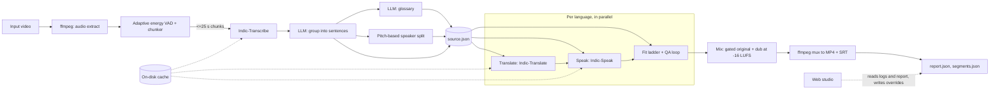

# Video dubbing: English video to Indian languages

Dubs one English video into any number of Indian languages and writes, per language, an **AI-dubbed** MP4 with synced speech, an SRT file and a per-sentence JSON, plus the English transcript and a machine-readable `report.json`. Every speech-to-text, translation, speech and text-in-image call goes to a Bodhan model (Indic-Transcribe, Indic-Translate, Indic-Speak, Indic-OCR). An optional OpenAI-compatible LLM judges and edits **English only**. A Vani-style web studio sits on top of the same pipeline so a person can review and fix any sentence.

> The output is AI-generated speech from a fixed voice library. It does not clone or imitate the original speaker.

## Setup

Requires Python 3.10+ and **ffmpeg** (with ffprobe) on the PATH. A `Dockerfile` is included.

```bash
make setup                  # pip install -r requirements-dev.txt && pip install -e .
cp .env.example .env        # then fill in the keys
```

| Variable | Purpose |
|---|---|
| `BODHAN_TRANSCRIBE_KEY`, `BODHAN_TRANSLATE_KEY`, `BODHAN_SPEAK_KEY` | one key per Bodhan model (or a single `BODHAN_API_KEY` for all three) |
| `BODHAN_OCR_KEY` | optional: Indic-OCR key, only for `--ocr` (on-screen text) |
| `LLM_BASE_URL`, `LLM_MODEL`, `LLM_API_KEY` | any OpenAI-compatible endpoint. Optional: without it every LLM decision has a deterministic fallback |

## Run

```bash
python -m bodhan_dub \
  --input path/to/video.mp4 \
  --langs hi,ta,bn \
  --out ./out \
  [--glossary glossary.yaml] [--voices voices.yaml] [--code-mixed] [--ocr] [--style "educational lecture"]
```

`--langs` accepts any Indic-Speak language code: `hi bn ta te mr gu kn ml pa or as ur ne sa sd ks kok mai doi mni brx sat`. Exit code is non-zero if any language failed; partial outputs and the report are still written. Re-running the same command is nearly free: every Bodhan call is cached on disk under `out/work/cache`.

```
out/
  report.json              per-language status, timings, retries, QA, cost, targets missed and why
  transcript.en.json       English sentences with start/end, speaker, glossary
  run.log.jsonl            structured log: one record per stage, per segment attempt, per API retry
  hi/ video.hi.mp4  subtitles.hi.srt  segments.hi.json  onscreen.hi.json (with --ocr)
  ta/ ...
```

`glossary.yaml` (optional) pins terms; `voices.yaml` (optional) picks voices:

```yaml
terms:
  - term: Pythagoras theorem
    translations: {hi: "पाइथागोरस प्रमेय"}     # your own rendering is substituted before translation
speakers: {S1: Kavya, S2: Amit}                  # or per language: languages: {ta: {female: Anitha}}
```

### On-screen text (`--ocr`)

Slides, captions and lower thirds are translated too, and drawn over the original text in each dubbed video. Frames are sampled every `--ocr-interval` seconds (default 2, at most `--ocr-max-frames` 40). A frame that looks like the previous one is not sent again, so a static slide costs one Indic-OCR call. Indic-OCR returns reading-ordered blocks with boxes; page furniture, pictures, formulas, tables, text that is already in an Indian script and low-confidence blocks are skipped and counted in `report.json`. The same text on consecutive frames is tracked as one item with a start and end, translated once per language by Indic-Translate (your glossary applies), and shown for exactly that time. The overlay is a box in the original background colour that covers the original text, with the translation in a Noto font for the script (shaped with Raqm, or with HarfBuzz through the `uharfbuzz` package where Pillow has no Raqm, as on Windows, so conjuncts render correctly; on Windows the built-in Nirmala UI font is used when no Noto font is installed), sized from the original text and shrunk before the box grows. If OCR is unavailable or an overlay fails, the dub is still produced without it. Drawing on the video means this one stage re-encodes the picture (x264, CRF 20).

### Web studio

```bash
python -m bodhan_dub.web --port 8000     # open http://localhost:8000
```

Upload a video, tick the languages, and watch the progress. Then for each language:

- **Sentences**: every sentence with check badges (sync offset, how the fit was achieved, speed, back-transcription error rate, repeat/omission flags, retries), a play button, and **Why?**, which shows every attempt and what the speech model actually said. **Edit** changes the English (re-translated by Indic-Translate), types your own target text, picks voice and style, and sets speed within 0.85-1.2x. **Hear this voice and style** plays the line in the chosen voice and style before you commit (one cached Indic-Speak call). **Use my own voice** lets you record in the browser or upload a recording for that one sentence; it replaces the AI voice, is fitted into the time slot (speed never above 1.2x) and is never regenerated. Only that line is re-voiced; the rest comes from cache.
- **Timeline**: dubbed video with English speech, dub and untouched (non-speech) lanes and live captions.
- **Glossary & voices**: pin terms per language; choose a voice per speaker.
- **Report & export**: targets table, misses with reasons, costs, downloads.

The web layer holds no dubbing logic. It starts `run_pipeline`, reads its logs and report, and saves edits as `overrides.json` that the next run applies. Keys stay on the server.

## How it works



Stage by stage:

1. **Probe and extract**: duration, 16 kHz mono audio.
2. **Voice activity**: an adaptive energy detector (no ASR model) finds speech. The threshold is relative to the clip, so a constant music bed stays under it. Flat-energy stretches are rejected as music or hum.
3. **Chunking**: cut at pauses of 0.6 s or more, never inside speech, up to 25 s per chunk. Longer unbroken speech is split at its largest internal pause; a hard split is flagged.
4. **Transcribe** each chunk with Indic-Transcribe (text only, so segment timestamps come from the VAD chunk boundaries).
5. **Sentence grouping**: the LLM regroups fragments into whole sentences; a deterministic fallback uses punctuation and pauses. Invalid LLM output is rejected.
6. **Glossary and speakers**: LLM-extracted terms plus yours; speakers grouped by pitch.
7. **Translate** each sentence with Indic-Translate; your glossary renderings are substituted before translation, and pinned terms and numbers are checked after.
8. **Speak** with Indic-Speak in short pieces (a sentence at a time).
9. **Fit ladder**: fits, then borrows the pause after the line, then starts a little early (within 250 ms), then stretches up to 1.2x, then asks the LLM to shorten the English and re-translates. Speed never exceeds 1.2x.
10. **QA loop**: the dubbed audio is transcribed back with Indic-Transcribe. Character error rate against the translation is recorded. A repeated phrase, a missing tail or a large mismatch triggers a re-voice with finer pieces; the best attempt wins.
11. **Mix**: the original soundtrack is silenced only where English speech was; music and effects elsewhere stay. Dubbed speech is normalized to -16 LUFS with a peak limiter.
12. **Mux, subtitles, report.**

Deploy (Vercel + Render): [DEPLOY.md](DEPLOY.md). More detail: [docs/design_notes.md](docs/design_notes.md) (design notes and flow chart), [docs/PR_DESCRIPTION.md](docs/PR_DESCRIPTION.md).

## Where the LLM is used

Grouping sentences, extracting a glossary, shortening an over-long English sentence, and judging a borderline dubbed line from its back-transcript. It reads and writes English only; any output containing Indic script is rejected. Each decision has a deterministic fallback, and the whole pipeline runs with no LLM.

## Bodhan models

| Model | Mode | Used for |
|---|---|---|
| Indic-Transcribe | hosted | English source (`language=en`) and back-transcription of the dub (`language=<target>`) |
| Indic-Translate | hosted | every translation, including glossary terms; `script=codemix` with `--code-mixed` |
| Indic-Speak | hosted | all speech; the language's own recorded voices; optional `style` |
| Indic-OCR | hosted | text in sampled video frames (`--ocr`): `/v1/chat/completions`, image as a data URI, blocks with boxes |

## Tests

```bash
make check      # ruff + the full test suite
```

Unit tests cover segmentation, the VAD, timing ladder, QA, glossary, voices and the LLM guardrails. Integration tests, including the 30-second smoke test, run the whole pipeline against an in-process **fake** Bodhan API (`tests/fake_bodhan.py`) with injected faults: repeated speech, truncated speech, a failing language, over-long lines, non-speech stretches, cache reuse and manual overrides. The fake is a test double only; the pipeline never falls back to it.

## Limitations (stated honestly)

- **QA thresholds are lightly calibrated.** The tests prove the logic against a fake; the real run below is one 5.5-minute video. The QA threshold (`BODHAN_DUB_CER_FAIL`, default 0.35) and the repeat/omission ratios should be tuned on more real runs.
- **LLM coverage in the reported run is partial.** The cached source stage (sentence grouping and glossary) was built on an earlier run while the LLM was unavailable (provider quota, then a retired model name), so it used the rule-based fallbacks. Shortening and judging ran with the LLM (`llama-3.3-70b-versatile` on Groq) in the final run. A clean `--force` run would use the LLM for grouping and the glossary too. `report.json` records what happened (`llm.calls`, `llm.failed_calls`, `llm.switched_off`, `llm.last_error`).
- **Speaker separation is a pitch heuristic** (at most two speakers, male/female by median pitch). Similar voices or more than two speakers will be merged. Override in `voices.yaml` or the web studio.
- **Music under speech is lost.** There is no source separation, so while someone speaks the original background is silenced and only the dub plays. Music and effects between speech are kept.
- **Loud music with no gaps** can defeat the energy detector. Flat-energy and implausible-transcript guards reduce, but do not eliminate, narration over music.
- **Glossary enforcement is partial.** Terms with your own rendering are substituted before translation. Other pinned terms are only checked and flagged (`term_variant`), because only Indic-Translate may write Indian-language text.
- **Subtitles are one cue per sentence**, wrapped at 42 characters, not split to reading speed.
- Not implemented: "my narration" recording as a whole-video mode (per-sentence own voice exists).
- The web studio runs one job at a time. Set `DUB_ACCESS_TOKEN` when hosting it; the page shows a sign-in screen first.
- **Style/emotion strength depends on the model.** The style is sent exactly as documented (`instructions` JSON with `lang` and `style`), but how strongly Indic-Speak applies it varies by voice and sentence. Use the editor's preview to compare.
- **On-screen text is approximate in time and in look.** Frames are sampled, so a text starts and ends to the nearest interval, and a fast animation or text over a busy photo can be missed or boxed with a flat colour. Tables are not translated. Needs `BODHAN_OCR_KEY`; Indic-OCR pricing is not in the docs, so set `BODHAN_OCR_PRICE_PER_IMAGE` to count it in the cost report. Install `fonts-noto-core` (the Dockerfiles do) or the overlay falls back to whatever font covers the script.
- **Own-voice lines are not checked** by the speech model (no back-transcription) and cannot be shortened by the LLM; a recording longer than its slot is sped up to 1.2x at most and then trimmed at the next sentence, and the line is marked degraded.

## Demo video and outputs

- Demo video (5 minutes or less, full run into Hindi, Tamil and Bengali): https://drive.google.com/file/d/13kSwj_-DzGF7YsehUKiEk9XBKb6f_Pv9/view
- Dubbed MP4s (hi, ta, bn) and `report.json`: https://github.com/anuragnayak01/Bodhan-AI-Cookbook/releases/tag/demo-v1
- Architecture diagram and flow chart: [How it works](#how-it-works) and [docs/design_notes.md](docs/design_notes.md)

## Results (one real run)

Input: a 5.49-minute English maths lesson, `--langs hi,ta,bn --ocr`. Numbers are from `report.json`.

| | Hindi | Tamil | Bengali | Target |
|---|---|---|---|---|
| Lines dubbed / degraded | 25 / 0 | 24 / 1 | 23 / 2 | |
| Sync within ±300 ms | 100% | 100% | 100% | ±300 ms |
| Stretch range | 1.0–1.14 | 1.0–1.2 | 1.0–1.2 | 0.85–1.2 |
| Length difference | 0 ms | 0 ms | 0 ms | ≤100 ms |
| Speech loudness (LUFS) | −16.08 | −16.09 | −16.30 | −16 |
| Mean / max back-transcription CER | 5.6% / 29.7% | 3.5% / 12.4% | 5.7% / 23.2% | |
| LLM shortenings / speech retries | 0 / 1 | 8 / 0 | 6 / 7 | |
| On-screen text burned in | 7 of 7 | 7 of 7 | 7 of 7 | |

Misses: Tamil line 1 and Bengali lines 15 and 17 were still too long at 1.2× or had a high back-transcription error after shortening (Bengali 17 was also judged bad by the LLM). They are marked `degraded` in the report and the segments JSON, not hidden.

## Cost and runtime

Measured on the 5.49-minute video, 3 languages: the full run cost ₹6.72 (**₹0.41 per video minute per language**) and took 32 minutes, because Bodhan rate-limits all three models. The final re-run that applied LLM shortening reused the cache, cost ₹1.44 more (speech retries) and took 4 minutes; including all re-runs the total is about ₹8.4 (about ₹0.5 per video minute per language). OCR is not priced in the docs and is counted as 0.

Hosted prices: Indic-Transcribe ₹0.10 per audio minute, Indic-Translate ₹0.20 per 10,000 output tokens, Indic-Speak ₹6 per 10,000 input characters. Speech dominates. Rough estimate for a talking-head lesson (about 130 English words a minute, so roughly 700 Indian-language characters of speech a minute): about ₹0.45 speech, ₹0.10 back-transcription, under ₹0.02 translation, plus retries, so **about ₹0.6 per video minute per language**, plus ₹0.10 per video minute once for the English source. A 5-minute video in 3 languages is therefore around ₹9-10, close to the ₹10 starter credit, so rely on the cache and ask for more credit before repeated full runs. These are estimates; `report.json` records the real cost per language. Runtime is bounded by API calls (about 3-4 per sentence per language) at `--concurrency` 4; measure it on a real run.

## AI assistance

Built with Claude Code (Claude Sonnet) as a pair programmer for the pipeline, tests, web studio and docs. All code was reviewed and run; the author must be able to explain every line.
