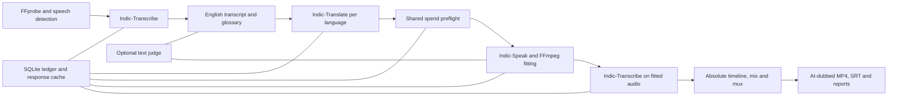
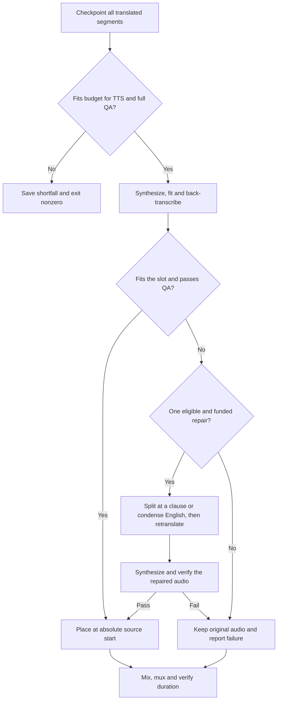

# Video dubbing with Bodhan AI

Dub a local English video into one or more Indian languages. The CLI writes an AI-dubbed MP4, timed subtitles, and a report that identifies any skipped or unverified segments. It accepts MP4, MOV, MKV and WebM files between 1 and 15 minutes long.

## Setup

On Linux, macOS or WSL, install Python 3.10+ and FFmpeg with FFprobe, the `atempo` and `ebur128` filters, and the `libx264` and AAC encoders. Run these commands from the Cookbook root.

```bash
python -m venv .venv
source .venv/bin/activate
python -m pip install ./examples/video_dubbing
```

Export `BODHAN_TRANSCRIBE_KEY`, `BODHAN_TRANSLATE_KEY`, and `BODHAN_SPEAK_KEY` from your Bodhan console. The CLI reads environment variables. To use a local environment file, copy [`.env.example`](.env.example) to `.env`, fill in the three placeholders, and run `set -a; source .env; set +a`.

Set `LLM_BASE_URL`, `LLM_MODEL`, and `LLM_API_KEY` together to enable an optional OpenAI-compatible text judge. The reference route is OpenRouter's `google/gemini-2.5-flash-lite`. Other endpoints accept `LLM_INPUT_USD_PER_MILLION` and `LLM_OUTPUT_USD_PER_MILLION` for their published token rates. The provider handles an unavailable judge via deterministic fallback. [Bodhan API reference](https://console.bodhan.ai/api-docs/) · [OpenRouter Flash Lite pricing](https://openrouter.ai/google/gemini-2.5-flash-lite)

## Run

```bash
python -m bodhan_dub --input path/to/video.mp4 --langs hi,ta,bn --out ./out
```

Supported targets are `as,bn,en,gu,hi,kn,ml,mr,or,pa,ta,te,ur`. English uses the source transcript with a fixed Indic-Speak voice. [Indic-Speak production language list](https://huggingface.co/bodhan-ai/indic-speak)

| Option | Behavior |
| --- | --- |
| `--glossary glossary.yaml` | Assign expected spellings to English terms for consistency checks. See the YAML below. |
| `--voices voices.yaml` | Choose a fixed Indic-Speak library voice by target language. |
| `--background-stem effects.wav` | Supply a clean music and effects stem aligned to the video. |
| `--state-dir DIR` | Select a shared response cache and spend ledger. The default is `$XDG_STATE_HOME/bodhan_dub` or `~/.local/state/bodhan_dub`. |
| `--budget-inr N` | Set the maximum lifetime estimate, up to ₹10. The ledger initially includes a ₹0.02 historical smoke estimate. Use `--prior-spend-inr 0` on a fresh ledger only if it represents a separate account with zero prior spend. |
| `--excerpt-seconds N` | Process a prefix of 1–45 seconds from an otherwise valid full-length video. |
| `--preflight-only` | Run through translation, checkpoint it, and estimate first-pass TTS and QA without dispatching TTS. |
| `--require-complete-translation` | Block synthesis if any source window or requested translation failed. |
| `--workers N` | Limit workers and total in-flight requests. Each endpoint defaults to one in-flight request. |
| `--skip-translation-review` | Skip optional review of flagged translations. |
| `--verbose` | Log stage decisions, accepted placement times and CER. |

Use this format for glossary and voice files.

```yaml
# glossary.yaml
parallel lines:
  hi: समानांतर रेखाएँ
  ta: இணை கோடுகள்
  bn: সমান্তরাল রেখা
```

```yaml
# voices.yaml
hi: Kavya
ta: Anitha
bn: Ishita
```

The output contains `transcript.en.json` and `report.json`, plus `<lang>/video.<lang>.mp4`, `<lang>/subtitles.<lang>.srt`, and `<lang>/segments.<lang>.json` per language with usable output. Segment and subtitle checkpoints survive a partial failure. A language with segments but no verified placements has no new MP4. When the output directory contains a previously rendered bundle, a preflight or failed rerun preserves that bundle and the report points to a separate checkpoint. Give concurrent runs separate output directories. Unresolved slots in a partial MP4 retain original audio. A silence-only input passes through with empty subtitles and no synthesis. The CLI returns a nonzero exit status for partial or failed runs.

## How it works





- Speech detection uses FFmpeg-filtered audio and short-window acoustics. It prefers pauses, caps ASR requests at 30 seconds and overlaps forced cuts. Hosted ASR can return text only. In that case timing is estimated from speech activity and allocated across sentence or clause boundaries. The report labels those starts as approximate.
- The text judge can propose merges and recurring English terms, review selected risky translations, and condense overlong English. Code validates selected spans and protected terms, quantities and relationships. Indic-Translate supplies all target text. Glossary renderings flag discrepancies for review. The hosted translation route accepts target and script settings, with no gloss entry field to force a specific rendering.
- Synthesis uses one fixed voice per language. FFmpeg decodes the response bytes, trims confirmed edge silence and stretches pitch-preservingly at a maximum tempo of 1.2× when needed. A short quiet tail can extend a slot. If the original clip still overruns, the pipeline looks for enough confirmed quiet before the next speech or audible cue and refits the cached synthesis. A fresh back-transcription is required before placing that clip. A content repair can split clauses or use condensed English. Only a fitted and back-transcribed candidate is admitted to the mix.
- The report records normalized CER, possible repeats and omissions, stretch and trim measurements, budget events, retries and stage latency. Exact placement is relative to the source timings available to the pipeline. Human listening remains necessary to judge naturalness and meaning.
- The original mix is retained outside dubbed slots. Within them the supplied stem replaces the original, or the original is attenuated. This can reduce music and effects mixed into original speech. Acoustic detection can miss quiet speech or mistake changing music for speech. Speaker overlap receives the same fixed voice policy.

### Budget and resume

The SQLite ledger tracks attempts, available credit, estimated and usage-derived charges, and ambiguous failures. Baseline TTS and QA are reserved together for all languages before any synthesis. Additional attempts use remaining headroom. Cached success is reusable across runs, including a smoke and the full demo when their input audio and model parameters match. Account-level credits and provider invoices are independent of the local estimate. Use one state directory for every paid run against the same submission budget. [Published Bodhan pricing](https://console.bodhan.ai/)

### Demo and verification

Use the download link in the take-home assignment to save the Class 9 mathematics lesson to `examples/video_dubbing/sample_data/demo.en.mp4`. Both commands use the same state directory. The 33-second prefix contains the first complete ASR window.

```bash
cd examples/video_dubbing
python -m bodhan_dub --input sample_data/demo.en.mp4 --langs hi,ta,bn \
  --out outputs/smoke --state-dir .bodhan-dub-state --excerpt-seconds 33 \
  --require-complete-translation
python -m bodhan_dub --input sample_data/demo.en.mp4 --langs hi,ta,bn \
  --out outputs/demo --state-dir .bodhan-dub-state --require-complete-translation
```

Run these commands from the Cookbook root.

```bash
python -m pip install -r requirements-dev.txt
python -m pytest examples/video_dubbing/tests
python scripts/validate_recipe.py examples/video_dubbing
make check
```

The offline suite runs the CLI and real FFmpeg against simulated provider responses. It checks decoded placement, subtitles, silence, retries, partial output, reports, the spend cutoff and response reuse.

### Observed verification

The offline suite passed 22 tests with simulated hosted responses and real FFmpeg 9.0.1. A controlled 450 ms placement regression failed the decoded-audio timing assertion, and the original build passed. The recipe validator and Ruff passed. The Cookbook's `make check` stopped at the existing AndroidSpeak validation failure, reproduced on a clean archive of the base commit.

The 33-second hosted smoke produced two verified Hindi segments and one verified Bengali segment. No Tamil clip fit its slot in that smoke. Both rendered MP4s were 66.7 ms over the excerpt, and both speech buses were below the −16 LUFS target. The smoke cost estimate was ₹0.878. The full demo reused the first ASR request from the smoke. Earlier sentence boundaries differed from the final demo.

The full 5m29s hosted demo finished with status **partial** in 15.7 minutes. All 63 translations were ready before TTS and the preflight reserved ₹6.53. The full run tracked ₹6.734 in provider charges and estimates. The lifetime ledger included ₹8.033 of the ₹10 cap, including the prior ₹0.02 estimate and ₹0.000 in uncertain charges.

| Language | Verified segments | Mean CER on verified clips | Speech bus | Video length error | Run cost/min |
| --- | ---: | ---: | ---: | ---: | ---: |
| Hindi | 20/21 | 5.9% | -16.2 LUFS | +0.0 ms | ₹0.364 |
| Tamil | 11/21 | 3.7% | -16.2 LUFS | +0.0 ms | ₹0.487 |
| Bengali | 13/21 | 7.2% | -16.5 LUFS | +0.0 ms | ₹0.370 |

FFmpeg decoded the exported files, and an independent SRT parser checked cue order, bounds, text and correspondence with the accepted QA records. The hosted English ASR supplied text only, so the full lesson's transcript timings are approximate. Sync to independently annotated English utterances and native-speaker listening remain unverified. An independent decoded-AAC check across accepted intervals measured −16.1 LUFS in Hindi, −16.2 in Tamil and −16.5 in Bengali. The follow-up rerun-preservation fix and the additional loudness correction for peak-limited clips were tested offline after the live render began. The walkthrough uses actual output excerpts. Generated media and detailed reports are kept in the local `outputs/` directory.

### Targeted demo recovery

[Hindi dub](https://drive.google.com/file/d/1v8UXGNVp_3nR_DoHiKN0ymPByD1x6Yis/view?usp=drivesdk) · [Tamil dub](https://drive.google.com/file/d/17aZUNhnhGK0AhSQJ9oZVBDGiDHAxzRgW/view?usp=drivesdk) · [Bengali dub](https://drive.google.com/file/d/1GS9CKqx4rmlwPgtfZ50Bx4WRI3gUlSWz/view?usp=drivesdk) · [71-second walkthrough](https://drive.google.com/file/d/1-Ju-rmtPcbCl__zIoFr4e8Wy7_lvuZco/view?usp=drivesdk)

A separate recovery pass reused fitted audio or synthesized only unresolved clips. It verified nine cached clips using measured quiet tails and recovered nine more with reviewed English condensations, retranslation and audio checks. Each target-language text came from Indic-Translate. The supplied lesson diagram confirmed the Tamil example's 120° value. The report retains the raw and reviewed CER when the verification transcript spells numbers phonetically.

| Language | First full run | Final verified coverage | Mean CER on verified clips | Decoded speech |
| --- | ---: | ---: | ---: | ---: |
| Hindi | 20/21 | 21/21 | 5.6% | -16.2 LUFS |
| Tamil | 11/21 | 21/21 | 5.1% | -16.2 LUFS |
| Bengali | 13/21 | 20/21 | 6.1% | -16.5 LUFS |

Every final MP4 decodes and matches the original 329.266667-second duration. Independent checks match all 18 repaired clips to their successful verification cache entries and measure the decoded placement and subtitle cues. Bengali segment 15, starting at 3:44.54, retains the original English after multiple candidates exceeded the 1.2× tempo limit or changed the geometry vocabulary. Source starts are approximate. Pronunciation and naturalness still need native-speaker review.

The lifetime ledger tracked ₹9.527 of the ₹10 cap, including the previous smoke estimate. The final outputs include supervised repairs of the lesson. The evaluator CLI runs unattended with the same verified quiet-tail policy and the standard bounded recovery options.

### AI assistance

Codex helped implement the CLI and parallelized work on the hosted adapters, media pipeline and tests. Acceptance checks exercise the installed entry point and inspect actual media in addition to report fields.
