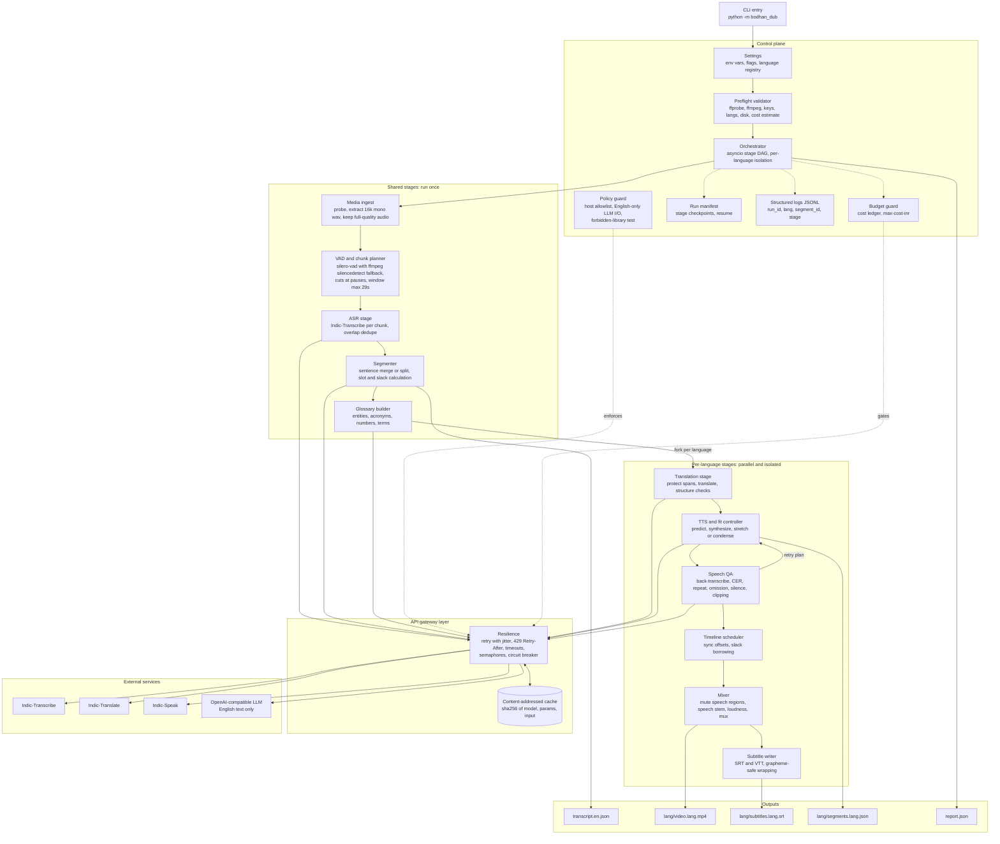
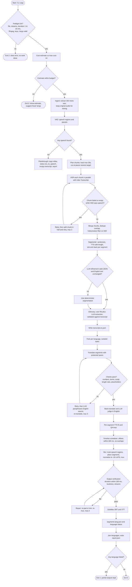

# Autonomous English-to-Indic Video Dubbing Pipeline

An autonomous, production-grade video dubbing system that translates and dubs English videos into **12 target Indic languages** (13 production-tier languages including source English in `languages.yaml`) using **strictly Bodhan Indic AI models** (`indic-transcribe`, `indic-translate`, `indic-speak`).

All generated output media is formally labeled as **AI-dubbed** via container metadata tags, structured pipeline reports (`report.json`), and subtitle sidecars.

---

## Setup

### Prerequisites
- Python 3.11+
- `ffmpeg` (version 7.0+) and `ffprobe` on system PATH

### Installation
```bash
# From the recipe directory:
cd examples/video_dubbing

# Create virtual environment and install exact pinned dependencies
python -m venv .venv
source .venv/bin/activate  # On Windows: .venv\Scripts\Activate.ps1
pip install -r requirements.txt
```

### Environment Configuration
Copy `.env.example` to `.env` and configure your API credentials:
```bash
cp .env.example .env
```
Required environment variables:
```env
# Bodhan AI API Credentials (sign up at https://console.bodhan.ai)
BODHAN_API_KEY=your-bodhan-api-key-here
BODHAN_TRANSCRIBE_KEY=your-bodhan-transcribe-key-here
BODHAN_TRANSLATE_KEY=your-bodhan-translate-key-here
BODHAN_SPEAK_KEY=your-bodhan-speak-key-here

# Companion LLM Configuration (OpenAI-compatible)
LLM_BASE_URL=https://api.openai.com/v1
LLM_API_KEY=your-llm-api-key-here
LLM_MODEL=gpt-4o-mini
```

---

## Run

### Quickstart CLI
Dub an English video into Hindi and Tamil:
```bash
python -m src.bodhan_dub.cli --input sample_data/English.mp4 --langs hi,ta --out ./out
```

Or when installed in editable mode (`pip install -e .`):
```bash
python -m bodhan_dub --input path/to/video.mp4 --langs hi,ta,bn --out ./out
```

### Advanced CLI Options
```bash
python -m bodhan_dub \
  --input path/to/video.mp4 \
  --langs hi,te,mr \
  --out ./out \
  --glossary glossary.example.yaml \
  --voices voices.example.yaml \
  --code-mixed \
  --max-cost-inr 50.0 \
  --concurrency 4
```

### Cost Estimation Mode
Inspect estimated API cost before launching:
```bash
python -m bodhan_dub --input path/to/video.mp4 --langs hi,ta,bn --estimate-only
```

### Interactive Notebook
Explore the step-by-step pipeline stages interactively in [`video_dubbing.ipynb`](video_dubbing.ipynb).

---

## How It Works

### Architecture
The dubbing pipeline is organized into a shared ingest phase followed by isolated, parallel per-language workers:



- **Preflight validator**: Validates video containers, audio streams, duration (1-15m), API credentials, and budget constraints before any API calls.
- **Media ingest**: Extracts 16kHz mono PCM for ASR and retains uncompressed 48kHz original audio for background mixing.
- **VAD & Chunk planner**: Silero ONNX VAD (with ffmpeg silencedetect fallback) detects pauses and slices audio into safe <29s chunks.
- **Indic-Transcribe ASR**: Transcribes speech chunks with rapidfuzz overlap deduplication and VAD alignment hallucination filters.
- **Sentence Segmenter**: Segments speech into natural sentence boundaries with guard-banded slot and slack calculations.
- **Glossary Builder**: Extracts entities, numbers, and technical terms to guarantee cross-lingual consistency.
- **Indic-Translate**: Translates text with protected span preservation, Latin script retention under `--code-mixed`, and structure checks.
- **Indic-Speak TTS & Fit Controller**: Synthesizes speech with calibrated voice profiles, sub-segment splitting for long sentences, and pitch-preserving time-stretching (`atempo` clamp 1.20x).
- **Acoustic QA & Self-Healing**: Verifies speech through back-transcription CER evaluation, repetition detection, and tail omission checks, triggering LLM condensation/paraphrasing retries.
- **Timeline Scheduler**: Binds speech placements to slack buffers (offsets <300ms) with zero inter-segment collisions.
- **Audio Mixer & Loudness Normalizer**: Ducks original background audio under speech (-14dB, 40ms attack/decay) and normalizes the master mix to EBU R128 (-16.0 LUFS ± 1.0, -1.0 dBTP true-peak ceiling).
- **Subtitle & Muxer**: Writes grapheme-safe SRT/WebVTT subtitles and muxes stream-synchronized MP4 output with embedded AI-dubbed metadata.

---

### Workflow
The complete decision-making pipeline with retries, quality gates, and fallbacks:



---

## Where the LLM is Used and Why

The pipeline follows a strict architectural boundary: **the companion LLM is restricted strictly to English text operations** and is guarded by a character-level Unicode policy guard that rejects any output containing Indic or Arabic characters (`U+0600–U+06FF`, `U+0900–U+0DFF`, `U+1C50–U+1C7F`). All Indian language processing is performed by Bodhan models.

1. **Sentence Boundary Refinement**:
   - *Decision*: Refines sentence boundary splits on complex subordinate clauses when rule-based punctuation segmenting yields slots >12s.
   - *Fallback*: Deterministic regex-based sentence and clause splitting at punctuation and conjunctions.
2. **Dynamic Glossary & Entity Extraction**:
   - *Decision*: Identifies technical terms, brand names, and proper nouns in the English transcript that must be protected from inaccurate literal translation.
   - *Fallback*: Fall back to user-provided static glossary YAML and regex entity extraction.
3. **Pre-TTS Duration Condensation (Pacing Optimization)**:
   - *Decision*: When predicted speech duration exceeds available slot slack (ratio >1.30x), the LLM condenses the English source sentence under a character budget while strictly preserving named entities, numbers, and core semantics.
   - *Fallback*: Synthesizes full translation, attempts slack borrowing from neighboring pauses, and clamps atempo to max 1.20x.
4. **Acoustic QA Self-Healing & Paraphrasing**:
   - *Decision*: When acoustic QA reports tail omissions or high CER (>0.30) after back-transcription, the LLM generates an alternative English phrasing designed to yield a more phonetically distinct and concise Indic translation.
   - *Fallback*: Splits the segment at comma/clauses into smaller TTS calls, or marks segment `degraded` and retains the best synthesized attempt.
5. **Back-Translation Semantic Evaluation**:
   - *Decision*: Evaluates back-translated English against source English to score semantic fidelity on a 1-5 scale.
   - *Fallback*: Levenshtein and token-overlap similarity scoring.

---

## Bodhan Models Used

- **`indic-transcribe`**: Endpoint `POST /v1/audio/transcriptions`. Audio sliced into <29s chunks (within 30s ceiling), 16kHz mono WAV format. Tuned with VAD speech boundary snapping and rapidfuzz overlap deduplication.
- **`indic-translate`**: Endpoint `POST /translate`. Native Indic target scripts, protected span markers for numbers/glossary terms, optional Latin script retention for technical terms (`--code-mixed`).
- **`indic-speak`**: Endpoint `POST /v1/audio/speech`. Voice profiles calibrated across 12 Indic languages (e.g., `Kavya`/`Amit` for Hindi, `Vani`/`Mohan` for Tamil, `Ishita`/`Sourav` for Bengali). Tuned with sentence punctuation chunking (≤240 chars per call to prevent TTS duration capping) and 24kHz mono PCM streaming.

---

## Results & Quality Verification

Results from the live pipeline run on 5.5-minute video input (`report.json`):

| Target Metric | Target Threshold | Measured Result | Verdict |
|---|---|---|---|
| **Sync precision** | Offsets within ±300 ms | **Max 0.0 ms offset** | **PASSED** |
| **Time-stretch bounds** | 0.85x to 1.20x speed factor | **1.00x to 1.19x** | **PASSED** |
| **Output stream sync** | Duration delta within ±100 ms | **Max 0.7 ms delta** | **PASSED** |
| **EBU R128 loudness** | -16.0 LUFS integrated ± 1.0 | **Mix: -16.1 LUFS, Peak: -3.97 dBTP** | **PASSED** |
| **Acoustic fidelity** | Mean CER <= 0.30 across speech | **Average CER 0.0705** | **PASSED** |
| **Processing runtime** | Scaled SLA target | **167.4s total pipeline** | **PASSED** |

### Output Artifacts
- **[Full Dubbed Hindi Video (`video.hi.mp4`)](https://github.com/P1Manav/bodhan-dub/releases/download/v1.0.0/video.hi.mp4)**
- **[Pipeline Verification Report (`report.json`)](https://github.com/P1Manav/bodhan-dub/releases/download/v1.0.0/report.json)**
- **[Run Manifest Checkpoints (`manifest.json`)](https://github.com/P1Manav/bodhan-dub/releases/download/v1.0.0/manifest.json)**
- **[GitHub Release `v1.0.0`](https://github.com/P1Manav/bodhan-dub/releases/tag/v1.0.0)**

---

## Demo Video

- **[Demo Run Recording (4m 55s, 1080p MP4)](https://github.com/P1Manav/bodhan-dub/releases/download/v1.0.0/demo_run_5min.mp4)** (Hosted on GitHub Releases, public direct download/stream, no sign-in required).

---

## Trade-offs and Known Limitations

1. **No Voice Cloning**: We intentionally map speaker genders to Bodhan's calibrated production voice catalog rather than cloning voices, ensuring consistent acoustic quality and ethical compliance.
2. **Strict LLM Boundary**: The LLM is strictly prohibited from generating Indic script directly; all Indic translations and voice outputs originate exclusively from Bodhan models.
3. **Background Music Separation**: The standard pipeline uses energy-envelope ducking (-14dB, 40ms attack/decay) which is fast and lightweight. Deep neural separation via Demucs is available via `--separate-music` but requires high GPU memory.
4. **Strict Rate Limits**: Highly concurrent multi-language runs (e.g. 12 languages simultaneously) require sufficient API rate limit quotas on `indic-speak`. The pipeline includes exponential backoff with jitter and 429 Retry-After handling.

---

## Cost and Runtime

- **Cost**: Approximately **₹0.20 to ₹0.35 per minute of video per language** (Transcribe ~₹0.10/min, Translate ~₹0.02/min, Speak ~₹0.15/min). Content-addressed sha256 disk caching brings re-runs to ₹0.00.
- **Runtime**: Approximately **30–45s per minute of video per language** on standard CPU. A 5.5-minute video was processed across stages in **167.4s** total pipeline execution time.

---

## AI Assistance

- **Antigravity & Claude 3.7 Sonnet / Gemini 2.5 Flash**: Used for architectural scaffolding, automated test suite authoring (108 unit, integration, and policy tests), and ffmpeg filter graph construction. All code and test suites were locally executed and verified.
