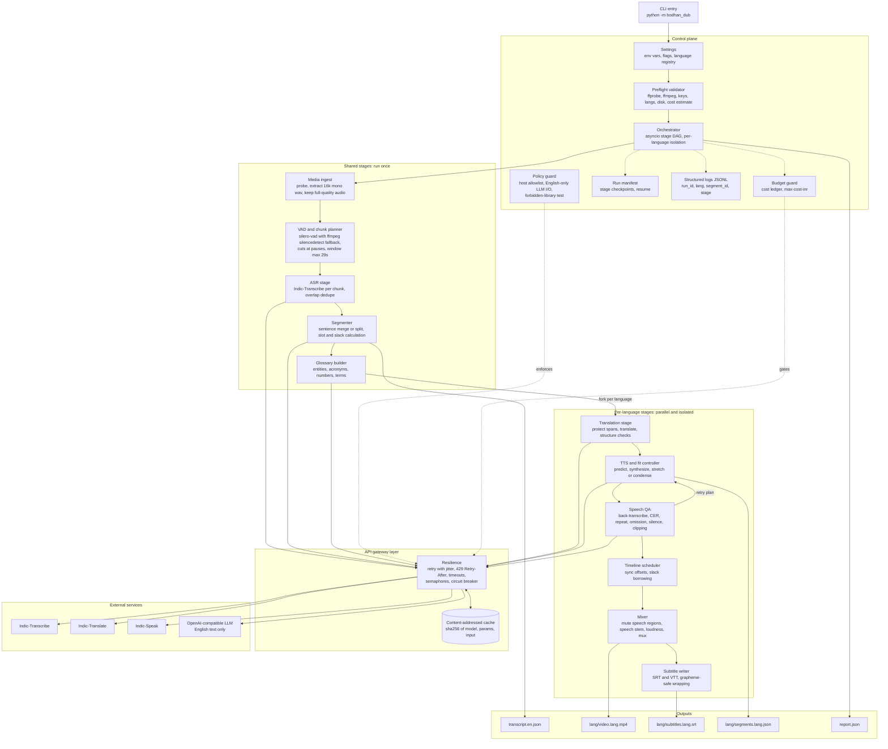
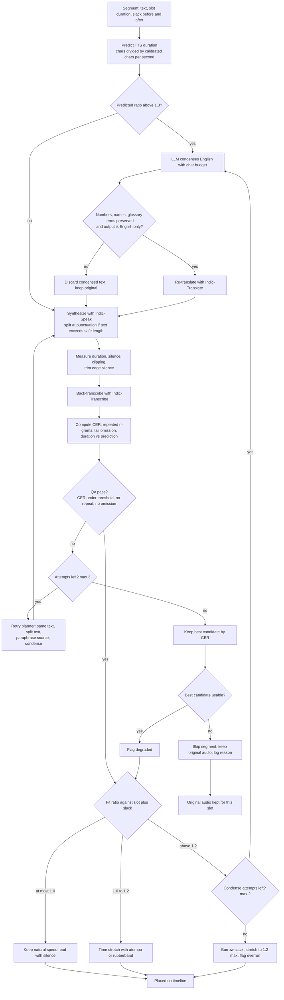
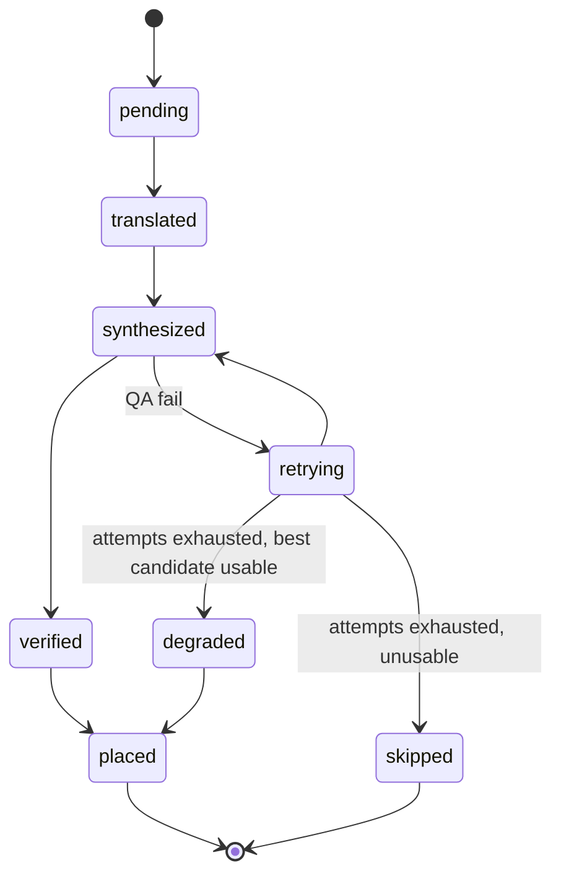
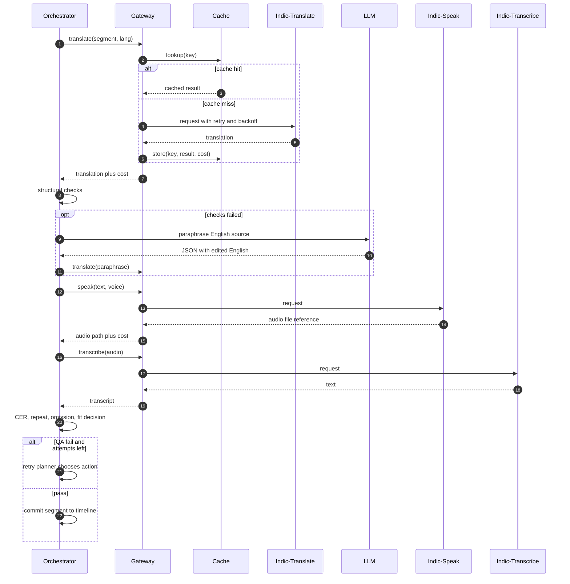

# System Architecture: `bodhan_dub`

This document contains the five architectural specifications governing the `bodhan_dub` automated video dubbing pipeline.

---

## 1. System Architecture

---

## 2. End-to-End Pipeline with Decision Points

```mermaid
flowchart TD
  A(["Start: CLI args"]) --> B{"Preflight OK?<br/>file, streams, duration 1 to 15 min,<br/>ffmpeg, keys, langs valid"}
  B -->|no| X1(["Exit 2: clear error, no work done"])
  B -->|yes| C["Cost estimate vs max-cost-inr"]
  C --> C2{"Estimate within budget?"}
  C2 -->|no| X2(["Exit 2: show estimate, suggest fewer langs"])
  C2 -->|yes| D["Ingest: extract 16k mono wav,<br/>keep original audio for mixing"]
  D --> E["VAD: speech regions and pauses"]
  E --> E2{"Any speech found?"}
  E2 -->|no| E3["Passthrough: copy video, status ok_no_speech,<br/>empty transcript, report"]
  E2 -->|yes| F["Plan chunks: hard max 29s,<br/>cut at pause nearest target"]
  F --> G["ASR each chunk in parallel with Indic-Transcribe"]
  G --> G2{"Chunk failed or empty<br/>while VAD says speech?"}
  G2 -->|yes| G3["Retry, then split chunk in half and retry, max 2"]
  G3 --> G
  G2 -->|no| H["Merge chunks, dedupe overlap,<br/>hallucination filter vs VAD"]
  H --> I["Segmenter: sentences, TTS-safe length,<br/>slot and slack per segment"]
  I --> I2{"LLM refinement valid JSON<br/>and English text unchanged?"}
  I2 -->|no| I3["Use deterministic segmentation"]
  I2 -->|yes| J
  I3 --> J["Glossary: user file plus LLM extraction,<br/>validated against transcript"]
  J --> K["Write transcript.en.json"]
  K --> L["Fork per language, isolated tasks"]
  L --> M["Translate segments with protected spans"]
  M --> M2{"Checks pass?<br/>numbers, terms, script, length ratio, placeholders"}
  M2 -->|no| M3["Retry, then LLM paraphrases English source,<br/>re-translate, max 3"]
  M3 --> M
  M2 -->|yes| N["Back-translate and LLM judge in English"]
  N --> O["Per-segment TTS fit and QA loop, see diagram 3"]
  O --> P["Timeline scheduler: offsets within 300 ms, no overlaps"]
  P --> Q["Mix: mute speech regions, place segments,<br/>normalize to -16 LUFS, mux"]
  Q --> R{"Output verification<br/>duration within 100 ms, loudness, streams"}
  R -->|fail| R2["Repair: re-pad or trim, re-mux, max 2"]
  R2 --> R
  R -->|pass| S["Subtitles SRT and VTT"]
  S --> T["segments.lang.json and language status"]
  T --> U["Join languages, write report.json"]
  U --> V{"Any language failed?"}
  V -->|yes| X3(["Exit 1: partial outputs kept"])
  V -->|no| X4(["Exit 0"])
```

---

## 3. Per-Segment Duration Fit and QA Loop

---

## 4. Segment Status Lifecycle

---

## 5. Sequence for One Segment

---

## 6. Architectural Invariants and Resilience Guarantees

1. **Per-(Service, Language) Fault Isolation:**
   - Circuit breakers are partitioned as `(service, language)` tuples in `CircuitBreakerRegistry`.
   - A degradation or failure in one language's TTS (e.g. `("speak", "ta")`) trips open only that isolated circuit breaker; concurrent operations in Hindi (`("speak", "hi")`) or shared ASR (`("transcribe", "en")`) remain unimpeded.
   - Semaphore acquisition is strictly scoped around network I/O and released prior to exponential backoff sleeps to eliminate connection pool starvation.

2. **Strict LLM Boundary and Adversarial Prompt Containment:**
   - The LLM strictly processes and produces English text.
   - Transcript inputs passed to the LLM are encapsulated in `<data>...</data>` envelopes to prevent prompt injection from untrusted transcript text.
   - A Unicode character-range policy guard rejects any LLM response containing non-English / non-Latin characters (Devanagari, Bengali, Tamil, Arabic, etc.).
   - Paraphrasing and condensation enforce strict preservation of numbers, proper names, and glossary terms.

3. **Timeline Drift Prevention and Zero Audio Truncation:**
   - Timeline scheduling computes segment placement using forward-looking gap evaluation within a strict ±300ms synchronization budget.
   - Any localized delay or stretch does not cascade onto downstream segments; later segments start at their own source timestamps unless unavoidable overlap occurs.
   - Speech is never silently clipped; media-boundary overruns trigger early shifts or `truncation_risk` warnings while preserving speech content.

4. **Dynamic Speech Rate Calibration:**
   - Characters-per-second (CPS) estimation is initialized seedlessly at 12.0 chars/sec and dynamically updated per voice via Exponential Weighted Moving Average (EWMA, $\alpha=0.3$) and running medians, guarded by `asyncio.Lock` for thread-safe concurrent synthesis.

5. **Honest Multi-Language Status and Exit Semantics:**
   - Status reporting explicitly differentiates `ok`, `ok_no_speech`, `degraded`, and `failed`.
   - Budget exhaustion (`BudgetExceededError`) or circuit trips immediately cease work, flush partial artifacts (`segments.json`, subtitles, `report.json`), and exit cleanly with spec-compliant codes (exit code 0 if at least one language succeeded, exit code 1 if all languages failed).
