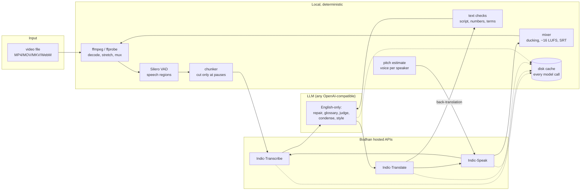

# Design notes: video dubbing pipeline

This explains how `bodhan_dub` turns one English video into dubbed videos, how it checks its own work, and why each decision sits with plain code or with the LLM.

## Ground rules this design keeps

- **All speech recognition, translation and speech synthesis go to Bodhan:** `indic-transcribe`, `indic-translate` and `indic-speak`. No other ASR, MT or TTS is used anywhere, not even for alignment or fallback. Timing comes from voice-activity detection (Silero VAD), which the brief allows.
- **The LLM only reads and writes English.** It repairs the English transcript, builds the glossary, shortens English lines that run long, picks a speaking style and judges translations *through their English back-translation*. Every Indian-language word comes from Indic-Translate.
- **The LLM proposes, code decides.** Every LLM answer is validated by deterministic code. If it fails validation, the LLM is re-asked once with the exact errors, and if it fails again a deterministic fallback runs. An LLM outage degrades quality; it never stops a run.

## Architecture

| Component | File | One line |
|---|---|---|
| CLI | `cli.py` | the exact required command; exit 0 / 1 (a language failed) / 2 (bad input or setup) |
| Orchestrator | `pipeline.py` | shared stages once, then one isolated thread per language |
| Bodhan client | `bodhan.py` | retries with backoff, a shared rate-limit cooldown, a concurrency cap, cost metering, caching |
| LLM client | `llm.py` | JSON replies, optional settings dropped if rejected, cached, failures become one `LLMError` |
| VAD | `vad.py` | Silero frame scores → speech regions; energy fallback |
| Chunker | `chunking.py` | regions → chunks of 15 s or less, cut at the longest pause |
| Transcribe | `transcribe.py` | Indic-Transcribe per chunk; an empty transcript is a logged skip |
| Repair | `repair.py` | LLM fixes punctuation, numbers and mishearings and merges fragments; validator plus fallback |
| Glossary | `glossary.py` | LLM term list, checked for literal presence; user YAML wins |
| Translate | `translate.py` | translate, back-translate, check, judge, try alternatives, pick the best |
| Voices | `voices.py` | pitch → male/female voice with hysteresis; `--voices` override |
| Synthesis | `synth.py` | per-sentence TTS, back-transcription QA, re-takes, timing fit, condensing |
| Mix | `mix.py` | placement, ducking, loudness, mux, subtitles |
| Report | `report.py` | every quality target scored, with the reason for each miss |

## Workflow

```mermaid
flowchart TD
    A[probe + extract 16 kHz audio] --> B[Silero VAD → speech regions]
    B --> C[pack chunks ≤15 s, cut at longest pause<br/>nonstop speech: forced cut at quietest frame]
    C --> D[Indic-Transcribe each chunk]
    D --> D1{empty?}
    D1 -- yes --> SK1[skip: no speech recognised]
    D1 -- no --> E[LLM repair: punctuation, digits,<br/>mishearings, merge fragments]
    E --> E1{validator: ids, gaps ≤1.5 s,<br/>units ≤25 s, word overlap ≥0.7}
    E1 -- fail --> E2[re-ask once with the errors] --> E3{valid?}
    E3 -- no --> E4[fallback: raw segments + basic cleanup]
    E1 -- ok --> F
    E3 -- yes --> F
    E4 --> F[LLM glossary, filtered to terms really in the text]
    F --> G[pitch → voice per unit · LLM picks a style]
    G --> L{{for each language, in parallel and isolated}}
    L --> T1[Indic-Translate unit] --> T2[back-translate to English]
    T2 --> T3{checks: script, numbers,<br/>glossary terms in back-translation}
    T3 --> T4[LLM judge: source vs back-translation]
    T4 --> T5{problem?}
    T5 -- yes --> T6[alternatives: per-sentence, code-mixed<br/>checked + judged] --> T7[pick best by checks, then verdict]
    T5 -- no --> S1
    T7 --> S1[Indic-Speak each sentence]
    S1 --> S2[back-transcribe → CER, length ratio]
    S2 --> S3{repetition / omission?}
    S3 -- yes, takes left --> S1
    S3 -- no --> S4{fits slot + following silence?}
    S4 -- yes --> M
    S4 -- within 1.2× --> S5[time-stretch] --> M
    S4 -- longer --> S6[LLM shortens English, code checks numbers + terms<br/>→ re-translate → re-speak, up to 3 rounds, each asking for less] --> S5
    M[place lines, never overlapping] --> N[duck original under speech · dub at −16 LUFS · mux]
    N --> O[video.lang.mp4 · subtitles.lang.srt · segments.lang.json]
    O --> R[report.json: every target, every miss explained]
```

## Where the LLM decides, and the fallback for each

| Decision point | What the LLM decides | How code checks it | If it fails |
|---|---|---|---|
| Transcript repair | punctuation, numbers as digits, obvious mishearings, which fragments form one sentence, what is not narration | ids exact and in order, no merge across pauses over 1.5 s, units of 25 s or less, word overlap with the raw ASR of at least 0.7 | re-ask once with the error list, then raw segments with basic cleanup |
| Glossary | which names, acronyms, technical terms and figure labels must stay consistent | each term must literally occur in the transcript | user glossary only |
| Speaking style | the Indic-Speak style matching the genre (a lesson → "educational lecture") | must be one of the 14 documented styles | neutral voice |
| Translation judge | per unit, whether the back-translation still means the source (ok / minor / major) | verdicts must reference known ids; deterministic checks run regardless | deterministic checks alone decide |
| Condensing | a shorter English wording of a line that runs long | shorter by at least 3%, same numbers, same glossary terms; then re-translated and re-checked | gentle stretch up to 1.2×, then the overrun is reported |

## How sync and quality are checked

- **Timing source.** Indic-Transcribe returns no timestamps, so a segment's start is the VAD onset of its chunk. Chunks never cut through speech except where speech is nonstop for over 15 s, which is flagged `forced_cut`.
- **Duration drift**, in order: (1) use the line's own slot plus part of the silence after it (at most 1.5× the slot plus 1 s, so a line never drifts off its picture); (2) time-stretch up to 1.2×, pitch-preserving `atempo`; (3) the LLM shortens the *English*, which is re-translated and re-spoken, in up to three rounds. Each round starts from the best English so far and asks for less: it recomputes the target from the measured speech, and goes 15% further after a round that didn't help. Lines never overlap: if one still runs long, the next starts after it, and that shift is the reported sync error.
- **Translation fidelity**, without the LLM ever reading or writing Indian-language text: back-translate with Indic-Translate, then check numbers (native digits normalised), script share, and whether every glossary term in the source reappears in the back-translation. Back-translations paraphrase ("common arm" → "common side"), so a missing term alone does not trigger recovery. **The LLM judge decides:** alternatives are tried on a hard failure, a lost number, a changed `keep` term, or a `major` verdict. The term check decides alone only if the judge is unavailable. In testing this caught Hindi rendering "vertically opposite angles" as "right angle" and "reflex angle" as "angle of reflection", while ignoring harmless paraphrases.
- **Model misbehaviour** (Indic-Speak repeating or dropping words): every TTS clip (one or two sentences) is back-transcribed with Indic-Transcribe and judged by `ttsqa.py`:
  - a **number-aware CER**: digit runs and Latin words are bounded wildcards, because Indic-Speak reads "180" in English even in Hindi;
  - a **loop detector**: the text's own words said more often than written;
  - a **length check** for omissions.

  Seen live: a three-times loop and a dropped clause, both caught. A *repetition* or *omission* is re-spoken sentence by sentence, then once fresh; a plain *mismatch* is flagged but not retaken, because it is more often back-transcription noise. Ordinary CER is reported next to the number-aware one.
- **Silence and music.** Non-speech stays non-speech: nothing is dubbed outside VAD speech regions, empty transcripts are skipped, and the LLM can mark lyrics or noise as `drop`. The original audio bed is kept and **ducked only where a dub line replaces the original speech**, so music, dropped vocals and any line that could not be dubbed keep their original audio instead of leaving silent holes.
- **Loudness.** The dub speech track is normalised to −16 LUFS (EBU R128, measured with ffmpeg's `ebur128`) before mixing.
- **Length.** The mix is built at exactly the input duration, and the video stream is copied, not re-encoded.

## Failure handling

- **Per-call:** retries with exponential backoff and jitter on 429, 5xx and network errors. A 429 sets a cooldown for that model shared by every thread (it honours `Retry-After`), so threads don't burn retries together. Client errors (4xx) fail fast.
- **Per-chunk, per-unit, per-sentence:** a failure is recorded as a `skipped` or `flagged` item with its reason, and the run goes on. A language where *every* unit failed (a bad key, an outage) is marked `failed`, never `ok`.
- **Per-language:** each language runs inside an isolation boundary. A crash marks that language `failed` in `report.json`, still writes its partial `segments.<lang>.json`, and the CLI exits 1 after the others finish.
- **Reruns:** every Bodhan and LLM call is cached by a hash of its exact input, so a rerun after a crash pays only for what is missing.

## Speakers and voices

There is no diarization. Each unit's median pitch (autocorrelation over voiced frames, numpy only) maps to the language's male (below 165 Hz) or female voice. A unit switches voice only if it is at least 20 Hz past the split, so one speaker does not flip-flop between voices. `--voices` overrides this per language. The output is labelled AI-dubbed in the MP4 metadata and in the first subtitle cue, and no voice imitates the original speaker.

## LLM choice: a bake-off on the real task

The reviewers run their own LLM, so the guardrails, not the model, have to carry quality. To check that, five models on Sarvam's OpenAI-compatible API were given the same repair and glossary task (the demo's 25 raw ASR segments), each on its best reasoning setting:

| Model | Accepted | Units | Mean fidelity | Repair time | Notes |
|---|---|---|---|---|---|
| glm5.3-flash, `low` | first try | 14 | 0.966 | 1.6 s | **used for the demo**: fastest, follows every rule |
| gemma4 (no `reasoning_effort`) | first try | 18 | 0.974 | 3.4 s | merges less; one small added word |
| glm5.3, `low` | after 1 retry | 14 | 0.963 | 7.3 s | made a 30.8 s unit; the retry-with-errors loop fixed it |
| deepseekv4.1-flash, `none` | first try | 25 | 0.964 | 5.1 s | never merges, so no sentence repair |
| sarvam-105b, `none` | fallback | 25 | — | 6.3 s | merged across a 1.9 s pause and made a 48 s unit, twice |

- Two models (sarvam-105b, deepseek) reasoned without stopping at `low` effort and needed `reasoning_effort=none`. gemma4 misbehaves if `reasoning_effort` is sent at all. Hence these settings are optional env variables, sent only when set, and dropped automatically if the provider rejects them.
- An Indic-specialised model has no advantage here: by rule, the LLM never writes Indian-language text.
- Batching was checked live with no `LLM_MAX_TOKENS` (the provider default cap): 40 segments repaired in 2 batches, and 40 judge items in 3 calls, all accepted. A reply cut off at the token limit makes repair split the batch at its widest pause, rather than fall back.
