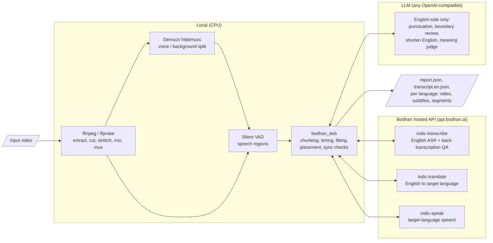

# Architecture and workflow

## Components

The LLM never writes Indian-language text. Every Indian-language word comes from `indic-translate`, every
dubbed sound from `indic-speak`, and every transcript from `indic-transcribe`.

## Stages (one line each)

| # | Stage | Module | What it does |
|---|---|---|---|
| 1 | Audio | `audio.py` | Probe the container and extract audio on the container timeline (keeps any A/V start offset). |
| 2 | Separation gate | `separate.py` | Separate 4 short speech windows; run full Demucs only if voice and background are < 30 dB apart. |
| 3 | VAD | `vad.py` | Silero speech regions, edges refined with one rule (30 dB below speech level). |
| 4 | Chunking | `chunking.py` | Group regions into ≤ 28 s chunks, cut at pauses ≥ 0.6 s. |
| 5 | ASR | `transcribe.py` | Transcribe chunks in parallel; re-split replies that look cut off; retry junk replies. |
| 6 | Punctuation | `punctuate.py` | LLM restores case and punctuation; the words must come back unchanged. |
| 7 | Alignment | `align.py` | Re-transcribe the pieces between pauses to anchor sentence breaks to real pauses. |
| 8 | Sentences, review, units | `sentences.py`, `review.py`, `units.py` | Time words from speech regions; LLM merges fragments; split into ≤ 12 s units at real pauses. |
| 9 | Translate | `translate.py`, `glossary.py` | Batches of 5 lines with script, repetition and length checks; one-by-one fallback. Optional code-mixed prompt; glossary check with one retry per unit. |
| 10 | Dub | `dub_language.py`, `fit.py`, `pausefit.py`, `condense.py`, `qa.py` | TTS, fit (pauses, then speed 0.85–1.2×, then shorter English), back-transcription QA. |
| 11 | Placement and sync loop | `schedule.py`, `dub_language.py` | First sound on the source start; catch-up for late clips; measure, correct, re-measure, undo if worse. |
| 12 | Mix and mux | `assemble.py`, `subtitles.py` | Dub at −16 LUFS; under it the separated background (or silence); the original audio everywhere else; SRT; mux (picture copied, or re-encoded to H.264 when MP4 cannot carry its codec); AI-dubbed label in the title, audio track and first subtitle cue. |
| 13 | Verify | `sync_check.py` | Measure the dubbed track with the same detector as the source; cross-correlate the MP4 with the plan. |
| — | Run log | `logs.py` | Every log record also goes to `run.log.jsonl` with stage, language and segment; one final record per segment. |

## Workflow, with checks, retries and decision points

```mermaid
flowchart TD
    A["probe + extract audio"] --> B{"voice vs background<br/>< 30 dB apart?"}
    B -- yes --> B1["Demucs: voice for timing,<br/>background for the mix"]
    B -- no --> C
    B1 --> C["VAD + chunks at pauses"]
    C --> D["indic-transcribe per chunk"]
    D --> D1{"reply junk?<br/>(one character repeated)"}
    D1 -- yes --> D2["retry up to 2x"] --> D3
    D1 -- no --> D3{"reply cut off<br/>or still junk?"}
    D3 -- yes --> D4["split at a pause,<br/>transcribe halves (≤ 3 levels);<br/>keep only if longer"]
    D3 -- no --> E
    D4 --> E["LLM punctuation"]
    E --> E1{"words unchanged?"}
    E1 -- no --> E2["retry, then rule fallback"] --> F
    E1 -- yes --> F["pause-level alignment<br/>(anchor only when unambiguous)"]
    F --> G["sentences timed from speech regions"]
    G --> H["LLM boundary review"]
    H --> H1{"merge passes checks?<br/>(consecutive, same letters, same token count)"}
    H1 -- no --> H2["reject merge"] --> I
    H1 -- yes --> I["units ≤ 12 s at real pauses"]
    I --> L["for each language (a failure never stops the others)"]
    L --> T["indic-translate, batch of 5<br/>(code-mixed prompt with --code-mixed)"]
    T --> T1{"checks pass?<br/>(script, repetition, length, line count)"}
    T1 -- "line count wrong" --> T2["translate one by one"]
    T1 -- "other failure" --> T3["flag the segment"]
    T1 -- yes --> G1{"glossary term missing?"}
    T2 --> G1
    G1 -- yes --> G2["re-translate once with the rendering<br/>in the English; keep it only if better"]
    G1 -- no --> S
    G2 --> S
    T3 --> S["indic-speak (1–2 sentences)"]
    S --> FIT{"fits the source window?"}
    FIT -- "after pauses / speed 0.85–1.2x" --> Q
    FIT -- "still too long" --> CD["LLM shortens the English<br/>(up to 3 candidates)"]
    CD --> CD1{"rule check +<br/>LLM meaning judge"}
    CD1 -- pass --> T
    CD1 -- "fail / LLM error" --> Q
    Q["back-transcribe with indic-transcribe, CER"] --> Q1{"repeat / omission / high CER?"}
    Q1 -- "yes (≤ 2 retries)" --> S
    Q1 -- "no, or ASR junk = QA unknown" --> P["place first sound on the source start"]
    P --> P1{"clip delayed by the previous one?"}
    P1 -- yes --> P2["catch-up: re-speed, then shorter English<br/>for the real time left"] --> SL
    P1 -- no --> SL["sync loop: measure, correct, re-measure;<br/>undo a round that is worse"]
    SL --> M["mix at −16 LUFS, subtitles, mux"]
    M --> V["verify: sync on the speech track,<br/>MP4 cross-correlation"]
    V --> R["report.json; exit 1 if any language failed"]
```

**Errors and money.** Every Bodhan call retries 429 and 5xx with backoff. An out-of-credit reply
(`429 budget_exceeded`) is not retried: that key fails fast for the rest of the run and the report lists it under
`out_of_credit`. The LLM client paces itself from the provider's rate-limit headers, waits on 429 for the time
the server gives, and stops calling for the rest of the run when a daily cap is hit; every LLM step has a
non-LLM fallback (see [design notes](design_notes.md)).
