# Architecture

Three Bodhan models, one companion LLM that is optional, and a lot of plain
deterministic code. The design principle is that **models do the language work,
code does the timing work**, and every stage can be inspected and replayed.

```mermaid
flowchart LR
  IN["input video<br/>MP4 / MOV / MKV / WebM"]

  subgraph transcribe["Stage 1 — transcribe"]
    PCM["ffmpeg → 16 kHz mono"]
    VAD["energy VAD<br/>adaptive floor + hysteresis"]
    CH["chunker<br/>≤28 s, cut at quietest point"]
    ASR["indic-transcribe"]
    PCM --> VAD --> CH --> ASR
  end

  subgraph lang["Stages 2–3 — per language, in parallel"]
    BLK["block builder<br/>one segment per line"]
    MT["indic-translate"]
    ALIGN{"aligned?"}
    SPLIT["proportional split<br/>(fallback)"]
    TTS["indic-speak"]
    QA["back-transcribe<br/>CER + repetition + truncation"]
    FIT["trim silence<br/>atempo ≤ 1.20"]
    TREE["place at source start"]
    BLK --> MT --> ALIGN
    ALIGN -->|yes| TTS
    ALIGN -->|no| SPLIT --> TTS
    TTS --> QA
    QA -->|fail| TTS
    QA -->|pass| FIT --> TREE
  end

  subgraph assemble["Stage 4 — assemble"]
    BED["bed: gate out speech<br/>keep music and effects"]
    MIX["mix, bed −6 dB"]
    LUF["loudnorm −16 LUFS<br/>two-pass"]
    MUX["mux, -c:v copy"]
    SRT["subtitles.srt"]
    MIX --> LUF --> MUX
  end

  IN --> PCM
  ASR --> TR["transcript.en.json"]
  TR --> BLK
  TREE --> DUB["audio.&lt;lang&gt;.wav"]
  IN --> BED
  DUB --> MIX
  BED --> MIX
  MUX --> OUT["video.&lt;lang&gt;.mp4"]
  TTS --> SRT
  OUT --> REP["report.json"]
```



## Components

| Component | Responsibility | Why here |
|---|---|---|
| `cli.py` / `pipeline.py` | Interface, stage order, exit codes, per-language isolation | The interface is part of the assignment contract; isolation is what keeps one bad language from sinking the run |
| `media.py` | ffmpeg/ffprobe, sample-exact PCM slicing, atempo | Every audio decision needs sample addresses, not float seconds |
| `vad.py` | Energy VAD with an adaptive floor | Deterministic, dependency-free, and unit-testable; no model can be confused with ASR |
| `chunker.py` | ≤28 s chunks cut at the quietest internal frame | The ASR is trained on ≤30 s clips and degrades past that |
| `asr.py` | VAD → chunks → transcribe → `transcript.en.json` | Timestamps come from the cuts, because the ASR returns text only |
| `translate.py` | Block building, line alignment, proportional fallback | Translation needs context; alignment needs per-segment text |
| `duration.py` | Self-calibrating speech rate, the fit ladder | Duration drift is the core dubbing problem |
| `speak.py` | TTS, QA retry ladder, silence trim, placement | Owns everything that decides how a line sounds |
| `qa.py` | CER, repetition, truncation | Catches the model misbehaviour Bodhan documents |
| `bed.py` | Mute speech spans, keep the rest | Music and effects must survive |
| `mix.py` | Mix, two-pass loudness | −16 LUFS ±1 is a stated target |
| `mux.py` | Mux with `-c:v copy`, verify duration | Video must not be re-encoded, duration must not drift |
| `subtitles.py` | SRT with readable cues | A deliverable in its own right |
| `ratelimit.py` | Per-model pacer + adaptive concurrency | The account's real limits are lower than advertised |
| `cache.py` | Content-addressed response cache | A rerun costs nothing |
| `cost.py` | Rupee meter per stage | Cost is a stated concern |
| `glossary.py` | Term verification | The API has no glossary parameter, so this is verify-not-force |
| `voices.py` | Voice selection from the fixed library | One consistent narrator per language |

## Data flow

```
video ──► transcript.en.json ──► segments.<lang>.json ──► audio.<lang>.wav ──► video.<lang>.mp4
                                                    │
                                                    └──► subtitles.<lang>.srt
```

Every artifact is keyed by its input, so the run is resumable at any boundary:
`segments.<lang>.json` is written after translation and again after speech, and
the assembler only needs the latter plus the original video.
