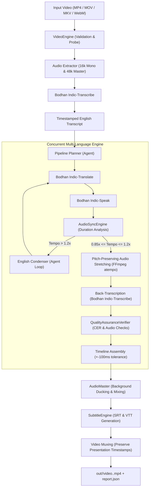

# Bodhan.AI Video Dubbing Pipeline - System Architecture

## Architecture Overview

The **Bodhan.AI Video Dubbing Pipeline** is an agentic, modular audio/video processing system architected to accept source English videos, produce speech dubs in Indian languages, enforce audio-video synchrony, and perform automated QA.

## Core Modules

### 1. `bodhan_dub.clients`
Isolated, resilient HTTP adapters for Bodhan's hosted endpoints with exponential backoff and observability:
- `BodhanTranscribeClient`: Speech-to-text with windowing and sentence-aware chunking.
- `BodhanTranslateClient`: Multilingual machine translation using `indic-translate`.
- `BodhanSpeakClient`: Text-to-speech audio synthesis with `indic-speak`.

### 2. `bodhan_dub.core`
Deterministic media processing components:
- `VideoEngine`: FFprobe metadata extraction, stream verification, and FFmpeg remuxing.
- `AudioSyncEngine`: Target window duration calculation, cascading `atempo` filters, and master PCM timeline assembly.
- `AudioMaster`: Sidechain background audio ducking (-12 dB) and EBU R128 loudness normalization (-16 LUFS).
- `SubtitleEngine`: Timecode conversion and generation of valid SRT and WebVTT subtitles.

### 3. `bodhan_dub.agent`
The decision-making and verification loop:
- `PipelinePlanner`: Manages segment execution states, scheduling, and bounded retry budgets.
- `EnglishCondenser`: Condenses English source text to reduce spoken syllable count when translated text exceeds the 1.20x time-stretching ceiling.
- `QualityAssuranceVerifier`: Back-transcribes dubbed audio, computes Levenshtein distance, Character Error Rate (CER), detects silence/clipping, and assigns status (`ACCEPTED`, `CONDENSED`, `MANUAL_REVIEW`).
- `CostAndLatencyTracker`: Records API response latencies, retry counts, and cost metrics for `report.json`.
