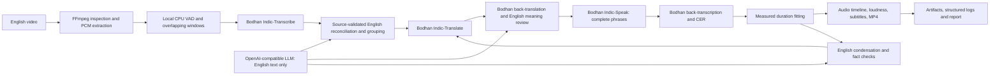
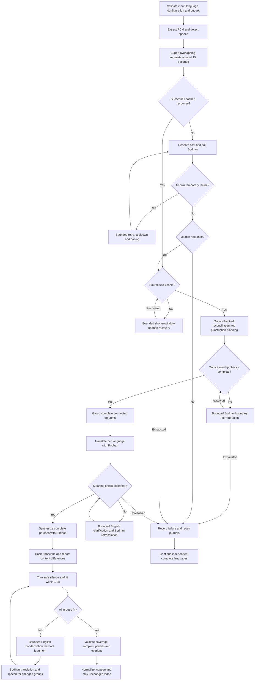

# Architecture and workflow

The retry loop is bounded by client attempts and the cost ledger. Unknown outcomes stop: a timeout may already have been billed. Duration recovery has at most three rounds per invocation; explicit continuations preserve the original combined budget and reuse successful outputs.

## What the LLM decides

The LLM joins English overlap text, groups connected thoughts and proposes shorter English when measured speech still cannot fit. Reconciliation validates all words against source references. Condensation protects numerical phrases, letter labels, negation and configured glossary terms, then uses a separate English factual judgment. These checks reduce risk but are not a proof of semantic equivalence. Deterministic fallback can preserve source words and exact overlap duplicates if planning fails; it does not invent missing speech or translate anything.

Python controls file validation, timestamps, request bounds, retries, budget reservation, sample placement, speed, loudness, subtitle serialization and output status. Bodhan controls all recognized words, all target-language text and all generated speech. The LLM never receives audio.

## Timing and fitting

VAD detects activity, not word boundaries. Request windows carry overlapping context and non-overlapping source ownership cores. English source references provide coarse time envelopes. Character-weighted distribution across VAD speech and snapping to observed long gaps give an estimated timeline. The report explicitly says the ±300 ms target is unverified.

Before paid recovery, the fitter tries native audio, safe edge-silence trimming, near-digital internal-silence compaction, bounded use of neighbouring free time and tempo up to 1.2×. It retains at least one second in protected long-pause cores and never overlaps another dubbed group. A strict sample-level validator prevents discarded or duplicated normalized samples. If narration remains oversized, only its English is condensed; Bodhan retranslates and regenerates it. Rejected/failed recovery leaves no finalized incomplete video for that language.

Source pauses now require boundaries between independently generated complete sentences/headings. A quiet point in a waveform is never accepted as a word boundary. The fitter preserves target text, generates complete phrase atoms, measures them and assigns whole atoms to source intervals. Each interval is normalized separately, with sample/text provenance checked before rendering. If a partition cannot fit, bounded English condensation and Bodhan regeneration may try again. The system reports failure rather than reverting to a mid-word or mid-phrase cut. No video frames are extended, repeated or slowed. This prevents pauses introduced by our placement code; it does not certify provider pronunciation or naturalness.

## Content and failure policy

Generated speech is recognized again by Bodhan and compared with the exact synthesis reference. CER is a diagnostic target, not an automatic claim that the TTS is wrong: English terms recognized in an Indic script can disagree textually. Failed checks and provider errors remain in the report. Duration recovery checks successful new candidates; a final missing-evidence pass closes retry/continuation gaps. Translation correctness, numerical meaning and naturalness remain a separate quality pass.

Whole-run reservations and stage journals bound new paid work. Per-language failure preserves complete independent languages. Cache identity includes content and generation settings; changed artifacts are rejected. A successful cached input is reused rather than billed again. Raw exceptions and credentials are not logged.

## Research used

- [ElevenLabs: bring your own transcript](https://elevenlabs.io/docs/eleven-api/guides/how-to/dubbing/bring-your-own-transcript): natural segment boundaries and comparable spoken lengths help dubbing. Its numerical limits apply to its own service, not Bodhan.
- [ElevenLabs: refine and regenerate](https://elevenlabs.io/docs/eleven-api/guides/how-to/dubbing/refine-and-regenerate): changing translated text requires regenerating the affected speech.
- [Amazon duration modelling research](https://cdn.amazon.science/2c/de/191aa8ec423696fcab88f2945f64/duration-modeling-of-neural-tts-for-automatic-dubbing.pdf) and [IWSLT dubbing research](https://aclanthology.org/2023.iwslt-1.9/): translation length, phrasing and duration control must work together.
- [Azure SSML duration control](https://learn.microsoft.com/en-us/azure/ai-services/speech-service/speech-synthesis-markup-voice#adjust-the-audio-duration) illustrates a provider-specific duration feature. We do not assume Bodhan supports it.
- [Bodhan API documentation](https://console.bodhan.ai/api-docs/): native generation, short speech inputs, documented translation routes and rate limits. No undocumented speed/target-duration parameter is sent.

These are design references only. No commercial/non-Bodhan speech or translation API is used by this pipeline.

## Source-audio leakage correction

The original mixed soundtrack is now excluded from all final dubbed audio. A VAD non-speech label does not establish that a region contains no speech; the Hindi review exposed audible original audio inside such a labelled gap. Each output track now contains only generated narration, with silence elsewhere. Video muxing copies the original video stream and maps only the new audio track. Music/effects are not retained; no clean-background/separation integration is currently implemented. This policy applies to every input and requested language.

## Translation meaning safeguards

The English source is normalized for contextual numerical shorthand before initial translation and duration recovery. Bodhan alone translates both forwards and backwards. An English-only LLM compares source facts with the back-translation, including instructions, labels, ordinals and quantities. A bounded repair may clarify or shorten English before requesting new Bodhan translation; it cannot patch target text directly. Failures are isolated by unit/language and cannot silently pass as complete output.

An optional reference-backed glossary is supplied as context and checked against the generated target. For verification only, matched textbook concepts can be replaced by corresponding opaque IDs in copies of source/target text, avoiding false errors caused by the back-translator renaming a known term. Final target text, subtitles and TTS input retain Bodhan's actual output. Non-overlapping term matching distinguishes complementary/supplementary spellings that contain one another. Glossary presence and English meaning judgments are fallible evidence, not native-speaker certification.

Resumed repairs preserve older manifests, provider journals, unsuccessful requests and cumulative spending. New text/audio receives fresh content verification bound to its actual waveform hash. Complete-phrase and physical fit constraints apply identically to repaired and original groups. Successful languages/groups are reused; a repair never authorizes an arbitrary waveform cut or original-source audio in gaps.
