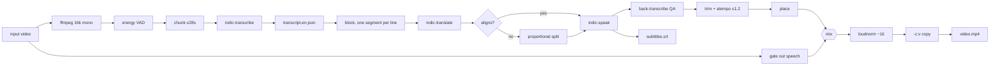
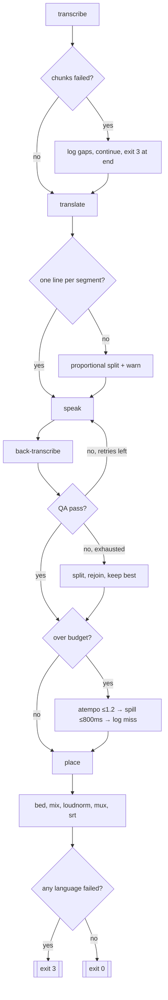

## Summary

An agentic pipeline that dubs an English video into Indian languages with
Bodhan's Indic models. One command produces, per language, a dubbed MP4 and an
SRT, plus a machine-readable report covering sync, quality, retries, runtime and
cost. Timestamps are derived from voice-activity chunk boundaries rather than the
model, translation is line-aligned to segments so context and timing both
survive, and every generated clip is back-transcribed and checked before it is
accepted.

## How to run

```bash
cd examples/video_dubbing
python -m venv .venv && source .venv/bin/activate
pip install -r requirements.txt
pip install -e .
cp .env.example .env      # BODHAN_API_KEY, or per-model keys

python -m bodhan_dub --input video.mp4 --langs hi,ta,bn --out ./out
```

Requires Python 3.10+ and ffmpeg on `PATH`. A Dockerfile is included.

## Architecture



- **`asr`** — VAD finds speech, chunks are capped at 28 s and cut at the quietest
  frame; each chunk's boundaries become the segment timestamps.
- **`translate`** — segments are grouped into ~250-character blocks and sent with
  one segment per newline, so the reply is one translated line per segment.
- **`speak`** — one TTS call per segment, back-transcribed and checked, leading
  silence trimmed, fitted with `atempo`, placed at the source start.
- **`assemble`** — the original audio is gated to remove speech, mixed under the
  dub, normalised to −16 LUFS, muxed with the video stream copied, and paired
  with an SRT.

Full diagrams: `docs/architecture.md`, `docs/workflow.md`.

## Workflow



## Where the LLM is used, and why

One decision: **shortening English** when a translated segment cannot fit its
slot even at 1.20×. The shortened English is re-translated by Indic-Translate, so
the Indian-language text never comes from the LLM.

Guards: the answer is rejected if it contains any non-Latin character, drops a
number from the source, drops a glossary term, or is not actually shorter.
Fallback: without `LLM_*` credentials the step is skipped and the duration ladder
ends at a logged `miss` with the overrun in milliseconds.

## Bodhan models used

| Model | Endpoint | Settings |
|---|---|---|
| `indic-transcribe` | `POST /v1/audio/transcriptions` | 16 kHz mono, ≤28 s chunks, `language=en` (source) / target language (QA) |
| `indic-translate` | `POST /translate`, with `POST /v1/chat/completions` fallback | Blocked input, one segment per line; `script=codemix` for `--code-mixed` |
| `indic-speak` | `POST /v1/audio/speech` | Language voice from the library, `style="educational lecture"`, 24 kHz out |

All hosted. The translate fallback exists because `POST /translate` returns 404 on
the deployment I tested against; the client detects that once per run and switches
to the chat transport with the documented prompt.

## Results

Demo: *Class 9 Mathematics, Chapter 6, Period 1*, 5 min 29 s.

| Metric | Hindi | Tamil | Bengali |
|---|---|---|---|
| Segments dubbed | 72 / 72 | 72 / 72 | 72 / 72 |
| Mean CER | 0.071 | 0.140 | 0.078 |
| QA failures | 2 | 3 | 6 |
| Loudness | −16.07 LUFS | −16.05 LUFS | −16.26 LUFS |
| Duration drift | +0 ms | +0 ms | +0 ms |
| Max time-stretch | 1.20× | 1.20× | 1.20× |
| Cost | ₹1.97 | ₹2.65 | ₹2.37 |

Outputs:
[Hindi](https://drive.google.com/drive/folders/1sucwTCWTJDFbhbQqlrCEPOMs8YebcqHN?usp=drive_link) ·
[Tamil](https://drive.google.com/drive/folders/1JXYUltfA66PJpch0VXN5lMpGwXnfx4is?usp=drive_link) ·
[Bengali](https://drive.google.com/drive/folders/1zAUiLU39sESAJeR8g01E5Sc3Q3q4BwNY?usp=drive_link)

Each folder holds the dubbed MP4, the SRT, and that run's `report.json`.

## Demo video

[Walkthrough, under five minutes](https://drive.google.com/file/d/14OU2wHgdFJ0-tl7k50DfzSCboop537Tl/view?usp=drive_link)
— a live run on a fresh clip, then the outputs and the report.

## Trade-offs and known limitations

- One consistent voice per language; no diarization.
- Music under speech is lost with the speech; source separation is not enabled.
- Runtime is bounded by the account's request quota, which behaved like a parallel
  cap far below the advertised RPM.
- Two blocks fell back to proportional splitting; the fallback is labelled.
- CER is not trusted below twelve characters.

## Cost and runtime

| | Per minute of input | Notes |
|---|---|---|
| Hindi (one language) | ~₹0.36 | ASR ₹0.07, TTS ₹0.31, QA ₹0.07, MT negligible |
| Three languages | ~₹1.1 | ASR is shared |

Measured cold runs of the 5 min 29 s demo: Hindi ₹1.97, Tamil ₹2.65, Bengali
₹2.37. `indic-speak` is roughly 80% of the cost, as expected at ₹6 per 10k
characters.

Runtime is dominated by the account's request quota — the deployed limit
rejected requests at roughly 26 per minute against an advertised 120, so a cold
language takes 10–15 minutes even though the pipeline is fully concurrent.

## AI assistance

Built with an AI coding assistant used for scaffolding, test generation and
review. Every design decision in `docs/design.md` was made against measured
behaviour: the transcription timestamps, the line-aligned translation, the
concurrency cap and the loudness step were each changed after a real run showed
the previous approach was wrong.
