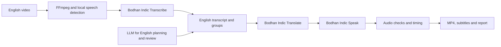
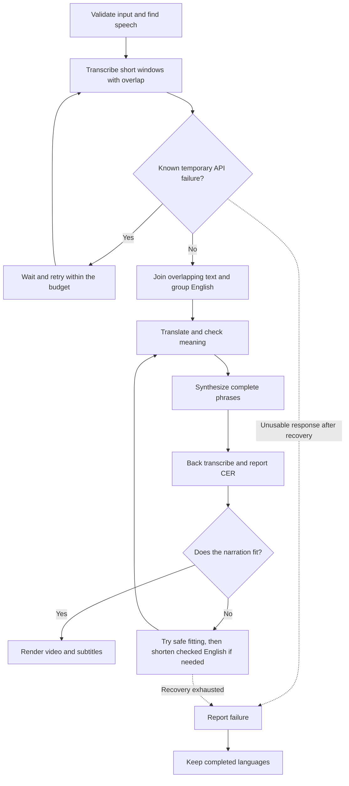

## Summary

I built a command line pipeline that dubs an English video into Indian languages. It produces a dubbed MP4, subtitles, an English transcript, and a report that shows what passed, what failed, and what each stage cost.

## How to run

From a clean checkout:

```sh
cd examples/video_dubbing
sh scripts/setup.sh
source .venv/bin/activate
# Set the variables listed in .env.example in your shell.
python -m bodhan_dub --input /path/to/English.mp4 --langs hi,ta,bn --out ./out
```

The recipe README documents credentials, Docker, and the output layout. Docker setup and 507 tests passed on Linux ARM64.

## Architecture



FFmpeg prepares audio and renders the final video. Bodhan handles recognition, translation and speech generation. Python handles timing, validation, and the spending limit.

## Workflow



Verified responses are cached. An uncertain request outcome stops that retry path so it does not automatically send a request that may already have been billed. See the recipe’s design notes for the full workflow.

## Where the LLM is used, and why

I tested with Groq’s `openai/gpt-oss-120b`. It helps join overlapping English transcripts, group connected thoughts, judge meaning after back translation, and shorten English when speech still runs long. Python checks that the joins are supported by the source and that shortened text preserves protected numbers, terms, and diagram labels. The LLM works with English text. Bodhan generates all target language text and speech. If recovery cannot resolve a problem, the report explains it.

## Bodhan models used

- **Indic Transcribe (hosted):** English source audio and dubbed audio verification. Source requests are at most 15 seconds with overlap.
- **Indic Translate (hosted):** Translates grouped passages and produces English back translations for meaning checks. The demo uses a geometry glossary.
- **Indic Speak (hosted):** Generates complete spoken phrases. The recipe uses one voice per language.

## Results

[Open the Hindi, Tamil, and Bengali dubs, subtitles, and reports](https://drive.google.com/drive/folders/1w0TS-eCZH6u00KkhyyKf5epPGO1QRk8y?usp=share_link)

All three videos are 329.267 seconds. Each contains 12 groups, with zero skips. Playback speeds were between 1.0× and 1.2×. Narration loudness was −16.11 LUFS for Hindi, −16.15 for Tamil, and −16.28 for Bengali. The report includes character error rate (CER) for all 36 groups, with six warnings. The 300 ms acoustic sync target remains unverified.

507 recipe tests passed locally and in Docker. The Cookbook wide check was attempted and reports a failure in the existing AndroidSpeak recipe. The video dubbing recipe validator passes.

## Demo video

[Watch the demo recording (4:02)](https://drive.google.com/file/d/1S2th1qKBc0D8y3mh1jVgW1Pn-JsAigd0/view?usp=sharing)

The recording is 4:02. It shows the hosted stages, saved results, and final playback. The local preview plays the prepared dubs and highlights the matching transcript.

## Trade-offs and known limitations

The timeline is estimated from speech detection and transcription windows. The demo completed through saved runs and automatic fitting continuations. A fresh run on the final version and native speech quality still need further verification. Original mixed audio is removed to avoid leaking the English voice. Protected pauses stay silent. The recipe writes separate subtitle files.

## Cost and runtime

The combined validation cost was estimated at ₹20.79, including earlier attempts and recovery. Across the 5.49 minute input and three target languages, that averages about ₹1.26 per input minute per language. The final offline render took 18.4 seconds. A fresh hosted runtime and cost benchmark remain unverified.

## AI assistance

I used OpenAI Codex for implementation, debugging, tests, and documentation. I reviewed the outputs and used my listening checks to guide fixes for pauses and source audio leakage.
