# Workflow

Where the pipeline branches, retries, and gives up — including the decision
points that only exist because the models misbehave.

```mermaid
flowchart TD
  START([video in]) --> A1[probe + decode<br/>16 kHz mono]
  A1 --> A2[VAD<br/>merge pauses under 300 ms]
  A2 --> A3{any speech?}
  A3 -->|no| A4[[fail: media error, exit 3]]
  A3 -->|yes| A5[chunk ≤ 28 s<br/>cut at quietest frame]
  A5 --> A6[indic-transcribe<br/>paced + cached]
  A6 --> A7{chunks failed?}
  A7 -->|some| A8[log the gaps<br/>mark partial, keep going]
  A7 -->|none| B1
  A8 --> B1

  B1[/for each language/] --> B2[block builder<br/>one segment per line]
  B2 --> B3[indic-translate]
  B3 --> B4{one line per segment?}
  B4 -->|yes| B5[use the lines]
  B4 -->|no| B6[split proportionally<br/>warn with line counts]
  B5 --> C1
  B6 --> C1

  C1[indic-speak] --> C2[back-transcribe]
  C2 --> C3{QA pass?}
  C3 -->|yes| C6
  C3 -->|no, clip < 12 chars| C6
  C3 -->|no, attempts left| C1
  C3 -->|no, exhausted| C4[split in half,<br/>synthesize, rejoin]
  C4 --> C5{passes now?}
  C5 -->|yes| C6
  C5 -->|no| C7[keep the better take<br/>qa = fail + reason]
  C7 --> C6

  C6[trim leading silence] --> D1{over budget?}
  D1 -->|no| D5
  D1 -->|yes| D2[atempo ≤ 1.20]
  D2 --> D3{still over?}
  D3 -->|no| D5
  D3 -->|yes| D4{LLM configured?}
  D4 -->|yes| D6[shorten English →<br/>re-translate → re-speak]
  D6 --> D7{better?}
  D7 -->|yes| D5
  D7 -->|no| D8[spill ≤ 800 ms,<br/>else log a miss]
  D4 -->|no| D8
  D8 --> D5

  D5[place at source start] --> E1[bed: gate out speech]
  E1 --> E2[mix, bed −6 dB]
  E2 --> E3[loudnorm −16 LUFS,<br/>two-pass]
  E3 --> E4[mux, -c:v copy,<br/>-t input duration,<br/>embed subtitle track]
  E4 --> E5[write SRT]
  E5 --> E6[verify duration<br/>and loudness]
  E6 --> F1{any language failed?}
  F1 -->|yes| F2[[exit 3, partial artefacts kept]]
  F1 -->|no| F3[[exit 0]]
```

## Retry and budget policy

| Failure | Response | Bound |
|---|---|---|
| 429 on any model | Per-model pacer halves nothing, drops a concurrency slot, shared cooldown doubles 2 s → 12 s | 8 throttle waits, then fail the call |
| 5xx / transport | Exponential backoff with jitter | 4 attempts |
| 401 / 403 | Stop immediately, name the key to fix | 1 request per in-flight worker |
| TTS repeat / truncation | Retry once, then split and rejoin, then accept with a reason | 4 synthesis calls worst case |
| ASR chunk failure | Log the span and continue with the rest | Run-level, not fatal |
| One language failing | Mark `*_failed`, continue the others | Never fatal to the run |
| Unbuildable stage | `not_implemented` marker, exit 3 | — |

## Caching and resumability

Every model call is keyed by the SHA-256 of its exact input, and the decoded
16 kHz PCM is keyed by the video's content hash. A rerun after any failure pays
only for what is missing — the two lost chunks in a 72-chunk run cost about two
paise to retry.
